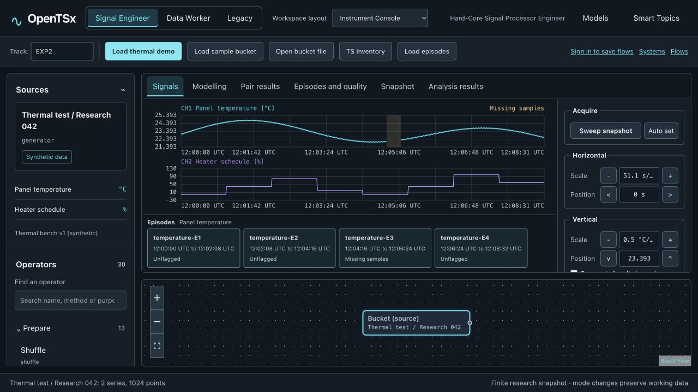
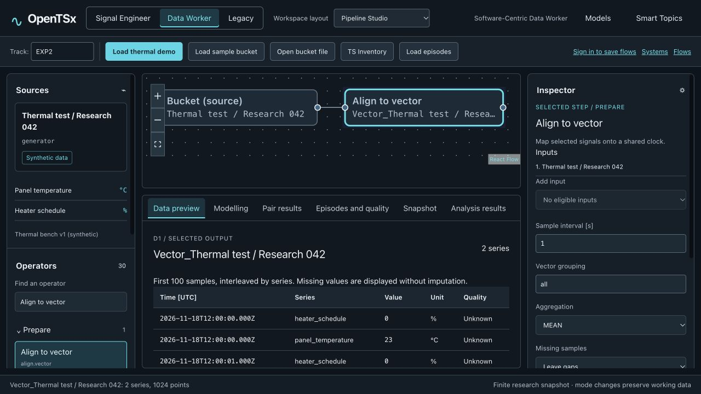

# OpenTSx

**Turn time series into data products.**

[](https://github.com/kamir/OpenTSx/actions/workflows/ci.yml)
[](LICENSE)

[Workbench](#choose-your-workspace) · [Run locally](#run-the-workbench) ·
[LASCARIS](#connect-through-scalytics-lascaris) ·
[Developer guide](docs/devguide/README.md) · [Research](#build-on-research)

OpenTSx is Mirko Kämpf's flagship open-source workbench for mapping, preparing,
analyzing and publishing time-series data. Bring business events, industrial
measurements or engineering telemetry into a common episode contract, then
build inspectable signals, forecasts and Kafka-native data products.

The source changes. The time-series workflow stays consistent. OpenTSx is
designed as the time-series domain module for
[Scalytics LASCARIS](https://www.scalytics.io/en-gb/lascaris)
solutions, with source integration
and decentralized execution connected through explicit data and runtime
contracts.



*Implemented Workbench, showing a labelled synthetic thermal experiment.*

## Build a data product from its source

1. **Map observations.** Declare series identity, dimensions, timestamps, units
   and provenance at the input boundary. Sources enter through adapters,
   episode files or Kafka-compatible topics.
2. **Prepare episodes.** Select signals, align clocks, convert units, resample
   and segment meaningful intervals. Keep missing values and unknown quality
   explicit.
3. **Inspect the signals.** Explore distributions, spectra, correlations and
   event relationships. Record operator parameters and inspect each graph
   node's actual output.
4. **Evaluate predictions.** Fit ARIMA, SARIMA or SARIMAX, compare baselines
   with chronological backtests, and inspect prediction intervals.
5. **Publish supported processing.** Deploy supported operator graphs as Smart
   Topics or register reviewed fitted artifacts for continuous scoring. Output
   topics become reusable inputs for downstream data products.

The [episode contract](docs/datamodel-2026/04-MODELL-V2-SPEC.md),
[operator lessons](docs/user-manual/17-learn-operators.md) and
[reviewed forecast deployment](docs/devguide/model-smart-topics.md) connect
these steps to their implementations and execution limits.

## Apply one workflow across domains

These application patterns use the same mapping, episode and analysis concepts.
Each deployment supplies its domain's source adapters and operating rules.

| Domain | Example inputs | Data-product applications |
| :--- | :--- | :--- |
| Commerce | Orders, prices, demand | Forecasts and baseline comparisons |
| Factories | Process and vibration | Cycle comparison and diagnostics |
| Data centers | Power, temperature, load | Capacity and cooling analysis |
| IoT | Devices and field sensors | Clock alignment and quality checks |
| Space technology | Test and telemetry | Thermal and power-cycle analysis |

## Choose your workspace

Use the same source, operator graph and modelling editor through three
presentations. Switching modes preserves the working analysis.

| Mode | Choose your layout |
| :--- | :--- |
| Signal Engineer | Instrument Console; Diagnostic Bench |
| Data Worker | Pipeline Studio; Recipe Notebook |
| Legacy | Classic Workbench controls and inspection tools |

Signal Engineer puts traces, units, cursors, trigger and diagnostics first.
Data Worker puts source mapping, DAGs, actual data previews and recipes first.

The contextual operator library exposes one configuration at a time. Runtime
availability stays visible; adding a library algorithm does not imply that
every processor can execute it. Read the
[Workbench guide](docs/devguide/workbench-analysis.md) for controls, episode
quality, diagnostics and finite snapshots.



*Pipeline Studio, showing computed output from the same synthetic source.*

## Connect through Scalytics LASCARIS

The integration principle is to connect sources through
[Scalytics LASCARIS](https://www.scalytics.io/en-gb/lascaris) and apply
time-series processing where data can be handled under the deployment's
locality constraints.
OpenTSx supplies the domain layer: source mapping, episode preparation,
scientific operators, the Workbench and typed signal outputs.

The integration boundaries in this repository are episode contracts,
Kafka/KafScale topics, library APIs and documented Apache Wayang execution
profiles. Platform connectors and LASCARIS orchestration connect through those
boundaries. This repository does not contain a separate LASCARIS connector
distribution.

For decentralized execution, use the
[Wayang runtime profiles](docs/devguide/integration/wayang-unified-plan.md):
bounded and trusted-local continuous Rust processing, and signed bounded JVM
statistics federation. Operator support, topic ownership, checkpoints and
publication guarantees are defined per profile.

The separate [signed Rust profile](docs/devguide/integration/rust-runner-b1.md)
verifies Ed25519 continuous pass-through plans against local policy and retains
acknowledged whole-topic checkpoints. Native x86_64/ARM64 and three-target musl
CI gates are defined. Physical ARMv7 qualification remains open.

The [local Rust B2 catalog](docs/devguide/integration/rust-runner-b2.md)
adds the remaining Track B operators and bounded cross-correlation through
explicit local context. It includes typed statistics, vector and DQ output,
restored operator state and Java/Rust regression proof. Its admission is
separate from signed B1 and the Java UI rollout profile.

The [signed bounded Rust site profile](docs/devguide/integration/rust-runner-b3.md)
adds certificate-authenticated plan pulls, signed conformance and bounded
decode-to-statistics execution. Owner-local qualification pins actual test,
protocol and placement evidence. Fresh job checks retain whole-topic cuts and
series inventories; acknowledged site aggregates survive signal-cluster
outages and forward with deterministic deduplication identities. This profile
does not admit the remaining B2 operators or close physical ARMv7 acceptance.

For the local three-worker Rust profile, choose **Legacy** in the Workbench
header, then open **Smart Topic**. The [bounded rollout
guide](docs/devguide/integration/wayang-rust-compose.md) connects the original
v2 DAG, authenticated backend and PostgreSQL journal to a custom Wayang Rust
stage. One to three workers each own complete topics, regardless of their
partition counts.

The [continuous profile](docs/devguide/integration/wayang-rust-continuous.md)
retains positions and operator state across increments and service restart.
Its local publication gateway rejects retired grants. Explicit same-DAG resume
preserves state; changed-DAG restart replays complete topics into a distinct
fresh output after revocation. Unknown broker outcomes halt replacement.
This capped single-owner gateway has no automatic failover.

The [federation measurement report](docs/datamodel-2026/measurements/wayang-federation-2026-11-17/REPORT.md)
records executed comparisons and data movement. It distinguishes observed
results from performance claims.

## Run the Workbench

Start the standalone synthetic thermal demo with Node 24.22.2 and the locked
frontend dependencies. It needs no account, Python service, Docker or broker:

```bash
cd opentsx-saas-frontend
npm ci --no-audit --no-fund
npm run demo
```

The [standalone demo guide](docs/devguide/standalone-workbench.md) covers the
local workflow, fast tests and browser acceptance.
During an edit, `npm run check:local -- src/workbench/presentation.ts` checks
frontend types, lint and related tests. The guide also lists the full checks
required before pushing.

The [standalone numerical service](docs/devguide/standalone-numerics.md) runs
finite snapshot analyses without Kafka or MLflow. It accepts API requests and
can serve an explicitly built Workbench from the same local address.

The [standalone analysis package](docs/devguide/standalone-analysis.md) combines
the built Workbench and finite numerical service in an isolated Compose
project without an existing CP cluster:

```bash
python3 deploy/local-cp/workbench.py build --profile finite
python3 deploy/local-cp/workbench.py up --profile finite
```

Repeated package builds reuse separate verified dependency, wheel and frontend
artifact caches. The package test command still executes the complete suites.

Run the [deterministic windpark demo](docs/devguide/windpark-replay-demo.md)
to simulate three turbines, detect underperformance, persist real Iceberg
episodes locally and verify their replay. Its focused regressions run offline
after the first Maven build.

The [packaged artifact checks](docs/devguide/published-artifact-acceptance.md)
test tools-image startup and Windpark replay before publication, then pull
the published digest on native AMD64 and ARM64 runners. Their edit tests run
locally without Docker or network access.

You need Docker Compose and an existing Confluent Platform Docker cluster for
the local CP profile. The profile uses pinned Linux ARM64 images, a React
Workbench, the Python numerical service, MLflow and persistent lifecycle state.

Follow the [local CP guide](docs/devguide/local-cp-workbench.md) for the source
checkout, build, checks, startup and configuration. The Workbench delivery was
verified on [revision 545a601](https://github.com/kamir/OpenTSx/commit/545a60157026ae3b775117b391efd38dddd6a83c).

On a running local profile, open
[the Workbench](http://127.0.0.1:18081/workbench), choose **Load thermal demo**,
and switch between Signal Engineer and Data Worker. The demo is synthetic and
requires no external source credentials. **Legacy** remains available in the
header and through [the direct Legacy entry](http://127.0.0.1:18081/workbench?mode=legacy).

Configure OpenTSx producers with Apache Kafka brokers or a KafScale Proxy
endpoint. For KafScale, start with the
[local Proxy setup](opentsx-kafscale-conformance/README.md#start-the-local-proxy),
then follow the
[Kafka-native streaming guide](docs/devops/kafka-native-streaming.md). The
pinned local KafScale bundle serializes metadata snapshot changes and
refreshes durable metadata for Proxy responses. Durable read failures
return an error. These overlays cover the local single-broker fixture.

Statistical Smart Topics and general processor DAGs have separate execution
contracts; choose the documented profile for the output you need.

## Learn, extend and operate

- [User manual](docs/user-manual/README.md): data contracts, analysis and
  operational concepts.
- [Developer guide](docs/devguide/README.md): build, tests and integration paths.
- [Python library](python-package/README.md): public APIs and numerical analysis.
- [Operator lessons](docs/user-manual/17-learn-operators.md): executable workloads
  and the distinction between UI, library and deployed support.
- [Modelling and scoring](docs/devguide/model-smart-topics.md): reviewed fits,
  registry artifacts, live context and acknowledged predictions.
- [Bounded execution](docs/devguide/integration/wayang-rust-compose.md) and
  [continuous execution](docs/devguide/integration/wayang-rust-continuous.md):
  whole-topic processing, retained state and restart behavior.
- [Operations guide](docs/devops/README.md): deployment and infrastructure.
- [Documentation index](docs/README.md): additional module and reference guides.

## Build on research

Created by [Mirko Kämpf](https://github.com/kamir), OpenTSx carries forward
Hadoop.TS research and years of work with Java, Kafka and complex time-series
systems. The maintained classic libraries, data conversion bridge and Legacy
Workbench preserve that experience alongside the modern workspace.

Research foundations include
[Hadoop.TS](https://www.ijcaonline.org/archives/volume74/number17/12974-0233) and
[the detection of emerging trends using traffic data and context networks](https://journals.plos.org/plosone/article?id=10.1371/journal.pone.0141892).
The focus remains connecting methods to explicit data, inspectable parameters
and reproducible experiments.

## Contribute

Read [CONTRIBUTING.md](CONTRIBUTING.md), the
[Code of Conduct](CODE_OF_CONDUCT.md), the [security policy](SECURITY.md) and the
[changelog](CHANGELOG.md). Changes to operators include their applicable
contracts, tests, documentation and learning material.
Maven CI retains exception diagnostics, sanitized cache reports and bounded
HTTP response metadata for Wayang and BOM downloads. Caches are scoped by
workload and runtime inputs. Read the
[CI diagnostics and their limits](CONTRIBUTING.md#check-continuous-integration).

## License

OpenTSx is licensed under [Apache 2.0](LICENSE). See [NOTICE](NOTICE) for
copyright and attribution of the maintained research foundations.
