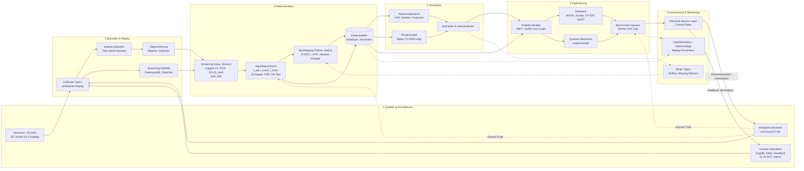

# OpenTSx – Systemrekonstruktion, Simulation & Optimierung (Konzept, P8)

> Status: **Konzept und Recherchegrundlage**, 2026-10-12. Ergebnis der Deep Research zur Kette *Quellen → Zeitreihen →
> rekonstruierte Struktur → Simulation → Optimierung (klassisch, später Quanten)*, Methodikbezug: Kämpf (2017).
> Umsetzung als **Phase P8** in [TASK-011](../../EVOLUTION/TASK-011-datamodel-refresher-2026.md); Control Plane:
> Personal Service Layer ([05-SMART-TOPICS §11](05-SMART-TOPICS.md)). ER1 ist ein internes System und wird nur als
> Datenklasse (Zugriffe, Edits, Feedback) behandelt.

---

Die Kette „Zeitreihen → rekonstruiertes Netzwerk → Simulation → Optimierung“ lässt sich für OpenTSx als **solver- und methodenneutrale Pipeline über versionierte Kantentabellen** bauen. Die Methodik dafür liegt größtenteils schon vor. Mirko Kämpfs Dissertation (MLU Halle-Wittenberg, verteidigt am 29. Mai 2017, nicht „ca. 2015“) liefert eine formale Rekonstruktions-Grammatik (Gl. 9.1–9.7), eine ausgearbeitete Signifikanzschicht und kontextsensitive Normalisierungen. Die Forschung von 2020 bis 2026 ergänzt kausale Bestätigung (PCMCI-Familie, multivariate Transferentropie, Hawkes-Granger), bessere Ereignismaße (ECA statt klassischer Event Synchronization) und stärkere Nullmodelle. Was fehlt, ist die **Verbindung**. Kein gefundenes Produkt verknüpft replay-verifizierte Episoden, entdeckte Graphen, kalibrierte Simulation und Optimierungsinstanzen mit durchgehender Provenienz. Kein gefundener Benchmark bietet Energie- oder Winddaten mit bekannter Ground-Truth-Struktur, und kein gefundenes Produkt rechnet Strukturentdeckung im Streaming. Bei der Optimierung ist das Urteil eindeutig. Klassische MIP-Solver und GPU-Heuristiken sind produktionsreif. Ein **praktischer Quantenvorteil bei Optimierung ist Stand Oktober 2026 nicht belegt**: Jede prominente Behauptung hat eine veröffentlichte klassische Gegenrechnung. Der Windpark-Simulator mit Ground Truth ist daher der stärkste Hebel von OpenTSx. Er macht die Plattform zum Ort, an dem Rekonstruktionsmethoden und klassische wie quantenbasierte Solver auf denselben, nachvollziehbaren Instanzen fair verglichen werden. Das ist ein Beitrag, den derzeit niemand leistet.

## Kämpfs Dissertation liefert eine siebenstufige Rekonstruktions-Grammatik, aber keinen Optimierungsschritt

Die Arbeit heißt **„Time-Series-Based Reconstruction and Analysis of Complex Networks – Methods for Quantitative Comparison of Dynamic Processes“**. Sie ist eine Dissertation zum Dr. rer. nat. an der Naturwissenschaftlichen Fakultät II (Physik) der MLU Halle-Wittenberg, mit den Gutachtern J. W. Kantelhardt, S. Trimper und H. Kantz, URN urn:nbn:de:gbv:3:4-21151 ([DNB-Archivkopie](https://d-nb.info/1142920550/34); [DNB-Katalog](https://services.dnb.de/sru/dnb?version=1.1&operation=searchRetrieve&query=per%3DK%C3%A4mpf%20and%20per%3DMirko&recordSchema=oai_dc&maximumRecords=20)). Eine DOI hat sie nicht. Für Zitate eignen sich daneben die begutachteten Kernpublikationen: Physica A 2012 zu Fluktuationen in Wikipedia-Zugriffs- und Edit-Daten ([RePEc](https://ideas.repec.org/a/eee/phsmap/v391y2012i23p6101-6111.html)), PLOS ONE 2015 zur Trenderkennung mit Kontextnetzwerken ([PMC](https://pmc.ncbi.nlm.nih.gov/articles/PMC4699901/)) und IJCA 2013 zu Hadoop.TS ([IJCA](https://ijcaonline.org/archives/volume74/number17/12974-0233/)). Eine Vortragsfolie bezeichnet Hadoop.TS ausdrücklich als Vorgänger von OpenTSx ([SlideShare](https://www.slideshare.net/slideshow/time-seriesanalysisusinganeventstreamingplatform-v3final/228829017)).

### Der methodische Kern ist eine Pipeline, die sich direkt als Modul-DSL umsetzen lässt

Kapitel 9.1 formalisiert sieben Schritte ([Diss.](https://d-nb.info/1142920550/34)):

1. Aggregation von Rohereignissen zu Zeitreihen, X(t) = A(E(t)). Messungen dürfen ausdrücklich durch Simulation ersetzt werden.
2. Eine Erzeugungsfunktion, etwa Filter oder Peak- und Ereignisdetektion. Sie liefert „time series buckets“ mit gleicher Auflösung und Länge.
3. Gruppierung, die den Analysekontext definiert.
4. Eine Link-Creation-Funktion je Maß.
5. Ein Link-Filter.
6. Eine **Connectivity-Projection-Funktion**, die mehrere Schichten kombiniert, linear als l_c = Σ c_i·l_i.
7. Graphmetriken S_m. Über Episoden berechnet, werden sie selbst wieder zu Zeitreihen S_m(t).

Diese Rückführung der Struktur in eine Zeitreihe ist der Punkt, an dem Simulation und Optimierung andocken können. Die Arbeit sieht die rekonstruierten Netze explizit als Basis, um „das Systemverhalten zu simulieren und die Zeitentwicklung aus extrahierten Modellen zu studieren“. Einen Optimierungsschritt enthält sie **nicht**. Diese Brücke muss aus anderer Literatur kommen.

### Die Signifikanzschicht ist der unterschätzte Teil der Arbeit

Die Dissertation definiert drei Linkstärken für Kreuzkorrelationen:

- **adjustierte Linkstärke** l_adj: Verhältnis zum Mittel aus zehn Shuffles, nach Paluš
- **normalisierte Linkstärke** l_norm: Peak über dem Mittel, geteilt durch die Streuung der CC(τ)-Funktion, nach Berezin et al.
- **transformierte Linkstärke** l_trans: trennt Einzelpeaks von breiter Struktur

Kalibrierungssimulationen zeigen, dass Einzelpeaks l_norm-Werte zwischen 2,25 und 5 erzeugen. Werte **über 5** gelten deshalb als signifikant ([Diss., Kap. 9–10](https://d-nb.info/1142920550/34)).

Für Event Synchronization (ES) nach Quiroga liefert die Arbeit eine Kalibrierung, die in der späteren Literatur so nicht auftaucht:

- Zufällige Ereignisreihen erzeugen bereits Q ≈ 0,28.
- Die Dichteabhängigkeit folgt **Q_rand = 0,6/(5 + max(x, 1/x))**.
- Links werden nur bei Q/Q_rand ≥ t_f akzeptiert.
- Die Richtung q ist nur bei relativen Verschiebungen < 0,5 verlässlich.

Auf Systemebene vergleicht ein Zwei-Stichproben-KS-Test die Linkstärkeverteilung echter Daten gegen geshuffelte Daten und gegen Reihen aus anderen Zeiträumen. Damit prüft er, ob sich ein Prozess überhaupt sinnvoll als Netzwerk modellieren lässt.

Ein **adaptiver Schwellwert** zerlegt die logarithmierte Linkstärke-Verteilung in einen Parabel-Anteil (zufällig) und einen Geraden-Anteil (relevant). Die Fitparameter werden selbst zur Systemzeitreihe. Eine k-Means-Klassifikation in den Ebenen der drei Linkstärken trennt starke, „schwache aber signifikante“ und zufällige Links. Das ist das explizite Argument der Arbeit, *weak ties* nicht wegzuschneiden ([Diss., Sec. 10.6](https://d-nb.info/1142920550/34)).

### Kontext- und Strukturmaße sind für Content-Interaktionsdaten zugeschnitten

Drei Maße zielen auf Daten aus reiner Content-Interaktion:

- **Context Cohesive Force** CCF = ⟨C⟩/⟨ρ_partial⟩ verallgemeinert Kenetts Index Cohesive Force. Sie trennt Kopplung durch einen gemeinsamen Kontexttreiber, etwa eine Indexseite oder einen Aktienindex, von direkter Kopplung.
- Die **zeitaufgelösten Relevanzindizes** L.TRRI und G.TRRI normalisieren die Aktivität eines Zentralknotens gegen seine lokale und seine sprachübergreifende Nachbarschaft.
- **Structure Induced Stress** (SIS) misst über Knotenverschiebungen in einem Force-Layout, wie stark ein funktionales Netz das strukturelle „verzerrt“ ([Diss., Kap. 11–12](https://d-nb.info/1142920550/34); [PMC](https://pmc.ncbi.nlm.nih.gov/articles/PMC4699901/)).

SIS ist billig zu berechnen und liefert eine skalare Lücke zwischen Struktur und Funktion. Das macht es zu einem natürlichen Kandidaten für eine Optimierungszielgröße.

### Die empirischen Befunde bestimmen die Methodenwahl

Wikipedia-Zugriffsreihen sind stark langzeitkorreliert (DFA α ≈ 0,9, gestreckt-exponentielle Wiederkehrintervalle). Edit-Ereignisse sind nahezu poissonsch ([RePEc](https://ideas.repec.org/a/eee/phsmap/v391y2012i23p6101-6111.html)). Daraus folgt eine harte Designregel: Dichte, langzeitkorrelierte Reihen brauchen Kreuzkorrelation mit LRC-erhaltenden Surrogaten (Fourier-Filter nach Schreiber/Schmitz). Dünne Ereignisreihen brauchen ES oder ihre Nachfolger. Die Arbeit zeigt selbst, dass langreichweitige Korrelationen Linkstärken aufblähen und dass Trends Scheinkorrelationen erzeugen ([Diss., Sec. 10.5.3](https://d-nb.info/1142920550/34)).

Die Autoren benennen ihre Grenzen offen. Kausalität wurde „noch nicht untersucht“. TRRI-Änderungen sind „nicht als Ursache“ interpretierbar. Die Gewichte der Schichtprojektion sind unbekannt. Sliding-Window-Netze berühren Keoghs Kritik am Subsequence-Clustering ([Diss., Kap. 14](https://d-nb.info/1142920550/34); [PMC](https://pmc.ncbi.nlm.nih.gov/articles/PMC4699901/)).

Die Rezeption hat vor allem den Anwendungsfall aufgegriffen: Wikipedia-Aufmerksamkeit als Proxy für Konflikte, Gesundheit und Märkte. Den methodischen Kern (signifikanzgefilterte Funktionsnetze, CCF, SIS) hat sie kaum aufgenommen ([Semantic Scholar](https://api.semanticscholar.org/graph/v1/paper/DOI:10.1371/journal.pone.0141892/citations?fields=title,year,venue,externalIds,authors&limit=100)). Genau dieser Kern ist unterausgeschöpft und für OpenTSx sofort verwertbar.

## Kausale Strukturentdeckung ist gereift, aber batch-gebunden und an Baselines zu messen

### PCMCI ist der Referenzrahmen, ECA und Hawkes sind die Antwort auf Ereignisdaten

Für kontinuierliche Sensordaten ist Runges **PCMCI-Familie** der Stand der Technik ([Runge et al., Nat. Rev. Earth Environ. 2023](https://producciocientifica.uv.es/documentos/64c85d3aacdc40244331ee04?lang=en)). PCMCI kombiniert eine PC-artige Elternvorauswahl mit MCI-Tests ([Sci. Adv. 2019](https://elib.dlr.de/131630/1/Runge_ScienceAdvances_2019.pdf)). Die Varianten ergänzen jeweils eine Fähigkeit:

- PCMCI+ fügt kontemporäre Links hinzu und kalibriert CI-Tests unter Autokorrelation besser ([PMLR 2020](https://proceedings.mlr.press/v124/runge20a.html)).
- LPCMCI erlaubt latente Konfounder ([arXiv 2007.01884](https://arxiv.org/pdf/2007.01884)).
- RPCMCI behandelt Regime.
- J-PCMCI+ behandelt mehrere Kontexte ([tigramite](https://github.com/jakobrunge/tigramite)).

Multivariate Transferentropie (IDTxl) erreicht auf synthetischen Netzen bis 100 Knoten bei T = 10.000 **über 98 % Precision und Recall**. Bivariate Verfahren verlieren dagegen mit wachsender Datenmenge die Kontrolle über Falsch-Positive ([Novelli et al. 2019](https://www.ncbi.nlm.nih.gov/pmc/articles/PMC6663300/); [Novelli & Lizier 2021](https://arxiv.org/abs/2007.07500v1)).

Für Ereignisdaten hat sich die Lage seit der Dissertation verschoben. Odenweller & Donner (PRE 2020) zeigen, dass klassisches ES Synchronität strukturell schlecht von serieller Abhängigkeit (Burstiness) trennt. **Event Coincidence Analysis (ECA)** ist dagegen „weitgehend robust“ ([arXiv 1910.12343](https://arxiv.org/pdf/1910.12343)). Wolf et al. 2020 bestätigen, dass ES Ereignisse an aufeinanderfolgenden Zeitschritten falsch behandelt ([PIK](https://publications.pik-potsdam.de/pubman/item/item_23895)). Boers et al. (Nature 2019) haben ES mit dynamischen Verzögerungen und einer Korrektur für multiples Testen großskalig eingesetzt ([PIK](https://publications.pik-potsdam.de/pubman/item/item_23141)). Für kausale Aussagen über Ereignisströme ist **multivariates Hawkes-Granger** der prinzipielle Weg. Es modelliert Selbstanregung explizit, statt sie als Störgröße zu behandeln ([Xu et al., ICML 2016](https://www.arxiv.org/pdf/1602.04511); [ISAHP, AISTATS 2024](https://proceedings.mlr.press/v238/wu24a.html)).

Für die Dissertation heißt das: Ihre ES-Kalibrierung bleibt als Baseline wertvoll. Ihre Nullmodelle müssen aber die Ereignis-Clusterung innerhalb jeder Reihe erhalten, und ECA sollte als Standard daneben stehen.

### Autokorrelation ist die dominante Quelle von Scheinlinks

Autokorrelation erzeugt Scheinlinks. Das ist empirisch gut belegt: Guez et al. zeigen es mit DFA und Surrogaten an Klimanetzen ([arXiv 1407.6243](https://arxiv.org/pdf/1407.6243)). Haas, Goswami und von Luxburg (2023) zeigen, dass bei lokal kohärenter Korrelationsstruktur **„spurious link bundle teleconnections“** zu erwarten sind und gängige Resampling-Verfahren für Signifikanz ungeeignet sind ([arXiv 2211.02888](https://arxiv.org/abs/2211.02888v2)). Bagging von PCMCI+ liefert Konfidenzmaße pro Link ([arXiv 2306.08946](https://arxiv.org/pdf/2306.08946)).

Das deckt sich mit Kämpfs Befund zur LRC-Inflation. Die Plattform muss Signifikanz deshalb als **Erstklasse-Ausgabe** führen: Score, p-Wert, Nullmodell und Korrekturverfahren an jeder Kante.

### Benchmarks zeigen: Kreuzkorrelation ist oft gleich gut

Der ernüchterndste Befund kommt aus realen Benchmarks. Auf **CausalRivers** (ICLR 2025) schneiden Kreuzkorrelations- und „Reverse-Physics“-Baselines vergleichbar mit mehreren Kausalverfahren ab ([arXiv 2503.17452](https://arxiv.org/html/2503.17452v1)). CausalTime argumentiert, dass synthetische Daten die Leistung auf realen Daten schlecht vorhersagen ([arXiv 2310.01753](https://arxiv.org/pdf/2310.01753)). PCMCI-Baselines degradieren deutlich, wenn Daten fehlen ([arXiv 2507.03310](https://arxiv.org/pdf/2507.03310)).

Konvergentes Cross-Mapping (CCM) versagt unter Synchronisation und starkem gemeinsamem Antrieb ([PMC9126924](https://www.ncbi.nlm.nih.gov/pmc/articles/PMC9126924/)). Beides ist bei Wake-Kopplung im Windpark typisch, deshalb taugt CCM nicht als Primärmethode.

Daraus folgt eine klare Regel: Kreuzkorrelation bleibt **Pflicht-Baseline**, und jede neue Methode muss sie auf domänennahen Daten schlagen.

### Skalierung und Lizenzen erzwingen eine Screen-then-Confirm-Architektur

Paarweise Maße skalieren mit O(N²·τ·T), sind aber trivial parallelisierbar und inkrementell als laufende Summen über Fenster pflegbar. Bedingte Verfahren (PCMCI, mTE) sind für etwa 10 bis 200 Variablen validiert. Peer-reviewte Streaming-Varianten von PCMCI oder mTE gibt es nicht. GPU-Ports wie jax-pcmci oder Causal-TS sind selbstberichtet und ungeprüft ([PyPI jax-pcmci](https://pypi.org/project/jax-pcmci/); [Causal-TS](https://causal-ts.readthedocs.io/en/latest/)).

Zur Lizenzfrage: **tigramite und JIDT stehen unter GPL-3.0** ([tigramite](https://github.com/jakobrunge/tigramite); [JIDT](https://github.com/jlizier/jidt)). OpenTSx steht laut `pom.xml` unter Apache 2.0. Das spricht dafür, GPL-Bibliotheken nur hinter einer Prozessgrenze anzubinden, etwa als Python-Worker, der Iceberg liest und Kantentabellen zurückschreibt. Einfache Maße (CC, ECA, ES, Gauß-TE) sollte OpenTSx sauber in Java nachimplementieren. Das ist eine Ableitung aus gängiger GPL-Auslegung, keine Rechtsberatung.

Die folgende Tabelle ordnet Methoden den Datentypen zu.

| Datentyp | Screening (Stream, Java) | Bestätigung (Batch, Python) | Nullmodell |
|---|---|---|---|
| Dichte Sensorreihen (SCADA 1 s–10 min) | Lagged CC, l_norm/l_trans (Kämpf) | PCMCI+ (ParCorr), CMIknn/GPDC auf reduzierter Menge, mTE bei T ≥ 10³–10⁴ | IAAFT / Block-Bootstrap, LRC-erhaltende Fourier-Surrogate |
| Dichte Content-Reihen (Zugriffe, α ≈ 0,9) | CC nach Wochenzyklus-Normalisierung, CCF | PCMCI+ je Regime (RPCMCI), Kontextknoten als Konditionierung | Fourier-Filter-Surrogate (LRC-erhaltend) |
| Dünne Ereignisse (Edits, Tickets, Feedback) | ECA, ES mit Q_rand-Kalibrierung | Multivariates Hawkes-Granger | ISI-Shuffle / Jitter, Clusterung erhaltend |
| Univariate Charakterisierung | DFA, RIS (Kämpf) | Rekurrenznetze, Visibility Graphs (pyunicorn) | Shuffle vs. FFM |

## Digitale Zwillinge setzen Struktur heute meist voraus, statt sie zu lernen

### Im Wind ist die validierte Kette physikbasiert, nicht netzwerkgelernt

Die am besten belegte Kette im Windbereich lautet: SCADA-kalibriertes FLORIS → Yaw-Offset-Optimierung → Feldversuch. NREL/NextEra haben damit Wake-Verluste in den Betriebsbereichen um **etwa 6,6 %** gesenkt. Das ist rund die Hälfte des statischen Optimums ([Fleming et al., WES 2020](https://wes.copernicus.org/articles/5/945/2020/)). In einem kommerziellen Park lagen die geschätzten AEP-Gewinne bei **3,8 % bzw. 2,8 %** ([Simley et al., WES 2021](https://wes.copernicus.org/articles/6/1427/2021/)).

Gelernte Graphen liefern bessere Vorhersagen, sind aber kaum in Regelkreise geschlossen. Ein LSTM-GNN auf 30-s-SCADA senkt den MAE um **ca. 30 %** gegenüber Leistungskurven ([Daenens et al., WES 2025](https://wes.copernicus.org/articles/10/1137/2025/)). Ein Gutachter fragt dort allerdings, ob der Gewinn echte Wake-Kopplung abbildet, denn jede Turbine misst ihre Windgeschwindigkeit selbst ([WES-Diskussion](https://wes.copernicus.org/articles/10/1137/2025/wes-10-1137-2025-discussion.html)). Der Graph ist in solchen Arbeiten meist aus Geometrie oder Windrichtung **vorgegeben**, nicht inferiert. Kausalentdeckung auf SCADA arbeitet bisher auf Sensorebene innerhalb einer Turbine, für die Fehlerdiagnose ([Chatterjee & Dethlefs 2020](https://iopscience.iop.org/article/10.1088/1742-6596/1618/2/022022)). Datengetriebene Inferenz windrichtungsabhängiger Turbine-zu-Turbine-Graphen ist deshalb eine offene Nische. Sie passt zu einer Plattform, die Episoden bereits nach Sektoren segmentieren kann.

Koopman-MPC für Wake-Steuerung ist bisher nur in geschlossener Simulation kleiner Parks gezeigt ([TUHH](https://tore.tuhh.de/handle/11420/14669); [arXiv 2409.06523](https://www.arxiv.org/abs/2409.06523)). GNN-Wake-Surrogate werden gegen PyWake validiert, nicht gegen Messungen ([arXiv 2311.12750](https://arxiv.org/pdf/2311.12750)).

### Im Content-Bereich existieren die Bausteine, aber nicht ihre Kopplung

Für Wikipedia gibt es die Einzelteile:

- **Struktur:** Klickstrom-Netze mit nachgewiesenem Aufmerksamkeits-Spillover ([J. Comp. Soc. Sci. 2023](https://link.springer.com/article/10.1007/s42001-023-00215-w)).
- **Knotendynamik:** Antizipations- und Abklingmodelle, die bis 14 Tage voraus besser prognostizieren als Baselines ([ICWSM 2022](https://arxiv.org/abs/2105.10900)).
- **Exogene Eingänge:** Hawkes-Modelle mit Promotion-Input, die „viral potential“ als Antwort auf externe Anregung quantifizieren ([Rizoiu et al.](https://arxiv.org/pdf/1703.01012)).

Ein veröffentlichtes multivariates Hawkes-Modell auf dem Wikipedia-Seitennetz wurde **nicht gefunden**. Feedback-Schleifen sind experimentell belegt. Eine einzige frühe Aufwertung hebt Endbewertungen um rund 25 % (Muchnik 2013, zusammengefasst in [arXiv 2604.10360](https://arxiv.org/pdf/2604.10360)). Simulationen zeigen, dass Empfehlungsschleifen Popularitäts-Bias verstärken ([arXiv 2007.13019](https://alphaxiv.org/abs/2007.13019)).

### Was ER1 einbringt, ohne dass Aussagen über das System selbst möglich sind

Kämpfs internes ER1-System ist nicht öffentlich. Dieser Bericht trifft deshalb **keine** Aussagen über seine Daten oder Ergebnisse. Konzeptionell gilt nur: Wenn ER1 Zugriffs- und Edit-Zeitreihen zusammen mit Nutzerfeedback erfasst, liefert es genau die Kombination, die der Literatur fehlt. Dichte Aufmerksamkeitsreihen eignen sich für CC/PCMCI. Dünne Edit- und Feedback-Ereignisse eignen sich für ECA/Hawkes. Feedback-Ereignisse wirken als **quasi-interventionelle Eingänge** in die Dynamik. Ein solcher Datensatz wäre ein internes Gegenstück zum Wind-Simulator und ein Prüfstein für die Content-Seite der Pipeline. Gegen Wiki-Daten von 2009 lässt sich dieser Teil nicht vollständig validieren.

### Identifizierbarkeit verlangt Regimevielfalt oder Anregung

Alle Domänen zeigen dieselben Fehlerbilder:

- überparametrisierte, nicht identifizierbare Wake-Modelle ([van Beek et al. 2021](https://www.mdpi.com/1996-1073/14/5/1293))
- Kalibrierparameter, die Modellfehler kompensieren ([wes-2023-98](https://wes.copernicus.org/preprints/wes-2023-98))
- Scheinlinks durch korrupte Datenströme ([UMN/IEEE TAC](https://ar5iv.labs.arxiv.org/html/2006.04690))
- Inferenz, die nur in passenden Kopplungsregimen fehlerfrei ist ([Sci. Rep. 2015](https://link.springer.com/article/10.1038/srep10829))

Industrielle PCMCI-Anwendungen begegnen Nichtstationarität durch Segmentierung in Betriebsmodi ([arXiv 2501.11545](https://arxiv.org/pdf/2501.11545)). Adaptive Koopman-MPC hält das Modell durch ein kleines Testsignal identifizierbar ([TUHH](https://tore.tuhh.de/handle/11420/14669)).

Eine glaubwürdige Validierungsleiter hat drei Stufen: (1) synthetische Ground Truth, (2) zurückgehaltene Messdaten, (3) Interventionstests im Feld. Die meisten veröffentlichten ML-Zwillinge enden bei Stufe 1 oder 2. Mit Episodenmodell, Replay und Simulator kann OpenTSx alle drei Stufen organisatorisch abbilden.

## Klassische Solver liefern, Quantenvorteil bleibt unbewiesen

### Zwei Problemklassen liegen auf rekonstruierten Netzen

Auf rekonstruierten Kopplungsmatrizen entstehen zwei Arten von Optimierungsproblemen.

Die erste Klasse sind **graph-native Binärprobleme**. Die Kopplungsmatrix wird direkt zur QUBO-Matrix:

- Max-Cut und Modularitäts-Partitionierung. Zwei Communities passen laut Negre et al. „fast ohne Umformulierung“ auf einen Annealer ([PLoS ONE 2020](https://arxiv.org/pdf/1901.09756)).
- Auswahl repräsentativer Sensoren oder Turbinen: Abdeckung maximieren, Redundanz über |C_ij| bestrafen, analog zur Portfolio-Diversifikation.
- MIS auf schwellwertgefilterten Graphen.

Die zweite Klasse sind **physik- und betriebsnahe Probleme**: Unit Commitment, Wartungsplanung, Yaw-Steuerung, Netzdesign. Sie sind von Natur aus MILP/MIQCP/NLP. Als QUBO lassen sie sich nur über Strafterme, Schlupfvariablen und Diskretisierung formulieren. Das kostet viele Qubits und Lösungsqualität ([UC-Survey, arXiv 2601.01777](https://arxiv.org/html/2601.01777v1); [Müller et al., IEEE TPS 2025](https://cris.maastrichtuniversity.nl/en/publications/quantum-annealing-for-optimizing-unit-scheduling-in-renewable-ene/)). Klassisch wird Yaw-Steuerung als Integerprogramm gelöst ([Bestehorn et al., WES 2025](https://wes.copernicus.org/articles/10/1637/2025/wes-10-1637-2025.pdf)).

Eine QUBO-Formulierung speziell für ein Event-Synchronization-Netz wurde **nicht gefunden**. Beispiele mit Korrelationsnetzen stammen fast nur aus der Finanzwelt ([arXiv 2509.07766](https://arxiv.org/html/2509.07766v2); [arXiv 2602.23976](https://arxiv.org/abs/2602.23976)).

### Energieanwendungen bleiben im Proof-of-Concept-Maßstab

Gate-basierte Windpark-Layouts laufen in der Simulation mit **16 Qubits** auf 4×4-Gittern ([Plymouth/arXiv 2312.13123](https://arxiv.org/pdf/2312.13123)), Folgearbeiten mit bis zu 20 Qubits auf 9×9-Gittern, ebenfalls simuliert ([arXiv 2512.17582](https://www.arxiv.org/abs/2512.17582)). Ein APS-Abstract von 2025 fasst den Vergleich so zusammen: D-Wave liefert in Sekunden nahezu optimale Lösungen ohne Garantie, Gurobi höhere Qualität mit Garantie ([APS](https://archive.aps.org/smt/2025/mar-x22/14)). Unit Commitment auf IEEE-118-Bus gelingt nur über Dekomposition, bei der der klassische Master die Hauptarbeit leistet ([arXiv 2502.15917](https://arxiv.org/html/2502.15917v2)). Das deutsche Q-GRID-Projekt schließt, dass „jeglicher Nachweis potenzieller Quanten-Utility im Energiesektor“ noch weiter untersucht werden muss ([arXiv 2403.17495](https://arxiv.org/pdf/2403.17495)).

### Jede prominente Vorteilsbehauptung hat eine klassische Gegenrechnung

| Behauptung | Ursprung, Grad | Gegenbefund, Grad | Stand |
|---|---|---|---|
| Superlineare Beschleunigung bei MIS auf Rydberg-Arrays (289 Qubits) | Ebadi et al., Science 2022 — peer-reviewed ([arXiv 2202.09372](https://www.arxiv.org/abs/2202.09372)) | Andrist et al., PRR 2023: klassisch exakt für Tausende Knoten in Minuten — peer-reviewed ([PRR](https://link.aps.org/doi/10.1103/PhysRevResearch.5.043277)) | neutralisiert |
| Skalierungsvorteil bei approximativer Optimierung (QAC, >1.300 log. Qubits) | Munoz-Bauza & Lidar, PRL 2025 — peer-reviewed; von D-Wave beworben ([arXiv 2401.07184](https://arxiv.org/pdf/2401.07184)) | Pawłowski et al., Phys. Rev. Applied: GPU-Simulated-Bifurcation skaliert gleich gut oder besser ([arXiv 2505.22514](https://arxiv.org/pdf/2505.22514)) | umstritten |
| BF-DCQO auf IBM Heron „bis 80× schneller als CPLEX“ | Kipu/IBM — Preprint + Pressemitteilung ([arXiv 2505.08663](https://arxiv.org/html/2505.08663v1)) | D-Wave-Forscher: Quantenteil trägt wenig bei — Preprint, Wettbewerber ([arXiv 2509.14358](https://arxiv.org/abs/2509.14358)); Kipus eigener Benchmark 2026: Parallel Tempering und GPU-ABS3 erreichen oder übertreffen ([arXiv 2603.13607](https://arxiv.org/pdf/2603.13607)) | widerlegt als „Vorteil“, Parität bestenfalls |
| QAOA mit besserer Skalierung als Branch-and-Bound (LABS) | Shaydulin et al., Sci. Adv. 2024 — peer-reviewed ([PMC](https://pmc.ncbi.nlm.nih.gov/articles/PMC11135426)) | gilt nur rauschfrei simuliert bis 40 Qubits | kein praktischer Vorteil |

IBM selbst erklärt, dass die Community den Vorteil **noch nicht erreicht** hat. Es hat einen Advantage-Tracker gestartet, der bislang keine Optimierungseinträge führt ([IBM QDC 2025](https://www.ibm.com/quantum/blog/qdc-2025)). Die Benchmark-Bibliothek QOBLIB (Nature Computational Science) verlangt den Vergleich gegen die **stärksten** klassischen Verfahren ([IBM-Blog QOBLIB](https://www.ibm.com/quantum/blog/qoblib); [ZIB](https://opus4.kobv.de/opus4-zib/frontdoor/index/index/docId/9998)).

Klassisch ist der Fortschritt dagegen real. Die GPU-LP-Familie PDLP ist in HiGHS und in NVIDIA cuOpt angekommen, das inzwischen in COIN-OR liegt ([arXiv 2506.02174](https://arxiv.org/pdf/2506.02174); [Edinburgh](https://maths.ed.ac.uk/highs-and-nvidia-cuopt-driving-open-source-innovation-in-optimization)). NVIDIAs „über 5.000× schneller“ ist allerdings eine Herstelleraussage für sehr große LPs, nicht für Branch-and-Bound bei MIP. Quanten-inspirierte Solver (Digital Annealer, SBM) zeigen problemabhängige Rangfolgen ohne klaren Sieger ([Oshiyama & Ohzeki 2022](https://www.ncbi.nlm.nih.gov/pmc/articles/PMC8828756/)).

Für OpenTSx folgt daraus eine Hierarchie:

1. HiGHS (offen) oder Gurobi für MILP/MIQP.
2. CP-SAT für Scheduling.
3. SA, Tabu oder Parallel Tempering für Korrelations-QUBOs.
4. Leiden für Modularität.
5. Quantenbackends nur als **experimentelles Backend** mit vorab fixiertem Benchmarkprotokoll.

## Das End-to-End-Konzept verbindet sechs Schichten über eine gemeinsame Kantentabelle

Das Konzept ordnet vorhandene und geplante OpenTSx-Bausteine in eine geschlossene Schleife. Der zentrale Integrationsvertrag ist eine **versionierte Iceberg-Kantentabelle**. Ihre Felder sind `src, dst, layer, method, lag, score, p_value, null_model, correction, episode_id, window, replay_offsets, run_id`. Jede Methode schreibt in dieses Schema, jede Simulation und jede Optimierung liest daraus. Damit ist Kämpfs Schritt 4/5 (Link-Creation plus Filter) austauschbar, ohne dass sich die nachgelagerten Schichten ändern.

**Legende.**

- **Durchgezogene Pfeile** sind Datenflüsse über Kafka-Topics oder Iceberg-Tabellen.
- **Gestrichelte Pfeile** sind Validierung, Provenienz oder Modellrückfluss.
- Der **Zylinder** markiert die Kantentabelle als zentralen Vertrag.

Die sechs Schichten im Einzelnen:

- **Schicht 1** führt heterogene Quellen in das Episodenmodell. Sensoren tragen IEC-Semantik, Content-Daten tragen Ereignistypen, und der Simulator tritt als gleichberechtigte Quelle auf. So läuft Kämpfs Gl. 9.1, nach der Messung durch Simulation ersetzbar ist, wörtlich durch dieselbe Pipeline.
- **Schicht 2** liefert byte-identischen Replay, Datenqualitätsmetriken und Segmentierung. Segmentierung ist die Standardantwort auf Nichtstationarität.
- **Schicht 3** trennt billiges Streaming-Screening von teurer Batch-Bestätigung. Die Signifikanzschicht kombiniert Kämpfs Linkstärken mit modernen Nullmodellen und FDR/FWER-Korrektur.
- **Schicht 4** simuliert auf rekonstruierten Graphen. Für Content-Netze eignen sich Hawkes-Prozesse auf dem Graphen, für Sensorsysteme VAR oder Koopman. Im Wind kommen hybride Modelle aus Wake-Physik plus gelernter Restkopplung hinzu. Für den Energieverbund (Windpark, Elektrolyse, Speicher, Vermarktung) konkretisiert [07-DIGITAL-TWIN-BSP](07-DIGITAL-TWIN-BSP.md) diese Schicht als Zwilling aus atomaren Elementen.
- **Schicht 5** formuliert Optimierungsprobleme direkt aus Graph und Simulation. Graph-native Probleme werden als QUBO formuliert, Betriebsprobleme als MILP. Ein Harness misst jedes Backend gegen dieselben Instanzen.
- **Schicht 6** verbucht jeden Schritt als OpenLineage-Lauf in OpenMetadata, wo der vorhandene Kafka-Konnektor ihn aufnimmt ([OM-Doku](https://docs.open-metadata.org/v2.0.x/connectors/pipeline/openlineage)). Smart Topics trainieren Modelle (MLflow) und führen sie föderiert über Wayang aus. Der Personal Service Layer schließt die Schleife: Entscheidungen werden zu Interventionen im Simulator oder zu Feedback-Ereignissen im Content-System, deren Wirkung die nächste Rekonstruktion misst.

### Die Zustandsevolution entsteht als rollierende Schleife

Optimierung „berechnet die Evolution des Systemzustands“ nicht in einem Schritt. Sie tut es als **rollierende Schleife** im Stil von MPC. Je Episode wird die Struktur neu geschätzt, die Strukturzeitreihe S_m(t) fortgeschrieben, das Modell simuliert und die nächste Steuergröße optimiert. Kämpfs SIS und die Fitparameter des adaptiven Schwellwerts dienen dabei als Zustandsindikatoren, die bei Strukturbrüchen (Burst, Regimewechsel, Fehler) einen Neu-Fit auslösen.

Die Feldversuche zur Wake-Steuerung zeigen, warum diese Schleife Interventionen braucht: Messbare Gewinne lagen bei rund der Hälfte des modellierten Optimums ([WES 2020](https://wes.copernicus.org/articles/5/945/2020/)). Erst Interventionen kalibrieren den Zwilling. Für Wikipedia-artige Systeme übernimmt Nutzerfeedback diese Rolle, wenn es als Ereignis mit Zeitstempel erfasst wird. Mit Feedback ist allerdings Vorsicht nötig: Ranking- und Empfehlungsschleifen können kausale Links verdecken oder umkehren.

## Fünf Lücken, in denen OpenTSx eine Alleinstellung hat

Die Landschaftsanalyse findet keinen Wettbewerber, der die Kette schließt:

- **Streaming-Plattformen** bieten univariate Anomalieerkennung und Prognosen. Kusto zerlegt Reihen und wendet Tukey-Zäune an ([Microsoft Learn](https://learn.microsoft.com/en-us/kusto/query/anomaly-detection)). Flink ML hat seit Juni 2023 kein Release mehr ([ASF](https://release-catalog.apache.org/flink-ml/index.html)). Keine dieser Plattformen hat einen eingebauten Operator für Kausal- oder Netzwerkentdeckung.
- **Causal-AI-Anbieter** sind geschlossen und domänenagnostisch. causaLens verspricht „von Rohdaten zum Kausalgraphen“ (Herstelleraussage, [causaLens](https://causalens.com/?p=1762)), Causely zielt auf Kubernetes-Root-Cause ([VentureBeat](https://venturebeat.com/ai/causely-launches-causal-ai-for-kubernetes-raises-8-8m-in-seed-funding)).
- **Twin-Plattformen** modellieren Struktur von Hand. AWS hat IoT Analytics und IoT Events abgekündigt ([AWS](https://docs.aws.amazon.com/iotevents/latest/developerguide/iotevents-end-of-support.html)).
- **Quantendienste** beginnen bei einem fertigen QUBO ([IBM Qiskit Functions](https://quantum.cloud.ibm.com/docs/en/guides/q-ctrl-optimization-solver)).

| Lücke | Belege | OpenTSx-Beitrag | Reifegrad des Beitrags |
|---|---|---|---|
| Domänen-Benchmark mit Ground-Truth-Struktur für Energie/Wind | CauseMe ist klimalastig ([causeme](https://causeme.uv.es/)); CausalTime/CausalRivers zeigen Transferproblem ([arXiv 2310.01753](https://arxiv.org/pdf/2310.01753)) | Simulator erzeugt Wake-Graph als gerichtete Wahrheit, plus Fehler, Regime, IEC-Katalog, Replay | hoch, Simulator existiert |
| Provenienz von Episode bis Optimierungsergebnis | OM/OpenLineage decken Simulation, Graph, QUBO nicht als Entitäten ab ([OM SDK](https://docs.open-metadata.org/v2.0.x/sdk/python/entities/ml-model)) | Custom-Facet „Replay-Provenienz“ (Topic, Offsets, Episoden-Hash) | mittel, OM-Modul existiert |
| Streaming-zu-Batch-Brücke für Strukturentdeckung | keine peer-reviewte Streaming-PCMCI; TU/e benennt die O(N²)-Lücke ([TU/e](https://dai.win.tue.nl/masterprojects/38)) | Sketch- und CC/ECA-Screening im Stream, PCMCI/mTE auf replayten Episoden | hoch, `opentsx-stats` vorhanden |
| Föderierte Strukturentdeckung über Betreiber | WINDWISE macht föderiertes Condition Monitoring, nicht Struktur ([CORDIS](https://cordis.europa.eu/project/id/101276753)); Inter-Farm-FL leidet unter Heterogenität ([arXiv 2409.03672](https://arxiv.org/abs/2409.03672)) | Mergebare Sketches + gemeinsamer IEC-Katalog + Wayang | Forschung, nicht trivial |
| Solver-neutrale Optimierungsinstanzen mit bekannten Optima | Q-GRID: Utility offen ([arXiv 2403.17495](https://arxiv.org/pdf/2403.17495)); Layout-Studien auf 16 Qubits | Simulator-erzeugte, versionierte QUBO/MILP-Instanzen, QOBLIB-kompatibel berichtet | mittel |

Eine sechste, kleinere Lücke betrifft die Methodik selbst. Kämpfs Signifikanzschicht (l_trans, adaptive Schwelle, Q_rand-Kalibrierung, CCF, SIS) ist nirgends als wiederverwendbare Bibliothek verfügbar. Als Apache-lizenziertes Java-Modul neben einer sauberen ECA-Implementierung würde sie eine echte Lücke im JVM-Ökosystem füllen. Dort ist JIDT (GPL, letztes Release August 2023) die einzige reife Bibliothek ([JIDT](https://github.com/jlizier/jidt)).

## Die Roadmap beginnt mit dem Benchmark, nicht mit dem Quantenrechner

Die Reihenfolge folgt dem Evidenzstand. Der höchste Erkenntnis- und Alleinstellungswert liegt in reproduzierbarer Rekonstruktion gegen Ground Truth. Quantenbackends kommen zuletzt und nur als Messobjekt.

| Stufe | Ziel | Konkrete Schritte | Abnahmekriterium |
|---|---|---|---|
| **0 – Fundament (≈ 1–2 Monate)** | Gemeinsamer Vertrag | Iceberg-Schema der Kantentabelle in `opentsx-store-iceberg`; OpenLineage-Facet „Replay-Provenienz“ in `opentsx-openmetadata`; Szenario im `opentsx-windpark` (z. B. Erweiterung von `ostsee-demo.yaml`) exportiert den wahren Wake-Graphen je Windrichtungssektor als Kantentabelle | Eine Ground-Truth-Kantentabelle mit Lineage ist in OM sichtbar |
| **1 – Klassische Rekonstruktion (≈ 2–4 Monate)** | Kämpf-Methodik als Java-Bibliothek | Clean-Room-Implementierung in `opentsx-stats`: lagged CC mit l_adj/l_norm/l_trans, ES mit Q_rand-Kalibrierung, ECA, DFA, RIS, Fourier-Filter-Surrogate; Streaming-Variante als laufende Fenstersummen in `opentsx-flink-core`; Wochenzyklus-Normalisierung und CCF für Content-Daten | Precision/Recall gegen Simulator-Ground-Truth je Sektor; CC-Baseline dokumentiert |
| **2 – Kausale Bestätigung (≈ 3–6 Monate)** | Screen-then-Confirm | Python-Worker (`python-package/opentsx/algorithms`) liest Episoden via pyiceberg, ruft tigramite (PCMCI+, RPCMCI) und IDTxl hinter Prozessgrenze auf, schreibt Kanten zurück; Bagging für Konfidenz; Hawkes-Granger für Ereignisströme; Vergleichsbericht im CauseMe-Stil | Bestätigung schlägt CC-Baseline auf Ground Truth messbar, sonst wird sie nicht Standard |
| **3 – Simulation auf rekonstruierter Struktur (≈ 4–8 Monate)** | Zwilling aus Daten | VAR/Koopman-Modelle auf bestätigten Kanten; für Content multivariater Hawkes auf Graph; Szenario-Replay gegen zurückgehaltene Episoden; SIS und Schwellwertparameter als Strukturbruch-Detektor | Out-of-sample-Prognose besser als strukturfreies Modell; Interventionsszenarien im Simulator reproduzierbar |
| **4 – Optimierung, klassisch (≈ 6–10 Monate)** | Entscheidungen aus Struktur | Problem-Builder: Sensor-/Turbinenauswahl und Partitionierung als QUBO (dimod-Format), Yaw/Wartung als MILP; Backends HiGHS, OR-Tools CP-SAT (Java), SA/PT; Ergebnisse als Smart-Topic-Ereignisse | Optimalitätslücke gegen MIP-Schranke protokolliert; geschlossene Schleife im Simulator verbessert Zielgröße |
| **5 – Quanten- und föderierte Experimente (ab ≈ 12 Monaten)** | Faire Messung | Quantenbackends (D-Wave Leap Hybrid, Qiskit Functions) nur über Python-Sidecar; Protokoll: Zeit-bis-Ziel inkl. Embedding und Warteschlange, beste getunte klassische Baseline, QOBLIB-Berichtsformat; Veröffentlichung der Instanzen; föderierte Rekonstruktion über Wayang mit Sketch-Austausch | Öffentlicher, reproduzierbarer Benchmark; Aussage „Parität/kein Vorteil“ ist ein gültiges Ergebnis |

### Drei erste Schritte für die nächsten vier Wochen

Der erste Schritt ist der **Ground-Truth-Export aus dem Windpark-Simulator**. Ohne bekannte Struktur ist jede Methodenwahl Geschmackssache. CausalRivers hat gezeigt, wie leicht Kausalverfahren hinter Kreuzkorrelation zurückfallen ([arXiv 2503.17452](https://arxiv.org/html/2503.17452v1)).

Der zweite Schritt ist das **Kantentabellen-Schema** mit Signifikanzfeldern. Es legt den Vertrag fest, an dem alle späteren Schichten hängen.

Der dritte Schritt ist eine **Referenzimplementierung von lagged CC mit l_norm/l_trans und ECA** in `opentsx-stats`, gemessen gegen den exportierten Graphen. Diese drei Bausteine erzeugen das erste publizierbare Artefakt. Sie hängen von keiner GPL-Bibliothek und keinem Quantenzugang ab.

Für die Content-Seite sollte parallel geklärt werden, ob ein anonymisierter oder synthetischer Auszug aus ER1-artigen Daten (Zugriff, Edit, Feedback) als zweiter Prüfstein dienen kann. Ohne ihn bleibt die Validierung auf öffentliche Wikipedia-Pageviews beschränkt.

## Evidenzgrade sauber getrennt

Die folgende Übersicht trennt die tragenden Aussagen nach Evidenzqualität. „Peer-reviewed“ bedeutet in Fachzeitschrift oder Konferenz begutachtet. „Preprint“ bedeutet arXiv oder Diskussionsstadium. „Herstelleraussage“ umfasst Pressemitteilungen, Produktseiten und herstellerverfasste Studien, auch wenn sie als Preprint erscheinen.

| Aussage | Peer-reviewed | Preprint | Herstelleraussage |
|---|---|---|---|
| Rekonstruktionsformalismus, Linkstärken, ES-Kalibrierung, CCF, TRRI, SIS | Dissertation 2017 (begutachtet durch Kommission); Physica A 2012; PLOS ONE 2015 | — | — |
| PCMCI/PCMCI+/LPCMCI kontrollieren Falsch-Positive unter Autokorrelation | Sci. Adv. 2019; UAI 2020; NeurIPS 2020 | Bagged PCMCI+ (2023) | — |
| ECA robuster als ES bei Burstiness | PRE 2020; Chaos 2020 | — | — |
| Kreuzkorrelation konkurriert mit Kausalverfahren auf realen Daten | CausalRivers, ICLR 2025 | — | — |
| mTE > 98 % Precision/Recall bis 100 Knoten (synthetisch) | Network Neuroscience 2019 | — | — |
| GPU-PCMCI-Beschleunigung | — | — | jax-pcmci, Causal-TS (selbstberichtet) |
| FLORIS-Wake-Steuerung im Feld: ca. 6,6 % weniger Wake-Verluste | WES 2020, WES 2021 | — | — |
| SCADA-GNN senkt MAE um ca. 30 % | WES 2025 (mit Gutachter-Vorbehalt zur Attribution) | — | — |
| KI-Wake-Surrogate „bis 10.000× schneller als CFD“ | — | — | NVIDIA/Siemens Gamesa |
| Kausalgraph „aus Rohdaten“ als Plattform | — | — | causaLens |
| Praktischer Quantenvorteil bei Optimierung | **nicht belegt** | — | IBM erwartet ihn, bestätigt ihn aber nicht |
| Skalierungsvorteil Annealing (QAC) | PRL 2025 — durch Phys. Rev. Applied bestritten | — | D-Wave-Kommunikation |
| BF-DCQO-Vorteil auf IBM Heron | — | Kipu 2025/2026; D-Wave-Gegenrechnung 2025 | Pressemeldungen „80× schneller“ |
| Energie-QUBOs (UC, Layout) nur im Kleinmaßstab | IEEE TPS 2025; Plymouth 2025 | UC-Survey 2026; arXiv 2512.17582 | — |
| GPU-LP „über 5.000× schneller“ | — | Übersicht arXiv 2506.02174 ordnet ein | NVIDIA |

Offen bleiben mehrere Punkte. Nicht geprüft wurden:

- Lizenzen von IDTxl, pyunicorn, causal-learn und netrd
- aktuelle Releases von qiskit-optimization und OpenQAOA
- der offizielle AWS-Status von TwinMaker
- Leaderboard-Zahlen von CauseMe und QOBLIB

Für Ereignis-Netzwerkinferenz auf Clickstream-artigen Daten wurde kein direkter Vergleich zwischen ES/ECA und Hawkes gefunden. Ebenso wenig wurde ein Hawkes-Modell auf dem Wikipedia-Seitennetz gefunden. Beides sind Forschungslücken, die OpenTSx mit eigenen Daten schließen kann.

## Fazit

Die zentrale Einsicht: Der Engpass liegt nicht mehr bei Algorithmen, sondern bei **Vergleichbarkeit und Rückkopplung**. Rekonstruktionsmethoden gibt es reichlich, und sie widersprechen sich auf realen Daten. Optimierungssolver gibt es reichlich, und Quantenbehauptungen fallen regelmäßig gegen besser getunte klassische Baselines. In beiden Fällen entscheidet, wer reproduzierbare Instanzen mit bekannter Wahrheit und lückenloser Provenienz bereitstellt. OpenTSx bringt dafür eine seltene Kombination mit: byte-identischen Replay, ein Episodenmodell, einen IEC-semantischen Katalog und einen Simulator mit Ground Truth. Damit kann OpenTSx diese Rolle für Energie und Content-Systeme übernehmen, statt im Wettbewerb der Einzelmethoden mitzulaufen.

Kämpfs Dissertation erweist sich dabei weniger als historischer Vorläufer denn als **fehlende Mittelschicht**. Ihre Signifikanz- und Kontextmaße füllen genau die Lücke zwischen billigem Screening und teurer Kausalbestätigung. Ihre Strukturzeitreihen S_m(t) liefern die Zustandsvariablen, auf denen eine rollierende Optimierung aufsetzen kann. Die realistische Erwartung an Quantencomputing ist, dass OpenTSx der Ort wird, an dem sein Nutzen ehrlich gemessen wird, nicht der Ort, an dem es Nutzen stiftet. Ein publiziertes Ergebnis „Parität, kein Vorteil auf realen Windpark-Instanzen“ wäre für die Community wertvoller als jede weitere Vorteilsbehauptung auf Spielzeugproblemen.
