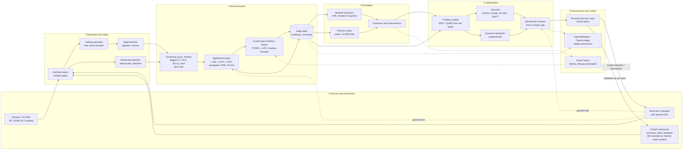

# OpenTSx: System reconstruction, simulation and optimization (concept, P8)

> Status: **concept and research basis**, 2026-10-12. Result of the deep research on the chain *sources → time series →
> reconstructed structure → simulation → optimization (classical, later quantum)*, methodological reference: Kämpf (2017).
> Implementation as **phase P8** in [TASK-011](../../EVOLUTION/TASK-011-datamodel-refresher-2026.md); control plane:
> Personal Service Layer ([05-SMART-TOPICS, section 11](05-SMART-TOPICS.md)). An internal notes system is treated only
> as a data class (accesses, edits, feedback).

---

The chain "time series → reconstructed network → simulation → optimization" can be built for OpenTSx as a **solver-neutral and method-neutral pipeline over versioned edge tables**. Most of the methodology for it already exists. Mirko Kämpf's dissertation (MLU Halle-Wittenberg, defended on 2017-05-29, not "about 2015") provides a formal reconstruction grammar (Eq. 9.1 to 9.7), a worked-out significance layer and context-sensitive normalizations. Research from 2020 to 2026 adds causal confirmation (PCMCI family, multivariate transfer entropy, Hawkes-Granger), better event measures (ECA instead of classical Event Synchronization) and stronger null models. What is missing is the **connection**. No product found links replay-verified episodes, discovered graphs, calibrated simulation and optimization instances with provenance throughout. No benchmark found offers energy or wind data with a known ground truth structure, and no product found computes structure discovery in streaming. For optimization the verdict is clear. Classical MIP solvers and GPU heuristics are ready for production. A **practical quantum advantage in optimization is not proven as of October 2026**: every prominent claim has a published classical counter-calculation. The wind farm simulator with ground truth is therefore the strongest lever of OpenTSx. It makes the platform the place where reconstruction methods and classical and quantum-based solvers are compared fairly on the same traceable instances. That is a contribution nobody makes at present.

## Kämpf's dissertation provides a seven-step reconstruction grammar, but no optimization step

The work is titled **"Time-Series-Based Reconstruction and Analysis of Complex Networks: Methods for Quantitative Comparison of Dynamic Processes"**. It is a dissertation for the Dr. rer. nat. at the Faculty of Natural Sciences II (Physics) of MLU Halle-Wittenberg, with the reviewers J. W. Kantelhardt, S. Trimper and H. Kantz, URN urn:nbn:de:gbv:3:4-21151 ([DNB archive copy](https://d-nb.info/1142920550/34); [DNB catalog](https://services.dnb.de/sru/dnb?version=1.1&operation=searchRetrieve&query=per%3DK%C3%A4mpf%20and%20per%3DMirko&recordSchema=oai_dc&maximumRecords=20)). It has no DOI. The peer-reviewed core publications are also suitable for citation: Physica A 2012 on fluctuations in Wikipedia access and edit data ([RePEc](https://ideas.repec.org/a/eee/phsmap/v391y2012i23p6101-6111.html)), PLOS ONE 2015 on trend detection with context networks ([PMC](https://pmc.ncbi.nlm.nih.gov/articles/PMC4699901/)) and IJCA 2013 on Hadoop.TS ([IJCA](https://ijcaonline.org/archives/volume74/number17/12974-0233/)). A talk slide explicitly calls Hadoop.TS the predecessor of OpenTSx ([SlideShare](https://www.slideshare.net/slideshow/time-seriesanalysisusinganeventstreamingplatform-v3final/228829017)).

### The methodological core is a pipeline that can be built directly as a module DSL

Chapter 9.1 formalizes seven steps ([Diss.](https://d-nb.info/1142920550/34)):

1. Aggregation of raw events into time series, X(t) = A(E(t)). Measurements may explicitly be replaced by simulation.
2. A generation function, for example a filter or peak and event detection. It delivers "time series buckets" of equal resolution and length.
3. Grouping, which defines the analysis context.
4. A link creation function per measure.
5. A link filter.
6. A **connectivity projection function** that combines several layers, linearly as l_c = Σ c_i·l_i.
7. Graph metrics S_m. Computed over episodes, they become time series S_m(t) themselves.

Turning the structure back into a time series is the point where simulation and optimization can attach. The work explicitly sees the reconstructed networks as a basis "to simulate the system behavior and to study the time evolution from extracted models". It does **not** contain an optimization step. This bridge must come from other literature.

### The significance layer is the underrated part of the work

The dissertation defines three link strengths for cross-correlations:

- **adjusted link strength** l_adj: ratio to the mean of ten shuffles, after Paluš
- **normalized link strength** l_norm: peak above the mean, divided by the spread of the CC(τ) function, after Berezin et al.
- **transformed link strength** l_trans: separates single peaks from broad structure

Calibration simulations show that single peaks produce l_norm values between 2.25 and 5. Values **above 5** therefore count as significant ([Diss., ch. 9 to 10](https://d-nb.info/1142920550/34)).

For Event Synchronization (ES) after Quiroga the work provides a calibration that does not appear in this form in later literature:

- Random event series already produce Q ≈ 0.28.
- The density dependence follows **Q_rand = 0.6/(5 + max(x, 1/x))**.
- Links are accepted only at Q/Q_rand ≥ t_f.
- The direction q is reliable only at relative shifts < 0.5.

At system level, a two-sample KS test compares the distribution of link strengths of real data against shuffled data and against series from other periods. With it, the test checks whether a process can be modeled as a network in a meaningful way at all.

An **adaptive threshold** splits the log-transformed distribution of link strengths into a parabola part (random) and a straight-line part (relevant). The fit parameters become a system time series themselves. A k-means classification in the planes of the three link strengths separates strong, "weak but significant" and random links. This is the explicit argument of the work for not cutting away *weak ties* ([Diss., Sec. 10.6](https://d-nb.info/1142920550/34)).

### Context and structure measures are tailored to content interaction data

Three measures aim at data from pure content interaction:

- **Context Cohesive Force** CCF = ⟨C⟩/⟨ρ_partial⟩ generalizes Kenett's Index Cohesive Force. It separates coupling through a shared context driver, for example an index page or a stock index, from direct coupling.
- The **time-resolved relevance indices** L.TRRI and G.TRRI normalize the activity of a central node against its local and its cross-language neighborhood.
- **Structure Induced Stress** (SIS) measures through node displacements in a force layout how strongly a functional network "distorts" the structural one ([Diss., ch. 11 to 12](https://d-nb.info/1142920550/34); [PMC](https://pmc.ncbi.nlm.nih.gov/articles/PMC4699901/)).

SIS is cheap to compute and provides a scalar gap between structure and function. That makes it a natural candidate for an optimization objective.

### The empirical findings decide the choice of methods

Wikipedia access series are strongly long-term correlated (DFA α ≈ 0.9, stretched exponential return intervals). Edit events are nearly Poissonian ([RePEc](https://ideas.repec.org/a/eee/phsmap/v391y2012i23p6101-6111.html)). A hard design rule follows from this: dense, long-term correlated series need cross-correlation with LRC-preserving surrogates (Fourier filter after Schreiber/Schmitz). Sparse event series need ES or its successors. The work itself shows that long-range correlations inflate link strengths and that trends produce spurious correlations ([Diss., Sec. 10.5.3](https://d-nb.info/1142920550/34)).

The authors name their limits openly. Causality was "not yet studied". TRRI changes cannot be interpreted "as a cause". The weights of the layer projection are unknown. Sliding-window networks touch Keogh's critique of subsequence clustering ([Diss., ch. 14](https://d-nb.info/1142920550/34); [PMC](https://pmc.ncbi.nlm.nih.gov/articles/PMC4699901/)).

The reception has mostly taken up the use case: Wikipedia attention as a proxy for conflicts, health and markets. It has hardly adopted the methodological core (significance-filtered functional networks, CCF, SIS) ([Semantic Scholar](https://api.semanticscholar.org/graph/v1/paper/DOI:10.1371/journal.pone.0141892/citations?fields=title,year,venue,externalIds,authors&limit=100)). This very core is underused and of immediate use for OpenTSx.

## Causal structure discovery has matured, but is bound to batch and must be measured against baselines

### PCMCI is the reference framework, ECA and Hawkes are the answer to event data

For continuous sensor data, Runge's **PCMCI family** is the state of the art ([Runge et al., Nat. Rev. Earth Environ. 2023](https://producciocientifica.uv.es/documentos/64c85d3aacdc40244331ee04?lang=en)). PCMCI combines a PC-like parent preselection with MCI tests ([Sci. Adv. 2019](https://elib.dlr.de/131630/1/Runge_ScienceAdvances_2019.pdf)). Each variant adds one capability:

- PCMCI+ adds contemporaneous links and calibrates CI tests better under autocorrelation ([PMLR 2020](https://proceedings.mlr.press/v124/runge20a.html)).
- LPCMCI allows latent confounders ([arXiv 2007.01884](https://arxiv.org/pdf/2007.01884)).
- RPCMCI handles regimes.
- J-PCMCI+ handles several contexts ([tigramite](https://github.com/jakobrunge/tigramite)).

Multivariate transfer entropy (IDTxl) reaches **over 98 % precision and recall** on synthetic networks of up to 100 nodes at T = 10,000. Bivariate methods, in contrast, lose control over false positives as the amount of data grows ([Novelli et al. 2019](https://www.ncbi.nlm.nih.gov/pmc/articles/PMC6663300/); [Novelli & Lizier 2021](https://arxiv.org/abs/2007.07500v1)).

For event data the situation has shifted since the dissertation. Odenweller & Donner (PRE 2020) show that classical ES structurally separates synchrony poorly from serial dependence (burstiness). **Event Coincidence Analysis (ECA)**, in contrast, is "largely robust" ([arXiv 1910.12343](https://arxiv.org/pdf/1910.12343)). Wolf et al. 2020 confirm that ES handles events at consecutive time steps wrongly ([PIK](https://publications.pik-potsdam.de/pubman/item/item_23895)). Boers et al. (Nature 2019) used ES with dynamic delays and a correction for multiple testing at large scale ([PIK](https://publications.pik-potsdam.de/pubman/item/item_23141)). For causal statements about event streams, **multivariate Hawkes-Granger** is the principled way. It models self-excitation explicitly instead of treating it as a nuisance factor ([Xu et al., ICML 2016](https://www.arxiv.org/pdf/1602.04511); [ISAHP, AISTATS 2024](https://proceedings.mlr.press/v238/wu24a.html)).

For the dissertation this means: its ES calibration stays valuable as a baseline. Its null models, however, must preserve the event clustering within each series, and ECA should stand next to that ES calibration as the standard.

### Autocorrelation is the dominant source of spurious links

Autocorrelation produces spurious links. This is well proven empirically: Guez et al. show it with DFA and surrogates on climate networks ([arXiv 1407.6243](https://arxiv.org/pdf/1407.6243)). Haas, Goswami and von Luxburg (2023) show that with a locally coherent correlation structure **"spurious link bundle teleconnections"** are to be expected and that common resampling methods are unsuitable for significance ([arXiv 2211.02888](https://arxiv.org/abs/2211.02888v2)). Bagging of PCMCI+ provides confidence measures per link ([arXiv 2306.08946](https://arxiv.org/pdf/2306.08946)).

This matches Kämpf's finding on LRC inflation. The platform must therefore carry significance as a **first-class output**: score, p-value, null model and correction method on every edge.

### Benchmarks show: cross-correlation is often just as good

The most sobering finding comes from real benchmarks. On **CausalRivers** (ICLR 2025), cross-correlation and "reverse physics" baselines perform comparably to several causal methods ([arXiv 2503.17452](https://arxiv.org/html/2503.17452v1)). CausalTime argues that synthetic data predict the performance on real data poorly ([arXiv 2310.01753](https://arxiv.org/pdf/2310.01753)). PCMCI baselines degrade markedly when data are missing ([arXiv 2507.03310](https://arxiv.org/pdf/2507.03310)).

Convergent cross mapping (CCM) fails under synchronization and a strong common driver ([PMC9126924](https://www.ncbi.nlm.nih.gov/pmc/articles/PMC9126924/)). Both are typical of wake coupling in a wind farm, so CCM is not suitable as a primary method.

A clear rule follows from this: cross-correlation stays the **mandatory baseline**, and every new method must beat it on data close to the domain.

### Scaling and licenses force a screen-then-confirm architecture

Pairwise measures scale with O(N²·τ·T), but are trivially parallelizable and maintainable incrementally as running sums over windows. Conditional methods (PCMCI, mTE) are validated for about 10 to 200 variables. There are no peer-reviewed streaming variants of PCMCI or mTE. GPU ports such as jax-pcmci or Causal-TS are self-reported and unchecked ([PyPI jax-pcmci](https://pypi.org/project/jax-pcmci/); [Causal-TS](https://causal-ts.readthedocs.io/en/latest/)).

On the license question: **tigramite and JIDT are under GPL-3.0** ([tigramite](https://github.com/jakobrunge/tigramite); [JIDT](https://github.com/jlizier/jidt)). According to `pom.xml`, OpenTSx is under Apache 2.0. This argues for connecting GPL libraries only behind a process boundary, for example as a Python worker that reads Iceberg and writes edge tables back. OpenTSx should reimplement simple measures (CC, ECA, ES, Gaussian TE) cleanly in Java. This is a conclusion from the common reading of the GPL, not legal advice.

The following table maps methods to data types.

| Data type | Screening (stream, Java) | Confirmation (batch, Python) | Null model |
|---|---|---|---|
| Dense sensor series (SCADA 1 s to 10 min) | Lagged CC, l_norm/l_trans (Kämpf) | PCMCI+ (ParCorr), CMIknn/GPDC on a reduced set, mTE at T ≥ 10³ to 10⁴ | IAAFT / block bootstrap, LRC-preserving Fourier surrogates |
| Dense content series (accesses, α ≈ 0.9) | CC after weekly cycle normalization, CCF | PCMCI+ per regime (RPCMCI), context nodes as conditioning | Fourier filter surrogates (LRC-preserving) |
| Sparse events (edits, tickets, feedback) | ECA, ES with Q_rand calibration | Multivariate Hawkes-Granger | ISI shuffle / jitter, preserving clustering |
| Univariate characterization | DFA, RIS (Kämpf) | Recurrence networks, visibility graphs (pyunicorn) | Shuffle vs. FFM |

## Digital twins today mostly assume structure instead of learning it

### In wind the validated chain is physics-based, not learned as a network

The best-proven chain in the wind domain is: SCADA-calibrated FLORIS → yaw offset optimization → field test. With it, NREL/NextEra lowered wake losses in the operating ranges by **about 6.6 %**. That is roughly half of the static optimum ([Fleming et al., WES 2020](https://wes.copernicus.org/articles/5/945/2020/)). In a commercial park the estimated AEP gains were **3.8 % and 2.8 %** ([Simley et al., WES 2021](https://wes.copernicus.org/articles/6/1427/2021/)).

Learned graphs give better predictions, but are rarely part of a closed control loop. An LSTM-GNN on 30 s SCADA lowers the MAE by **about 30 %** compared with power curves ([Daenens et al., WES 2025](https://wes.copernicus.org/articles/10/1137/2025/)). A reviewer there asks, however, whether the gain reflects real wake coupling, because every turbine measures its own wind speed ([WES discussion](https://wes.copernicus.org/articles/10/1137/2025/wes-10-1137-2025-discussion.html)). In such work the graph is mostly **given** by geometry or wind direction, not inferred. Causal discovery on SCADA so far works at sensor level within one turbine, for fault diagnosis ([Chatterjee & Dethlefs 2020](https://iopscience.iop.org/article/10.1088/1742-6596/1618/2/022022)). Data-driven inference of wind-direction-dependent turbine-to-turbine graphs is therefore an open niche. It fits a platform that can already segment episodes by sectors.

Koopman MPC for wake steering has so far been shown only in closed simulation of small parks ([TUHH](https://tore.tuhh.de/handle/11420/14669); [arXiv 2409.06523](https://www.arxiv.org/abs/2409.06523)). GNN wake surrogates are validated against PyWake, not against measurements ([arXiv 2311.12750](https://arxiv.org/pdf/2311.12750)).

### In the content domain the building blocks exist, but not their coupling

For Wikipedia the individual parts exist:

- **Structure:** clickstream networks with proven attention spillover ([J. Comp. Soc. Sci. 2023](https://link.springer.com/article/10.1007/s42001-023-00215-w)).
- **Node dynamics:** anticipation and decay models that forecast better than baselines up to 14 days ahead ([ICWSM 2022](https://arxiv.org/abs/2105.10900)).
- **Exogenous inputs:** Hawkes models with promotion input that quantify "viral potential" as the response to external excitation ([Rizoiu et al.](https://arxiv.org/pdf/1703.01012)).

A published multivariate Hawkes model on the Wikipedia page network was **not found**. Feedback loops are proven by experiment. A single early upvote raises final ratings by about 25 % (Muchnik 2013, summarized in [arXiv 2604.10360](https://arxiv.org/pdf/2604.10360)). Simulations show that recommendation loops amplify popularity bias ([arXiv 2007.13019](https://alphaxiv.org/abs/2007.13019)).

### What an internal notes system contributes, without statements about the system itself

The internal notes system is not public. This report therefore makes **no** statements about its data or results. Conceptually only this holds: if such a system records access and edit time series together with user feedback, it provides exactly the combination the literature lacks. Dense attention series suit CC/PCMCI. Sparse edit and feedback events suit ECA/Hawkes. Feedback events act as **quasi-interventional inputs** into the dynamics. Such a dataset would be an internal counterpart to the wind simulator and a touchstone for the content side of the pipeline. This part cannot be fully validated against wiki data from 2009.

### Identifiability needs a variety of regimes or excitation

All domains show the same failure patterns:

- overparameterized, non-identifiable wake models ([van Beek et al. 2021](https://www.mdpi.com/1996-1073/14/5/1293))
- calibration parameters that compensate for model errors ([wes-2023-98](https://wes.copernicus.org/preprints/wes-2023-98))
- spurious links from corrupted data streams ([UMN/IEEE TAC](https://ar5iv.labs.arxiv.org/html/2006.04690))
- inference that is free of errors only in suitable coupling regimes ([Sci. Rep. 2015](https://link.springer.com/article/10.1038/srep10829))

Industrial PCMCI applications counter non-stationarity by segmentation into operating modes ([arXiv 2501.11545](https://arxiv.org/pdf/2501.11545)). Adaptive Koopman MPC keeps the model identifiable through a small test signal ([TUHH](https://tore.tuhh.de/handle/11420/14669)).

A credible validation ladder has three stages: (1) synthetic ground truth, (2) held-out measurement data, (3) intervention tests in the field. Most published ML twins stop at stage 1 or 2. With the episode model, replay and the simulator, OpenTSx can map all three stages organizationally.

## Classical solvers deliver, quantum advantage stays unproven

### Two classes of problems sit on reconstructed networks

Two kinds of optimization problems arise on reconstructed coupling matrices.

The first class is **graph-native binary problems**. The coupling matrix becomes the QUBO matrix directly:

- Max-Cut and modularity partitioning. According to Negre et al., two communities fit onto an annealer "almost without reformulation" ([PLoS ONE 2020](https://arxiv.org/pdf/1901.09756)).
- Selection of representative sensors or turbines: maximize coverage, penalize redundancy through |C_ij|, analogous to portfolio diversification.
- MIS on threshold-filtered graphs.

The second class is **problems close to physics and operation**: unit commitment, maintenance planning, yaw control, network design. By nature they are MILP/MIQCP/NLP. As a QUBO they can be formulated only through penalty terms, slack variables and discretization. That costs many qubits and solution quality ([UC survey, arXiv 2601.01777](https://arxiv.org/html/2601.01777v1); [Müller et al., IEEE TPS 2025](https://cris.maastrichtuniversity.nl/en/publications/quantum-annealing-for-optimizing-unit-scheduling-in-renewable-ene/)). Classically, yaw control is solved as an integer program ([Bestehorn et al., WES 2025](https://wes.copernicus.org/articles/10/1637/2025/wes-10-1637-2025.pdf)).

A QUBO formulation specifically for an Event Synchronization network was **not found**. Examples with correlation networks come almost only from finance ([arXiv 2509.07766](https://arxiv.org/html/2509.07766v2); [arXiv 2602.23976](https://arxiv.org/abs/2602.23976)).

### Energy applications stay at proof-of-concept scale

Gate-based wind farm layouts run in simulation with **16 qubits** on 4×4 grids ([Plymouth/arXiv 2312.13123](https://arxiv.org/pdf/2312.13123)), follow-up work with up to 20 qubits on 9×9 grids, also simulated ([arXiv 2512.17582](https://www.arxiv.org/abs/2512.17582)). An APS abstract from 2025 sums up the comparison like this: D-Wave delivers near-optimal solutions in seconds without a guarantee, Gurobi higher quality with a guarantee ([APS](https://archive.aps.org/smt/2025/mar-x22/14)). Unit commitment on IEEE 118-bus succeeds only through decomposition, in which the classical master does the main work ([arXiv 2502.15917](https://arxiv.org/html/2502.15917v2)). The German Q-GRID project concludes that "any evidence of potential quantum utility in the energy sector" still needs further study ([arXiv 2403.17495](https://arxiv.org/pdf/2403.17495)).

### Every prominent claim of advantage has a classical counter-calculation

| Claim | Source, grade | Counter-finding, grade | Status |
|---|---|---|---|
| Superlinear speedup for MIS on Rydberg arrays (289 qubits) | Ebadi et al., Science 2022, peer-reviewed ([arXiv 2202.09372](https://www.arxiv.org/abs/2202.09372)) | Andrist et al., PRR 2023: classically exact for thousands of nodes in minutes, peer-reviewed ([PRR](https://link.aps.org/doi/10.1103/PhysRevResearch.5.043277)) | neutralized |
| Scaling advantage in approximate optimization (QAC, >1,300 logical qubits) | Munoz-Bauza & Lidar, PRL 2025, peer-reviewed; promoted by D-Wave ([arXiv 2401.07184](https://arxiv.org/pdf/2401.07184)) | Pawłowski et al., Phys. Rev. Applied: GPU simulated bifurcation scales as well or better ([arXiv 2505.22514](https://arxiv.org/pdf/2505.22514)) | disputed |
| BF-DCQO on IBM Heron "up to 80× faster than CPLEX" | Kipu/IBM, preprint + press release ([arXiv 2505.08663](https://arxiv.org/html/2505.08663v1)) | D-Wave researchers: the quantum part contributes little, preprint by a competitor ([arXiv 2509.14358](https://arxiv.org/abs/2509.14358)); Kipu's own benchmark 2026: parallel tempering and GPU ABS3 match or exceed it ([arXiv 2603.13607](https://arxiv.org/pdf/2603.13607)) | refuted as an "advantage", parity at best |
| QAOA with better scaling than branch-and-bound (LABS) | Shaydulin et al., Sci. Adv. 2024, peer-reviewed ([PMC](https://pmc.ncbi.nlm.nih.gov/articles/PMC11135426)) | holds only in noise-free simulation up to 40 qubits | no practical advantage |

IBM itself states that the community has **not yet reached** the advantage. It has started an advantage tracker that so far holds no optimization entries ([IBM QDC 2025](https://www.ibm.com/quantum/blog/qdc-2025)). The benchmark library QOBLIB (Nature Computational Science) requires the comparison against the **strongest** classical methods ([IBM blog QOBLIB](https://www.ibm.com/quantum/blog/qoblib); [ZIB](https://opus4.kobv.de/opus4-zib/frontdoor/index/index/docId/9998)).

On the classical side, in contrast, the progress is real. The GPU LP family PDLP has arrived in HiGHS and in NVIDIA cuOpt, which now lives in COIN-OR ([arXiv 2506.02174](https://arxiv.org/pdf/2506.02174); [Edinburgh](https://maths.ed.ac.uk/highs-and-nvidia-cuopt-driving-open-source-innovation-in-optimization)). NVIDIA's "over 5,000× faster", however, is a vendor statement for very large LPs, not for branch-and-bound in MIP. Quantum-inspired solvers (Digital Annealer, SBM) show problem-dependent rankings without a clear winner ([Oshiyama & Ohzeki 2022](https://www.ncbi.nlm.nih.gov/pmc/articles/PMC8828756/)).

For OpenTSx a hierarchy follows from this:

1. HiGHS (open) or Gurobi for MILP/MIQP.
2. CP-SAT for scheduling.
3. SA, tabu or parallel tempering for correlation QUBOs.
4. Leiden for modularity.
5. Quantum backends only as an **experimental backend** with a benchmark protocol fixed in advance.

## The end-to-end concept connects six layers through a shared edge table

The concept arranges existing and planned OpenTSx building blocks into a closed loop. The central integration contract is a **versioned Iceberg edge table**. Its fields are `src, dst, layer, method, lag, score, p_value, null_model, correction, episode_id, window, replay_offsets, run_id`. Every method writes into this schema, every simulation and every optimization reads from it. This makes Kämpf's step 4/5 (link creation plus filter) exchangeable without changes to the downstream layers.

**Legend.**

- **Solid arrows** are data flows through Kafka topics or Iceberg tables.
- **Dashed arrows** are validation, provenance or the flow of models back.
- The **cylinder** marks the edge table as the central contract.

The six layers in detail:

- **Layer 1** brings heterogeneous sources into the episode model. Sensors carry IEC semantics, content data carry event types, and the simulator appears as a source of equal standing. In this way Kämpf's Eq. 9.1, under which measurement can be replaced by simulation, runs literally through the same pipeline.
- **Layer 2** provides byte-identical replay, data quality metrics and segmentation. Segmentation is the standard answer to non-stationarity.
- **Layer 3** separates cheap streaming screening from expensive batch confirmation. The significance layer combines Kämpf's link strengths with modern null models and FDR/FWER correction.
- **Layer 4** simulates on reconstructed graphs. Hawkes processes on the graph suit content networks, VAR or Koopman suit sensor systems. In wind, hybrid models of wake physics plus learned residual coupling are added. For the energy system (wind farm, electrolysis, storage, marketing), [07-DIGITAL-TWIN-BSP](07-DIGITAL-TWIN-BSP.md) makes this layer concrete as a twin of atomic elements.
- **Layer 5** formulates optimization problems directly from the graph and the simulation. Graph-native problems are formulated as QUBO, operational problems as MILP. A harness measures every backend against the same instances.
- **Layer 6** records every step as an OpenLineage run in OpenMetadata, where the existing Kafka connector picks it up ([OM docs](https://docs.open-metadata.org/v2.0.x/connectors/pipeline/openlineage)). Smart Topics train models (MLflow) and run them federated through Wayang. The Personal Service Layer closes the loop: decisions become interventions in the simulator or feedback events in the content system, whose effect the next reconstruction measures.

### The evolution of the state comes from a rolling loop

Optimization does not "compute the evolution of the system state" in one step. It does so as a **rolling loop** in the style of MPC. Per episode the structure is estimated anew, the structure time series S_m(t) is extended, the model is simulated and the next control variable is optimized. Kämpf's SIS and the fit parameters of the adaptive threshold serve as state indicators that trigger a refit on structural breaks (burst, regime change, fault).

The field tests of wake steering show why this loop needs interventions: measurable gains were about half of the modeled optimum ([WES 2020](https://wes.copernicus.org/articles/5/945/2020/)). Only interventions calibrate the twin. For Wikipedia-like systems, user feedback takes this role when it is recorded as an event with a timestamp. Feedback needs care, however: ranking and recommendation loops can hide or reverse causal links.

## Five gaps in which OpenTSx stands alone

The landscape analysis finds no competitor that closes the chain:

- **Streaming platforms** offer univariate anomaly detection and forecasts. Kusto decomposes series and applies Tukey fences ([Microsoft Learn](https://learn.microsoft.com/en-us/kusto/query/anomaly-detection)). Flink ML has had no release since June 2023 ([ASF](https://release-catalog.apache.org/flink-ml/index.html)). None of these platforms has a built-in operator for causal or network discovery.
- **Causal AI vendors** are closed and domain-agnostic. causaLens promises "from raw data to the causal graph" (vendor statement, [causaLens](https://causalens.com/?p=1762)), Causely aims at root causes in Kubernetes ([VentureBeat](https://venturebeat.com/ai/causely-launches-causal-ai-for-kubernetes-raises-8-8m-in-seed-funding)).
- **Twin platforms** model structure by hand. AWS has discontinued IoT Analytics and IoT Events ([AWS](https://docs.aws.amazon.com/iotevents/latest/developerguide/iotevents-end-of-support.html)).
- **Quantum services** start from a finished QUBO ([IBM Qiskit Functions](https://quantum.cloud.ibm.com/docs/en/guides/q-ctrl-optimization-solver)).

| Gap | Evidence | OpenTSx contribution | Maturity of the contribution |
|---|---|---|---|
| Domain benchmark with a ground truth structure for energy/wind | CauseMe is weighted toward climate ([causeme](https://causeme.uv.es/)); CausalTime/CausalRivers show a transfer problem ([arXiv 2310.01753](https://arxiv.org/pdf/2310.01753)) | The simulator produces the wake graph as directed truth, plus faults, regimes, IEC catalog, replay | high, simulator exists |
| Provenance from episode to optimization result | OM/OpenLineage do not cover simulation, graph, QUBO as entities ([OM SDK](https://docs.open-metadata.org/v2.0.x/sdk/python/entities/ml-model)) | Custom facet "replay provenance" (topic, offsets, episode hash) | medium, OM module exists |
| Streaming-to-batch bridge for structure discovery | no peer-reviewed streaming PCMCI; TU/e names the O(N²) gap ([TU/e](https://dai.win.tue.nl/masterprojects/38)) | Sketch and CC/ECA screening in the stream, PCMCI/mTE on replayed episodes | high, `opentsx-stats` exists |
| Federated structure discovery across operators | WINDWISE does federated condition monitoring, not structure ([CORDIS](https://cordis.europa.eu/project/id/101276753)); inter-farm FL suffers from heterogeneity ([arXiv 2409.03672](https://arxiv.org/abs/2409.03672)) | Mergeable sketches + shared IEC catalog + Wayang | research, not trivial |
| Solver-neutral optimization instances with known optima | Q-GRID: utility open ([arXiv 2403.17495](https://arxiv.org/pdf/2403.17495)); layout studies on 16 qubits | Simulator-generated, versioned QUBO/MILP instances, reported in a QOBLIB-compatible form | medium |

A sixth, smaller gap concerns the methodology itself. Kämpf's significance layer (l_trans, adaptive threshold, Q_rand calibration, CCF, SIS) is available nowhere as a reusable library. As an Apache-licensed Java module next to a clean ECA implementation, it would fill a real gap in the JVM ecosystem. There, JIDT (GPL, last release August 2023) is the only mature library ([JIDT](https://github.com/jlizier/jidt)).

## The roadmap starts with the benchmark, not with the quantum computer

The order follows the state of the evidence. Reproducible reconstruction against ground truth offers the most insight and the strongest unique position. Quantum backends come last and only as an object of measurement.

| Stage | Goal | Concrete steps | Acceptance criterion |
|---|---|---|---|
| **0: Foundation (≈ 1 to 2 months)** | Shared contract | Iceberg schema of the edge table in `opentsx-store-iceberg`; OpenLineage facet "replay provenance" in `opentsx-openmetadata`; a scenario in `opentsx-windpark` (for example an extension of `ostsee-demo.yaml`) exports the true wake graph per wind direction sector as an edge table | A ground truth edge table with lineage is visible in OM |
| **1: Classical reconstruction (≈ 2 to 4 months)** | Kämpf methodology as a Java library | Clean-room implementation in `opentsx-stats`: lagged CC with l_adj/l_norm/l_trans, ES with Q_rand calibration, ECA, DFA, RIS, Fourier filter surrogates; streaming variant as running window sums in `opentsx-flink-core`; weekly cycle normalization and CCF for content data | Precision/recall against the simulator ground truth per sector; CC baseline documented |
| **2: Causal confirmation (≈ 3 to 6 months)** | Screen-then-confirm | Python worker (`python-package/opentsx/algorithms`) reads episodes via pyiceberg, calls tigramite (PCMCI+, RPCMCI) and IDTxl behind a process boundary, writes edges back; bagging for confidence; Hawkes-Granger for event streams; comparison report in CauseMe style | Confirmation measurably beats the CC baseline on ground truth, otherwise it does not become the standard |
| **3: Simulation on the reconstructed structure (≈ 4 to 8 months)** | Twin from data | VAR/Koopman models on confirmed edges; for content, multivariate Hawkes on the graph; scenario replay against held-out episodes; SIS and threshold parameters as a structural break detector | Out-of-sample forecast better than a structure-free model; intervention scenarios reproducible in the simulator |
| **4: Optimization, classical (≈ 6 to 10 months)** | Decisions from structure | Problem builder: sensor or turbine selection and partitioning as QUBO (dimod format), yaw/maintenance as MILP; backends HiGHS, OR-Tools CP-SAT (Java), SA/PT; results as Smart Topic events | Optimality gap against the MIP bound logged; closed loop in the simulator improves the objective |
| **5: Quantum and federated experiments (from ≈ 12 months)** | Fair measurement | Quantum backends (D-Wave Leap Hybrid, Qiskit Functions) only through a Python sidecar; protocol: time to target including embedding and queue, best tuned classical baseline, QOBLIB report format; publication of the instances; federated reconstruction through Wayang with sketch exchange | Public, reproducible benchmark; the statement "parity/no advantage" is a valid result |

### Three first steps for the next four weeks

The first step is the **ground truth export from the wind farm simulator**. Without a known structure, every choice of method is a matter of taste. CausalRivers has shown how easily causal methods fall behind cross-correlation ([arXiv 2503.17452](https://arxiv.org/html/2503.17452v1)).

The second step is the **edge table schema** with significance fields. It fixes the contract that all later layers depend on.

The third step is a **reference implementation of lagged CC with l_norm/l_trans and ECA** in `opentsx-stats`, measured against the exported graph. These three building blocks produce the first publishable artifact. They depend on no GPL library and no quantum access.

For the content side, it should be clarified in parallel whether an anonymized or synthetic extract of content interaction data (access, edit, feedback) can serve as a second touchstone. Without it, validation stays limited to public Wikipedia pageviews.

## Grades of evidence kept apart

The following overview separates the load-bearing statements by quality of evidence. "Peer-reviewed" means reviewed in a journal or at a conference. "Preprint" means arXiv or the discussion stage. "Vendor statement" covers press releases, product pages and studies written by vendors, also when they appear as a preprint.

| Statement | Peer-reviewed | Preprint | Vendor statement |
|---|---|---|---|
| Reconstruction formalism, link strengths, ES calibration, CCF, TRRI, SIS | Dissertation 2017 (reviewed by a committee); Physica A 2012; PLOS ONE 2015 | n/a | n/a |
| PCMCI/PCMCI+/LPCMCI control false positives under autocorrelation | Sci. Adv. 2019; UAI 2020; NeurIPS 2020 | Bagged PCMCI+ (2023) | n/a |
| ECA more stable than ES under burstiness | PRE 2020; Chaos 2020 | n/a | n/a |
| Cross-correlation competes with causal methods on real data | CausalRivers, ICLR 2025 | n/a | n/a |
| mTE > 98 % precision/recall up to 100 nodes (synthetic) | Network Neuroscience 2019 | n/a | n/a |
| GPU PCMCI speedup | n/a | n/a | jax-pcmci, Causal-TS (self-reported) |
| FLORIS wake steering in the field: about 6.6 % lower wake losses | WES 2020, WES 2021 | n/a | n/a |
| SCADA GNN lowers MAE by about 30 % | WES 2025 (with a reviewer's reservation about attribution) | n/a | n/a |
| AI wake surrogates "up to 10,000× faster than CFD" | n/a | n/a | NVIDIA/Siemens Gamesa |
| Causal graph "from raw data" as a platform | n/a | n/a | causaLens |
| Practical quantum advantage in optimization | **not proven** | n/a | IBM expects it, but does not confirm it |
| Scaling advantage of annealing (QAC) | PRL 2025, disputed by Phys. Rev. Applied | n/a | D-Wave communication |
| BF-DCQO advantage on IBM Heron | n/a | Kipu 2025/2026; D-Wave counter-calculation 2025 | Press releases "80× faster" |
| Energy QUBOs (UC, layout) only at small scale | IEEE TPS 2025; Plymouth 2025 | UC survey 2026; arXiv 2512.17582 | n/a |
| GPU LP "over 5,000× faster" | n/a | Survey arXiv 2506.02174 puts it in context | NVIDIA |

Several points stay open. These were not checked:

- licenses of IDTxl, pyunicorn, causal-learn and netrd
- current releases of qiskit-optimization and OpenQAOA
- the official AWS status of TwinMaker
- leaderboard figures of CauseMe and QOBLIB

For event network inference on clickstream-like data, no direct comparison between ES/ECA and Hawkes was found. Nor was a Hawkes model on the Wikipedia page network found. Both are research gaps that OpenTSx can close with its own data.

## Conclusion

The central insight: the bottleneck no longer lies in algorithms, but in **comparability and feedback**. Reconstruction methods are plentiful, and they contradict each other on real data. Optimization solvers are plentiful, and quantum claims regularly lose to better-tuned classical baselines. In both cases the deciding factor is who provides reproducible instances with a known truth and complete provenance. For this, OpenTSx brings a rare combination: byte-identical replay, an episode model, an IEC-semantic catalog and a simulator with ground truth. With it, OpenTSx can take on this role for energy and content systems instead of joining the race between single methods.

Kämpf's dissertation proves to be less a historical forerunner than the **missing middle layer**. Its significance and context measures fill exactly the gap between cheap screening and expensive causal confirmation. Its structure time series S_m(t) provide the state variables on which a rolling optimization can build. The realistic expectation for quantum computing is that OpenTSx becomes the place where its benefit is measured honestly, not the place where it creates benefit. A published result "parity, no advantage on real wind farm instances" would be worth more to the community than any further claim of advantage on toy problems.
