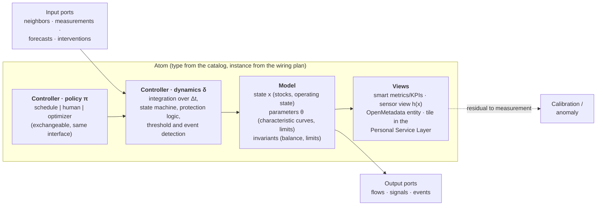
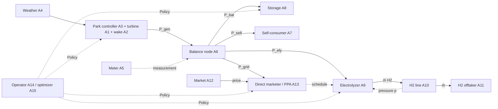
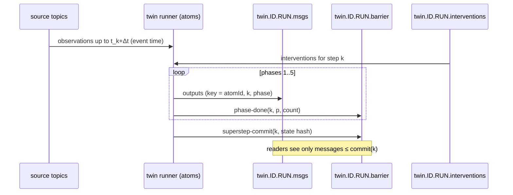

# OpenTSx: Digital twin as a cluster of atomic elements (concept, P9)

> Status: **proposal for discussion**, 2026-10-12. **The twin with its three operating modes is the core of the
> roadmap**; all three operating modes are supported in both execution variants (sections 4.3 and 10). Starting
> point: a project conversation about the cluster of wind farm, electrolyzer, H2 line, storage, self-consumption and
> marketing. It builds on [05-SMART-TOPICS](05-SMART-TOPICS.md) (Smart Topics, Personal Service Layer) and
> [06-SYSTEMREKONSTRUKTION-OPTIMIERUNG](06-SYSTEMREKONSTRUKTION-OPTIMIERUNG.md) (reconstruction, simulation,
> optimization). Implementation as **phase P9** in [TASK-011](../../EVOLUTION/TASK-011-datamodel-refresher-2026.md).
> People, contract partners and funding questions from the conversation are deliberately not part of this document;
> partners appear only as roles.

---

## 1. Summary

The twin is **not an ML model** but a **plant model**: a wiring of standard components ("atomic elements") whose
states change through interaction in fixed steps. In it, a human decision must propagate causally through the chain.
Example: The H2 offtaker closes the valve, the line pressure rises, after about one hour the electrolyzer must
curtail, the schedule is violated, the direct marketer must sell more power.

The proposal in four sentences:

1. **Every element is an atom with a model, views and control (MVC)**. The control is split into *dynamics* (how
   the plant responds physically or by rules, fixed) and *policy* (how it is operated, exchangeable between schedule,
   human and optimizer). We call this **MVC+P**.
2. **The twin is a wiring plan**: a YAML file that connects atoms from a catalog through typed ports. The components
   are standard, the wiring is individual per plant. That is the lever for transferability to other parks.
3. **Execution as layered BSP** (Bulk Synchronous Parallel): supersteps at a base step of 1 min, fixed phases in
   topological order within a superstep, a barrier through a control topic, deterministic and therefore replayable.
4. **Two execution variants, both of equal rank**: *tightly coupled* as one process (twin runner, all atoms in the
   process, hard barrier) and *loosely coupled* through Smart Topics (atoms as independent processors, coupling only
   through topics and event time). All three operating modes (Shadow, What-if, Forecast/MPC) run in both. Learned
   submodels are Smart Topics anyway, and the twin publishes as a derived Smart Topic. When loose coupling gives the
   same result as tight coupling, and what that costs, is a research question of its own (section 10).

---

## 2. Atomic elements

### 2.1 What an atom is

An atom `a` is the smallest element with its own state, its own parameters and its own responsibility for its
balance. Formally, per superstep `k` with step size `Δt`:

```
u_a(k)   = gather( y_b(k)  for wires b → a that lie in an earlier phase of k,
                   y_b(k-1) for all other wires,
                   obs_a(t_k), forecast_a(t_k), intervention_a(k) )
x_a(k+1) = δ_a( x_a(k), u_a(k), π_a(k), θ_a, Δt )        dynamics (controller, part 1)
π_a(k)   = policy_a( x_a(k), u_a(k), goals )                policy   (controller, part 2)
y_a(k)   = h_a( x_a(k), u_a(k) )                            outputs to neighbors
v_a(k)   = { view_i( x_a(0..k) ) }                          views (view)
```

Three kinds of quantities are distinguished:

| Kind | Examples | Rule |
|-----|-----------|-------|
| **Stock** | SoC, linepack/pressure, meter readings, stack temperature | only the atom itself changes it, by integration over `Δt` |
| **Flow** | kW, kg H2/h, m³/h | exchanged over ports; balance nodes check conservation |
| **Signal** | price, setpoint, schedule, forecast, status | exchanged over ports, no conservation |

### 2.2 MVC+P per atom



| Part | Content | Persistence in OpenTSx |
|------|--------|-----------------------|
| **Model** | state, parameters, invariants; Avro schema per atom type | state series as v2 episodes (`twin.<atom>.<var>`, tags `twin`, `run`), snapshots in Iceberg |
| **View** | pure functions of the state history. The most important view is the **sensor view `h(x)`**: What would a meter or sensor measure? The residual *measurement − sensor view* drives calibration and anomaly detection. | smart metrics, statistics (P4), OpenMetadata (lineage to the run) |
| **Controller · dynamics** | physical or rule-based response: integration, ramps, protective shutdown, events at their exact time (zero crossing within `Δt`) | code in the atom type, versioned; events as episodes with `segmentation=FEATURE_THRESHOLD` |
| **Controller · policy** | who decides: schedule, human, optimizer (P8.4) | intervention log (topic), every intervention with author and reason |

Why MVC fits here, and where it is stretched:

* **Single source of truth.** The model is the only place with state. Views are cheap, and there can be any number of
  them. That is exactly the classic MVC gain.
* **"Controller" means message processing here**, not UI input. The UI in the Personal Service Layer is only
  *one* source of interventions.
* **The split of dynamics and policy is the real added value.** Only this split can meet the requirement from the
  conversation that the numbers change consistently when a human decides: the decision replaces or overrides the
  policy, the dynamics stay the same. Human and optimizer are exchangeable through the same interface, and an
  optimizer proposal can be played through in the twin before approval.

### 2.3 Atom catalog (proposal for the PoC cluster)

| # | Atom | Model (state · parameters) | Dynamics δ | Policy π | Views | Data source |
|---|------|-----------------------------|-----------|----------|-------|-------------|
| A1 | **Wind turbine** | status, P, v_eff, yaw and pitch angle, Ct · power and Ct curve, position | curve with wake deficit, setpoint tracking, ramps | curtailment, yaw offset (wake steering) | power curve deviation, availability, PI (P5) | SCADA (IEC 61400-25), simulator |
| A2 | **Wake coupling** (relation atom) | sector-dependent deficit matrix · wake decay | deficits from direction and Ct of the upstream turbines | n/a | wake graph per sector; comparison of ground truth vs. reconstructed (P8) | simulator (truth), reconstruction (estimate) |
| A3 | **Park controller** | park setpoint, grid requirements · limits | distributes setpoints to the turbines, keeps the grid connection limits | requirements of the grid operator, the marketer | park P, curtailment losses | control system or park controller interface |
| A4 | **Weather** | measured and forecast fields per location and lead time | choice of the latest forecast, bias correction | n/a | forecast quality per lead time | DWD Open Data, park mast |
| A5 | **Meter / metering point** | meter readings, P, Q · register map, transformer ratios, OBIS code | meter reading → power, plausibility, gap handling | n/a | billing-relevant energy | Modbus (grid operator meters) |
| A6 | **Balance node / metering concept** | allocation rule (priorities) | solves the power balance **within** the step: generation = self-consumption + direct supply + electrolysis + storage + grid | order of priorities (self-consumption before market) | direct supply share, grid feed-in, balance error | derived |
| A7 | **Self-consumer / direct customer** | load profile, flexibility · connected load | load from measurement or profile | load shifting (if flexible) | share covered by own generation | meters, historical load profiles |
| A8 | **Battery storage** | SoC, P, SoH · capacity, efficiencies, C-rate | SoC integration with limits and losses | charge and discharge schedule | cycles, SoC course, revenue contribution | storage EMS (if present) |
| A9 | **Electrolyzer** | operating state (off/standby/warm/ramp/running), P_el, H2 flow, stack temperature · minimum load, ramp rates, specific consumption kWh/kg | state machine, ramps, **protective curtailment at line pressure > limit** | schedule (from the operator or self-generated) | schedule adherence, specific consumption, kg H2 | the operator's control (S7 PLC) through the agreed interface |
| A10 | **H2 line / buffer** | pressure p, mass (linepack) · volume, p_min/p_max, temperature | `dp/dt = (ṁ_in − ṁ_out)·R·T/V`; **time to limit** as an event | n/a | buffer level, time to impact | pressure measurement of the operator |
| A11 | **H2 offtaker** | offtake, valve position | offtake from measurement or profile; fault = valve closed | offtake profile | delivered kg, fault duration | operator/offtaker |
| A12 | **Market** | day-ahead and intraday prices, balancing energy price | price series (measured, scenario or forecast) | n/a | revenue, price profile | exchange and transparency data |
| A13 | **Direct marketer / schedule / PPA** | schedule (15 min), forecast, contractual obligations | deviation, balancing energy, follow-up trading | marketing strategy | deviation costs, PPA revenue | forecast and schedule data of the marketer |
| A14 | **Operator** (human) | n/a | n/a | interventions: setpoints, schedule override, approvals | decision log with effect | Personal Service Layer |
| A15 | **Optimizer** (policy atom) | horizon, objective, constraints | n/a | rolling horizon (MPC), writes setpoints and schedules | optimality gap, extra revenue against the reference | P8.4 |

Later extensions stay in the same scheme: PV system, CMS data (vibration monitoring) as extra turbine ports, more
parks.

**Reflection on granularity.** An atom is small enough that it has its own balance and its own parameters, and large
enough that its ports can be named in domain terms. The wind turbine is an atom, its gearbox is not (that would be a
CMS view). The **wake coupling becomes a relation atom of its own**, because it has learnable parameters and is the
subject of the reconstruction (P8). A mere wire in the wiring plan would be too little for that.

---

## 3. The wiring plan (twin configuration)

Components from the catalog, wiring per plant, typed ports with a unit. The plan is versioned and hashed like a
`Scenario` YAML of the wind farm simulator. The hash goes into the lineage of every run.

```yaml
twin: verbund-poc
baseStep: PT1M
atoms:
  park:     { type: windpark, turbines: from-catalog, wake: { model: jensen, sectorDeg: 30 } }
  wetter:   { type: weather,  source: dwd-mosmix, station: auto-nearest }
  nvp:      { type: meter, protocol: modbus-tcp, registerMap: maps/netzbetreiber-zaehler.yaml }
  bilanz:   { type: balance, priority: [eigenverbrauch, direktabnehmer, elektrolyse, speicher, netz] }
  ely:      { type: electrolyzer, minLoadKw: …, rampKwPerMin: …, kwhPerKg: …, policy: fahrplan }
  leitung:  { type: h2-line, volumeM3: …, pMinBar: …, pMaxBar: … }
  abnehmer: { type: h2-offtake }
  markt:    { type: market, mtu: PT15M }
  vermarkter: { type: direct-marketer, schedule: source:vermarkter-fahrplan }
wiring:
  - park.p_out        -> bilanz.p_gen
  - ely.p_el          -> bilanz.p_ely
  - bilanz.p_grid     -> vermarkter.p_actual
  - ely.h2_out        -> leitung.m_in
  - abnehmer.m_out    -> leitung.m_out
  - leitung.p         -> ely.p_downstream          # protective curtailment
  - wetter.wind_fc    -> park.wind_fc
  - markt.price       -> vermarkter.price
  - nvp.p_meas        -> bilanz.p_grid_meas        # sensor view vs. measurement
```



This is the answer to the question from the conversation about transferability. The platform and the atom catalog are
standard; a new project needs a new wiring plan, register maps and source mappings. To assess a new park with a direct
line, historical load profiles of the offtaker, a yield forecast and the balance node are enough (stage A,
section 6).

---

## 4. Execution: layered BSP

### 4.1 Superstep

Plain BSP (all atoms in parallel, messages take effect only in the next step) is equivalent to a Jacobi co-simulation.
That is not critical for stocks, **but wrong for the power balance**: generation, consumption and grid import must
balance in the *same* step. That is why I propose a **layered BSP**. A superstep consists of fixed phases in the
topological order of the wires, and each phase ends with a barrier. Cycles in the wiring plan are allowed only across
step boundaries (delay `Δt`, for example line pressure → electrolyzer). The runner checks this on load.

| Phase | Atoms | Result |
|-------|-------|----------|
| 0 · Sources (`SOURCES`) | market, offtaker, operating rules, meter | exogenous values; measurements, forecasts and interventions of the interval `[t_k, t_k+Δt)` are bound |
| 1 · Policy (`POLICY`) | standalone policy atoms (schedule, optimizer) | setpoints for this step |
| 2 · Assets (`ASSETS`) | generation, electrolyzer, storage | operating point from setpoint, limits, ramps, protection logic; the atom policy runs right before the dynamics |
| 3 · Balance (`BALANCE`) | balance node | grid balance, direct supply by priorities, residual to the measurement |
| 4 · Flows (`FLOWS`) | H2 line, marketer | new stocks and accounts, events at their exact time |
| 5 · Views (`VIEWS`) | derived views | smart metrics |

*Implemented (PoC, `opentsx-twin`):* The phases are named as in the code. An input gets the value of the same step
when its source lies in an earlier phase, otherwise the value of the previous step; feedback therefore always crosses
the step boundary. A value at step `k` describes the end of the interval `[t_k, t_k+Δt)`.

The execution is **multirate**. The base step is 1 min, which is enough for linepack, electrolyzer ramps and storage.
Every atom has a step that is an integer multiple of it: market and schedule 15 min, weather 1 h. The turbine
dynamics in the range of seconds are not computed in the twin. They come as a 1-min aggregate from the statistics
(P4) or from the simulator. Events within a step (pressure limit reached) are reported at their exact time and take
effect from the next step. The maximum response delay of `Δt` is documented.

### 4.2 Topics and barrier under KafScale conditions



* **Without transactions and without an idempotent producer**: Every message has a deterministic id
  `(run, k, phase, atom)`; duplicates are discarded on read. The commit record holds the expected count and a state
  hash. This matches the pattern from P2 (manual assignment, checkpoint files).
* **Determinism**: The same wiring plan, the same input episodes, the same intervention log and the same code version
  give bit-identical states. A run is therefore a unit of lineage
  (`schaltplanHash × eingangsHash × eingriffsHash × version`). Replay verification works as for the episodes.
* **State**: Snapshots every N steps in Iceberg (`twin_state`). KafScale has no compaction; the newest state is read
  through the checkpoint.

### 4.3 Where Smart Topics belong

Both variants are built. They share the atom contract, the wiring plan and the topic contract, so the same atom runs
in both without change.

| Variant | Coupling | Synchronization | Strengths | Limits |
|----------|----------|-----------------|---------|---------|
| **T: tight, one process** ("in the small") | method call in the process; topics only for input and output | layered BSP with a hard barrier (section 4.1) | deterministic, bit-identical replay, exact balance within the step, fast for experiments and what-if runs | one owner, one failure domain, scales only vertically |
| **L: loose, Smart Topics** | every atom (or every atom type, with instances as keys) is a Smart Topic processor; coupling only through port topics | event time watermarks instead of a global barrier; bounded staleness (SSP) up to asynchronous; balance node as a processor of its own with a balancing step | atoms can run at different owners (for example the electrolyzer at its operator, only ports are shared), independently deployable, fault-tolerant, horizontally scalable, data sovereignty | the result can differ from T; conservation and causal order must be secured explicitly |

A variant with one topic per atom *instance* is not pursued: instances are keys within the topic of their atom type.

Loose coupling in particular fits the reality of the cluster: electrolyzer, meters and marketing belong to different
parties. A twin whose atoms run where the data lives, and that exchanges only ports, continues the federation idea from
P7d/P8.5 at the level of the plant model.

Smart Topics take on three roles in both variants:

1. **Forecast ports**: wind and power forecast, load, prices. These are P7 models with an MLflow alias.
2. **Estimators for missing data**: electrolyzer load as long as no operating data flows; offtake profile. As
   requested in the conversation, this makes it possible to *"compute plausibly, as if one had real data"*.
3. **The twin as a Smart Topic**: state series and smart metrics as a derived topic; the prediction API is extended
   with **What-if**: a sequence of interventions goes in, the state trajectory and the KPI difference come out.

### 4.4 Data quality ladder and provenance

Every port value carries an origin class. When the higher class is missing, the next one applies:

`MEASURED > REPORTED (partner, schedule) > FORECAST > ESTIMATED (Smart Topic) > SYNTHETIC (simulator/profile)`

The class of an output is the minimum of its inputs (taint propagation). Every KPI therefore shows what share of it
rests on measurement. Only this way can a potential estimate be reported honestly.

---

## 5. Operating modes: one twin, three bindings

The same atoms, with inputs bound differently:

| Mode | Inputs | Purpose | Example from the conversation |
|-------|----------|-------|---------------------------|
| **Shadow** (nowcast) | live measurements, the rest estimated | state estimation, residuals, anomalies | make unmeasured quantities visible, meter plausibility |
| **Replay / what-if** | historical episodes + changed intervention log | counterfactual operating policies | "practice" supply under the PPA operating policy even before the official change of the metering concept, including forecast and schedule data of the marketer |
| **Forecast / MPC** | forecasts, optimizer as the policy | schedule proposals, early warning | pressure rise → "~1 h left until curtailment" → propose a schedule adjustment |

### Acceptance scenarios

| Id | Scenario | Acceptance criterion |
|----|----------|------------------|
| S1 | **H2 chain**: offtaker closes the valve → pressure rises → time to limit → electrolyzer curtails → schedule deviation → extra sales | chain reproduced with timestamps; an intervention (for example charge the storage, bring curtailment forward) changes all downstream numbers consistently; balance error 0 |
| S2 | **Potential** from historical data: overlap of generation and consumption, direct supply share vs. grid feed-in | only meter, balance node, market; report with origin shares (section 4.4) |
| S3 | **PPA shadow operation**: schedule and forecast of the marketer against actual generation | deviation statistics per 15 min, cost of the deviation |
| S4 | **Wake**: park atom with Jensen coupling reproduces the simulator ground truth; reconstructed graph (P8) checked against it | precision/recall per sector (P8.1) |

---

## 6. Stages with a value gate (against "too big for the goal")

The conversation raised the justified concern that the project could be bigger than its benefit, as long as the added
value cannot be estimated and the electrolyzer is not in one's own hands. That is why the work is staged. Every stage
delivers a benefit on its own and ends at a decision gate.

| Stage | Content | Needs simulation? | Gate |
|-------|--------|---------------------|----------|
| **A: data and potential** | adapters (Modbus, DWD, market, partner data), metric catalog, mirroring with validation; S2 | no | order of magnitude of the added value in €/a with origin shares |
| **B: shadow and replay** | atom contract, runner, simple atom models; S3 | yes, rule-based | deviation statistics reliable |
| **C: causal chains** | electrolyzer, line and offtaker atoms with operating data; S1 | yes | chain confirmed with real data |
| **D: optimization** | optimizer as the policy (P8.4), MPC, proposals in the Service Layer | yes | extra revenue against the reference operating policy in replay |

In addition, a **screening of the state of the art** is planned before stage B, as recommended in the conversation.
The screening will check co-simulation frameworks and standards such as mosaik, HELICS and FMI 3.0 (atoms as FMUs?)
and energy system tools such as pandapower, PyPSA and oemof. Only then is the decision made whether the runner is
built in-house or an existing co-simulation core is connected. The atom contract (section 2) stays the same in both
cases.

---

## 7. Data access from the conversation (stage A)

| Building block | Content | Connection to OpenTSx |
|----------|--------|----------------------|
| **Modbus module** (generic) | Modbus TCP/RTU, register maps as YAML (address, type, scaling, unit, OBIS code), poll interval | `RawReading` → normalizer (like the wind farm `SourceMapping`) → episodes |
| **IEC 60870-5-101/-104** | data exchange through the park computer interface that is intended for the electrolyzer operator; opposite direction: its operating data (load, pressure, offtake) | a separate adapter, the same normalization |
| **Electrolyzer control** | at the electrolyzer operator, the data comes together on an S7 PLC; access only through an agreed interface (104, OPC UA or export) | source with origin `REPORTED` |
| **DWD collector** | Open Data forecasts (MOSMIX/ICON) and measurements, automatic fetch, station selection per site, optionally keep for all of Germany | weather atom, episodes per station/variable/lead time |
| **Market and partner data** | prices; forecasts and schedules of the direct marketer; control system API (interface description pending) | fetch by API; where no API exists, scheduled fetch with format conversion |
| **Single data packages** | historical series loaded as one-off imports, with source and period | batch import CLI with origin metadata |
| **Metric metadata service** | catalog for new channels (meters, electrolysis, storage, H2) analogous to the IEC catalog | OpenMetadata publisher (P4) |
| **Mirroring for local analysis** | Kafka mirroring through a temporary SSH tunnel; **technical validation** (offsets, count, bytes, hash) and **domain validation** (identical sketches/statistics per metric, mergeable from P4) | replay verification (P2), statistics (P4) |
| **OpenTSDB projection** | optional presentation layer | existing store adapter (P3) |

**Language (reflection on a rebuild in Go/Rust).** The contracts (Avro v2, topic layout, edge table, atom contract)
are language-neutral. Small edge collectors (Modbus, 104, DWD) as Go or Rust binaries make sense: small footprint and
simple to distribute. A rebuild of the core pays off only once stage B has shown the benefit. Until then it ties up
effort that is needed for data access and the potential estimate.

---

## 8. Wake graph as a simulation reference (made precise)

In P8.0, "true wake graph" means **the graph that the simulator used to generate the data**. It is a simulation
reference, not a measurement result. `opentsx-windpark` already computes the wakes with the Jensen model
(`WakeModel`, recomputed every 10 s from direction and Ct of the running turbines). The export therefore needs no new
model, only a disclosure.

| Definition | Proposal |
|------------|-----------|
| Direction convention | meteorological: the direction *from which* the wind comes, degrees clockwise from north |
| Sectors | 12 × 30°, centers 0°, 30°, …; sector = `[center − 15°, center + 15°)` |
| Edge `A → B` | B lies in the wake cone of A (`lateral < D/2 + k·s`, `s > 0`) for at least one direction of the sector (1° grid) |
| Edge weights | mean deficit over the sector directions, maximum, coverage share (share of directions with an effect), distance in rotor diameters |
| Reference Ct | Ct at 8 m/s (part load). Ct dependence as an extra table for 4, 8 and 12 m/s |
| Dynamic truth | in addition the edge log actually used in the run: per 10 s step the active pairs with deficit > threshold, as edge episodes. This is the strictest reference, because standstills and curtailment (Ct = 0) switch edges off. |
| Labeling | `gt.source=simulator`, `gt.kind=wake`, scenario hash, turbine ids from the catalog |
| Format | edge table following the P8.0 schema (Iceberg), plus CSV |

Limits of this truth: The Jensen model does not capture atmospheric stability, wake meandering, partial overlap of the
rotor area or vertical profiles. One graph per sector is a simplification for a real park, because the coupling also
depends on the operating state and the atmosphere. For real data the graph therefore stays an estimate (P8) that can
be checked against this reference only on simulator data.

---

## 9. Open decisions (proposals)

| No. | Topic | Proposal |
|-----|-------|-----------|
| D18 | Atom contract | MVC+P, Avro schema per atom type for state and ports, atom catalog as standard components, wiring plan YAML per plant |
| D19 | Execution | layered BSP, base step 1 min, multirate as integer multiples, deterministic, barrier topic |
| D20 | Embedding | **Decided (2026-10-12):** both variants with equal rank, tightly coupled as one process (T) and loosely coupled through Smart Topics (L); all three operating modes in both; a shared atom, wiring plan and topic contract |
| D21 | Data quality | origin ladder with taint propagation; KPIs show the measured share |
| D22 | Approach | stages A to D with a value gate; stage A without simulation |
| D23 | Language | the core stays Java; edge collectors may be Go/Rust; no rebuild of the core before gate B |
| D24 | Co-simulation | screening (mosaik, HELICS, FMI 3.0) before building a runner of our own |

---

## 9a. State of implementation (PoC)

Module [`opentsx-twin`](../../opentsx-twin/README.md): atom contract MVC+P, wiring plan YAML with validation,
variant T with layered BSP, topic contract (`PortMessage`, `Barrier`) as code, origin ladder,
snapshots, all three operating modes, export of the state series as v2 episodes. Building blocks: generation, market,
H2 offtaker, electrolyzer, battery, balance node, H2 line, direct marketer, operating rules. Scenario S1
runs on synthetic data (`bin/opentsx twin`). **Variant L** (`LooseRunner`) runs with the same atom code;
first measurements in section 10a. Avro schemas per atom type (`twin/avro/`) exist. Open: KafScale binding,
turbine/wake/weather/meter atoms, optimizer (P8.4), real data.

User interface and LabVIEW bridge: [09-STUDIO-LABVIEW-STEUERPULT](09-STUDIO-LABVIEW-STEUERPULT.md). Visual inventory,
navigation through the plant and maintenance on the same atom anchor:
[12-EXPLORATIVES-UI-INVENTAR](12-EXPLORATIVES-UI-INVENTAR.md).

*See also:* [08-HAUS-ZWILLING](08-HAUS-ZWILLING.md) transfers the method (atom contract, three operating modes,
origin ladder, stages A to D, alternative − reference) to a single-family house with oil and wood heating, including
calibration against bills (P9.7).

See also: [10-BOOT-ZWILLING](10-BOOT-ZWILLING.md), the third scenario, a boat (Etap 22) as an island energy system
with a power station, solar and shore power, with CSV import of real operating data and calibration.

## 10. Research question: tightly vs. loosely coupled twins (paper outline)

**Working title:** *Digital Twins on Logs: Synchronization Semantics from Bulk-Synchronous to Loosely Coupled Smart
Topics.*

**Thesis.** A twin of atomic elements can run as one deterministic process (BSP) or as a loosely coupled cluster of
stream processors over a log (Kafka/KafScale). Loose coupling brings ownership boundaries, data sovereignty,
independent deployments and fault tolerance, but costs accuracy and reproducibility. How much depends measurably on
the coupling strength and the time constants of the atoms. From this, a design rule can be derived that says which
couplings must stay tight.

**Context (related work, to be checked):**
* BSP (Valiant 1990), Pregel; Stale Synchronous Parallel and asynchronous parameter servers from distributed ML.
* Parallel discrete event simulation: conservative (Chandy-Misra-Bryant) vs. optimistic (Time Warp,
  Jefferson); HLA time management (IEEE 1516).
* Co-simulation: FMI 3.0, mosaik, HELICS; Jacobi vs. Gauss-Seidel coupling, error estimates of the
  coupling step size.
* Stream processing: event time and watermarks (Dataflow model), exactly-once over logs.
* Digital twins in energy systems; federated learning and federation across operator boundaries.

**Research questions:**

| No. | Question | Metric |
|-----|-------|-----------|
| RQ1 | When does loose coupling (L) give the same result as tight coupling (T)? Error bound as a function of staleness `s`, coupling strength and time constants | state deviation against T, KPI deviation |
| RQ2 | How do conserved quantities (power balance, H2 mass) stay conserved under loose coupling? Balancing step, balance node, conservative protocol | balance error per step and cumulative |
| RQ3 | How is the causal order of events and interventions kept (for example "valve closed" before "curtailment")? | number of causal violations, response delay |
| RQ4 | Is replay without transactions and without an idempotent producer (KafScale) reproducible? Deterministic ids, watermark protocol | bit-identical repeatability, deviation rate |
| RQ5 | What does L cost and what does it bring: latency, throughput, recovery after the failure of an atom, operation across ownership boundaries | end-to-end latency, recovery time, data movement |
| RQ6 | Do all three operating modes (Shadow, What-if, MPC) work in L? In particular what-if branches and MPC horizons over distributed atoms | runtime per scenario, equal results with T |

**Experimental setup.** The same wiring plan, the same inputs, both variants. Scenarios S1 (H2 chain) and S3
(PPA shadow operation), plus synthetic clusters with controlled coupling strength, disturbances (delayed, missing,
duplicate messages, atom failure) and size scaling. The reference is T; ground truth comes from the simulator.

**Expected contribution.**
1. Synchronization semantics for twins on a log, with a design rule "what must be tightly coupled".
2. Error bounds and measurements for BSP vs. SSP vs. asynchronous on a realistic energy system.
3. Open reference implementation (OpenTSx) with both variants and reproducible scenarios.


## 10a. First measurements: variant L against variant T (RQ1, RQ5)

**Setup.** `LooseRunner` runs every atom as a processor of its own with its own superstep clock. Coupling runs only
through port messages (`PortMessage`), with no global barrier. An atom may compute as soon as every wired input has a
*visible* value that is at most `s` supersteps older than the value T would use. `s = 0` is BSP, `s > 0` is SSP,
"async" never waits. The wall-clock time is simulated in ticks: a real step costs one tick (adjustable per atom), a
message from tick `w` is visible from tick `w + 1 + lag (+ jitter)`; outages block an atom for a tick interval. Both
variants share atom code, policies, interventions, run log and hash (`RunSetup`). Measurement program:
`bin/opentsx twin-coupling [--csv file]`, scenarios H2 chain (360 steps), house (8,760 steps), boat
(1,344 steps).

**Result 1: conformance.** L with `s = 0` is bit-identical with T for all three scenarios (same run id, same chained
state hash, same events, same set of messages), also with latency, jitter, slow processors and outages, in all three
operating modes (test `LooseRunnerTest`). The transport layer then changes only the wall-clock time, never the result.

**Result 2: feedback loops decide the throughput, not the depth of the chain.** Without feedback the atoms work as a
pipeline: under BSP the boat needs 1,346 ticks for 1,344 steps. Every feedback loop, in contrast, limits the step rate.
The measurements give exactly

> Ticks per step = max(1, max over all loops Σ(1 + lag) / Σ(d + s)),

with `d = 1` for a delayed (feedback) edge and `d = 0` otherwise. Example for the house (loop building ↔ boiler, two
edges): `lag = 0` → 2 ticks per step; `lag = 2` → 6; with `s = 1` → 2; `s = 2` → 1.2; from `s = 4` → 1.

Context: This is the *iteration bound* known from dataflow analysis (maximum cycle ratio of processing time and delays
per loop; Reiter 1968 for computation graphs, Renfors/Neuvo 1981 for digital filters, Parhi/Messerschmitt 1991 for
iterative dataflow programs; check the references before publication). What is new is not the formula but its
application to twins over a log: staleness `s` acts like extra delays on the edges, and the colocation of loops keeps
the result bit-identical to T.

**Result 3: staleness in fast control loops is expensive.** The gain is up to a factor of 6, paid for with deviation
(excerpt, `lag = 2`, without jitter; NRMSE normalized to the range of the T series):

| Scenario | Coupling | Ticks | Factor | NRMSE (worst series) | max. KPI deviation | Events differ |
|---|---|---|---|---|---|---|
| H2 chain | BSP | 2,164 | 1.0 | 0 | 0 | 0 |
| H2 chain | SSP `s = 2` | 433 | 5.0 | 0.14 (schedule deviation) | 1.9 % | 2 |
| H2 chain | async | 360 | 6.0 | 0.19 | 3.9 % | 2 |
| House | BSP | 52,561 | 1.0 | 0 | 0 | 0 |
| House | SSP `s = 2` | 10,513 | 5.0 | 0.28 (oil consumption) | 386 % (hours below setpoint) | 0 |
| House | async | 8,760 | 6.0 | 0.32 (room temperature) | 461 % | 0 |
| Boat | async | 1,344 | 1.0 | 0.16 (shore power) | 12 % | 0 |
| **H2 chain** | **BSP, loops colocated** | **369** | **5.9** | **0** | **0** | **0** |
| **House** | **BSP, loops colocated** | **8,766** | **6.0** | **0** | **0** | **0** |

For the boat, staleness brings nothing at all (no loop, the pipeline is full anyway), but it costs 12 % KPI deviation.

**Result 4: design rule.** *Feedback loops belong in one processor; between processors BSP is enough.*
`Coupling.colocatingCycles()` puts every strongly connected component of the wiring plan (Tarjan) into one processor
and couples only the acyclic edges loosely. Result: bit-identical with T **and** full pipeline throughput. After that,
staleness (`s > 0`) brings no more throughput, only errors. It stays a tool for outages and ownership boundaries (an
atom that runs at its operator and does not deliver for a while), not for speed. For D20 this means: variant L is
operated as a **hybrid**, T within a loop, L in between. The cut line follows from the wiring plan, not from
preferences.

**Limits of this measurement.** Simulated wall-clock time instead of real processors; one tick per step for all atoms;
deviations only against T, not against measured data; conserved quantities (RQ2) and causal violations (RQ3) not yet
counted separately; the house KPI "hours below setpoint" is small, and relative deviations look large there. Next
steps: failure experiments (recovery time, RQ5), balance error per step (RQ2), real processors over KafScale (RQ4),
synthetic clusters with controlled coupling strength.
