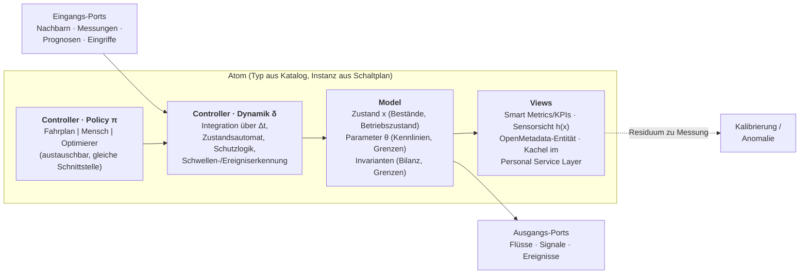
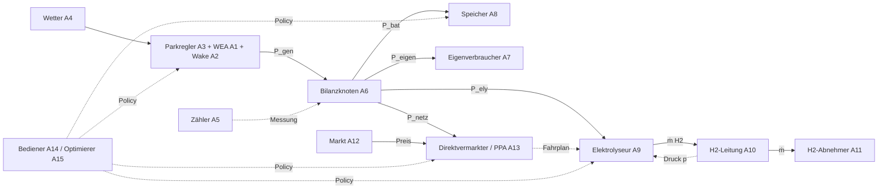
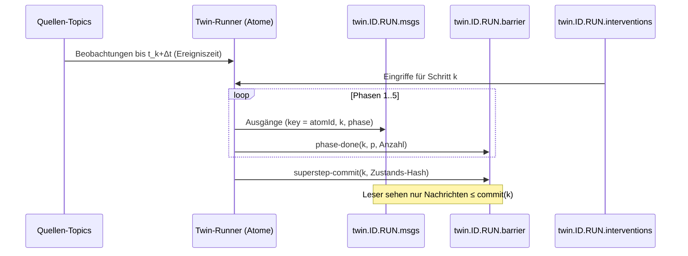

# OpenTSx – Digitaler Zwilling als Verbund atomarer Elemente (Konzept, P9)

> Status: **Vorschlag zur Diskussion**, 2026-10-12. **Der Zwilling mit seinen drei Betriebsarten ist der Kern der
> Roadmap**; alle drei Betriebsarten werden in beiden Ausführungsvarianten ermöglicht (§4.3, §10). Ausgangspunkt: Projektgespräch zum Verbund aus Windpark,
> Elektrolyseur, H2-Leitung, Speicher, Eigenverbrauch und Vermarktung. Baut auf
> [05-SMART-TOPICS](05-SMART-TOPICS.md) (Smart Topics, Personal Service Layer) und
> [06-SYSTEMREKONSTRUKTION-OPTIMIERUNG](06-SYSTEMREKONSTRUKTION-OPTIMIERUNG.md) (Rekonstruktion, Simulation,
> Optimierung) auf. Umsetzung als **Phase P9** in [TASK-011](../../EVOLUTION/TASK-011-datamodel-refresher-2026.md).
> Personen, Vertragspartner und Förderfragen aus dem Gespräch sind bewusst nicht Teil dieses Dokuments; Partner
> erscheinen nur als Rollen.

---

## 1. Kurzfassung

Der Zwilling ist **kein ML-Modell**, sondern ein **Anlagenmodell**: eine Verschaltung von Standardbauteilen
(„atomare Elemente“), deren Zustände sich in festen Takten durch Wechselwirkung ändern. Eine menschliche
Entscheidung muss sich darin kausal durch die Kette fortpflanzen. Beispiel: Der H2-Abnehmer schließt den Schieber,
der Leitungsdruck steigt, nach etwa einer Stunde muss der Elektrolyseur abregeln, der Fahrplan wird verletzt, der
Direktvermarkter muss mehr Strom vermarkten.

Vorschlag in vier Sätzen:

1. **Jedes Element ist ein Atom mit Modell, Sichten und Steuerung (MVC)**. Die Steuerung wird getrennt in
   *Dynamik* (wie die Anlage physikalisch bzw. regelbasiert reagiert, fest) und *Policy* (wie sie gefahren wird,
   austauschbar zwischen Fahrplan, Mensch und Optimierer). Wir nennen das **MVC+P**.
2. **Der Zwilling ist ein Schaltplan**: ein YAML, das Atome aus einem Katalog über typisierte Ports verbindet. Die
   Bauteile sind Standard, die Verschaltung ist je Anlage individuell. Das ist der Hebel für die Übertragbarkeit auf
   andere Parks.
3. **Ausführung als geschichtetes BSP** (Bulk Synchronous Parallel): Superschritte im Basistakt 1 min, innerhalb
   eines Superschritts feste Phasen in topologischer Ordnung, Barriere über ein Kontroll-Topic, deterministisch und
   damit replaybar.
4. **Zwei Ausführungsvarianten, beide gleichrangig**: *eng gekoppelt* als ein Prozess (Twin-Runner, alle Atome im
   Prozess, harte Barriere) und *lose gekoppelt* über Smart Topics (Atome als eigenständige Prozessoren, Kopplung nur
   über Topics und Ereigniszeit). Alle drei Betriebsarten (Shadow, What-if, Prognose/MPC) laufen in beiden. Gelernte
   Teilmodelle sind ohnehin Smart Topics, und der Zwilling publiziert als abgeleitetes Smart Topic. Wann die lose
   Kopplung dasselbe Ergebnis liefert wie die enge, und was sie dafür kostet, ist eine eigene Forschungsfrage (§10).

---

## 2. Atomare Elemente

### 2.1 Was ein Atom ist

Ein Atom `a` ist das kleinste Element mit eigenem Zustand, eigenen Parametern und eigener Verantwortung für seine
Bilanz. Formal, pro Superschritt `k` mit Schrittweite `Δt`:

```
u_a(k)   = gather( y_b(k)  für Verdrahtungen b → a, die in einer früheren Phase von k liegen,
                   y_b(k-1) für alle übrigen Verdrahtungen,
                   obs_a(t_k), forecast_a(t_k), intervention_a(k) )
x_a(k+1) = δ_a( x_a(k), u_a(k), π_a(k), θ_a, Δt )        Dynamik (Controller, Teil 1)
π_a(k)   = policy_a( x_a(k), u_a(k), Ziele )                Policy  (Controller, Teil 2)
y_a(k)   = h_a( x_a(k), u_a(k) )                            Ausgänge an Nachbarn
v_a(k)   = { view_i( x_a(0..k) ) }                          Sichten (View)
```

Drei Arten von Größen werden unterschieden:

| Art | Beispiele | Regel |
|-----|-----------|-------|
| **Bestand** (stock) | SoC, Linepack/Druck, Zählerstände, Stapeltemperatur | nur das Atom selbst ändert ihn, durch Integration über `Δt` |
| **Fluss** (flow) | kW, kg H2/h, m³/h | über Ports ausgetauscht; Bilanzknoten prüfen Erhaltung |
| **Signal** | Preis, Sollwert, Fahrplan, Prognose, Status | über Ports ausgetauscht, keine Erhaltung |

### 2.2 MVC+P je Atom



| Teil | Inhalt | Persistenz in OpenTSx |
|------|--------|-----------------------|
| **Model** | Zustand, Parameter, Invarianten; Avro-Schema je Atomtyp | Zustandsreihen als v2-Episoden (`twin.<atom>.<var>`, Tags `twin`, `run`), Snapshots in Iceberg |
| **View** | reine Funktionen der Zustandshistorie. Wichtigste Sicht ist die **Sensorsicht `h(x)`**: Was würde ein Zähler/Sensor messen? Das Residuum *Messung − Sensorsicht* treibt Kalibrierung und Anomalieerkennung. | Smart Metrics, Statistik (P4), OpenMetadata (Lineage zum Lauf) |
| **Controller · Dynamik** | physikalische bzw. regelbasierte Reaktion: Integration, Rampen, Schutzabschaltung, Ereignisse mit exaktem Zeitpunkt (Nulldurchgang innerhalb von `Δt`) | Code im Atomtyp, versioniert; Ereignisse als Episoden mit `segmentation=FEATURE_THRESHOLD` |
| **Controller · Policy** | wer entscheidet: Fahrplan, Mensch, Optimierer (P8.4) | Eingriffslog (Topic), jeder Eingriff mit Urheber und Begründung |

Warum MVC hier passt, und wo es gestreckt wird:

* **Single Source of Truth.** Das Modell ist die einzige Stelle mit Zustand. Sichten sind billig und beliebig viele.
  Das ist genau der klassische MVC-Gewinn.
* **„Controller“ heißt hier Nachrichtenverarbeitung**, nicht UI-Eingabe. Die UI im Personal Service Layer ist nur
  *eine* Quelle von Eingriffen.
* **Die Trennung Dynamik/Policy ist der eigentliche Mehrwert.** Nur so ist die Forderung aus dem Gespräch erfüllbar,
  dass sich bei einer menschlichen Entscheidung die Zahlen konsistent ändern: Die Entscheidung tauscht bzw. übersteuert
  die Policy, die Dynamik bleibt dieselbe. Mensch und Optimierer sind über dieselbe Schnittstelle austauschbar, und
  ein Optimierervorschlag kann vor der Freigabe im Zwilling durchgespielt werden.

### 2.3 Atomkatalog (Vorschlag für den PoC-Verbund)

| # | Atom | Model (Zustand · Parameter) | Dynamik δ | Policy π | Views | Datenquelle |
|---|------|-----------------------------|-----------|----------|-------|-------------|
| A1 | **WEA** | Status, P, v_eff, Gier-/Pitchwinkel, Ct · Leistungs-/Ct-Kennlinie, Position | Kennlinie mit Wake-Defizit, Sollwertfolge, Rampen | Abregelung, Gierversatz (Wake-Steering) | Leistungskurvenabweichung, Verfügbarkeit, PI (P5) | SCADA (IEC 61400-25), Simulator |
| A2 | **Wake-Kopplung** (Relationsatom) | sektorabhängige Defizitmatrix · Wake-Decay | Defizite aus Richtung und Ct der Oberlieger | – | Wake-Graph je Sektor; Vergleich Ground Truth vs. rekonstruiert (P8) | Simulator (Wahrheit), Rekonstruktion (Schätzung) |
| A3 | **Parkregler** | Park-Sollwert, Netzvorgaben · Grenzwerte | verteilt Sollwerte auf WEA, hält Netzanschlussgrenzen | Vorgaben Netzbetreiber, Vermarkter | Park-P, Abregelverluste | Leitsystem-/Parkreglerschnittstelle |
| A4 | **Wetter** | gemessene und prognostizierte Felder je Ort und Vorlaufzeit | Auswahl jüngster Prognose, Bias-Korrektur | – | Prognosegüte je Vorlaufzeit | DWD Open Data, Parkmast |
| A5 | **Zähler / Messpunkt** | Zählerstände, P, Q · Registerkarte, Wandlerfaktoren, OBIS-Kennzahl | Zählerstand → Leistung, Plausibilität, Lückenbehandlung | – | abrechnungsrelevante Energie | Modbus (Netzbetreiber-Zähler) |
| A6 | **Bilanzknoten / Messkonzept** | Verteilregel (Prioritäten) | löst die Leistungsbilanz **innerhalb** des Schritts: Erzeugung = Eigenverbrauch + Direktbelieferung + Elektrolyse + Speicher + Netz | Prioritätenfolge (Eigenverbrauch vor Markt) | Direktbelieferungsanteil, Einspeisung, Bilanzfehler | abgeleitet |
| A7 | **Eigenverbraucher / Direktabnehmer** | Lastgang, Flexibilität · Anschlussleistung | Last aus Messung oder Profil | Lastverschiebung (falls flexibel) | Deckungsgrad aus Eigenerzeugung | Zähler, historische Lastgänge |
| A8 | **Batteriespeicher** | SoC, P, SoH · Kapazität, Wirkungsgrade, C-Rate | SoC-Integration mit Grenzen und Verlusten | Lade-/Entladefahrplan | Zyklen, SoC-Verlauf, Erlösbeitrag | Speicher-EMS (falls vorhanden) |
| A9 | **Elektrolyseur** | Betriebszustand (aus/Standby/warm/Rampe/Betrieb), P_el, H2-Fluss, Stapeltemperatur · Mindestlast, Rampenraten, spez. Verbrauch kWh/kg | Zustandsautomat, Rampen, **Schutzabregelung bei Leitungsdruck > Grenze** | Fahrplan (vom Betreiber oder selbst erzeugt) | Fahrplantreue, spez. Verbrauch, kg H2 | Steuerung des Betreibers (S7-SPS) über vereinbarte Schnittstelle |
| A10 | **H2-Leitung / Puffer** | Druck p, Masse (Linepack) · Volumen, p_min/p_max, Temperatur | `dp/dt = (ṁ_in − ṁ_out)·R·T/V`; **Zeit-bis-Grenze** als Ereignis | – | Pufferfüllstand, Zeit bis Auswirkung | Druckmessung des Betreibers |
| A11 | **H2-Abnehmer** | Abnahme, Schieberstellung | Abnahme nach Messung/Profil; Störung = Schieber zu | Abnahmeprofil | gelieferte kg, Störungsdauer | Betreiber/Abnehmer |
| A12 | **Markt** | Day-Ahead-/Intraday-Preise, Ausgleichsenergiepreis | Preisreihe (gemessen, Szenario oder Prognose) | – | Erlös, Preisprofil | Börsen-/Transparenzdaten |
| A13 | **Direktvermarkter / Fahrplan / PPA** | Fahrplan (15 min), Prognose, Vertragspflichten | Abweichung, Ausgleichsenergie, Nachhandel | Vermarktungsstrategie | Abweichungskosten, PPA-Erlös | Prognose- und Fahrplandaten des Vermarkters |
| A14 | **Bediener** (Mensch) | – | – | Eingriffe: Sollwerte, Fahrplanübersteuerung, Freigaben | Entscheidungslog mit Wirkung | Personal Service Layer |
| A15 | **Optimierer** (Policy-Atom) | Horizont, Ziel, Nebenbedingungen | – | rollierender Horizont (MPC), schreibt Sollwerte/Fahrpläne | Optimalitätslücke, Mehrerlös gegen Referenz | P8.4 |

Spätere Erweiterungen bleiben im selben Schema: PV-Anlage, CMS-Daten (Schwingungsüberwachung) als zusätzliche
WEA-Ports, weitere Parks.

**Reflexion zur Granularität.** Ein Atom ist so klein, dass es eine eigene Bilanz und eigene Parameter hat, und so
groß, dass seine Ports fachlich benennbar sind. Die WEA ist ein Atom, ihr Getriebe nicht (das wäre ein CMS-View).
Die **Wake-Kopplung wird ein eigenes Relationsatom**, weil sie lernbare Parameter hat und der Gegenstand der
Rekonstruktion (P8) ist. Ein bloßer Draht im Schaltplan wäre dafür zu wenig.

---

## 3. Der Schaltplan (Twin-Konfiguration)

Bauteile aus dem Katalog, Verschaltung je Anlage, typisierte Ports mit Einheit. Der Plan wird wie ein
`Scenario`-YAML des Windpark-Simulators versioniert und gehasht. Der Hash geht in die Lineage jedes Laufs ein.

```yaml
twin: verbund-poc
baseStep: PT1M
atoms:
  park:     { type: windpark, turbines: from-catalog, wake: { model: jensen, sectorDeg: 30 } }
  wetter:   { type: weather,  source: dwd-mosmix, station: auto-nearest }
  nvp:      { type: meter, protocol: modbus-tcp, registerMap: maps/netzbetreiber-zaehler.yaml }
  bilanz:   { type: balance, priority: [eigenverbrauch, direktabnehmer, elektrolyse, speicher, netz] }
  ely:      { type: electrolyzer, minLoadKw: …, rampKwPerMin: …, kwhPerKg: …, policy: fahrplan }
  leitung:  { type: h2-line, volumeM3: …, pMinBar: …, pMaxBar: … }
  abnehmer: { type: h2-offtake }
  markt:    { type: market, mtu: PT15M }
  vermarkter: { type: direct-marketer, schedule: source:vermarkter-fahrplan }
wiring:
  - park.p_out        -> bilanz.p_gen
  - ely.p_el          -> bilanz.p_ely
  - bilanz.p_grid     -> vermarkter.p_actual
  - ely.h2_out        -> leitung.m_in
  - abnehmer.m_out    -> leitung.m_out
  - leitung.p         -> ely.p_downstream          # Schutzabregelung
  - wetter.wind_fc    -> park.wind_fc
  - markt.price       -> vermarkter.price
  - nvp.p_meas        -> bilanz.p_grid_meas        # Sensorsicht vs. Messung
```



Das ist die Antwort auf die Frage aus dem Gespräch nach der Übertragbarkeit. Die Plattform und der Atomkatalog sind
Standard, ein neues Projekt braucht einen neuen Schaltplan, Registerkarten und Quellen-Mappings. Für die Bewertung
eines neuen Parks mit Direktleitung reichen historische Lastgänge des Abnehmers, eine Ertragsprognose und der
Bilanzknoten (Stufe A, §6).

---

## 4. Ausführung: geschichtetes BSP

### 4.1 Superschritt

Reines BSP (alle Atome parallel, Nachrichten wirken erst im nächsten Schritt) entspricht einer Jacobi-Kosimulation.
Das ist für Bestände unkritisch, für die **Leistungsbilanz aber falsch**: Erzeugung, Verbrauch und Netzbezug müssen
im *selben* Schritt aufgehen. Deshalb schlage ich ein **geschichtetes BSP** vor. Ein Superschritt besteht aus festen
Phasen in topologischer Ordnung der Verdrahtung, jede Phase endet mit einer Barriere. Zyklen im Schaltplan sind nur
über Schrittgrenzen erlaubt (Verzögerung `Δt`, z. B. Leitungsdruck → Elektrolyseur). Der Runner prüft das beim
Laden.

| Phase | Atome | Ergebnis |
|-------|-------|----------|
| 0 · Quellen (`SOURCES`) | Markt, Abnehmer, Betriebsvorgaben, Zähler | exogene Werte; Messungen, Prognosen und Eingriffe des Intervalls `[t_k, t_k+Δt)` sind gebunden |
| 1 · Policy (`POLICY`) | eigenständige Policy-Atome (Fahrplan, Optimierer) | Sollwerte für diesen Schritt |
| 2 · Anlagen (`ASSETS`) | Erzeugung, Elektrolyseur, Speicher | Arbeitspunkt aus Sollwert, Grenzen, Rampen, Schutzlogik; die Atom-Policy läuft unmittelbar vor der Dynamik |
| 3 · Bilanz (`BALANCE`) | Bilanzknoten | Netzsaldo, Direktbelieferung nach Prioritäten, Residuum zur Messung |
| 4 · Flüsse (`FLOWS`) | H2-Leitung, Vermarkter | neue Bestände und Konten, Ereignisse mit exaktem Zeitpunkt |
| 5 · Views (`VIEWS`) | abgeleitete Sichten | Smart Metrics |

*Umgesetzt (PoC, `opentsx-twin`):* Die Phasen sind so benannt wie im Code. Ein Eingang erhält den Wert desselben
Schritts, wenn seine Quelle in einer früheren Phase liegt, sonst den des vorigen Schritts; Rückkopplungen kreuzen
damit immer die Schrittgrenze. Ein Wert bei Schritt `k` beschreibt das Ende des Intervalls `[t_k, t_k+Δt)`.

Die Ausführung ist **mehrratig**. Der Basistakt beträgt 1 min, das reicht für Linepack, Elektrolyseurrampen und
Speicher. Jedes Atom hat einen Takt als ganzzahliges Vielfaches davon: Markt und Fahrplan 15 min, Wetter 1 h. Die
WEA-Dynamik im Sekundenbereich wird nicht im Zwilling gerechnet. Sie kommt als 1-min-Aggregat aus der Statistik (P4)
bzw. aus dem Simulator. Ereignisse innerhalb eines Schritts (Druckgrenze erreicht) werden mit exaktem Zeitpunkt
gemeldet und wirken ab dem nächsten Schritt. Die maximale Reaktionsverzögerung von `Δt` wird dokumentiert.

### 4.2 Topics und Barriere unter KafScale-Bedingungen



* **Ohne Transaktionen und idempotenten Producer**: Jede Nachricht hat eine deterministische Id
  `(run, k, phase, atom)`, Duplikate werden beim Lesen verworfen. Der Commit-Datensatz enthält die erwartete Anzahl
  und einen Zustands-Hash. Das entspricht dem Muster aus P2 (manuelle Zuweisung, Checkpoint-Dateien).
* **Determinismus**: gleicher Schaltplan, gleiche Eingangsepisoden, gleiches Eingriffslog und gleiche Code-Version
  ergeben bitgleiche Zustände. Ein Lauf ist damit eine Lineage-Einheit
  (`schaltplanHash × eingangsHash × eingriffsHash × version`). Replay-Verifikation wie bei den Episoden.
* **Zustand**: Snapshots alle N Schritte in Iceberg (`twin_state`). KafScale kennt keine Compaction, der neueste
  Zustand wird über den Checkpoint gelesen.

### 4.3 Wo Smart Topics hingehören

Beide Varianten werden gebaut. Sie teilen Atomvertrag, Schaltplan und Topic-Vertrag, sodass dasselbe Atom ohne
Änderung in beiden läuft.

| Variante | Kopplung | Synchronisation | Stärken | Grenzen |
|----------|----------|-----------------|---------|---------|
| **T – eng, ein Prozess** („im Kleinen“) | Methodenaufruf im Prozess; Topics nur für Ein-/Ausgabe | geschichtetes BSP mit harter Barriere (§4.1) | deterministisch, bitgleiches Replay, Bilanz exakt im Schritt, schnell für Experimente und What-if-Läufe | ein Eigentümer, ein Ausfallbereich, skaliert nur vertikal |
| **L – lose, Smart Topics** | jedes Atom (bzw. jeder Atomtyp, Instanzen als Schlüssel) ist ein Smart-Topic-Prozessor; Kopplung nur über Port-Topics | Ereigniszeit-Watermarks statt globaler Barriere; begrenzte Veraltung (*bounded staleness*, SSP) bis asynchron; Bilanzknoten als eigener Prozessor mit Ausgleichsschritt | Atome können bei verschiedenen Eigentümern laufen (z. B. der Elektrolyseur beim Betreiber, nur Ports werden geteilt), unabhängig deploybar, ausfalltolerant, horizontal skalierbar, Datenhoheit | Ergebnis kann von T abweichen; Erhaltung und Kausalordnung müssen explizit gesichert werden |

Eine Variante je Atom-*Instanz* als eigenes Topic wird nicht verfolgt: Instanzen sind Schlüssel innerhalb des
Topics ihres Atomtyps.

Gerade die lose Kopplung passt zur Realität des Verbunds: Elektrolyseur, Zähler und Vermarktung gehören
verschiedenen Parteien. Ein Zwilling, dessen Atome dort laufen, wo die Daten liegen, und der nur Ports austauscht,
setzt die Föderationsidee aus P7d/P8.5 auf der Ebene des Anlagenmodells fort.

Smart Topics übernehmen in beiden Varianten drei Rollen:

1. **Prognose-Ports**: Wind- und Leistungsprognose, Last, Preise. Das sind P7-Modelle mit MLflow-Alias.
2. **Schätzer für fehlende Daten**: Elektrolyseurlast, solange keine Betriebsdaten fließen; Abnahmeprofil. Damit lässt
   sich, wie im Gespräch gefordert, *„plausibel rechnen, als ob man echte Daten hätte“*.
3. **Der Zwilling als Smart Topic**: Zustandsreihen und Smart Metrics als abgeleitetes Topic, die Prediction-API wird
   um **What-if** erweitert: Eingriffsfolge rein, Zustandsverlauf und KPI-Differenz raus.

### 4.4 Datenqualitätsleiter und Provenienz

Jeder Portwert trägt eine Herkunftsklasse. Fehlt die höhere Klasse, greift die nächste:

`MEASURED > REPORTED (Partner, Fahrplan) > FORECAST > ESTIMATED (Smart Topic) > SYNTHETIC (Simulator/Profil)`

Die Klasse eines Ausgangs ist das Minimum seiner Eingänge (Taint-Propagation). Jede KPI zeigt damit, zu welchem Anteil
sie auf Messung beruht. Erst so lässt sich eine Potenzialabschätzung ehrlich berichten.

---

## 5. Betriebsarten: ein Zwilling, drei Bindungen

Dieselben Atome, unterschiedlich gebundene Eingänge:

| Modus | Eingänge | Zweck | Beispiel aus dem Gespräch |
|-------|----------|-------|---------------------------|
| **Shadow** (Nowcast) | Live-Messungen, Rest geschätzt | Zustandsschätzung, Residuen, Anomalien | nicht gemessene Größen sichtbar machen, Zählerplausibilität |
| **Replay / What-if** | historische Episoden + geändertes Eingriffslog | kontrafaktische Fahrweisen | Belieferung nach PPA-Fahrweise schon vor der offiziellen Umstellung des Messkonzepts „üben“, inkl. Prognose- und Fahrplandaten des Vermarkters |
| **Prognose / MPC** | Prognosen, Optimierer als Policy | Fahrplanvorschläge, Frühwarnung | Druckanstieg → „noch ~1 h bis Abregelung“ → Fahrplananpassung vorschlagen |

### Abnahmeszenarien

| Id | Szenario | Abnahmekriterium |
|----|----------|------------------|
| S1 | **H2-Kette**: Abnehmer schließt Schieber → Druck steigt → Zeit-bis-Grenze → Elektrolyseur regelt ab → Fahrplanabweichung → Mehrvermarktung | Kette mit Zeitstempeln reproduziert; ein Eingriff (z. B. Speicher laden, Abregelung vorziehen) ändert alle nachgelagerten Zahlen konsistent; Bilanzfehler 0 |
| S2 | **Potenzial** aus historischen Daten: Überlappung von Erzeugung und Verbrauch, Direktbelieferungsanteil vs. Einspeisung | nur Zähler, Bilanzknoten, Markt; Bericht mit Herkunftsanteilen (§4.4) |
| S3 | **PPA-Schattenbetrieb**: Fahrplan und Prognose des Vermarkters gegen tatsächliche Erzeugung | Abweichungsstatistik je 15 min, Kosten der Abweichung |
| S4 | **Wake**: Park-Atom mit Jensen-Kopplung reproduziert die Simulator-Ground-Truth; rekonstruierter Graph (P8) dagegen geprüft | Precision/Recall je Sektor (P8.1) |

---

## 6. Stufen mit Wertschranke (gegen „zu groß für das Ziel“)

Im Gespräch kam die berechtigte Sorge, das Vorhaben könnte größer sein als sein Nutzen, solange der Mehrwert nicht
abschätzbar ist und der Elektrolyseur nicht in eigener Hand liegt. Darum wird gestuft. Jede Stufe liefert für sich
einen Nutzen und endet an einer Entscheidungsschranke.

| Stufe | Inhalt | braucht Simulation? | Schranke |
|-------|--------|---------------------|----------|
| **A – Daten & Potenzial** | Adapter (Modbus, DWD, Markt, Partnerdaten), Metrikkatalog, Spiegelung mit Validierung; S2 | nein | Größenordnung des Mehrwerts in €/a mit Herkunftsanteilen |
| **B – Shadow & Replay** | Atomvertrag, Runner, einfache Atommodelle; S3 | ja, regelbasiert | Abweichungsstatistik belastbar |
| **C – Kausalketten** | Elektrolyseur-, Leitungs-, Abnehmer-Atome mit Betriebsdaten; S1 | ja | Kette mit echten Daten bestätigt |
| **D – Optimierung** | Optimierer als Policy (P8.4), MPC, Vorschläge im Service Layer | ja | Mehrerlös gegen Referenzfahrweise im Replay |

Zusätzlich ist vor Stufe B ein **Screening Stand der Technik** vorgesehen, wie im Gespräch empfohlen. Zu prüfen sind
Kosimulations-Frameworks und -Standards wie mosaik, HELICS und FMI 3.0 (Atome als FMUs?) sowie
Energiesystemwerkzeuge wie pandapower, PyPSA und oemof. Erst danach fällt die Entscheidung, ob der Runner selbst
gebaut oder ein bestehender Kosimulationskern angebunden wird. Der Atomvertrag (§2) bleibt in beiden Fällen gleich.

---

## 7. Datenzugang aus dem Gespräch (Stufe A)

| Baustein | Inhalt | Anschluss an OpenTSx |
|----------|--------|----------------------|
| **Modbus-Modul** (generisch) | Modbus TCP/RTU, Registerkarten als YAML (Adresse, Typ, Skalierung, Einheit, OBIS-Kennzahl), Pollintervall | `RawReading` → Normalizer (wie Windpark-`SourceMapping`) → Episoden |
| **IEC 60870-5-101/-104** | Datenaustausch über die Parkrechner-Schnittstelle, die für den Elektrolyseurbetreiber vorgesehen ist; Gegenrichtung: dessen Betriebsdaten (Last, Druck, Abnahme) | eigener Adapter, gleiche Normalisierung |
| **Elektrolyseur-Steuerung** | Daten laufen beim Betreiber auf einer S7-SPS zusammen; Zugriff nur über eine vereinbarte Schnittstelle (104, OPC UA oder Export) | Quelle mit Herkunft `REPORTED` |
| **DWD-Sammler** | Open-Data-Prognosen (MOSMIX/ICON) und Messungen, automatischer Abruf, Stationsauswahl je Standort, optional deutschlandweit vorhalten | Wetter-Atom, Episoden je Station/Variable/Vorlaufzeit |
| **Markt- und Partnerdaten** | Preise; Prognosen und Fahrpläne des Direktvermarkters; Leitsystem-API (Schnittstellenbeschreibung ausstehend) | Abruf per API; wo keine API existiert, zeitgesteuerter Abruf mit Formatkonvertierung |
| **Einzelne Datenpakete** | punktuell eingespielte historische Reihen mit Quelle und Zeitraum | Batch-Import-CLI mit Herkunftsmetadaten |
| **Metrik-Metadatendienst** | Katalog für neue Kanäle (Zähler, Elektrolyse, Speicher, H2) analog zum IEC-Katalog | OpenMetadata-Publisher (P4) |
| **Spiegelung zur lokalen Analyse** | Kafka-Spiegelung über einen temporären SSH-Tunnel; **technische Validierung** (Offsets, Anzahl, Bytes, Hash) und **fachliche Validierung** (je Metrik identische Sketches/Statistiken, mergebar aus P4) | Replay-Verifikation (P2), Statistik (P4) |
| **OpenTSDB-Projektion** | optionale Darstellungsschicht | vorhandener Store-Adapter (P3) |

**Sprache (Reflexion zum Neubau in Go/Rust).** Die Verträge (Avro v2, Topic-Layout, Kantentabelle, Atomvertrag) sind
sprachneutral. Kleine Edge-Sammler (Modbus, 104, DWD) als Go- oder Rust-Binaries sind sinnvoll: geringer Footprint und
einfach zu verteilen. Ein Neubau des Kerns lohnt sich erst, wenn Stufe B den Nutzen gezeigt hat. Bis dahin bindet er
Kraft, die für Datenzugang und Potenzialabschätzung gebraucht wird.

---

## 8. Wake-Graph als Simulationsreferenz (präzisiert)

„Wahrer Wake-Graph“ heißt in P8.0: **der Graph, den der Simulator zur Erzeugung der Daten verwendet hat**. Er ist
eine Simulationsreferenz, kein Messergebnis. `opentsx-windpark` rechnet die Wakes bereits mit dem Jensen-Modell
(`WakeModel`, alle 10 s aus Richtung und Ct der laufenden Anlagen neu). Der Export braucht also kein neues Modell,
nur eine Offenlegung.

| Festlegung | Vorschlag |
|------------|-----------|
| Richtungskonvention | meteorologisch: Richtung, *aus der* der Wind kommt, Grad im Uhrzeigersinn ab Nord |
| Sektoren | 12 × 30°, Mitten 0°, 30°, …; Sektor = `[Mitte − 15°, Mitte + 15°)` |
| Kante `A → B` | B liegt für mindestens eine Richtung des Sektors (1°-Raster) im Wake-Kegel von A (`lateral < D/2 + k·s`, `s > 0`) |
| Kantengewichte | mittleres Defizit über die Sektorrichtungen, Maximum, Abdeckungsanteil (Anteil der Richtungen mit Wirkung), Abstand in Rotordurchmessern |
| Referenz-Ct | Ct bei 8 m/s (Teillast). Ct-Abhängigkeit als zusätzliche Tabelle für 4, 8 und 12 m/s |
| Dynamische Wahrheit | zusätzlich das tatsächlich verwendete Kantenlog des Laufs: je 10-s-Schritt die aktiven Paare mit Defizit > Schwelle, als Kantenepisoden. Das ist die strengste Referenz, weil Stillstände und Abregelung (Ct = 0) Kanten abschalten. |
| Kennzeichnung | `gt.source=simulator`, `gt.kind=wake`, Szenario-Hash, Anlagen-Ids aus dem Katalog |
| Format | Kantentabelle nach P8.0-Schema (Iceberg), zusätzlich CSV |

Grenzen dieser Wahrheit: Das Jensen-Modell kennt weder atmosphärische Stabilität noch Wake-Mäander, Teilüberdeckung
der Rotorfläche oder vertikale Profile. Ein Graph je Sektor ist für einen realen Park eine Vereinfachung, denn die
Kopplung hängt auch von Betriebszustand und Atmosphäre ab. Für reale Daten bleibt der Graph daher eine Schätzung (P8),
die gegen diese Referenz nur auf Simulatordaten geprüft werden kann.

---

## 9. Offene Entscheidungen (Vorschläge)

| Nr. | Thema | Vorschlag |
|-----|-------|-----------|
| D18 | Atomvertrag | MVC+P, Avro-Schema je Atomtyp für Zustand und Ports, Atomkatalog als Standardbauteile, Schaltplan-YAML je Anlage |
| D19 | Ausführung | geschichtetes BSP, Basistakt 1 min, Mehrrate als ganzzahlige Vielfache, deterministisch, Barriere-Topic |
| D20 | Einbettung | **Entschieden (2026-10-12):** beide Varianten gleichrangig – eng gekoppelt als ein Prozess (T) und lose gekoppelt über Smart Topics (L); alle drei Betriebsarten in beiden; gemeinsamer Atom-, Schaltplan- und Topic-Vertrag |
| D21 | Datenqualität | Herkunftsleiter mit Taint-Propagation; KPIs zeigen Messanteil |
| D22 | Vorgehen | Stufen A–D mit Wertschranke; Stufe A ohne Simulation |
| D23 | Sprache | Kern bleibt Java; Edge-Sammler dürfen Go/Rust sein; kein Kern-Neubau vor Schranke B |
| D24 | Kosimulation | Screening (mosaik, HELICS, FMI 3.0) vor dem Bau eines eigenen Runners |

---

## 9a. Umsetzungsstand (PoC)

Modul [`opentsx-twin`](../../opentsx-twin/README.md): Atomvertrag MVC+P, Schaltplan-YAML mit Validierung,
Variante T mit geschichtetem BSP, Topic-Vertrag (`PortMessage`, `Barrier`) als Code, Herkunftsleiter,
Snapshots, alle drei Betriebsarten, Export der Zustandsreihen als v2-Episoden. Bausteine: Erzeugung, Markt,
H2-Abnehmer, Elektrolyseur, Batterie, Bilanzknoten, H2-Leitung, Direktvermarkter, Betriebsvorgaben. Szenario S1
läuft auf synthetischen Daten (`bin/opentsx twin`). Offen: Variante L, Avro-Schemas je Atomtyp, KafScale-Binding,
WEA/Wake/Wetter/Zähler-Atome, Optimierer (P8.4), echte Daten.

Oberfläche und LabVIEW-Brücke: [09-STUDIO-LABVIEW-STEUERPULT](09-STUDIO-LABVIEW-STEUERPULT.md).

Siehe auch: [10-BOOT-ZWILLING](10-BOOT-ZWILLING.md) – drittes Szenario, ein Boot (Etap 22) als Insel-Energiesystem
mit Powerstation, Solar und Landstrom, mit CSV-Import echter Betriebsdaten und Kalibrierung.

## 10. Forschungsfrage: eng vs. lose gekoppelte Zwillinge (Paper-Skizze)

**Arbeitstitel:** *Digital Twins on Logs – Synchronization Semantics from Bulk-Synchronous to Loosely Coupled Smart
Topics.*

**These.** Ein Zwilling aus atomaren Elementen lässt sich als ein deterministischer Prozess (BSP) oder als lose
gekoppelter Verbund von Stream-Prozessoren über ein Log (Kafka/KafScale) ausführen. Die lose Kopplung bringt
Eigentümergrenzen, Datenhoheit, unabhängige Deployments und Ausfalltoleranz, kostet aber Genauigkeit und
Reproduzierbarkeit. Wie viel, hängt messbar von der Kopplungsstärke und den Zeitkonstanten der Atome ab. Daraus
lässt sich eine Entwurfsregel ableiten, welche Kopplungen eng bleiben müssen.

**Einordnung (verwandte Arbeiten, zu prüfen):**
* BSP (Valiant 1990), Pregel; Stale Synchronous Parallel und asynchrone Parameter-Server aus dem verteilten ML.
* Parallele diskrete Ereignissimulation: konservativ (Chandy-Misra-Bryant) vs. optimistisch (Time Warp,
  Jefferson); HLA-Zeitmanagement (IEEE 1516).
* Kosimulation: FMI 3.0, mosaik, HELICS; Jacobi- vs. Gauss-Seidel-Kopplung, Fehlerabschätzungen der
  Kopplungsschrittweite.
* Stream Processing: Ereigniszeit und Watermarks (Dataflow-Modell), exactly-once über Logs.
* Digital Twins in Energiesystemen; föderiertes Lernen und Föderation über Betreibergrenzen.

**Forschungsfragen:**

| Nr. | Frage | Messgröße |
|-----|-------|-----------|
| RQ1 | Wann liefert die lose Kopplung (L) dasselbe Ergebnis wie die enge (T)? Fehlerschranke als Funktion von Veraltung `s`, Kopplungsstärke und Zeitkonstanten | Zustandsabweichung gegen T, KPI-Abweichung |
| RQ2 | Wie bleiben Erhaltungsgrößen (Leistungsbilanz, H2-Masse) unter loser Kopplung erhalten? Ausgleichsschritt, Bilanzknoten, Konservativ-Protokoll | Bilanzfehler je Schritt und kumuliert |
| RQ3 | Wie bleibt die Kausalordnung von Ereignissen und Eingriffen erhalten (z. B. „Schieber zu“ vor „Abregelung“)? | Anzahl Kausalverletzungen, Reaktionsverzögerung |
| RQ4 | Ist Replay ohne Transaktionen und idempotenten Producer (KafScale) reproduzierbar? Deterministische Ids, Watermark-Protokoll | bitgleiche Wiederholbarkeit, Abweichungsrate |
| RQ5 | Was kostet und bringt L: Latenz, Durchsatz, Erholung nach Ausfall eines Atoms, Betrieb über Eigentümergrenzen | End-to-end-Latenz, Erholungszeit, Datenbewegung |
| RQ6 | Funktionieren alle drei Betriebsarten (Shadow, What-if, MPC) in L? Insbesondere What-if-Verzweigungen und MPC-Horizonte über verteilte Atome | Laufzeit je Szenario, Ergebnisgleichheit mit T |

**Versuchsaufbau.** Gleicher Schaltplan, gleiche Eingänge, beide Varianten. Szenarien S1 (H2-Kette) und S3
(PPA-Schattenbetrieb), dazu synthetische Verbünde mit gesteuerter Kopplungsstärke, Störungen (verzögerte, fehlende,
doppelte Nachrichten, Atomausfall) und Größenskalierung. Referenz ist T, Ground Truth kommt aus dem Simulator.

**Erwarteter Beitrag.**
1. Synchronisationssemantik für Zwillinge auf einem Log, mit Entwurfsregel „was muss eng gekoppelt sein“.
2. Fehlerschranken und Messungen für BSP vs. SSP vs. asynchron an einem realistischen Energieverbund.
3. Offene Referenzimplementierung (OpenTSx) mit beiden Varianten und reproduzierbaren Szenarien.
