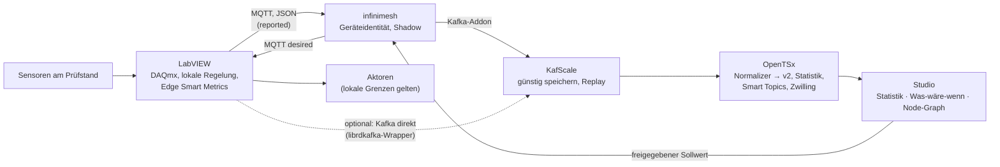

# OpenTSx – Smart Topics Studio, LabVIEW-Analogie und Steuerpult (Konzept)

> Status: **Konzept und Prototyp**, 2026-10-12. Gehört zu P7e (Personal Service Layer) und P9 (Digitaler Zwilling).
> Prototyp: [`docs/prototypes/smart-topics-studio.html`](../prototypes/smart-topics-studio.html) (statische Seite,
> Daten aus `opentsx-twin`, Szenario S1). Bezüge: [05-SMART-TOPICS](05-SMART-TOPICS.md),
> [07-DIGITAL-TWIN-BSP](07-DIGITAL-TWIN-BSP.md).

---

## 1. Kurzfassung

* **Studio:** Smart Topics bekommen eine Oberfläche mit drei Ansichten. Die **Statistik** zeigt die Zahlen, die
  **Prognose & Was-wäre-wenn** die möglichen Abläufe, der **Node-Graph** die Struktur.
* **Node-Graph:** Er ist der Schaltplan des Zwillings, gezeichnet als Blockdiagramm. Das kennt man aus Node-RED,
  NiFi und LabVIEW.
* **LabVIEW:** Die Analogie trägt weit. Der Unterschied liegt in der Rolle: LabVIEW regelt deterministisch am
  Prüfstand, OpenTSx überwacht, vergleicht und plant **über** vielen Prüfständen.
* **Der Kreis schließt sich.** LabVIEW berechnet am Gerät Smart Metrics und veröffentlicht sie (MQTT → infinimesh →
  KafScale). OpenTSx verdichtet, modelliert und schlägt Fahrweisen vor. Freigegebene Sollwerte gehen über den
  `desired`-Zustand von infinimesh zurück an LabVIEW. Dort entscheidet weiterhin die lokale Sicherheitslogik.
* **Voraussetzungen:** Es gibt keinen reifen Kafka-Client für LabVIEW und kein Avro. Am Rand spricht man deshalb
  JSON über MQTT, und OpenTSx normalisiert in das v2-Modell. Der Rückweg braucht eine Freigabe.

---

## 2. Die drei Ansichten des Studios

| Ansicht | Zeigt | Datenquelle | Prototyp |
|---------|-------|-------------|----------|
| **Statistik** („mathematische Variante“) | Reihenliste mit Herkunft (gemessen/gemeldet/Prognose/…), Kennwerte n, fehlend, Mittel, Std.-Abw., Min, P5, Median, P95, Max, Verlauf mit Ereignissen, Verteilung | Laufende Statistik (P4: Welford, Quantil-Sketch, DQ) bzw. Zwillingsreihen (`RunResult`) | ja |
| **Prognose & Was-wäre-wenn** | Vergleich Beobachtet ↔ Alternative mit Kennzahlen und Δ; Prognose ab „jetzt“ (Snapshot) mit austauschbarer Fahrweise; Ereignisliste | `Twin.whatIf`, `Twin.forecast`; später Prediction-API der Smart Topics (P7) | ja (vorberechnetes Raster) |
| **Node-Graph** | Bausteine als Knoten, Ports, Drähte; Spalten = Phasen eines Takts; durchgezogen = selber Takt, gestrichelt = nächster Takt; ◆ = extern gebundener Eingang; Zeitregler zeigt Werte an den Ports; Inspektor je Knoten | `TwinPlan` (Schaltplan), Schattenlauf | ja (nur ansehen) |

Regeln, die der Prototyp schon umsetzt:

* **Herkunft:** Jede Reihe zeigt, wie sie entstanden ist. Modellierte Werte sehen nie aus wie Messungen.
* **Kennzeichnung:** Was-wäre-wenn und Prognose heißen in der Oberfläche auch so und stehen mit ihrer Lauf-Id da.
* **Gleiche Basis:** Alternativen werden gegen dieselbe Ausgangslage verglichen (Referenz minus Alternative, wie in
  P8).

**Das Studio ist eine Sicht auf jedes modellierte System.** Ein System beschreibt sich über die Schnittstelle
`org.opentsx.twin.studio.StudioScenario`:

* Schaltplan
* Eingänge und Eingriffe des Referenzlaufs
* benannte Alternativen (Eingriffe, Fahrweisen, andere Annahmen)
* Prognosen ab Snapshots
* Smart Metrics, Vergleichsgrößen, Kennzahlen und Beschriftungen

`StudioExport` rechnet alle registrierten Szenarien und schreibt eine JSON-Datei. Die Oberfläche hat keine
Sonderfälle. Lange Läufe, etwa ein Jahr im Stundentakt, werden für die Anzeige auf höchstens 2000 Punkte je Reihe
gemittelt.

Szenarien:

* die Wasserstoffkette (umgesetzt)
* das Einfamilienhaus im Erzgebirge ([08](08-HAUS-ZWILLING.md); ein Jahr, für die Anzeige auf 5-h-Mittel verdichtet)
* das Boot Etap 22 ([10](10-BOOT-ZWILLING.md); 14 Tage im 15-Minuten-Takt)

Als **vierte Ansicht** ist **„Anlage erkunden“** vorgesehen: ein visuelles Inventar auf Karte, Grundriss oder
Decksplan, mit Hover-Karte, Datenblatt, Dokumenten und Wartung am selben Atom-Anker
([12-EXPLORATIVES-UI-INVENTAR](12-EXPLORATIVES-UI-INVENTAR.md), Prototyp
[`anlagen-explorer.html`](../prototypes/anlagen-explorer.html)).

Für den Ausbau vorgesehen:

* Den Node-Graph **bearbeiten**: Das Ziehen von Drähten ändert das Schaltplan-YAML, und die Plan-Validierung prüft
  sofort.
* **Live-Betrieb** über KafScale statt vorberechneter Läufe.
* Eingriffe mit **Freigabe-Workflow**: Bediener, Begründung, Grenzwertprüfung.
* **Sub-Graphen** (zusammengesetzte Bausteine, analog SubVI).
* Was-wäre-wenn-Läufe direkt aus der Oberfläche starten.

Der Prototyp lässt sich reproduzieren:

```bash
java -cp "$(bin/opentsx classpath opentsx-twin)" org.opentsx.twin.studio.StudioExport /tmp/studio.json
python3 tools/build_studio.py /tmp/studio.json      # schreibt docs/prototypes/smart-topics-studio.html
```

---

## 3. Analogie: LabVIEW, Node-RED, NiFi und OpenTSx

| LabVIEW | OpenTSx | Node-RED | NiFi |
|---------|---------|----------|------|
| Blockdiagramm | Schaltplan (`TwinPlan`), im Studio als Node-Graph | Flow | Process Group |
| Frontpanel | Studio-Ansichten Statistik / Prognose | Dashboard | UI |
| VI / SubVI | Baustein (Atom) / künftig zusammengesetzter Baustein | Node / Subflow | Processor |
| Draht (Datenfluss) | Port-Verbindung; im Betrieb ein Topic | Wire, `msg` | Connection, FlowFile |
| Knoten führt aus, wenn alle Eingänge anliegen | Phase im Takt (geschichtetes BSP); alle Eingänge eines Bausteins stehen vor seinem Schritt fest | pro Nachricht | Scheduler je Processor |
| Schieberegister / Feedback-Knoten | Zustand des Bausteins und Rückkopplungsdraht in den nächsten Takt | Context | State Manager |
| Queue, Channel Wire | KafScale-Topic | Wire | Queue mit Backpressure |
| Shared Variable / Tag | letzter Wert eines Smart Topics | – | – |
| Timed Loop, Real-Time, FPGA | **nicht** Aufgabe von OpenTSx; Takt 1 min, überwachend | – | – |
| – | Herkunft und Lineage je Wert | – | Provenance |

Quellen zur Semantik:

* LabVIEW: [Datenfluss](https://www.ni.com/docs/en-IN/bundle/labview/page/block-diagram-data-flow.html), [Feedback Node](https://www.ni.com/docs/en-US/bundle/labview-api-ref/page/functions/feedback-node.html), [Channel Wires](https://www.ni.com/en/support/documentation/supplemental/16/channel-wires.html)
* Node-RED: [Concepts](https://nodered.org/docs/user-guide/concepts)
* NiFi: [Overview](https://nifi.apache.org/docs/nifi-docs/html/overview.html)

**Kernunterschied.** In LabVIEW ist der Datenfluss die **Ausführung am Gerät**, mit harten Zeitgarantien auf RT oder
FPGA. In OpenTSx ist der Datenfluss ein **Modell des Systems**. Es läuft im Schatten mit, lässt sich zurückspulen,
verzweigen (Was-wäre-wenn) und vorausrechnen (Prognose). Beides ergänzt sich: LabVIEW ist die lokale Hand, OpenTSx das
gemeinsame Gedächtnis und der Planungstisch.

---

## 4. Steuerpult für die LabVIEW-Gemeinde: schließt sich der Kreis?



**Ja, der Kreis schließt sich, mit einer klaren Rollenteilung:**

1. **LabVIEW** führt die Sensoren am Gerät zusammen. Es berechnet dort, was nur lokal sinnvoll geht: Effektivwert,
   Spitzen, Spektren je Messlauf, Zustände. Diese Werte veröffentlicht es als **Edge Smart Metrics** mit Herkunft
   `MEASURED` und der berechnenden VI als Provenienz.
2. **KafScale** nimmt alles günstig auf und kann es exakt wieder abspielen.
3. **OpenTSx** normalisiert in das v2-Modell und rechnet über viele Prüfstände hinweg:
   * Statistik und Datenqualität
   * Smart Topics mit Prognosen
   * Zwilling für Was-wäre-wenn
   * Koordinationspotenzial (P8)
4. **Das Studio** ist das Steuerpult. Dort sieht man, vergleicht, simuliert und gibt frei.
5. **Der Rückweg** läuft über den `desired`-Zustand von infinimesh. LabVIEW übernimmt einen Sollwert nur innerhalb
   seiner lokalen Grenzen. Echtzeit und Sicherheit bleiben am Gerät.

### Faktenlage (Stand Oktober 2026)

| Thema | Befund | Folge |
|-------|--------|-------|
| Kafka aus LabVIEW | Kein reifer Client. Es gibt das Community-Projekt [LVKafka](https://github.com/sundeepChandhoke/LVKafka) (librdkafka-Wrapper, wenige Sterne, keine Releases, Lizenz nicht angegeben). Auf VIPM gibt es keine Treffer ([vipm.io](https://www.vipm.io/search/?q=kafka)). | Direktweg nur als Option |
| Avro in LabVIEW | Keine Bibliothek gefunden. Single-Object-Encoding (`C3 01`, 8 Byte Fingerprint, Avro-Binärdaten) wäre für ein flaches Schema in reinem G machbar; das ist eine Einschätzung, nicht erprobt. | Am Rand JSON, OpenTSx normalisiert |
| MQTT aus LabVIEW | Open-Source-Client des LabVIEW Open Source Project mit TLS-Erweiterung ([VIPM](https://www.vipm.io/package/labview_open_source_project_lib_mqtt_securedtcp_connection/), 0-BSD). Kommerziell gibt es WireQueue-MQTT ([NI Tools Network](https://www.ni.com/it-it/support/downloads/tools-network/download.wirequeue-mqtt-driver.html)). | Bevorzugter Weg |
| Client-Zertifikat-TLS | infinimesh verlangt auf 8883 ein Client-Zertifikat. Ein Forenbericht beschreibt Probleme mit Client-Zertifikaten in LabVIEW-TLS ([NI-Forum](https://ni.lithium.com/t5/LabVIEW/TLS-with-Client-Certificate/m-p/4244369)). | **vor Festlegung testen** |
| infinimesh → KafScale | Das Kafka-Addon schreibt JSON, Schlüssel ist die Geräte-Id ([infinimesh/addons](https://github.com/infinimesh/addons)). Es ist ausdrücklich auch für KafScale gedacht. | Brücke existiert |
| Bestandsdaten | TDMS-Dateien lassen sich mit npTDMS lesen ([PyPI](https://pypi.org/project/npTDMS/)). | TDMS-Import als schneller Nutzen |
| Lizenzen | Die LabVIEW Community Edition ist nur für private, nicht-kommerzielle Nutzung ([NI](https://ni.com/en/support/documentation/supplemental/20/labview-community-edition-usage-details.html)). Seit 2025 gibt es wieder Dauerlizenzen ([Emerson](https://www.emerson.com/en-us/news/2025/03-emerson-streamlines-embedded-software-test-for-hardware-in-the-loop-engineers)). | Publisher-Paket unter BSD/MIT über VIPM verteilen |
| NI-eigene Angebote | SystemLink (auch Kubernetes-basiert, [NI](https://ni.com/en-us/about-ni/newsroom/news-releases/ni-s-systemlink-enterprise-brings-competitive-edge-with-new-clou.html)); Emerson baut KI-Assistenz in LabVIEW aus ([automation.com](https://www.automation.com/article/emerson-reaches-milestone-ai-flagship-test-measurement-software-platform)) | OpenTSx positioniert sich offen und herstellerneutral daneben, nicht dagegen |

### Integrationswege (Rangfolge)

| Rang | Weg | Aufwand | Bemerkung |
|------|-----|---------|-----------|
| 1 | **LabVIEW → MQTT (JSON) → infinimesh → Kafka-Addon → KafScale → Normalizer** | niedrig–mittel | reifer MQTT-Client, keine DLL, Rückweg über `desired` inklusive; offen: Client-Zertifikat-TLS |
| 2 | **TDMS-Import** (npTDMS → Observations/Episoden) | niedrig | zurückgestellt (keine Bestände, 4a); Option für spätere Anwender |
| 3 | **OpenTSx-Publisher-Paket für LabVIEW** (VIs „DAQmx-Task → SmartMetric veröffentlichen“, JSON-Vertrag unten, später optional Avro) | mittel | macht die Brücke für LabVIEW-Nutzer greifbar; Pflege nötig |
| 4 | Kafka direkt (LVKafka/librdkafka, JSON) | mittel–hoch | unreif, native Bibliotheken je Plattform; KafScale: `enable.idempotence=false` |
| 5 | OPC UA / Sparkplug B | mittel | sinnvoll, wenn ein OPC-UA-Server ohnehin existiert ([LabVIEW OPC UA Toolkit](https://www.ni.com/en-us/shop/product/labview-opc-ua-toolkit.html)) |

### Vertrag für Edge Smart Metrics (Entwurf `opentsx.smartmetric.v1`, JSON)

Diese Form ist für LabVIEW einfach zu erzeugen (Cluster → JSON). Der OpenTSx-Normalizer bildet sie auf
`SeriesKey`/`Observation` bzw. `Episode` ab.

```json
{
  "schema": "opentsx.smartmetric.v1",
  "metric": "rig.motor.vibration_rms",
  "tags": { "rig": "P3", "sensor": "acc1" },
  "unit": "m/s^2",
  "ts": "2026-10-12T09:00:00.123456Z",
  "value": 1.234,
  "window": { "from": "2026-10-12T08:59:59.123456Z", "to": "2026-10-12T09:00:00.123456Z" },
  "origin": "MEASURED",
  "producer": { "tool": "LabVIEW", "vi": "VibrationRMS.vi", "version": "1.2.0" }
}
```

Für Blöcke gilt dieselbe Form mit `"t0"`, `"interval_us"` und `"values": [...]` statt `ts`/`value`; sie wird
als `Episode` (REGULAR) abgebildet. Die Payload kommt über MQTT unter `reported` oder als Wert im Kafka-Topic.
Zeiten sind UTC mit Mikrosekunden.

### Was OpenTSx für LabVIEW-Nutzer attraktiv macht

* Ein **VIPM-Paket mit Beispiel-VIs** veröffentlicht Smart Metrics in wenigen Minuten.
* Der **TDMS-Import** macht Bestandsdaten sofort vergleichbar.
* Studio, Smart Topics und Zwilling gibt es **ohne zusätzliche Lizenzkosten**. Alles ist offen und herstellerneutral.
* **Was-wäre-wenn und Prognose** lassen sich über mehrere Prüfstände rechnen, mit Herkunft jeder Zahl.
* Ein **klarer Rückweg mit Freigabe**. Die Echtzeit bleibt bei LabVIEW.

### Risiken

* **Pflege:** infinimesh wurde frisch neu aufgesetzt, die APIs sind beta. Deshalb nur lose über den Vertrag koppeln.
* **TLS mit Client-Zertifikat** aus LabVIEW ist ungeklärt.
* **Sicherheit des Rückwegs:** Sollwerte nur mit Freigabe, Grenzprüfung in LabVIEW und Rechten nach dem Prinzip der
  geringsten Rechte.
* **Erwartung:** OpenTSx ist keine Echtzeitregelung. Das muss klar kommuniziert werden.

---

## 4a. Entscheidungen vom 2026-10-12

* **Kein LabVIEW-Pilot vorerst.** Die Überlegung stammt aus der Laborpraxis. Der Aufhänger bleibt: LabVIEW-Anwender
  haben selten ein Datenmanagement. Hier setzt OpenTSx an, indem ein Smart Topic **direkt auf Sensoren abgebildet**
  wird.
* **Der Rückweg wird von Anfang an mitgedacht.** Steuerkommandos laufen in einem **Feedback-Topic** auf und werden
  dort auf LabVIEW-Aktoren abgebildet.
* **Keine TDMS-Bestände.** Der TDMS-Import fällt in der Rangfolge zurück und bleibt eine Option für spätere Anwender.

### Abbildung Sensor ↔ Smart Topic ↔ Aktor

Je Apparatur gibt es eine versionierte Abbildungsdatei, analog zur Registerkarte beim Modbus-Modul:

```yaml
apparatus: pruefstand-3
sensors:                                  # physischer Kanal -> Serie
  - channel: cDAQ1Mod1/ai0                # DAQmx-Kanal
    metric: rig.motor.vibration_rms
    tags: { rig: P3, sensor: acc1 }
    unit: m/s^2
    smartMetric: { window: PT1S, function: rms }
actuators:                                # Kommando-Ziel -> Ausgang an der Apparatur
  - target: rig.motor.speed_setpoint
    channel: cDAQ1Mod2/ao0
    unit: rpm
    limits: { min: 0, max: 3000, maxStepPerSecond: 100 }
    requiresApproval: true
```

Das Smart Topic eines Sensors hat damit einen festen Namen, eine Einheit und eine Herkunft (`MEASURED`, VI und
Version als Provenienz). Die Datenhaltung übernimmt OpenTSx: KafScale, Iceberg, Statistik und Metadaten.

### Feedback-Topic: Kommandos und Quittungen (Entwurf)

* **Kommandos:** `tsx.<domain>.commands.v1` (Schlüssel = Apparatur). Für Geräte hinter infinimesh wird dasselbe
  Kommando in den `desired`-Zustand gespiegelt.
* **Quittungen:** `tsx.<domain>.command-acks.v1`.

```json
{
  "schema": "opentsx.command.v1",
  "commandId": "01JA0Q3K8Z0000000000000000",
  "target": { "apparatus": "pruefstand-3", "actuator": "rig.motor.speed_setpoint" },
  "action": "set",
  "value": 1200,
  "unit": "rpm",
  "validFrom": "2026-10-12T10:00:00Z",
  "validUntil": "2026-10-12T10:15:00Z",
  "issuedBy": "twin:pruefstand-3@run-…",
  "approvedBy": "operator:mk",
  "reason": "Was-wäre-wenn W3 freigegeben"
}
```

```json
{ "schema": "opentsx.command-ack.v1", "commandId": "01JA0Q3K8Z0000000000000000",
  "status": "applied", "appliedValue": 1200, "ts": "2026-10-12T10:00:00.250Z", "detail": "" }
```

Regeln:

1. **Lokale Verriegelungen haben immer Vorrang.** LabVIEW prüft Grenzen, Schrittweite und Gültigkeit. Ein
   abgelaufenes Kommando wird nicht ausgeführt und mit `expired` quittiert, eines außerhalb der Grenzen mit
   `rejected`.
2. **Jedes Kommando bekommt eine Quittung:** `accepted`, `applied`, `rejected` oder `expired`.
3. **Herkunft im Zwilling:** Quittungen fließen als Ereignisse zurück. Ein angewendeter Sollwert wird im Zwilling zum
   `Intervention`-Eintrag mit Herkunft `REPORTED`. Damit sind Modell und Wirklichkeit vergleichbar.
4. **Idempotenz:** Weil KafScale keinen idempotenten Producer hat, ist die `commandId` deterministisch. Doppelte
   Zustellungen ignoriert die Apparatur.
5. **Freigabe:** Kommandos aus Optimierer oder Zwilling brauchen eine Freigabe im Studio, wenn `requiresApproval`
   gesetzt ist.

## 5. Roadmap-Einträge

* **P7e Studio:** die drei Ansichten produktiv (Live-Daten über KafScale, Statistik aus P4, Prediction-API aus P7),
  den Node-Graph bearbeitbar (Schaltplan-YAML mit Validierung) und Eingriffe mit Freigabe-Workflow.
* **LabVIEW-Brücke:**
  * JSON-Vertrag `opentsx.smartmetric.v1` als JSON-Schema mit Normalizer und Tests
  * TDMS-Import
  * Publisher-Paket (VIPM, BSD/MIT)
  * Test der Client-Zertifikat-TLS gegen infinimesh
* **infinimesh-Connector** (schon vorgemerkt) und der Rückweg `desired` mit Freigabe.

Die offenen Fragen von 2026-10-12 sind in §4a beantwortet.
