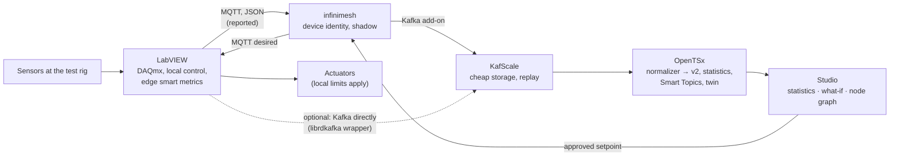

# OpenTSx: Smart Topics Studio, the LabVIEW analogy and the control desk (concept)

> Status: **concept and prototype**, 2026-10-12. Belongs to P7e (Personal Service Layer) and P9 (digital twin).
> Prototype: [`docs/prototypes/smart-topics-studio.html`](../prototypes/smart-topics-studio.html) (a static page,
> data from `opentsx-twin`, scenario S1). References: [05-SMART-TOPICS](05-SMART-TOPICS.md),
> [07-DIGITAL-TWIN-BSP](07-DIGITAL-TWIN-BSP.md).

---

## 1. Summary

* **Studio:** Smart Topics get a user interface with three views. **Statistics** shows the numbers, **forecast and
  what-if** the possible courses, the **node graph** the structure.
* **Node graph:** it is the wiring plan of the twin, drawn as a block diagram. This is familiar from Node-RED, NiFi
  and LabVIEW.
* **LabVIEW:** the analogy goes far. The difference lies in the role: LabVIEW controls deterministically at the test
  rig, OpenTSx monitors, compares and plans **across** many test rigs.
* **The loop closes.** LabVIEW calculates smart metrics at the device and publishes them (MQTT → infinimesh →
  KafScale). OpenTSx condenses, models and proposes operating modes. Approved setpoints go back to LabVIEW through
  the `desired` state of infinimesh. There the local safety logic still decides.
* **Prerequisites:** there is no mature Kafka client for LabVIEW and no Avro. At the edge the devices therefore
  speak JSON over MQTT, and OpenTSx normalizes into the v2 model. The way back needs an approval.

---

## 2. The three views of the Studio

| View | Shows | Data source | Prototype |
|------|-------|-------------|-----------|
| **Statistics** ("mathematical variant") | list of series with origin (measured, reported, forecast, ...), figures n, missing, mean, std. dev., min, P5, median, P95, max, course with events, distribution | running statistics (P4: Welford, quantile sketch, DQ) or twin series (`RunResult`) | yes |
| **Forecast and what-if** | comparison observed ↔ alternative with key figures and Δ; forecast from "now" (snapshot) with an exchangeable operating mode; list of events | `Twin.whatIf`, `Twin.forecast`; later the prediction API of the Smart Topics (P7) | yes (precomputed grid) |
| **Node graph** | building blocks as nodes, ports, wires; columns = phases of a time step; solid = same step, dashed = next step; ◆ = input bound from outside; a time slider shows the values at the ports; an inspector per node | `TwinPlan` (wiring plan), shadow run | yes (view only) |

Since the rework as a product interface the views are called **Overview** (new: the story of the scenario, the
sequence of events, the most important courses), **Compare** (formerly forecast and what-if), **System diagram**
(formerly node graph) and **Series** (formerly statistics). Above all views stands a summary with four key figures
(`StudioScenario.headline()`) and the question the scenario answers (`decision()`). In the system diagram the color of
a connection shows the energy carrier (electricity, hydrogen, heat, fuel, signal); connections across several
columns run in lanes of their own below the blocks. The switch "Technical details" shows ids, run ids and raw values.
Limits from `limits()` appear as lines in the charts.

The shell follows the layout of a development environment: at the top a title bar with menus (File, View, Scenario,
Help), on the left an icon bar for the views that can be collapsed and expanded, below it the scenarios as document
tabs. Details of a building block or a connection slide in from the right and close with Esc. The status bar at the
bottom carries the note "Example data", the period and the time step. The summary stands only in the overview.
Keyboard: Alt+1 to Alt+5 for the views (Alt+5 is the event topic), Ctrl+B for the icon bar.

The document tabs belong to the chosen scenario; it is changed in the menu "Scenario". Next to the scenario itself
the Studio has a link to its page in the asset explorer (`anlagen-explorer.html?sys=<twin>`, from a building block
with `&open=<twin>/<atom>`) and the view **Event topic**. It shows the records of the topic
`twin.<id>.<run>.events` (key: building block, value: JSON `twin.event.v1`) from two sources. **Live from the
topic:** through the bridge from `opentsx-twin-live`, which reads the topic from KafScale and passes it to the
browser as server-sent events (`bin/opentsx twin-live bridge`); the topic is written by
`bin/opentsx twin-live publish`, on request in time lapse. **Replay without a broker:** the calculated reference run
in the browser. The twin still calculates a run as a whole; a twin that publishes while it calculates is a later
stage. Details: [`opentsx-twin-live/README.md`](../../opentsx-twin-live/README.md).

Rules that the prototype already implements:

* **Origin:** each series shows how it came about. Modeled values never look like measurements.
* **Labeling:** what-if and forecast are called so in the user interface too and stand there with their run id.
* **Same basis:** alternatives are compared against the same starting point (reference minus alternative, as in
  P8).

**The Studio is a view of every modeled system.** A system describes itself through the interface
`org.opentsx.twin.studio.StudioScenario`:

* wiring plan
* inputs and interventions of the reference run
* named alternatives (interventions, operating modes, other assumptions)
* forecasts from snapshots
* smart metrics, comparison quantities, key figures and labels
* optionally a guide (`StudioGuide`, file `twin/<plan>.guide.yaml` next to the wiring plan): what it is about, what
  each building block, port, parameter, setpoint and wire means, where the value should come from and which sources
  are fit for comparison. A test checks guide and wiring plan against each other: nothing stays unexplained, nothing
  unknown is explained. Implemented for the hydrogen chain and the house; without a guide the user interface
  generates a general sentence per wire from kind, unit and time step.

In the node graph, hovering over a wire or port shows the explanation with the value at the chosen time, and a click
holds it. Per building block, **own details** can be entered: manufacturer, type, serial number, year of
construction, note and own parameter values. They stay in the browser (local storage) and can be exported: as an
inventory (`opentsx.inventory.v1`, see [12](12-EXPLORATIVES-UI-INVENTAR.md)) and as an own wiring plan that
`bin/opentsx house --plan` or `bin/opentsx twin --plan` calculates. Both files belong in `config/private/`.

`StudioExport` calculates all registered scenarios and writes one JSON file. The user interface has no special
cases. Long runs, for example one year at hourly steps, are averaged to at most 2000 points per series for display.

Scenarios:

* the hydrogen chain (implemented)
* the single-family house in the Ore Mountains ([08](08-HAUS-ZWILLING.md); one year, condensed to 5-hour means for
  display)
* the boat Etap 22 ([10](10-BOOT-ZWILLING.md); 14 days at 15-minute steps)

A **fourth view**, **"Explore the plant"**, is planned: a visual inventory on a map, floor plan or deck plan, with a
hover card, data sheet, documents and maintenance on the same atom anchor
([12-EXPLORATIVES-UI-INVENTAR](12-EXPLORATIVES-UI-INVENTAR.md), prototype
[`anlagen-explorer.html`](../prototypes/anlagen-explorer.html)).

Planned for later:

* **Editing** the node graph: dragging wires changes the wiring plan YAML, and the plan validation checks at once.
* **Live operation** over KafScale instead of precomputed runs.
* Interventions with an **approval workflow**: operator, reason, limit check.
* **Sub-graphs** (composite building blocks, like a SubVI).
* Starting what-if runs directly from the user interface.

The prototype can be reproduced:

```bash
java -cp "$(bin/opentsx classpath opentsx-twin)" org.opentsx.twin.studio.StudioExport /tmp/studio.json
python3 tools/build_studio.py /tmp/studio.json      # writes docs/prototypes/smart-topics-studio.html
```

---

## 3. Analogy: LabVIEW, Node-RED, NiFi and OpenTSx

| LabVIEW | OpenTSx | Node-RED | NiFi |
|---------|---------|----------|------|
| Block diagram | wiring plan (`TwinPlan`), in the Studio as the node graph | Flow | Process Group |
| Front panel | Studio views statistics / forecast | Dashboard | UI |
| VI / SubVI | building block (atom) / later a composite building block | Node / Subflow | Processor |
| Wire (data flow) | port connection; in operation a topic | Wire, `msg` | Connection, FlowFile |
| A node executes when all inputs are present | phase in the time step (layered BSP); all inputs of a building block are fixed before its step | per message | scheduler per processor |
| Shift register / feedback node | state of the building block and a feedback wire into the next time step | Context | State Manager |
| Queue, channel wire | KafScale topic | Wire | Queue with backpressure |
| Shared variable / tag | last value of a Smart Topic | none | none |
| Timed loop, real time, FPGA | **not** a task of OpenTSx; time step 1 min, monitoring | none | none |
| none | origin and lineage per value | none | Provenance |

Sources on the semantics:

* LabVIEW: [data flow](https://www.ni.com/docs/en-IN/bundle/labview/page/block-diagram-data-flow.html), [Feedback Node](https://www.ni.com/docs/en-US/bundle/labview-api-ref/page/functions/feedback-node.html), [Channel Wires](https://www.ni.com/en/support/documentation/supplemental/16/channel-wires.html)
* Node-RED: [Concepts](https://nodered.org/docs/user-guide/concepts)
* NiFi: [Overview](https://nifi.apache.org/docs/nifi-docs/html/overview.html)

**Core difference.** In LabVIEW the data flow is the **execution at the device**, with hard timing guarantees on RT
or FPGA. In OpenTSx the data flow is a **model of the system**. It runs along in the shadow and can be rewound,
branched (what-if) and calculated ahead (forecast). The two complement each other: LabVIEW is the local hand, OpenTSx
the shared memory and the planning table.

---

## 4. A control desk for the LabVIEW community: does the loop close?



**Yes, the loop closes, with a clear division of roles:**

1. **LabVIEW** brings the sensors together at the device. It calculates there what only makes sense locally: RMS
   value, peaks, spectra per measurement run, states. It publishes these values as **edge smart metrics** with the
   origin `MEASURED` and the calculating VI as provenance.
2. **KafScale** takes in everything cheaply and can replay it exactly.
3. **OpenTSx** normalizes into the v2 model and calculates across many test rigs:
   * statistics and data quality
   * Smart Topics with forecasts
   * twin for what-if
   * coordination potential (P8)
4. **The Studio** is the control desk. There one sees, compares, simulates and approves.
5. **The way back** runs through the `desired` state of infinimesh. LabVIEW takes over a setpoint only within its
   local limits. Real time and safety stay at the device.

### Facts (as of October 2026)

| Topic | Finding | Consequence |
|-------|---------|-------------|
| Kafka from LabVIEW | No mature client. There is the community project [LVKafka](https://github.com/sundeepChandhoke/LVKafka) (a librdkafka wrapper, few stars, no releases, no license stated). VIPM has no hits ([vipm.io](https://www.vipm.io/search/?q=kafka)). | the direct way only as an option |
| Avro in LabVIEW | No library found. Single-object encoding (`C3 01`, 8-byte fingerprint, Avro binary data) would be feasible for a flat schema in pure G; this is an estimate, not tried. | JSON at the edge, OpenTSx normalizes |
| MQTT from LabVIEW | Open source client of the LabVIEW Open Source Project with a TLS extension ([VIPM](https://www.vipm.io/package/labview_open_source_project_lib_mqtt_securedtcp_connection/), 0-BSD). Commercially there is WireQueue-MQTT ([NI Tools Network](https://www.ni.com/it-it/support/downloads/tools-network/download.wirequeue-mqtt-driver.html)). | preferred way |
| Client certificate TLS | infinimesh requires a client certificate on 8883. A forum report describes problems with client certificates in LabVIEW TLS ([NI forum](https://ni.lithium.com/t5/LabVIEW/TLS-with-Client-Certificate/m-p/4244369)). | **test before deciding** |
| infinimesh → KafScale | The Kafka add-on writes JSON, the key is the device id ([infinimesh/addons](https://github.com/infinimesh/addons)). It is explicitly meant for KafScale too. | the bridge exists |
| Existing data | TDMS files can be read with npTDMS ([PyPI](https://pypi.org/project/npTDMS/)). | TDMS import as a quick benefit |
| Licenses | The LabVIEW Community Edition is only for private, non-commercial use ([NI](https://ni.com/en/support/documentation/supplemental/20/labview-community-edition-usage-details.html)). Since 2025 there are perpetual licenses again ([Emerson](https://www.emerson.com/en-us/news/2025/03-emerson-streamlines-embedded-software-test-for-hardware-in-the-loop-engineers)). | distribute the publisher package under BSD/MIT through VIPM |
| NI's own offerings | SystemLink (also Kubernetes based, [NI](https://ni.com/en-us/about-ni/newsroom/news-releases/ni-s-systemlink-enterprise-brings-competitive-edge-with-new-clou.html)); Emerson extends AI assistance in LabVIEW ([automation.com](https://www.automation.com/article/emerson-reaches-milestone-ai-flagship-test-measurement-software-platform)) | OpenTSx positions itself next to them, open and vendor neutral, not against them |

### Integration paths (ranking)

| Rank | Path | Effort | Remark |
|------|------|--------|--------|
| 1 | **LabVIEW → MQTT (JSON) → infinimesh → Kafka add-on → KafScale → normalizer** | low to medium | mature MQTT client, no DLL, the way back through `desired` included; open: client certificate TLS |
| 2 | **TDMS import** (npTDMS → observations and episodes) | low | deferred (no existing data, 4a); an option for later users |
| 3 | **OpenTSx publisher package for LabVIEW** (VIs "DAQmx task → publish SmartMetric", the JSON contract below, later optionally Avro) | medium | makes the bridge tangible for LabVIEW users; needs maintenance |
| 4 | Kafka directly (LVKafka/librdkafka, JSON) | medium to high | immature, native libraries per platform; KafScale: `enable.idempotence=false` |
| 5 | OPC UA / Sparkplug B | medium | useful when an OPC UA server exists anyway ([LabVIEW OPC UA Toolkit](https://www.ni.com/en-us/shop/product/labview-opc-ua-toolkit.html)) |

### Contract for edge smart metrics (draft `opentsx.smartmetric.v1`, JSON)

This form is easy to produce in LabVIEW (cluster → JSON). The OpenTSx normalizer maps it onto
`SeriesKey`/`Observation` or `Episode`.

```json
{
  "schema": "opentsx.smartmetric.v1",
  "metric": "rig.motor.vibration_rms",
  "tags": { "rig": "P3", "sensor": "acc1" },
  "unit": "m/s^2",
  "ts": "2026-10-12T09:00:00.123456Z",
  "value": 1.234,
  "window": { "from": "2026-10-12T08:59:59.123456Z", "to": "2026-10-12T09:00:00.123456Z" },
  "origin": "MEASURED",
  "producer": { "tool": "LabVIEW", "vi": "VibrationRMS.vi", "version": "1.2.0" }
}
```

Blocks use the same form with `"t0"`, `"interval_us"` and `"values": [...]` instead of `ts`/`value`; they are mapped
as an `Episode` (REGULAR). The payload arrives over MQTT under `reported` or as a value in the Kafka topic. Times are
UTC with microseconds.

### What makes OpenTSx attractive for LabVIEW users

* A **VIPM package with example VIs** publishes smart metrics within minutes.
* The **TDMS import** makes existing data comparable at once.
* Studio, Smart Topics and twin come **without additional license costs**. Everything is open and vendor neutral.
* **What-if and forecast** can be calculated across several test rigs, with the origin of every number.
* A **clear way back with approval**. Real time stays with LabVIEW.

### Risks

* **Maintenance:** infinimesh was set up anew recently, the APIs are beta. Therefore couple only loosely through the
  contract.
* **TLS with a client certificate** from LabVIEW is unresolved.
* **Safety of the way back:** setpoints only with approval, a limit check in LabVIEW and rights on the principle of
  least privilege.
* **Expectation:** OpenTSx is no real-time control. This has to be communicated clearly.

---

## 4a. Decisions of 2026-10-12

* **No LabVIEW pilot for now.** The idea comes from lab practice. The hook stays: LabVIEW users rarely have data
  management. OpenTSx starts here by **mapping a Smart Topic directly onto sensors**.
* **The way back is designed in from the start.** Control commands arrive in a **feedback topic** and are mapped
  there onto LabVIEW actuators.
* **No existing TDMS data.** The TDMS import drops in the ranking and stays an option for later users.

### Mapping sensor ↔ Smart Topic ↔ actuator

Each apparatus has a versioned mapping file, like the register map of the Modbus module:

```yaml
apparatus: test-rig-3
sensors:                                  # physical channel -> series
  - channel: cDAQ1Mod1/ai0                # DAQmx channel
    metric: rig.motor.vibration_rms
    tags: { rig: P3, sensor: acc1 }
    unit: m/s^2
    smartMetric: { window: PT1S, function: rms }
actuators:                                # command target -> output at the apparatus
  - target: rig.motor.speed_setpoint
    channel: cDAQ1Mod2/ao0
    unit: rpm
    limits: { min: 0, max: 3000, maxStepPerSecond: 100 }
    requiresApproval: true
```

The Smart Topic of a sensor thereby has a fixed name, a unit and an origin (`MEASURED`, VI and version as
provenance). OpenTSx takes over the data management: KafScale, Iceberg, statistics and metadata.

### Feedback topic: commands and acknowledgements (draft)

* **Commands:** `tsx.<domain>.commands.v1` (key = apparatus). For devices behind infinimesh the same command is
  mirrored into the `desired` state.
* **Acknowledgements:** `tsx.<domain>.command-acks.v1`.

```json
{
  "schema": "opentsx.command.v1",
  "commandId": "01JA0Q3K8Z0000000000000000",
  "target": { "apparatus": "test-rig-3", "actuator": "rig.motor.speed_setpoint" },
  "action": "set",
  "value": 1200,
  "unit": "rpm",
  "validFrom": "2026-10-12T10:00:00Z",
  "validUntil": "2026-10-12T10:15:00Z",
  "issuedBy": "twin:test-rig-3@run-…",
  "approvedBy": "operator:op1",
  "reason": "what-if W3 approved"
}
```

```json
{ "schema": "opentsx.command-ack.v1", "commandId": "01JA0Q3K8Z0000000000000000",
  "status": "applied", "appliedValue": 1200, "ts": "2026-10-12T10:00:00.250Z", "detail": "" }
```

Rules:

1. **Local interlocks always take precedence.** LabVIEW checks limits, step size and validity. An expired command
   is not executed and is acknowledged with `expired`, one outside the limits with `rejected`.
2. **Each command gets an acknowledgement:** `accepted`, `applied`, `rejected` or `expired`.
3. **Origin in the twin:** acknowledgements flow back as events. An applied setpoint becomes an `Intervention` entry
   with the origin `REPORTED` in the twin. This makes model and reality comparable.
4. **Idempotency:** because KafScale has no idempotent producer, the `commandId` is deterministic. The apparatus
   ignores duplicate deliveries.
5. **Approval:** commands from the optimizer or the twin need an approval in the Studio when `requiresApproval` is
   set.

## 5. Roadmap entries

* **P7e Studio:** the three views in production (live data over KafScale, statistics from P4, prediction API from
  P7), the node graph editable (wiring plan YAML with validation) and interventions with an approval workflow.
* **LabVIEW bridge:**
  * the JSON contract `opentsx.smartmetric.v1` as a JSON schema with normalizer and tests
  * TDMS import
  * publisher package (VIPM, BSD/MIT)
  * a test of client certificate TLS against infinimesh
* **infinimesh connector** (already planned) and the way back `desired` with approval.

The open questions of 2026-10-12 are answered in section 4a.
