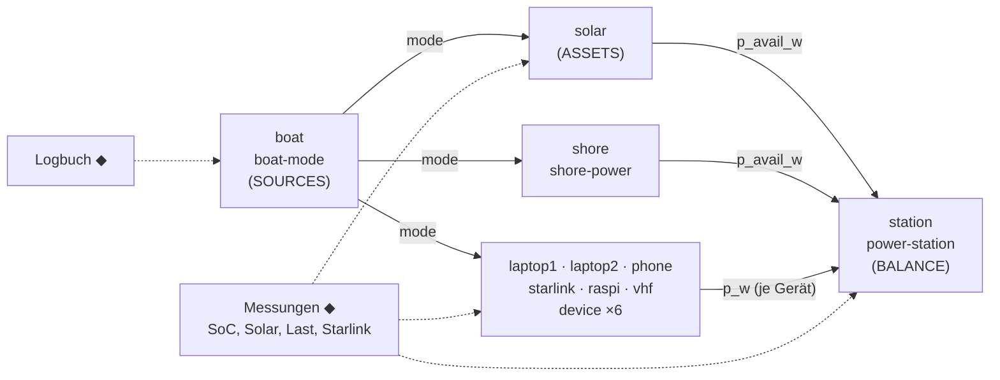

# OpenTSx – Boot-Zwilling: Etap 22 als Insel-Energiesystem (Konzept und PoC)

> Status: **Konzept und PoC**, 2026-10-12. Drittes Szenario des Digitalen Zwillings nach der H2-Kette (S1) und dem
> Einfamilienhaus. Gehört zu P9 ([07-DIGITAL-TWIN-BSP](07-DIGITAL-TWIN-BSP.md)), Abschnitt **P9.8** in
> [TASK-011](../../EVOLUTION/TASK-011-datamodel-refresher-2026.md). Ansichten und Edge-Vertrag:
> [09-STUDIO-LABVIEW-STEUERPULT](09-STUDIO-LABVIEW-STEUERPULT.md). Code: Paket `org.opentsx.twin.boat` und
> `org.opentsx.twin.demo.BoatDemo` in [`opentsx-twin`](../../opentsx-twin/README.md).
>
> **Alle Zahlen in diesem Dokument sind Annahmen oder Modellergebnisse auf erfundenen Eingängen.** Sie gelten, bis
> echte Betriebsdaten sie ersetzen (§8). Modellierte Werte und belegte Werte bleiben getrennt (P8-Prinzip).

---

## 1. Kurzfassung

* **Was:** Eine Etap 22 wird mit einer Powerstation, Solarzellen und Landstrom ausgestattet. Verbraucher sind zwei
  Laptops, ein Pixel 10, Starlink, ein Raspberry Pi und ein UKW-Funkgerät. Der Zwilling beschreibt die Nutzungsmuster
  als Simulation und wird dann mit echten Betriebsdaten unterfüttert.
* **Wie:** Ein gewöhnlicher Schaltplan ([`twin/boot-etap22.yaml`](../../opentsx-twin/src/main/resources/twin/boot-etap22.yaml))
  aus fünf neuen Bausteintypen, gebundenen Eingängen (Logbuch, Messreihen) und Eingriffen. Nichts ist für das Boot
  sonderbehandelt; das Studio zeigt es wie die H2-Kette und das Haus.
* **Ergebnis der Simulation (modelliert, Annahmen):** Im Urlaubstörn mit Starlink Mini reichen ~1 kWh und 200 Wp,
  solange alle zwei bis drei Tage Landstrom kommt; der SoC fällt auf ~34 %. Starlink ist mit ~530 Wh/Tag der größte
  Verbraucher (zwei Drittel der Last). Mit Starlink Standard fehlen über zwei Wochen ~2,4 kWh.
* **Echte Daten:** CSV-Vorlage ([`bootsdaten-vorlage.csv`](../../opentsx-twin/src/main/resources/twin/bootsdaten-vorlage.csv)),
  Import mit Herkunft `MEASURED`/`REPORTED`, Kalibrierung per Kleinste-Quadrate gegen den gemessenen SoC:
  `bin/opentsx boat --data config/private/bootsdaten.csv --calibrate`.
* **Kreislauf:** Der Raspberry Pi an Bord kann Messwerte als `opentsx.smartmetric.v1` über MQTT → infinimesh →
  KafScale veröffentlichen. Das Boot schließt den Kreis wie das LabVIEW-Konzept in 09.

---

## 2. Das System und seine Annahmen

**Boot.** Etap 22: Kleinkreuzer, ca. 6,7 m, Pinnensteuerung, kein festes Bordnetz mit Hausbatterie (Annahme). Bordnetz
heißt hier: die Powerstation mit 12-V-Buchse, USB-C PD und 230-V-Wechselrichter. Revier und Saison: Kieler Bucht /
westliche Ostsee (54,3° N, 10,1° O), Sommer (Juli), Bordzeit MESZ (UTC+2).

**„Powerbank“** wird als tragbare **Powerstation** gelesen (LiFePO4, MPPT-Solareingang, AC-Ladegerät, Ausgänge
12 V / USB-C / 230 V). Modell und Kapazität sind offen; alle Grenzen sind Parameter.

| Baustein | Größe | Annahme (Parameter) | Bemerkung |
|----------|-------|---------------------|-----------|
| Powerstation | Kapazität | **1024 Wh** (`capacityWh`) | typische 1-kWh-Klasse; Modell offen |
| | Start-SoC, Grenzen | 90 %; nutzbar 5–100 % (`soc0`, `socMin`, `socMax`) | unterhalb `socMin` schaltet die Station ab |
| | Lade-/Entladewirkungsgrad | je 0,95 (`etaCharge`, `etaDischarge`) | Rundlauf ≈ 0,90 |
| | Eigenverbrauch | 2 W (`idleW`) | BMS, Anzeige |
| | Grenzen | Laden 800 W, Solar-Eingang 500 W, Entladen 1800 W | |
| Solar | Leistung | **2 × 100 Wp flexibel** = 200 Wp (`wp`) | flach auf Deck/Bimini |
| | Minderung | 0,75 (`derate`) | Temperatur (flexible Module werden heiß), Verschmutzung, Kabel, MPPT |
| | Verschattung | Hafen 15 %, Segeln 35 %, Anker 10 % | Mast, Baum, Segel, Nachbarboote |
| | Einstrahlung | synthetischer Klarhimmel (Meinel) × Tages-Klarheitsindex 0,45–0,95 | im Mittel ≈ 5 kWh/m²·d im Juli |
| Landstrom | Ladegerät | 400 W AC, Wirkungsgrad 0,9 → 360 W DC (`chargerW`, `efficiency`) | nur im Hafen (Modi Hafen/unbemannt) |
| Laptop 1 | Nutzung | 15 W aus eigenem Akku (60 Wh), Laden bis 60 W über USB-C | Hafen 9–12 und 14–17 h, Anker 9–12 und 20–22 h |
| Laptop 2 | Nutzung | 10 W aus eigenem Akku (50 Wh), Laden bis 45 W | abends 19–22 h (Hafen, Anker) |
| Pixel 10 | Nutzung | 1,2 W im Mittel 7–23 h, 0,2 W nachts; Akku ~18,5 Wh, Laden bis 20 W | Tagesenergie klein (~20 Wh) |
| Starlink | Leistung | **Mini 30 W** im Mittel (Spanne 25–40 W); Standard als Faktor 2 (≈60 W) | 7–23 h an Bord; Schneeschmelze/Heizung aus |
| | Pfad | 12 V DC direkt, Wirkungsgrad 0,9; über Wechselrichter 0,8 | `path_eff` |
| Raspberry Pi | Leistung | 4 W, 24 h (auch unbemannt) | Datenlogger und Edge-Publisher (§9) |
| UKW-Funkgerät | Leistung | Empfang 5 W (~0,4 A bei 12,5 V), Senden 66 W (25 W HF, ~5,5 A), Sendeanteil 3 % | nur beim Segeln an |
| alle Geräte | Pfad | Wirkungsgrad 0,9 (USB-C PD, 12-V-Ausgang) | Verlust zwischen Station und Gerät |

Geräte mit eigenem Akku (Laptops, Telefon) ziehen nur Strom, solange sie angesteckt sind; die Nutzung entleert ihren
Akku. Daraus folgt der Hebel „Laptops laden, wenn die Sonne scheint“.

---

## 3. Nutzungsmodi und Szenarien

Der Betriebsmodus ist ein eigenes Signal (`boat.mode`), das Solar, Landstrom und alle Geräte lesen:

| Modus | Code | Wirkung |
|-------|------|---------|
| Hafen | `H`, 0 | Landstrom verfügbar; Laptops tagsüber in Nutzung; Starlink an |
| Segeln | `S`, 1 | UKW an, Segel verschatten die Module; Starlink an (Wetter, Navigation), Laptops zu |
| Anker | `A`, 2 | kein Landstrom; Laptops vormittags und abends; Starlink an |
| unbemannt | `U`, 3 | Boot liegt am Steg, niemand an Bord; nur der Raspberry Pi läuft; Landstrom verfügbar |

**Reiseplan als Tagesbuchstaben** (Parameter `itinerary`): `H` Hafentag, `S` segeln und im Hafen übernachten, `A`
segeln und ankern, `X` vor Anker bleiben, `U` unbemannt. Gesegelt wird 9–17 h; davor liegt das Boot dort, wo es die
Nacht verbracht hat.

* **Urlaubstörn (Referenz):** `HAXSHSAXXSHSAS`, Samstag 4. bis Freitag 17. Juli 2026. Sechs Ankernächte, die längste
  Strecke ohne Landstrom sind vier Tage (10.–13. Juli).
* **Wochenendnutzung:** `ASUUUUUASUUUUU`, Sa raus, So zurück, unter der Woche unbemannt.
* **Saison:** Der Plan beginnt im Juli; für Frühjahr/Herbst den Start im Plan verschieben (das Klarhimmelmodell
  rechnet mit dem Datum). Ein Binnenrevier ändert Breite, Länge und Verschattung.

Das Logbuch (welcher Modus wann) ist im Schattenbetrieb ein gebundener Eingang mit Herkunft `REPORTED`; ohne Logbuch
gilt der geplante Reiseplan als `SYNTHETIC`.

---

## 4. Schaltplan



| Typ | Phase | Eingänge (◆ = bindbar) | Ausgänge | Steuergrößen (Eingriffe) |
|-----|-------|------------------------|----------|---------------------------|
| `boat-mode` | SOURCES | `mode_obs` ◆ | `mode` | `force_mode` |
| `solar` | ASSETS | `mode`, `ghi_wm2` ◆, `p_meas_w` ◆ | `p_avail_w`, `ghi_wm2` | `wp`, `derate` |
| `shore-power` | ASSETS | `mode`, `available` ◆ | `p_avail_w`, `connected` | `enabled`, `every_n_days` |
| `device` | ASSETS | `mode`, `p_meas_w` ◆ | `p_w`, `active` | `on`, `scale`, `max_on_h`, `path_eff`, `charge_from_h`, `charge_to_h` |
| `power-station` | BALANCE | `p_solar_w`, `p_shore_w`, `p_<last>_w` je Gerät, `soc_meas` ◆, `p_load_meas_w` ◆ | `soc`, `p_batt_w`, `solar_used_w`, `shore_used_w`, `p_load_w`, `p_unmet_w`, `p_curtailed_w`, `autonomy_h`, `soc_residual`, `load_residual_w` | `capacity_wh`, `soc_min`, `soc_max`, `max_charge_w`, `nudge` |

Alle Leistungen in W, Energien in Wh, Takt 15 min, 14 Tage = 1344 Schritte. Die Powerstation ist Speicher und
Bilanzknoten zugleich; die Reihenfolge ihrer Lasten (`loads`) ist die Versorgungspriorität bei Knappheit (UKW zuerst,
Starlink zuletzt). Die Ports sind typgeprüft (Art und Einheit) wie in jedem Schaltplan.

**Entwurfsentscheidung.** Statt `balance` + `battery` aus S1 wiederzuverwenden, ist die Powerstation ein eigener
Baustein: Ein Insel-System hat keinen Netzanschluss als Ausgleich. Der Engpass ist genau „Speicher leer → Last
unversorgt“, und den muss ein Baustein in einem Schritt lösen (Direktversorgung, Laden, Entladen, ungedeckter Bedarf).

---

## 5. Energiebilanz und Fahrweise je Schritt

1. Lasten und Eigenverbrauch werden **direkt** gedeckt: zuerst Solar, dann Landstrom.
2. **Überschuss lädt** den Speicher (Solar vor Landstrom) bis `max_charge_w` und `soc_max`; nicht nutzbares Solar
   wird abgeregelt (`curtailed_wh`).
3. **Fehlbetrag** kommt aus dem Speicher bis `soc_min` und `maxDischargeW`.
4. Was dann fehlt, ist **ungedeckter Bedarf** (`unmet_wh`), verteilt in umgekehrter Priorität auf die Lasten.

Bilanz auf der DC-Seite (je Schritt und kumuliert, im Test geprüft):

```
solar_wh + shore_wh − served_wh − loss_wh + nudge_wh = soc_wh − soc_start_wh
loss_wh = Eigenverbrauch + Ladeverluste (1−η_c) + Entladeverluste (1/η_e − 1)
demand_wh = served_wh + unmet_wh
```

Geräteseitige Wandlungsverluste stecken im Gerät (`p_w = Geräteleistung / path_eff`). `nudge_wh` ist nur ungleich
null, wenn der Modell-SoC bewusst an die Messung herangezogen wird (§8).

---

## 6. Kennzahlen

| Kennzahl | Schlüssel (`BoatDemo.kpis`) | Bedeutung |
|----------|-----------------------------|-----------|
| Tagesenergie je Verbraucher | `<gerät>_wh_per_day` | an der Powerstation, inkl. Pfadverlust |
| Last je Tag | `load_wh_per_day` | Summe der Geräte |
| Solarertrag | `solar_yield_wh`, `solar_used_wh`, `curtailed_wh` | angeboten, genutzt, abgeregelt |
| Landstrom | `shore_wh` | DC-seitig; AC-Bezug = `shore_wh / 0,9` |
| Solaranteil | `solar_share_pct` | Solar / (Solar + Landstrom) |
| SoC-Minimum | `soc_min_pct` | tiefster Ladezustand im Lauf |
| Autonomie | `autonomy_h_mean`, Reihe `station.autonomy_h` | Stunden, die der nutzbare Speicher bei mittlerer Last (24 h) ohne Quelle reicht |
| Ungedeckter Bedarf | `unmet_wh`, `unmet_h`, je Last `station.unmet_<last>_wh` | Energie, die nicht geliefert werden konnte |
| Leere Geräteakkus | `device_unmet_use_wh` | Nutzung, die ein leerer Laptop-/Telefonakku nicht tragen konnte |
| Zyklen | `cycles` | Entladeenergie / Kapazität (Vollzyklen-Äquivalent) |

Ereignisse: `mode_change`, `shore_connected`/`shore_disconnected`, `soc_low` (unter 20 %), `supply_short` /
`supply_restored`.

---

## 7. Was-wäre-wenn-Hebel und erste Ergebnisse

Alle Hebel sind Eingriffe auf Steuergrößen ab Planbeginn; der Schaltplan bleibt gleich. Bewertung nach P8:
**Alternative minus Referenz, gleiche Eingänge, gleiche Information.** Die Zahlen sind **modelliert** (Annahmen aus §2,
synthetisches Wetter), nicht gemessen. Ausgabe von `bin/opentsx boat`:

| Alternative (Eingriff) | Δ ungedeckt Wh | Δ SoC-min | Δ Solar genutzt Wh | Δ Landstrom Wh | Δ Autonomie | Δ Last Wh/d |
|------------------------|---------------:|----------:|-------------------:|---------------:|------------:|------------:|
| *Referenz (absolut)* | *0* | *33,5 %* | *8214* | *4050* | *23,1 h* | *803* |
| +100 Wp (`solar.wp = 300`) | 0 | +37,2 pp | +1390 | −1455 | +2,1 h | 0 |
| Starlink nur 3 h/Tag (`starlink.max_on_h = 3`) | 0 | +45,9 pp | −3486 | −2706 | +27,7 h | −433 |
| Powerstation 2 kWh (`station.capacity_wh = 2048`) | 0 | +33,2 pp | 0 | +108 | +27,2 h | 0 |
| Landstrom nur jeden 3. Tag (`shore.every_n_days = 3`) | 0 | −4,1 pp | +297 | −815 | −2,6 h | 0 |
| Laptops laden nur 10–16 h (`charge_from_h/charge_to_h`) | 0 | −4,3 pp | +92 | −104 | +1,3 h | −3 |
| Starlink über Wechselrichter (`path_eff = 0,8`) | 0 | −20,2 pp | +184 | +786 | −2,8 h | +67 |
| Starlink Standard statt Mini (`power_factor = 2`) | **+2371** | −28,5 pp | +674 | +4487 | −12,4 h | +533 |
| Wochenendnutzung statt Törn (anderes Logbuch) | 0 | +29,7 pp | −5183 | −2016 | +57,8 h | −503 |

Lesart (modelliert): Starlink entscheidet über die Bilanz; DC-direkt statt Wechselrichter spart ~70 Wh/Tag. Seltener
Landstrom erhöht den Solaranteil, weil die Module dann nicht gegen einen vollen Speicher arbeiten. Erst mit Starlink
Standard wird es knapp; dort senkt +100 Wp den ungedeckten Bedarf (Test `moreSolarReducesUnmetDemand`).

---

## 8. Echte Betriebsdaten

### Quellen

| Quelle | Was | Herkunft | Bindung |
|--------|-----|----------|---------|
| App-Export der Powerstation (CSV) oder BLE-Mitschnitt | SoC, Solar-Eingang, Ausgangsleistung | `MEASURED` | `station.soc_meas`, `solar.p_meas_w`, `station.p_load_meas_w` |
| Starlink-App / lokale gRPC-Schnittstelle der Antenne | Leistung, Online-Zeit | `MEASURED` | `starlink.p_meas_w` |
| USB-C-Messgerät, Zwischenstecker | Leistung einzelner Geräte | `MEASURED` | `<gerät>.p_meas_w` |
| Logbuch (Hand, App) | Hafen/Segeln/Anker/unbemannt, Landstrom ja/nein | `REPORTED` | `boat.mode_obs`, `shore.available` |
| Solar-Einstrahlung (DWD, Satellit), optional | Globalstrahlung | `MEASURED`/`FORECAST` | `solar.ghi_wm2` |

### CSV-Vertrag

Vorlage: [`twin/bootsdaten-vorlage.csv`](../../opentsx-twin/src/main/resources/twin/bootsdaten-vorlage.csv) (drei Tage
**erfundener** Beispielzeilen, jede mit `notiz = BEISPIEL`). Echte Daten gehören nach `config/private/bootsdaten.csv`;
das Verzeichnis ist per `.gitignore` vom Repository ausgeschlossen.

| Spalte | Inhalt | Bindung |
|--------|--------|---------|
| `zeit` | ISO-Zeit mit Offset oder lokal (`--zone`, Standard Europe/Berlin) | – |
| `modus` | `hafen` \| `segeln` \| `anker` \| `unbemannt` | `boat.mode_obs` (REPORTED) |
| `landstrom` | 0/1 | `shore.available` (REPORTED) |
| `soc_prozent` | Ladezustand in % | `station.soc_meas` (MEASURED) |
| `solar_w` | Solar-Eingang in W | `solar.p_meas_w` (MEASURED) |
| `last_w` | Ausgangsleistung gesamt in W | `station.p_load_meas_w` (MEASURED) |
| `<gerät>_w` | z. B. `starlink_w`, `laptop1_w` (geräteseitig) | `<gerät>.p_meas_w` (MEASURED) |
| `<gerät>_an` | Gerät an diesem Tag an, 0/1 (Logbuch), z. B. `starlink_an` | `<gerät>.on` (REPORTED) |
| `einstrahlung_wm2` | Globalstrahlung in W/m² (nahe Wetterstation, z. B. DWD) | `solar.ghi_wm2` (MEASURED) |
| `notiz` | freier Text | ignoriert |

Trennzeichen `,` oder `;` (dann Dezimalkomma erlaubt), `#`-Zeilen sind Kommentare. Zeilen innerhalb eines
15-min-Schritts werden gemittelt (Modus: letzter Wert); Lücken bis 1 h werden gehalten, danach rechnet das Modell
(Herkunft `SYNTHETIC`). Gemessene Werte ersetzen das Modell im jeweiligen Schritt; in Was-wäre-wenn-Läufen auf
Messdaten werden sie über die **Systemhebel** skaliert (Solar × `wp/wp₀`, Gerät × `power_factor`, `on`,
`max_on_h`) und gelten dann als `ESTIMATED`. **Modellparameter** (`derate`, `scale`) wirken nicht auf Messwerte,
denn die Messung enthält sie schon; sie sind die Stellgrößen der Kalibrierung.

### Kalibrierung

`--calibrate` passt Nutzungs- und Minderungsparameter so an, dass der Zwilling die Messungen trifft:

* **Stellgrößen:** `solar.derate`, `laptops.scale` (beide Laptops), `starlink.scale`, jeweils als Eingriff zu
  Planbeginn. Teile, die in mehr als der Hälfte der Schritte gemessen sind, werden ausgelassen, sonst würden sie
  Fehler anderswo aufnehmen.
* **Ziele:** gemessener SoC (σ = 1 Prozentpunkt), gemessene Ausgangsleistung über `station.load_residual_w`
  (σ = 5 W) und, wenn Einstrahlung vorliegt, die gemessene Solarleistung bei SoC < 95 % (nicht abgeregelt; σ = 5 W).
  Für dieses Ziel rechnet das Solarmodell aus der Einstrahlung, die Solarmessung wird dafür nicht gebunden. Ohne
  Einstrahlung bleibt `solar.derate` außen vor, wenn Solar gemessen ist.
* **Verfahren:** Kleinste Quadrate auf den Residuen `(Modell − Messung)/σ`, beschränktes Levenberg-Marquardt mit
  Jacobi-Matrix aus Vorwärtsdifferenzen (ein Zwillingslauf je Stellgröße). Deterministisch.
* **Prüfung:** Aus Modelldaten mit bekannten Werten (Minderung 0,6, Starlink-Faktor 1,4) findet die Kalibrierung
  beide wieder (Test `calibrationRecoversKnownParameters`). Auf der Vorlage sinkt der Fehler von 1,9 auf 1,1
  Prozentpunkte (`laptops.scale` 1,24; erzeugt mit 1,3 und ganzzahlig gerundetem SoC).
* **Danach:** Schattenlauf und alle Was-wäre-wenn-Hebel laufen auf den echten Daten mit den kalibrierten Werten.
  Steuergröße `station.nudge` (0..1) zieht den Modell-SoC optional an die Messung (Assimilation, z. B. vor einer
  Prognose); die Korrektur wird als `nudge_wh` ausgewiesen.

### Simulierte Beispieldaten

Solange keine echten Exporte vorliegen, zeigt
[`twin/beispiel/boot-logs-simuliert.csv`](../../opentsx-twin/src/main/resources/twin/beispiel/boot-logs-simuliert.csv)
die ganze Kette von Import bis Kalibrierung ([Beschreibung](../../opentsx-twin/src/main/resources/twin/beispiel/README-boot.md)).
Die Datei ist **simuliert**, nicht gemessen: Kommentarkopf und `notiz` sagen es.

* **Erzeugung:** `org.opentsx.twin.boat.SimulatedLogs`, Seed 20260704, deterministisch. Der Zwilling läuft im
  5-min-Takt mit **verdeckten wahren Parametern** (Minderung 0,62, Starlink-Faktor 1,25, Laptop-Faktor 1,3), Törn
  `UHAXSHSAXXSHSU` (mit unbemannten Tagen), Bewölkung und Regen an den Ankertagen 8–10, Starlink aus an Tag 4.
* **Form und Unvollkommenheiten:** App-Export alle 5 min mit Logbuch und stündlicher Einstrahlung; Ortszeit ohne
  Offset; SoC in ganzen Prozent; Rauschen auf Solar, Last und Einstrahlung; keine App-Daten an unbemannten Tagen,
  drei Nächte und vier kurze Strecken ohne Bluetooth (81 % der Schritte haben Messwerte).
* **Aufruf:** `bin/opentsx boat --simulated` (Import, Kalibrierung, Schatten, Was-wäre-wenn, Vergleich mit der
  verdeckten Wahrheit).

| | wahr (verdeckt) | kalibriert |
|-|----------------:|-----------:|
| `solar.derate` | 0,620 | 0,614 |
| `laptops.scale` | 1,300 | 1,295 |
| `starlink.scale` | 1,250 | 1,249 |
| SoC-Abweichung (Schattenlauf) | – | 11,4 → 0,5 Prozentpunkte |

| Kennzahl auf dem „gemessenen“ Törn | wahrer Lauf (5 min) | kalibrierter Zwilling (15 min) |
|------------------------------------|--------------------:|-------------------------------:|
| ungedeckter Bedarf | 1493 Wh | 1494 Wh |
| Stunden mit Unterversorgung | 46,2 h | 46,3 h |
| SoC-Minimum | 5 % | 5 % |
| Solar genutzt / Landstrom | 5954 / 4597 Wh | 5946 / 4595 Wh |
| Last | 793 Wh/Tag | 792 Wh/Tag |

Lesart: In diesem simulierten Törn reichen 200 Wp bei derate 0,62 in der Regenphase vor Anker nicht; die Station
läuft drei Tage leer. Auf diesen Daten (modelliert, Δ zur Kalibrierung): Starlink nur 3 h/Tag beseitigt den
Fehlbetrag ganz, 2 kWh Speicher halbieren ihn grob (−906 Wh), +100 Wp senkt ihn um ~490 Wh. Der Test
`SimulatedLogsTest` prüft, dass die Datei genau der Generatorausgabe entspricht und die Kalibrierung die verdeckten
Werte wiederfindet.

---

## 9. Edge: Der Raspberry Pi veröffentlicht Smart Metrics

Der Pi läuft ohnehin 24 h. Er liest Powerstation (BLE oder USB, herstellerabhängig), Starlink (lokale Schnittstelle
der Antenne) und ein USB-C-Messgerät und veröffentlicht je Messung oder Block ein `opentsx.smartmetric.v1`
(Vertrag aus 09) über MQTT an infinimesh; das Kafka-Addon schreibt nach KafScale, OpenTSx normalisiert in v2:

```json
{
  "schema": "opentsx.smartmetric.v1",
  "metric": "boat.station.soc",
  "tags": { "boat": "etap22", "device": "station" },
  "unit": "1",
  "ts": "2026-07-06T18:00:00.000000Z",
  "value": 0.60,
  "origin": "MEASURED",
  "producer": { "tool": "raspi-boatlog", "version": "0.1.0" }
}
```

Blöcke (z. B. 15 min Solarleistung im Minutentakt) mit `t0`, `interval_us`, `values`. Auf See fehlt oft Netz: der Pi
puffert lokal und sendet nach, sobald Starlink oder Hafen-WLAN da ist (Ereigniszeit bleibt erhalten). Der Zwilling
bindet die normalisierten Reihen genauso wie die CSV.

**Rückweg (später, nur mit Freigabe):** Ein freigegebener Vorschlag des Zwillings („Starlink heute nur 3 h“, „Laptops
mittags laden“) geht über den `desired`-Zustand von infinimesh an den Pi; der Pi schaltet höchstens einen
Zwischenstecker oder zeigt eine Empfehlung. Die Sicherheit bleibt an Bord (UKW wird nie geschaltet).

---

## 10. Abbildung: Boot ↔ H2-Kette ↔ Haus

| Rolle im Zwilling | Boot | H2-Kette (S1) | Haus |
|-------------------|------|---------------|------|
| Speicher (Bestand) | Powerstation (SoC) | H2-Leitung / Linepack (Druck) | Hausbatterie |
| variable Quelle | Solar 200 Wp | Windpark | PV-Dach |
| verlässliche Quelle | Landstrom (nur im Hafen) | Netz / Markt | Netzanschluss |
| verschiebbare Last | Starlink-Zeitplan, Laptop-Laden | Elektrolyseur-Fahrplan | Wallbox, Wärmepumpe (Annahme) |
| Betriebsvorgabe | Modus (Hafen/Segeln/Anker) | Betriebsvorgaben (Abregelung) | Tarif-/Anwesenheitsprofil |
| Abweichung als KPI | ungedeckter Bedarf | Fahrplanabweichung, Mehrvermarktung | Netzbezug / Eigenverbrauchsquote |
| Schutzabschaltung | Station schaltet bei `soc_min` ab | Elektrolyseur bei 40 bar | Batterie-Entladegrenze |

(Die Benennung im Haus-Szenario kann abweichen.) Gemeinsam ist das Muster: ein Bestand zwischen schwankender
Quelle und Last, eine Grenze, ein Hebel zum Verschieben, ein KPI für das, was nicht klappt.

---

## 11. Anbindung an das Studio

Das Boot ist ein gewöhnlicher Zwilling; ein Exporter braucht nur diese statischen Methoden von
`org.opentsx.twin.demo.BoatDemo`:

| API | Liefert |
|-----|---------|
| `plan()` | `TwinPlan` aus `twin/boot-etap22.yaml` |
| `observed()` | `SeriesInputs` des Törns (Logbuch, REPORTED) |
| `reference()` | Eingriffe des Referenzlaufs (leer) |
| `shadow()` | den Referenz-Schattenlauf |
| `alternatives()` | `List<Alternative>`: `name`, `label`, `interventions`, `policies`, `inputs` (vollständige Bindung) |
| `run(plan, alternative, base)` | den Was-wäre-wenn-Lauf einer Alternative |
| `KEY_SERIES` | zuerst zu zeigende Reihen (`station.soc`, `station.p_unmet_w`, `solar.p_avail_w`, …) |
| `KEY_KPIS`, `kpis(RunResult)` | abgeleitete Kennzahlen (§6) |
| `logbook(plan, itinerary)` | Logbuchreihe zu einem Reiseplan |
| `calibrate(BoatData)`, `simulatedLogs()` | Kalibrierung auf Betriebsdaten; die simulierten Beispiel-Logs als Zeilen |

---

## 12. Grenzen (ehrlich)

* Alle Leistungen, Nutzungszeiten und Wetterwerte sind **Annahmen**; das Wetter ist ein deterministisches
  Klarhimmelmodell mit festem Tagesmuster, keine Messung.
* Solarmodule flach, keine Ausrichtung des Bootes, keine Temperaturdynamik (steckt pauschal in `derate`).
* Geräte erfahren nicht, ob die Station liefern konnte; was fehlt, steht als ungedeckter Bedarf an der Station.
* Gemessene Solarleistung ist die abgenommene Leistung (bei vollem Speicher abgeregelt); das Skalieren im
  Was-wäre-wenn ist eine Näherung.
* Kein Kühlschrank, kein Motor/Lichtmaschine, keine Navigationselektronik/Positionslichter (lassen sich als weitere
  `device` ergänzen).

---

## 13. Offene Fragen an den Eigner

1. Welche **Powerstation** (Modell, Kapazität, Solar-Eingang, Ladeleistung) ist geplant oder vorhanden?
2. Welche **Module** (Wp, flexibel/starr, Montageort, Ausrichtung)?
3. **Starlink Mini oder Standard**, und über 12 V direkt oder über den Wechselrichter?
4. **Revier und Saison** (Ostsee, Binnensee; nur Sommer oder auch Frühjahr/Herbst)?
5. Welche **Daten** lassen sich exportieren (App-Export der Station, Starlink-Statistik, USB-C-Messgerät, Logbuch)?
6. Typische **Nutzung**: Wie lange laufen die Laptops (Arbeit an Bord?), wann wird Starlink wirklich gebraucht?
7. Gibt es weitere Verbraucher (Kühlbox, Positionslichter, Plotter, Außenborder mit Ladeausgang)?
