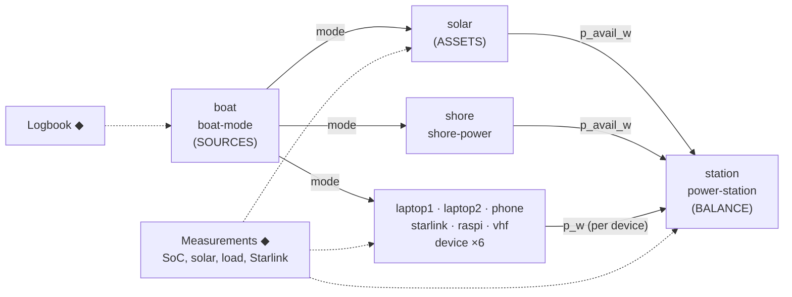

# OpenTSx boat twin: the Etap 22 as an island energy system (concept and PoC)

> Status: **concept and PoC**, 2026-10-12. Third scenario of the digital twin after the H2 chain (S1) and the
> single-family house. Belongs to P9 ([07-DIGITAL-TWIN-BSP](07-DIGITAL-TWIN-BSP.md)), section **P9.8** in
> [TASK-011](../../EVOLUTION/TASK-011-datamodel-refresher-2026.md). Views and edge contract:
> [09-STUDIO-LABVIEW-STEUERPULT](09-STUDIO-LABVIEW-STEUERPULT.md). Code: package `org.opentsx.twin.boat` and
> `org.opentsx.twin.demo.BoatDemo` in [`opentsx-twin`](../../opentsx-twin/README.md).
>
> **All numbers in this document are assumptions or model results on invented inputs.** They hold until real
> operating data replaces them (section 8). Modeled values and evidenced values stay apart (P8 principle).

---

## 1. Summary

* **What:** an Etap 22 is equipped with a power station, solar panels and shore power. The consumers are two
  laptops, a Pixel 10, Starlink, a Raspberry Pi and a VHF radio. The twin describes the usage patterns as a
  simulation and is then backed with real operating data.
* **How:** an ordinary wiring plan ([`twin/boot-etap22.yaml`](../../opentsx-twin/src/main/resources/twin/boot-etap22.yaml))
  of five new building block types, bound inputs (logbook, measured series) and interventions. Nothing is treated
  specially for the boat; the Studio shows it like the H2 chain and the house.
* **Result of the simulation (modeled, assumptions):** on the holiday cruise with Starlink Mini about 1 kWh and
  200 Wp are enough as long as shore power comes every two to three days; the SoC falls to about 34 %. Starlink is
  the largest consumer with about 530 Wh per day (two thirds of the load). With Starlink Standard about 2.4 kWh are
  missing over two weeks.
* **Real data:** CSV template ([`bootsdaten-vorlage.csv`](../../opentsx-twin/src/main/resources/twin/bootsdaten-vorlage.csv)),
  import with the origin `MEASURED`/`REPORTED`, calibration by least squares against the measured SoC:
  `bin/opentsx boat --data config/private/bootsdaten.csv --calibrate`.
* **Loop:** the Raspberry Pi on board can publish measurements as `opentsx.smartmetric.v1` over MQTT → infinimesh →
  KafScale. The boat closes the loop like the LabVIEW concept in 09.

---

## 2. The system and its assumptions

**Boat.** Etap 22: a small cruiser, about 6.7 m, tiller steering, no fixed on-board grid with a house battery
(assumption). On-board grid means here: the power station with a 12 V socket, USB-C PD and a 230 V inverter. Area
and season: Kiel Bay / western Baltic Sea (54.3° N, 10.1° E), summer (July), on-board time CEST (UTC+2).

**"Power bank"** is read as a portable **power station** (LiFePO4, MPPT solar input, AC charger, outputs 12 V /
USB-C / 230 V). Model and capacity are open; all limits are parameters.

| Building block | Quantity | Assumption (parameter) | Remark |
|----------------|----------|------------------------|--------|
| Power station | Capacity | **1024 Wh** (`capacityWh`) | typical 1 kWh class; model open |
| | Start SoC, limits | 90 %; usable 5 to 100 % (`soc0`, `socMin`, `socMax`) | below `socMin` the station switches off |
| | Charge and discharge efficiency | 0.95 each (`etaCharge`, `etaDischarge`) | round trip ≈ 0.90 |
| | Own consumption | 2 W (`idleW`) | BMS, display |
| | Limits | charging 800 W, solar input 500 W, discharging 1800 W | |
| Solar | Power | **2 × 100 Wp flexible** = 200 Wp (`wp`) | flat on deck or bimini |
| | Derating | 0.75 (`derate`) | temperature (flexible modules get hot), dirt, cables, MPPT |
| | Shading | harbour 15 %, sailing 35 %, anchor 10 % | mast, boom, sails, neighbouring boats |
| | Irradiance | synthetic clear sky (Meinel) × daily clearness index 0.45 to 0.95 | on average ≈ 5 kWh/m²·d in July |
| Shore power | Charger | 400 W AC, efficiency 0.9 → 360 W DC (`chargerW`, `efficiency`) | only in the harbour (modes harbour and away) |
| Laptop 1 | Use | 15 W from its own battery (60 Wh), charging up to 60 W over USB-C | harbour 9 to 12 and 14 to 17 h, anchor 9 to 12 and 20 to 22 h |
| Laptop 2 | Use | 10 W from its own battery (50 Wh), charging up to 45 W | evenings 19 to 22 h (harbour, anchor) |
| Pixel 10 | Use | 1.2 W on average 7 to 23 h, 0.2 W at night; battery about 18.5 Wh, charging up to 20 W | small daily energy (about 20 Wh) |
| Starlink | Power | **Mini 30 W** on average (range 25 to 40 W); Standard as a factor of 2 (≈60 W) | 7 to 23 h on board; snow melt and heating off |
| | Path | 12 V DC directly, efficiency 0.9; through the inverter 0.8 | `path_eff` |
| Raspberry Pi | Power | 4 W, 24 h (also when away) | data logger and edge publisher (section 9) |
| VHF radio | Power | receiving 5 W (about 0.4 A at 12.5 V), transmitting 66 W (25 W RF, about 5.5 A), transmit share 3 % | only on while sailing |
| all devices | Path | efficiency 0.9 (USB-C PD, 12 V output) | loss between station and device |

Devices with their own battery (laptops, phone) only draw power while they are plugged in; use drains their battery.
This gives the lever "charge the laptops while the sun shines".

---

## 3. Usage modes and scenarios

The operating mode is a signal of its own (`boat.mode`) that solar, shore power and all devices read:

| Mode | Code | Effect |
|------|------|--------|
| harbour | `H`, 0 | shore power available; laptops in use during the day; Starlink on |
| sailing | `S`, 1 | VHF on, the sails shade the modules; Starlink on (weather, navigation), laptops closed |
| anchor | `A`, 2 | no shore power; laptops in the morning and the evening; Starlink on |
| away | `U`, 3 | the boat lies at the jetty, nobody on board; only the Raspberry Pi runs; shore power available |

**Itinerary as day letters** (parameter `itinerary`): `H` harbour day, `S` sail and spend the night in the harbour,
`A` sail and anchor, `X` stay at anchor, `U` away. Sailing is from 9 to 17 h; before that the boat lies where it spent
the night.

* **Holiday cruise (reference):** `HAXSHSAXXSHSAS`, Saturday 4 to Friday 17 July 2026. Six nights at anchor; the
  longest stretch without shore power is four days (10 to 13 July).
* **Weekend use:** `ASUUUUUASUUUUU`, out on Saturday, back on Sunday, away during the week.
* **Season:** the plan starts in July; for spring or autumn move the start in the plan (the clear sky model
  calculates with the date). An inland area changes latitude, longitude and shading.

In shadow operation the logbook (which mode when) is a bound input with the origin `REPORTED`; without a logbook the
planned itinerary counts as `SYNTHETIC`.

---

## 4. Wiring plan



| Type | Phase | Inputs (◆ = bindable) | Outputs | Setpoints (interventions) |
|------|-------|------------------------|---------|---------------------------|
| `boat-mode` | SOURCES | `mode_obs` ◆ | `mode` | `force_mode` |
| `solar` | ASSETS | `mode`, `ghi_wm2` ◆, `p_meas_w` ◆ | `p_avail_w`, `ghi_wm2` | `wp`, `derate` |
| `shore-power` | ASSETS | `mode`, `available` ◆ | `p_avail_w`, `connected` | `enabled`, `every_n_days` |
| `device` | ASSETS | `mode`, `p_meas_w` ◆ | `p_w`, `active` | `on`, `scale`, `max_on_h`, `path_eff`, `charge_from_h`, `charge_to_h` |
| `power-station` | BALANCE | `p_solar_w`, `p_shore_w`, `p_<load>_w` per device, `soc_meas` ◆, `p_load_meas_w` ◆ | `soc`, `p_batt_w`, `solar_used_w`, `shore_used_w`, `p_load_w`, `p_unmet_w`, `p_curtailed_w`, `autonomy_h`, `soc_residual`, `load_residual_w` | `capacity_wh`, `soc_min`, `soc_max`, `max_charge_w`, `nudge` |

All powers in W, energies in Wh, time step 15 min, 14 days = 1344 steps. The power station is storage and balance
node at once; the order of its loads (`loads`) is the supply priority under shortage (VHF first, Starlink last). The
ports are type checked (kind and unit) as in every wiring plan.

**Design decision.** Instead of reusing `balance` + `battery` from S1, the power station is a building block of its
own: an island system has no grid connection to balance it. The bottleneck is exactly "storage empty → load not
supplied", and one building block has to solve it in one step (direct supply, charging, discharging, unmet demand).

---

## 5. Energy balance and operating mode per step

1. Loads and own consumption are covered **directly**: first by solar, then by shore power.
2. **Surplus charges** the storage (solar before shore power) up to `max_charge_w` and `soc_max`; solar that cannot be
   used is curtailed (`curtailed_wh`).
3. A **shortfall** comes from the storage down to `soc_min` and `maxDischargeW`.
4. What is still missing then is **unmet demand** (`unmet_wh`), spread over the loads in reverse priority.

Balance on the DC side (per step and cumulated, checked in the test):

```
solar_wh + shore_wh − served_wh − loss_wh + nudge_wh = soc_wh − soc_start_wh
loss_wh = own consumption + charging losses (1−η_c) + discharging losses (1/η_e − 1)
demand_wh = served_wh + unmet_wh
```

Conversion losses on the device side sit in the device (`p_w = device power / path_eff`). `nudge_wh` is non-zero only
when the model SoC is deliberately pulled toward the measurement (section 8).

---

## 6. Key figures

| Key figure | Key (`BoatDemo.kpis`) | Meaning |
|------------|-----------------------|---------|
| Daily energy per consumer | `<device>_wh_per_day` | at the power station, including the path loss |
| Load per day | `load_wh_per_day` | sum of the devices |
| Solar yield | `solar_yield_wh`, `solar_used_wh`, `curtailed_wh` | offered, used, curtailed |
| Shore power | `shore_wh` | on the DC side; AC draw = `shore_wh / 0.9` |
| Solar share | `solar_share_pct` | solar / (solar + shore power) |
| SoC minimum | `soc_min_pct` | lowest state of charge in the run |
| Autonomy | `autonomy_h_mean`, series `station.autonomy_h` | hours the usable storage lasts at mean load (24 h) without a source |
| Unmet demand | `unmet_wh`, `unmet_h`, per load `station.unmet_<load>_wh` | energy that could not be delivered |
| Empty device batteries | `device_unmet_use_wh` | use that an empty laptop or phone battery could not carry |
| Cycles | `cycles` | discharge energy / capacity (full cycle equivalent) |

Events: `mode_change`, `shore_connected`/`shore_disconnected`, `soc_low` (below 20 %), `supply_short` /
`supply_restored`.

---

## 7. What-if levers and first results

All levers are interventions on setpoints from the start of the plan; the wiring plan stays the same. Assessment as
in P8: **alternative minus reference, same inputs, same information.** The numbers are **modeled** (assumptions from
section 2, synthetic weather), not measured. Output of `bin/opentsx boat`:

| Alternative (intervention) | Δ unmet Wh | Δ SoC min | Δ solar used Wh | Δ shore power Wh | Δ autonomy | Δ load Wh/d |
|----------------------------|-----------:|----------:|----------------:|-----------------:|-----------:|------------:|
| *Reference (absolute)* | *0* | *33.5 %* | *8214* | *4050* | *23.1 h* | *803* |
| +100 Wp (`solar.wp = 300`) | 0 | +37.2 pp | +1390 | −1455 | +2.1 h | 0 |
| Starlink only 3 h per day (`starlink.max_on_h = 3`) | 0 | +45.9 pp | −3486 | −2706 | +27.7 h | −433 |
| Power station 2 kWh (`station.capacity_wh = 2048`) | 0 | +33.2 pp | 0 | +108 | +27.2 h | 0 |
| Shore power only every 3rd day (`shore.every_n_days = 3`) | 0 | −4.1 pp | +297 | −815 | −2.6 h | 0 |
| Laptops charge only 10 to 16 h (`charge_from_h/charge_to_h`) | 0 | −4.3 pp | +92 | −104 | +1.3 h | −3 |
| Starlink through the inverter (`path_eff = 0.8`) | 0 | −20.2 pp | +184 | +786 | −2.8 h | +67 |
| Starlink Standard instead of Mini (`power_factor = 2`) | **+2371** | −28.5 pp | +674 | +4487 | −12.4 h | +533 |
| Weekend use instead of the cruise (another logbook) | 0 | +29.7 pp | −5183 | −2016 | +57.8 h | −503 |

Reading (modeled): Starlink decides the balance; DC directly instead of the inverter saves about 70 Wh per day. Less
frequent shore power raises the solar share, because the modules then do not work against a full storage. Only with
Starlink Standard does it get tight; there +100 Wp lowers the unmet demand (test `moreSolarReducesUnmetDemand`).

---

## 8. Real operating data

### Sources

| Source | What | Origin | Binding |
|--------|------|--------|---------|
| App export of the power station (CSV) or a BLE capture | SoC, solar input, output power | `MEASURED` | `station.soc_meas`, `solar.p_meas_w`, `station.p_load_meas_w` |
| Starlink app / local gRPC interface of the antenna | power, online time | `MEASURED` | `starlink.p_meas_w` |
| USB-C meter, plug-in meter | power of single devices | `MEASURED` | `<device>.p_meas_w` |
| Logbook (by hand, app) | harbour, sailing, anchor, away, shore power yes or no | `REPORTED` | `boat.mode_obs`, `shore.available` |
| Solar irradiance (DWD, satellite), optional | global radiation | `MEASURED`/`FORECAST` | `solar.ghi_wm2` |

### CSV contract

Template: [`twin/bootsdaten-vorlage.csv`](../../opentsx-twin/src/main/resources/twin/bootsdaten-vorlage.csv) (three days
of **invented** example rows, each with a `note` that starts with `EXAMPLE`). Real data belongs in `config/private/bootsdaten.csv`;
`.gitignore` excludes the directory from the repository.

| Column | Content | Binding |
|--------|---------|---------|
| `time` | ISO time with offset or local (`--zone`, default Europe/Berlin) | none |
| `mode` | `harbour` \| `sailing` \| `anchor` \| `away` | `boat.mode_obs` (REPORTED) |
| `shore` | 0/1 | `shore.available` (REPORTED) |
| `soc_percent` | state of charge in % | `station.soc_meas` (MEASURED) |
| `solar_w` | solar input in W | `solar.p_meas_w` (MEASURED) |
| `load_w` | total output power in W | `station.p_load_meas_w` (MEASURED) |
| `<device>_w` | for example `starlink_w`, `laptop1_w` (on the device side) | `<device>.p_meas_w` (MEASURED) |
| `<device>_on` | device on that day, 0/1 (logbook), for example `starlink_on` | `<device>.on` (REPORTED) |
| `ghi_wm2` | global radiation in W/m² (nearby weather station, for example DWD) | `solar.ghi_wm2` (MEASURED) |
| `note` | free text | ignored |

The German column names `zeit`, `modus`, `landstrom`, `soc_prozent`, `last_w`, `<device>_an`, `einstrahlung_wm2` and
`notiz` and the German modes `hafen`, `segeln`, `anker` and `unbemannt` are accepted as aliases. A column named twice
is refused. The rows may span at most 3653 days and at most 35136 steps of the plan (366 days of 15-minute steps), and
a file has at most 527040 data rows (one row per minute for 366 days); every line after the header that is neither
blank nor a comment counts.

Separator `,` or `;` (then a decimal comma is allowed), `#` lines are comments. Rows inside a 15-minute step are
averaged (mode: last value); gaps up to 1 h are held, after that the model calculates (origin `SYNTHETIC`). Measured
values replace the model in their step; in what-if runs on measured data they are scaled through the **system
levers** (solar × `wp/wp₀`, device × `power_factor`, `on`, `max_on_h`) and then count as `ESTIMATED`. **Model
parameters** (`derate`, `scale`) do not act on measured values, because the measurement already contains them; they
are the setpoints of the calibration.

### Calibration

`--calibrate` fits usage and derating parameters so that the twin hits the measurements:

* **Setpoints:** `solar.derate`, `laptops.scale` (both laptops), `starlink.scale`, each as an intervention at the start
  of the plan. Parts that are measured in more than half of the steps are left out, otherwise they would absorb
  errors elsewhere.
* **Targets:** measured SoC (σ = 1 percentage point), measured output power through `station.load_residual_w`
  (σ = 5 W) and, when irradiance is given, the measured solar power at SoC < 95 % (not curtailed; σ = 5 W). For this
  target the solar model calculates from the irradiance, and the solar measurement is not bound for it. Without
  irradiance `solar.derate` stays out when solar is measured.
* **Method:** least squares on the residuals `(model − measurement)/σ`, bounded Levenberg-Marquardt with a Jacobian
  from forward differences (one twin run per setpoint). Deterministic.
* **Check:** from model data with known values (derating 0.6, Starlink factor 1.4) the calibration finds both again
  (test `calibrationRecoversKnownParameters`). On the template the error falls from 1.9 to 1.1 percentage points
  (`laptops.scale` 1.24; generated with 1.3 and a SoC rounded to whole numbers).
* **After that:** the shadow run and all what-if levers run on the real data with the calibrated values. The setpoint
  `station.nudge` (0..1) optionally pulls the model SoC toward the measurement (assimilation, for example before a
  forecast); the correction is reported as `nudge_wh`.

### Simulated example data

As long as there are no real exports,
[`twin/beispiel/boot-logs-simuliert.csv`](../../opentsx-twin/src/main/resources/twin/beispiel/boot-logs-simuliert.csv)
shows the whole chain from import to calibration ([description](../../opentsx-twin/src/main/resources/twin/beispiel/README-boot.md)).
The file is **simulated**, not measured: the comment header and `note` say so.

* **Generation:** `org.opentsx.twin.boat.SimulatedLogs`, seed 20260704, deterministic. The twin runs at 5-minute
  steps with **hidden true parameters** (derating 0.62, Starlink factor 1.25, laptop factor 1.3), cruise
  `UHAXSHSAXXSHSU` (with days away), clouds and rain on the anchor days 8 to 10, Starlink off on day 4.
* **Form and imperfections:** app export every 5 min with a logbook and hourly irradiance; local time without
  offset; SoC in whole percent; noise on solar, load and irradiance; no app data on days away, three nights and four
  short stretches without Bluetooth (81 % of the steps have measurements).
* **Call:** `bin/opentsx boat --simulated` (import, calibration, shadow, what-if, comparison with the hidden truth).

| | true (hidden) | calibrated |
|-|--------------:|-----------:|
| `solar.derate` | 0.620 | 0.614 |
| `laptops.scale` | 1.300 | 1.295 |
| `starlink.scale` | 1.250 | 1.249 |
| SoC deviation (shadow run) | none | 11.4 → 0.5 percentage points |

| Key figure on the "measured" cruise | true run (5 min) | calibrated twin (15 min) |
|-------------------------------------|-----------------:|-------------------------:|
| unmet demand | 1493 Wh | 1494 Wh |
| hours of undersupply | 46.2 h | 46.3 h |
| SoC minimum | 5 % | 5 % |
| solar used / shore power | 5954 / 4597 Wh | 5946 / 4595 Wh |
| load | 793 Wh per day | 792 Wh per day |

Reading: in this simulated cruise 200 Wp at a derating of 0.62 are not enough in the rainy phase at anchor; the
station runs empty for three days. On this data (modeled, Δ to the calibration): Starlink only 3 h per day removes
the shortfall entirely, 2 kWh of storage roughly halve it (−906 Wh), +100 Wp lowers it by about 490 Wh. The test
`SimulatedLogsTest` checks that the file equals the generator output exactly and that the calibration finds the
hidden values again.

---

## 9. Edge: the Raspberry Pi publishes smart metrics

The Pi runs 24 h anyway. It reads the power station (BLE or USB, depending on the manufacturer), Starlink (local
interface of the antenna) and a USB-C meter and publishes one `opentsx.smartmetric.v1` per measurement or block
(contract from 09) over MQTT to infinimesh; the Kafka add-on writes to KafScale, OpenTSx normalizes into v2:

```json
{
  "schema": "opentsx.smartmetric.v1",
  "metric": "boat.station.soc",
  "tags": { "boat": "etap22", "device": "station" },
  "unit": "1",
  "ts": "2026-07-06T18:00:00.000000Z",
  "value": 0.60,
  "origin": "MEASURED",
  "producer": { "tool": "raspi-boatlog", "version": "0.1.0" }
}
```

Blocks (for example 15 min of solar power at one-minute steps) come with `t0`, `interval_us`, `values`. At sea the
network is often missing: the Pi buffers locally and sends later as soon as Starlink or the harbour Wi-Fi is there
(the event time is kept). The twin binds the normalized series the same way as the CSV.

**Way back (later, only with approval):** an approved proposal of the twin ("Starlink only 3 h today", "charge the
laptops at noon") goes to the Pi through the `desired` state of infinimesh; the Pi at most switches a plug-in switch
or shows a recommendation. Safety stays on board (the VHF is never switched).

---

## 10. Mapping: boat ↔ H2 chain ↔ house

| Role in the twin | Boat | H2 chain (S1) | House |
|------------------|------|---------------|-------|
| Storage (stock) | power station (SoC) | H2 pipeline / linepack (pressure) | house battery |
| Variable source | solar 200 Wp | wind farm | PV roof |
| Reliable source | shore power (only in the harbour) | grid / market | grid connection |
| Shiftable load | Starlink schedule, laptop charging | electrolyzer schedule | wallbox, heat pump (assumption) |
| Operating rule | mode (harbour, sailing, anchor) | operating rules (curtailment) | tariff and presence profile |
| Deviation as a KPI | unmet demand | schedule deviation, extra marketing | grid draw / self-consumption ratio |
| Protective shutdown | the station switches off at `soc_min` | electrolyzer at 40 bar | battery discharge limit |

(The naming in the house scenario can differ.) The pattern is shared: a stock between a fluctuating source and a
load, a limit, a lever to shift, a KPI for what does not work.

---

## 11. Connection to the Studio

The boat is an ordinary twin; an exporter only needs these static methods of `org.opentsx.twin.demo.BoatDemo`:

| API | Returns |
|-----|---------|
| `plan()` | `TwinPlan` from `twin/boot-etap22.yaml` |
| `observed()` | `SeriesInputs` of the cruise (logbook, REPORTED) |
| `reference()` | interventions of the reference run (empty) |
| `shadow()` | the reference shadow run |
| `alternatives()` | `List<Alternative>`: `name`, `label`, `interventions`, `policies`, `inputs` (complete binding) |
| `run(plan, alternative, base)` | the what-if run of an alternative |
| `KEY_SERIES` | series to show first (`station.soc`, `station.p_unmet_w`, `solar.p_avail_w`, ...) |
| `KEY_KPIS`, `kpis(RunResult)` | derived key figures (section 6) |
| `logbook(plan, itinerary)` | logbook series for an itinerary |
| `calibrate(BoatData)`, `simulatedLogs()` | calibration on operating data; the simulated example logs as rows |

---

## 12. Limits

* All powers, usage times and weather values are **assumptions**; the weather is a deterministic clear sky model
  with a fixed daily pattern, not a measurement.
* Solar modules flat, no orientation of the boat, no temperature dynamics (lumped into `derate`).
* Devices do not learn whether the station could deliver; what is missing stands as unmet demand at the station.
* Measured solar power is the power taken (curtailed when the storage is full); the scaling in the what-if is an
  approximation.
* No fridge, no engine or alternator, no navigation electronics or position lights (they can be added as further
  `device` blocks).

---

## 13. Open questions to the owner

1. Which **power station** (model, capacity, solar input, charging power) is planned or present?
2. Which **modules** (Wp, flexible or rigid, mounting place, orientation)?
3. **Starlink Mini or Standard**, and over 12 V directly or through the inverter?
4. **Area and season** (Baltic Sea, inland lake; only summer or also spring and autumn)?
5. Which **data** can be exported (app export of the station, Starlink statistics, USB-C meter, logbook)?
6. Typical **use**: how long do the laptops run (work on board?), when is Starlink really needed?
7. Are there further consumers (cool box, position lights, plotter, outboard with a charging output)?
