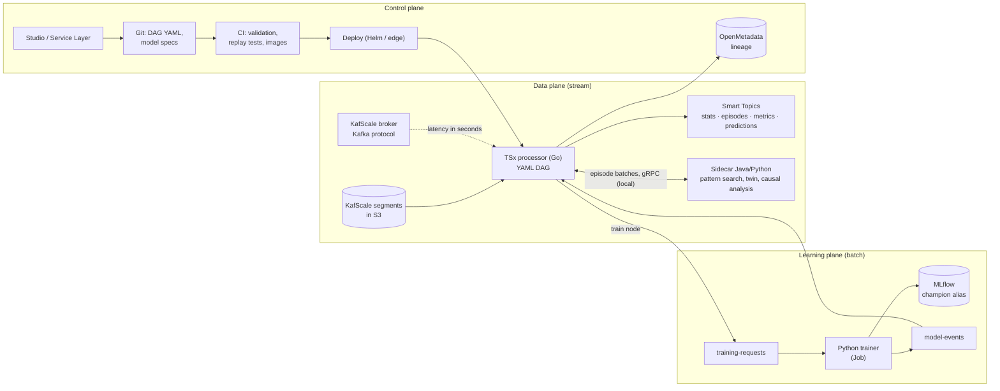

# OpenTSx: Smart Topic processor and DevOps concept

> Status: **partly running**. What runs today is the Java vector processor (`opentsx-retrieval`,
> `bin/opentsx vectors`, k3s component `vector-processor` with `VECTOR_PROCESSOR=true`). It runs the DAGs
> `opentsx.dag.v1` (vector sinks of `align.vector`, sections 5a and 5b) and `opentsx.dag.v2` (series sinks of the
> cleaning operators `dq.checks`, `convert.unit`, `resample`, `model.wind-shear`, `model.power-curve`, `feature.lag`
> and `feature.rolling`, [14](14-ENGINEERING-FLOW.md), section 6), both behind `decode.avro-soe`, and the workbench
> deploys them. Still a design: the Go processor, the sidecar, training with MLflow, and running any other operator
> of section 6 as a node of a DAG. The page answers the question: *How do Smart Topics compute in the stream, lean
> and with our TSA algorithms, without the overhead of Flink or Kafka Streams?* References:
> [05-SMART-TOPICS](05-SMART-TOPICS.md) (Smart Topics, training, prediction API),
> [07-DIGITAL-TWIN-BSP](07-DIGITAL-TWIN-BSP.md) (variants T/L, origin),
> [09-STUDIO-LABVIEW-STEUERPULT](09-STUDIO-LABVIEW-STEUERPULT.md) (edge metrics, commands).

---

## 1. Summary

1. **A Go processor in KafScale is the compute engine itself.** KafScale processors are standalone Go programs. They
   read closed segments directly from S3 and run next to the broker, not inside it. The operators of the DAG are Go
   functions in the same process. Neither Flink nor Kafka Streams is needed.
2. **Kafka Streams is ruled out under KafScale.** It needs compaction for the changelogs of its state stores and
   transactions for exactly-once. KafScale offers neither. Flink would work (manual assignment, own checkpoints), but
   it is too heavy for a lean DAG.
3. **Do not port everything to Go, only a stream core.** Go gets the small, deterministic operators that must run in
   the stream:
   * decoding and normalizing
   * forming episodes
   * statistics and sketches
   * data quality
   * incremental segmentation
   * resampling
   * scoring of exported models
   * writing Smart Metrics

   **Shared test vectors** secure the parity, as they already do for the sketch, SeriesId and Avro between Java and
   Python.
4. **Training never runs in the stream.** A `train` node in the DAG only triggers: it writes a training request.
   Python trains in batch, registers the model in MLflow and reports it. The `score` node swaps the champion while
   running.
5. **What exists only in Java or Python runs through a sidecar.** This applies to pattern search, the twin and causal
   analysis. The Go processor hands whole episodes to it locally through gRPC. Because an episode is already a micro
   batch, the call stays cheap.
6. **One declarative DAG (YAML), two runtimes.** Go is lean, reads directly from S3 and also runs at the edge: on the
   Raspberry Pi on board or on the lab PC. Java is the existing processor (`StatsProcessor`), generalized. Both read
   the same specification. A conformance test checks per operator that the outputs are byte-identical.

---

## 2. Facts: KafScale processors

The source is the repository [KafScale/platform](https://github.com/KafScale/platform), `addons/processors/`
(as of 2026-10-12):

| Property | Finding |
|----------|---------|
| Kind | standalone Go programs ("storage-native"). They read closed `.kfs` and `.index` segments from S3 and are neither broker nor Kafka client. |
| Templates | `skeleton` (template), `iceberg-processor` (topics to Iceberg), `sql-processor` (ad-hoc SQL over the Postgres wire protocol, without continuous queries) |
| Building blocks | segment lookup, decoder after `kafscale-spec.md`, YAML mapping, sink interface (`Write(ctx, []Record)`), lease per partition with offset checkpoint (backend etcd), Helm chart, Dockerfile |
| Semantics | at-least-once. Offsets advance only after a confirmed write. Scales per partition; a partition is never split across several workers. |
| Latency | seconds to minutes, because only closed segments are read. In return, operation is simpler and cheaper. |

**Consequence for OpenTSx:** a TSx processor in Go follows exactly this pattern. It replaces the sink stage with an
operator DAG. Building a new stream engine is not needed; lease, checkpoint and segment decoding come from the
template. For latencies in the range of seconds there is the second input: the Kafka protocol through the broker with
manual assignment, as in the Java `StatsProcessor` today.

---

## 3. Options compared

| Option | Algorithms | Operation | Fits KafScale | Edge (Pi, lab PC) | Assessment |
|--------|------------|-----------|---------------|-------------------|------------|
| **Kafka Streams** | Java, usable directly | light | **no:** state store changelogs need compaction, exactly-once needs transactions | moderate | ruled out |
| **Flink** | Java, usable | heavy (JobManager, TaskManager, state backend) | yes, with manual assignment and own checkpoints | no | for large joins and windows over many topics, not for the lean DAG |
| **Java processor** (like `StatsProcessor`) | all Java algorithms directly | medium (JVM, about 150 to 300 MB) | yes (Kafka protocol; segments from S3 possible once a Java decoder is built) | limited | good for operators that exist only in Java (pattern search, twin) |
| **Go processor (TSx core)** | stream core new in Go, the rest through a sidecar | very light (one binary, image of about 20 MB) | **native**, based on the processor template | **yes** | **recommendation** for the data plane |
| Port everything to Go | everything new | light | yes | yes | no: large effort, risk of results that drift apart. Pattern search, twin and causal analysis do not belong in the stream. |
| WASM plugins (for example wazero) | portable user functions | light | yes | yes | later, for operators of the users; numerically not mature yet |

---

## 4. Architecture: three planes



* **Data plane:** the processor reads from S3 or from the broker, runs the DAG and writes Smart Topics. It needs
  nothing but S3, etcd (or checkpoint files at the edge) and optionally a sidecar.
* **Learning plane:** training is a batch Job. It is triggered through a topic and acknowledged. It selects its data
  through the episode query (Iceberg or replay) and is therefore reproducible.
* **Control plane:**
  * DAG and model specifications are versioned in Git (GitOps).
  * CI validates and tests against recorded segments.
  * Deployment runs through Helm, or at the edge as a binary with a configuration file.
  * The Studio edits the DAG.
  * OpenMetadata shows the lineage, with the specification hash as the pipeline version.

---

## 5. The declarative processor DAG (draft `opentsx.dag.v1`)

```yaml
dag: windpark-ostsee-smart
version: 3
source:
  kind: kafscale-s3              # or kafscale-broker (latency in seconds)
  s3: { bucket: kafscale-data, namespace: production }
  topics: [tsx.windpark.observations.v2]
checkpoint: { backend: etcd }    # at the edge: file
nodes:
  - id: decode
    op: decode.avro-soe          # v2 single-object encoding; JSON (opentsx.smartmetric.v1) as well
  - id: norm
    op: normalize
    in: [decode]
    params: { mapping: catalog/windpark-iec.yaml }
  - id: ep
    op: episodes.fixed-duration
    in: [norm]
    params: { duration: PT10M, lateness: PT2M }
  - id: stats
    op: stats.welford-ddsketch
    in: [ep]
    params: { windows: [PT10M, PT1H], alpha: 0.01 }
  - id: dq
    op: dq.checks
    in: [ep]
    params: { checks: [COMPLETENESS, PLAUSIBLE_RANGE, FLATLINE, GAPS] }
  - id: gusts
    op: segment.extremum
    in: [ep]
    params: { feature: MAX, prominence: 2.0, window: PT4M, distance: PT5M }
  - id: forecast
    op: score.onnx
    in: [ep, stats]
    params: { model: "models:/windpark-power/champion", context: [weather] }
  - id: retrain
    op: train.trigger            # computes nothing, only triggers
    in: [stats]
    params: { when: "drift(psi) > 0.2 or every P7D", spec: models/windpark-power.yaml }
  - id: similar
    op: sidecar.call             # only when needed: Java pattern search
    in: [gusts]
    params: { endpoint: "localhost:7071", method: PatternSearch.topK, k: 5 }
sinks:
  - { from: stats,    topic: tsx.windpark.series-stats.v2 }
  - { from: dq,       topic: tsx.windpark.dq.v1 }
  - { from: gusts,    topic: tsx.windpark.episodes.v2, labels: { segmentation: gust } }
  - { from: forecast, topic: tsx.windpark.predictions.v1 }
  - { from: retrain,  topic: tsx.windpark.training-requests.v1 }
```

Rules:

* **Check before the start.** CI and the processor check the DAG before it starts: the operators must exist in the
  runtime, the types must match (Observation, Episode, Stats, Prediction), and there are no cycles. Only stateful
  operators have state, with a checkpoint.
* **Hash:** the specification hash goes into the provenance of every output record, like the plan hash of the twin.
* **Studio:** the node graph in the Studio is the same representation as for the twin. A processor DAG is a circuit
  diagram of stream operators.

---

## 5a. Vector measuring points: `align.vector` and `opentsx.vector.v1`

> Status: runs today. The operator exists twice: in the web workbench (`opentsx-saas-frontend`,
> `src/workbench/vector.ts`) and in Java (`opentsx-retrieval`, `VectorAligner`). Both pass the same test vectors
> ([`testvectors/align-vector.v1.json`](testvectors/align-vector.v1.json)). The vector processor (section 5b) runs
> vector sinks. The message format is JSON; an Avro form is open.

**Purpose.** Without it, a sink writes the result of exactly one node, and every message carries one value of one
series. Whoever needs "all values at time t" (model input, state vector of a plant, comparison of a raw and a derived
value) has to join several topics over time themselves. `align.vector` does that in the DAG: it brings the results of
several nodes onto a common clock and writes, per tick and key, **one measuring point with one value per component**.

```yaml
nodes:
  - id: zscore
    op: norm.zscore
    in: [decode]
  - id: vec
    op: align.vector
    in: [decode, zscore]                 # order = order of the components
    params: { every: PT60S, key: turbine, agg: MEAN, fill: as-of, maxAge: PT120S, emit: any, names: [raw, standardized] }
sinks:
  - { from: vec, topic: tsx.wind.smart.turbine-state.vectors.v1, schema: opentsx.vector.v1 }
```

**Rules.**

| Term | Rule |
|------|------|
| **Clock** (`every`) | Ticks are multiples of `every` since 1970-01-01T00:00:00Z. Tick *k* covers the half-open interval [k · every, (k + 1) · every). The clock therefore does not depend on the first value; two runs and two runtimes cut the same way. |
| **Component** | Every input (`in`) is a component, named through `names`. Its value in the tick is the aggregate (`agg`: `MEAN`, `LAST`, `FIRST`, `MIN`, `MAX`, `SUM`, `COUNT`) of the values of the input in the tick; NaN does not count. When an input carries several series per key, each series gives a component `<name>.<metric>` (without the prefix when there is only one input), in name order. The order thus does not depend on the order in which the series arrive. |
| **Key** (`key`) | What forms one vector together. `series`: the same series (seriesId) in all inputs. A tag name such as `turbine`: all series with the same value of this tag, that is, different channels of one plant. `all`: everything in one vector. |
| **Missing values** | A component without a value in the tick is `null`. With `fill: as-of` it takes the last value, if that is not older than `maxAge` (the same rule as the context joins in 05). |
| **Output** (`emit`) | `any`: a measuring point as soon as at least one component has a value. `complete`: only ticks in which all components have a value. |
| **Timestamp** | `ts` is the end of the tick, that is, the time from which the vector is complete. `window` names start and end. |
| **Axes** | Only inputs with a time axis. Spectra, histograms and scaling functions (FFT, PDF, DFA) are not components of a time vector. |

**Message** (JSON schema: [`schemas/opentsx.vector.v1.schema.json`](schemas/opentsx.vector.v1.schema.json)):

```json
{
  "schema": "opentsx.vector.v1",
  "vector": "turbine-state",
  "key": { "turbine": "T05" },
  "ts": "2026-10-01T00:01:00.000Z",
  "window": { "from": "2026-10-01T00:00:00.000Z", "to": "2026-10-01T00:01:00.000Z" },
  "clock": "PT60S",
  "components": ["raw.wind_speed", "raw.power_active", "standardized.wind_speed", "standardized.power_active"],
  "values": [10.99, 1966.46, 2.53, null],
  "missing": 1
}
```

The values are a list in the order of `components`, not a map from name to value: a vector has a fixed order, and a
model reads it without resolving names. The list `components` is in every message all the same, so that a reader
needs no DAG. The Kafka key of the message is the canonical text of `key`, so that all measuring points of a plant lie
in one partition and in time order.

**Back into the inventory.** The retrieval server reads the vector topics of the domain: every component appears in
the TS inventory as a series `smart.<name>.<component>` with the tag `vector=<name>` and can be loaded like any other
series. Per key and tick the later measuring point wins; measuring points with another clock or other components than
the newest one do not count towards the series.

**What runs.**

| Point | Rule |
|-------|------|
| What runs | `align.vector` whose inputs are all the source directly (`in: [decode]`). When another operator comes before it, the DAG is refused and the node is named. |
| Which series | `source.series` names the series (seriesId) of the source topic. The workbench writes the series chosen in the inventory into it. |
| Sink | only `tsx.<domain>.smart.<name>.vectors.v1` of the domain; the topic is created when needed (one partition, Kafka key = `key`, provenance with the DAG name and the hash of the document). |

The retrieval server runs no DAG itself; the vector processor (section 5b) runs the vector sinks.

**For a stream runtime, the rules imply:**

* **State:** per key and component, the aggregate of the open tick and the last value with its time (for `as-of`).
  It is bounded and goes into the checkpoint, as for `stats.welford-ddsketch`.
* **Closing a tick:** by event time, with allowed lateness (`lateness`, section 7). When a value comes later, a new
  revision of the measuring point is created; the id of a measuring point is deterministic from vector, key and
  tick.
* **Several inputs:** the inputs come from the same source topic, so they are in the same order per partition.
  Vectors across several topics need a join across partitions; that is Flink territory (D25) and not covered here.

---

## 5b. Continuous operation of the vector sinks (vector processor)

> Status: runs today. Implemented in `opentsx-retrieval` (`VectorStream`, `VectorProcessor`, `VectorProcessorApp`,
> command `opentsx vectors`), as the k3s component `vector-processor` (`VECTOR_PROCESSOR=true`) and in the workbench
> (tab "Smart Topic": Deploy, Stop, state).

`VectorAligner` (section 5a) aligns, in one pass, the data it is given. The vector processor keeps a vector sink up to
date: it follows `tsx.<domain>.episodes.v2` and appends the measuring points as soon as they are final.

**Control through topics.**

| Topic | Content | Rule |
|-------|---------|------|
| `tsx.<domain>.dags.v1` | `opentsx.dag-control.v1`: `dag`, `state` (`deployed` or `stopped`), `spec` (the DAG document), `by` (who asked for it), `at` | The key is the DAG name; per name the last record wins. A deployment therefore survives every restart of the processor. |
| `tsx.<domain>.dag-status.v1` | `opentsx.dag-status.v1`: `dag`, `vector`, `kind` (`vector` or `series`), `topic`, `state` (`starting`, `waiting`, `running`, `failed`, `stopped`), `specHash`, `records`, `watermark`, `waitingFor` (at most 10 series), `waitingForCount`, `skippedBlocks`, `undecodable`, `lostToRetention` and `ignoredControlRecords` (these three only when not 0), `error`, `at`. A refused DAG gets a record with `dag`, `state` `failed`, `specHash`, `error` and `at` only. | Key `<dag>/<vector>`, or `<dag>` for a DAG the processor refused; the last record wins. On every change of state, after every checkpoint that adds records, and otherwise every 30 s. |

**Semantics.**

| Point | Rule |
|-------|------|
| Runner | One runner per vector sink, with its own consumer, its own read positions and its own state. A new or changed DAG starts at the beginning of the source topic (`source.start: earliest`, the default) or with what arrives from now on (`latest`), without touching the others. |
| Series | `source.series` is required. As long as a named series has never been seen, nothing is written (`waiting`): only then is it known which series form a vector and what the components are called. |
| Closing a tick | A tick is final when **every** named series has reached its end, plus `lateness` (a parameter of the node, default none). What counts is the end of the episode (`tEnd`), not the last value. With episodes of 10 minutes and a 60 s clock, ten measuring points per key therefore appear at once. |
| Order per series | An episode must begin where the previous one of the same series ended, or later. Otherwise it is skipped and counted (`skippedBlocks`): a duplicate after a repeated write, or data out of order. `lateness` therefore evens out the offset **between** series, not late episodes of one series. |
| Checkpoint | One file per runner in the state directory: read positions and state (open ticks, last value per series for `as-of`, progress). It is written only once the broker has confirmed all measuring points. After a crash the runner repeats at most what it wrote since the last checkpoint; the values are the same, and readers take the later measuring point. |
| Broker window | Reading waits (`Patience`), writing retries up to the delivery timeout. When the broker does not confirm everything, the runner goes to `failed` and starts again after one minute from the last checkpoint, with a new producer. |
| One producer per runner | Every runner writes with its own producer, only to its sink topic; the status records have another one. Waiting for the confirmation does not block the loop. Reason: the KafScale proxy answers a produce request that mixes a topic with an owner and one without (a new sink topic before its first write) with a response that the Kafka client cannot read; the producer then goes silent completely (KOI-2026-10-13-02). With one producer for everything, a new sink topic stopped the whole processor. |
| Equality with the batch run | Fed with all data, `VectorStream` gives the same measuring points as `VectorAligner`, whatever the order in which the series arrive (test `VectorStreamTest`). |

**Operation.** Deploying and stopping are records in the control topic. There are three ways to get there:

| Way | Who |
|-----|-----|
| Workbench, tab "Smart Topic": Deploy, Stop | signed-in administrators; the SaaS backend checks the account (`POST /api/v1/dags/deploy`, `/stop`) and forwards with the run token to the retrieval server |
| Retrieval server `POST /v1/dags/deploy`, `/stop?name=` | whoever knows the run token (`X-OpenTSx-Run-Token`); the server checks the DAG and writes the record |
| `opentsx vectors deploy --dag`, `stop --name` | whoever reaches the broker |

`GET /v1/dags` of the retrieval server gives the state without sign-in: per DAG, what was asked for (by whom, when),
and what the processor reports per sink. A deployed DAG for which nobody has reported for two minutes has no processor
behind it; the workbench says so.

**Limits.** Exactly one processor per domain (no lease, no group). A series that goes silent holds up its vector:
there is no idle timeout, but the status shows what it waits for. Vectors, as in 5a, only directly on the series of
the source. The state of a runner is in memory and in the checkpoint; with very many series and a large offset it
grows with the number of open ticks.

---

## 6. Operator catalog and runtimes

The table is the design: "yes" means that the operator belongs in that runtime. Code exists today where an entry
says "available" or names a module (`opentsx-stats`, `opentsx-retrieval`, `opentsx-twin`, `opentsx.stats`, the wind
farm Normalizer). The vector processor runs only the operators named in the status line at the top.

| Operator | Go (core) | Java | Python | Parity |
|----------|-----------|------|--------|--------|
| `decode.avro-soe`, `decode.json-smartmetric` | yes | yes (available) | yes (available) | test vectors available (Avro SOE) |
| `normalize` (catalog/mapping) | yes | yes (wind farm Normalizer) | no | golden files |
| `episodes.fixed-duration`, `episodes.fixed-count` | yes | yes | no | episode ids deterministic |
| `stats.welford-ddsketch` | yes | yes (`opentsx-stats`) | yes (`opentsx.stats`) | **sketch test vector available** |
| `dq.checks` | yes | yes | no | golden files |
| `segment.threshold`, `segment.extremum` (incremental) | yes | yes (`opentsx-retrieval`) | no | streaming = batch, test suite available |
| `resample` | yes | yes | no | golden files |
| `align.vector` (sections 5a, 5b) | planned | yes: batch (`VectorAligner`) and continuous (`VectorProcessor`), both in `opentsx-retrieval` | n/a | **shared test vectors available** (Java and TypeScript, `testvectors/align-vector.v1.json`) |
| `score.onnx` | yes (onnxruntime through cgo) **or** pure Go models (linear, ES, conformal intervals) | yes (ONNX Runtime) | training | tolerance instead of byte equality (floating point) |
| `train.trigger` | yes | yes | no | none |
| `twin.step` (twin) | later, for variant L | yes (`opentsx-twin`) | no | L(0) = T |
| `pattern.search` (MASS/DTW) | no, `sidecar.call` | yes | no | none |
| causal analysis (PCMCI, mTE) | no | no | yes (batch, P8.2) | none |

**Limit of the Go core:** Go gets what has to run in the stream per partition with bounded state. What searches,
optimizes or learns over history stays in Java or Python and is triggered or queried.

---

## 7. Semantics

* **Delivery:** at-least-once, as for the KafScale processors. Because episode ids, stats keys and command ids are
  **deterministic**, the readers drop duplicates. Iceberg writes idempotently through the key. That gives
  **effectively exactly once**, without transactions.
* **Order and time:** order holds per partition. Time is event time with allowed lateness (`lateness`) as in P4. Late
  data creates a new revision of the episode (`revision`) instead of a silent loss.
* **State:** only statistics, segmenters, episode forming and scoring (model version) have state. It is written into
  the checkpoint together with the offset. A restart continues bit for bit; the same principle as the snapshots of
  the twin.
* **Backfill:** because the processor reads from S3, a backfill is only a run of the same version over old segments,
  without a special path.

This section describes the target. What of it the vector processor keeps today is in 7a, point by point.

---

## 7a. Streaming contract: time, finality, identity, restart, revision (draft)

> As of 2026-10-13. Prompted by the review briefing in [15](15-ENTSCHEIDUNGSKREIS.md), section 6. The column
> "Today" holds for the vector processor with its two sinks, vectors (`opentsx.vector.v1`) and cleaned series
> (`opentsx.episode.v2` in the topic `clean`). "Target" is proposed for approval (D58) and not implemented where it
> differs from "Today".

| Point | Today | Target |
|-------|-------|--------|
| **Event time** | Every episode and every measuring point carries the time it refers to (`tStart`, `tEnd`, `ts`). Windows and ticks lie on the grid since the epoch, not at the first value | stays |
| **Arrival time** | Only `createdAt` of the episode: when it was built. When a raw value arrived is recorded nowhere | Every output names up to which arrival time data is included (`asOf`). Only then can one say what was known at an earlier time |
| **Forecasts** | none | Creation time and target time kept apart; a forecast is a series over the target time with the creation time as a second axis |
| **Closing** | Vector: a tick is final when every named series has reached its end, plus `lateness`. Series: a window is final when the data of its series has passed its end. Only final results are written | stays; in addition a flag `final` in the output, so that a sink may also write preliminary results where a purpose needs it |
| **Late data** | An episode that begins before the end of the previous one of its series is skipped and counted (`skippedBlocks`). It goes into no result | It creates a **revision** of the affected result with a reference to the earlier one (`revision`, `revises`). Nothing is overwritten silently and nothing is dropped silently |
| **Identity** | Cleaned episodes: an id from series, time span and the hash of the DAG document; the same piece, computed again, has the same id, and a reader that keeps one episode per id counts it once. Vectors: no id; readers take the later record per key and tick | Every output has an id from what it logically is (signal, grade, time span, version). Vectors follow |
| **Duplicates in the source** | The same raw episode twice in the topic counts as "late" and is skipped. Two different episodes over the same time span (a correction by the source) as well: the second one loses | The source says with `revision` which one holds; the processor takes the higher one and revises its result |
| **Restart** | Checkpoint per sink: read positions and state, written only once the broker has confirmed everything before it. After a crash the processor repeats from the checkpoint; what was already written after it is in the topic twice (for series with the same id) | stays; that is "at least once" with an id, so exactly once for readers |
| **Refused fetch** | On a refused partition the Kafka client loses what it had already fetched from other partitions in the same fetch (observed on 2026-10-13: a cleaned series lacked one episode; inferred from the behavior, not from the source code). After a refusal `Patience` resets the consumer to the positions before the fetch. Proof on the lab broker is pending | A test that replays exactly that against a broker, not only against a simulated consumer |
| **Ownership** | In the topic `clean` or `features` one flow writes per signal (system and id); into a vector topic one flow. The retrieval server (409 `conflict`), `vectors deploy` and the vector processor refuse a second writer, and the workbench checks it before it deploys | stays |
| **Replay** | A new or changed DAG starts at the beginning of the source topic (or, with `source.start: latest`, at the end). The output names the hash of the document | A run is described by input data with offsets, initial state, parameters, the version of flow and system, and the information state (`asOf`). That makes it repeatable |
| **New version** | A changed document replaces the running one at once and starts from the beginning; the old output stays in the topic, with another hash | The new version first writes into the shadow, is compared against the running one and then switched over; the way back stays |
| **Equality of preview and operation** | For `align.vector` and for plausibility range, unit and resampling proven by shared test vectors of Java and TypeScript, as a whole and as a stream in arbitrary pieces. For all other operators of the workbench there is no second runtime | stays the condition for an operator to enter the processor |
| **Quality per value** | The quality byte of the v2 episode is read and not passed on. The plausibility range turns values into gaps or clips them | Mode `flag` as the default: the value stays, the byte says `IMPLAUSIBLE`; resampling passes on the share of questionable values per window ([15](15-ENTSCHEIDUNGSKREIS.md), section 5.1) |
| **Kind of quantity** | The processor averages whatever it is given | The kind of the signal (`ANALOG`, `STATUS`, `COUNTER`) determines the allowed aggregation; a mean over a counter is refused |

---

## 8. DevOps lifecycle

| Step | How |
|------|-----|
| **Develop** | DAG YAML in the repository; locally `tsx-processor run --dag x.yaml --source file:segments/` against recorded segments |
| **Validate (CI)** | schema and type check of the DAG, availability of the operators per runtime, **operator conformance Go ↔ Java** (shared test vectors), **replay test:** recorded segments → expected outputs (hash) |
| **Build** | one Go binary per architecture (amd64, arm64 for the Pi), distroless image, signed; Java sidecar as its own image |
| **Deploy** | Kubernetes through Helm (template from KafScale), one lease per partition; at the edge as a systemd unit with a checkpoint file |
| **Shadow operation** | The new DAG version runs in parallel and writes into `…shadow` topics. A comparison job checks the deviations (statistics, forecast quality) and only then releases it. |
| **Switch over / roll back** | change the configuration; offsets stay separate per version; going back is a change of configuration |
| **Model lifecycle** | `train.trigger` → training request → Python Job → MLflow (`challenger`) → shadow evaluation → alias `champion` → `model-events` → `score` reloads without a restart |
| **Observe** | Prometheus metrics: lag per partition, processing time per operator, late data, DQ rates; lineage and version in OpenMetadata |
| **Tenants** | in the Personal Service Layer one namespace per user and system (house, boat, lab), the same binary, an own DAG |

---

## 9. What this means for the three scenarios

| Scenario | Runtime | DAG (short form) |
|----------|---------|------------------|
| Energy system (wind farm, electrolysis) | Go in the cluster + Java sidecar (twin) | measurements → episodes → statistics/DQ → forecast → twin step → KPIs |
| House (Erzgebirge) | Go on a small computer in the house, or central | meters/smart plugs/tank level → episodes (1 h) → statistics → heating degree days → comparison with the house model |
| Boat (Etap 22) | **Go on the Raspberry Pi on board**, checkpoint file, uploads when Starlink or harbor Wi-Fi is there | power station/USB meter/Starlink → episodes (5 min) → state of charge/autonomy → forecast from solar and usage pattern |

---

## 10. Decisions (proposals)

| No. | Topic | Proposal |
|-----|-------|----------|
| D25 | Stream runtime | Go TSx processor based on the KafScale processor template for the data plane; no Kafka Streams; Flink only for large joins and windows over many topics |
| D26 | Algorithms in Go | only the stream core (section 6) with shared test vectors; pattern search, twin and causal analysis stay in Java/Python (sidecar or batch) |
| D27 | DAG specification | `opentsx.dag.v1` (YAML), language-neutral, hashed, read by Go and Java; the Studio edits it |
| D28 | Training | never in the stream; `train.trigger` → training request → Python/MLflow → `model-events` → swap while running |
| D29 | Semantics | at-least-once + deterministic ids = effectively exactly once; event time with revisions instead of dropping |
| D37 | Vector measuring points | `align.vector` as an operator with several inputs, message `opentsx.vector.v1`, clock aligned to the epoch, values as an ordered list (section 5a) |
| D39 | Continuous operation | an own vector processor after the pattern of the stats processor; deployments through the control topic `tsx.<domain>.dags.v1`, status through `tsx.<domain>.dag-status.v1`; one runner per sink with a checkpoint file (section 5b) |
| D38 | First execution | replaced by D39; the parity through shared test vectors stays (section 5a) |

## 11. Open points

* **Vector measuring points (5a):** an Avro form of `opentsx.vector.v1` and its place in model v2; a quality byte per
  component instead of only `null`; units of the components (today known only in the workbench); the test vectors
  for Go as well; vectors across several source topics; in continuous operation (5b) an idle timeout for series that
  went silent and a lease that prevents a second instance.
* **Latency:** are seconds to minutes enough (only closed segments)? Otherwise the broker input (Kafka protocol) is
  the default for the Go processor.
* **ONNX in Go:** onnxruntime through cgo (larger images, platform-dependent) or at first only pure Go models
  (linear, ES, quantile regression)? Proposal: pure Go models first; ONNX when a model needs it.
* **Leases without etcd:** at the edge (Pi, lab PC) there is no etcd. A checkpoint file and a single instance are
  enough there.
* **Repository:** does the Go processor live in OpenTSx (`opentsx-processor-go/`) or as an addon in the KafScale
  repository? Proposal: in OpenTSx, with the KafScale template as a dependency.
