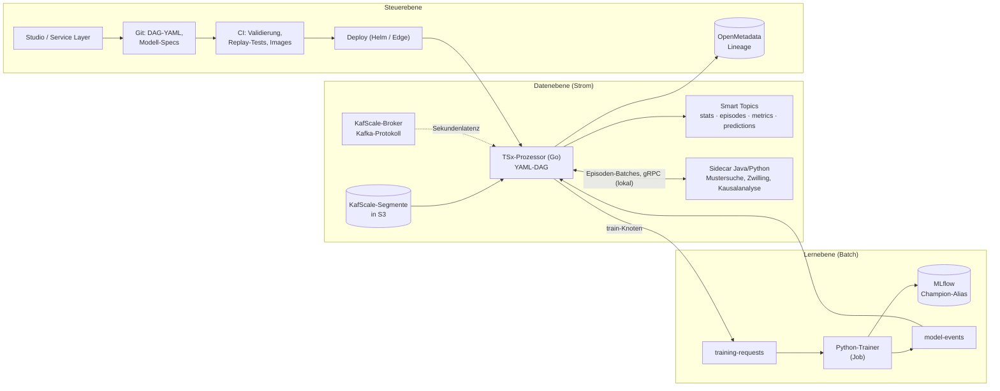

# OpenTSx – Smart-Topic-Prozessor und DevOps-Konzept

> Status: **Vorschlag**, 2026-10-12. Beantwortet die Frage: *Wie rechnen Smart Topics im Strom, schlank und mit
> unseren TSA-Algorithmen, ohne den Overhead von Flink oder Kafka Streams?* Bezüge:
> [05-SMART-TOPICS](05-SMART-TOPICS.md) (Smart Topics, Training, Prediction-API),
> [07-DIGITAL-TWIN-BSP](07-DIGITAL-TWIN-BSP.md) (Varianten T/L, Herkunft),
> [09-STUDIO-LABVIEW-STEUERPULT](09-STUDIO-LABVIEW-STEUERPULT.md) (Edge-Metriken, Kommandos).

---

## 1. Kurzfassung

1. **Ein Go-Prozessor in KafScale ist selbst der Rechner.** KafScale-Processors sind eigenständige Go-Programme. Sie
   lesen abgeschlossene Segmente direkt aus S3 und laufen neben dem Broker, nicht in ihm. Die Operatoren des DAG sind
   Go-Funktionen im selben Prozess. Es braucht weder Flink noch Kafka Streams.
2. **Kafka Streams scheidet unter KafScale aus.** Es braucht Compaction für die Changelogs seiner State Stores und
   Transaktionen für exactly-once. KafScale bietet beides nicht. Flink ginge (manuelle Zuweisung, eigene
   Checkpoints), ist aber für einen schlanken DAG zu schwer.
3. **Nicht alles nach Go portieren, sondern einen Stream-Kern.** Go bekommt die kleinen, deterministischen
   Operatoren, die im Strom laufen müssen:
   * Dekodieren und Normalisieren
   * Episoden bilden
   * Statistik und Sketches
   * Datenqualität
   * inkrementelle Segmentierung
   * Resampling
   * Scoring exportierter Modelle
   * Smart Metrics schreiben

   Die Parität sichern **gemeinsame Testvektoren**, wie bisher bei Sketch, SeriesId und Avro zwischen Java und
   Python.
4. **Training läuft nie im Strom.** Ein `train`-Knoten im DAG stößt nur an: Er schreibt eine Trainingsanfrage.
   Python trainiert im Batch, registriert das Modell in MLflow und meldet es. Der `score`-Knoten tauscht den
   Champion im laufenden Betrieb aus.
5. **Was es nur in Java oder Python gibt, läuft über einen Sidecar.** Das gilt für Mustersuche, Zwilling und
   Kausalanalyse. Der Go-Prozessor reicht ganze Episoden lokal per gRPC weiter. Weil eine Episode schon ein
   Mikro-Batch ist, bleibt der Aufruf billig.
6. **Ein deklarativer DAG (YAML), zwei Laufzeiten.** Go ist schlank, liest direkt aus S3 und läuft auch am Rand: auf
   dem Raspberry Pi an Bord oder dem Labor-PC. Java ist der bestehende Prozessor (`StatsProcessor`), verallgemeinert.
   Beide lesen dieselbe Spezifikation. Ein Konformitätstest prüft je Operator, dass die Ausgaben bytegleich sind.

---

## 2. Faktenlage: KafScale-Processors

Quelle ist das Repository [KafScale/platform](https://github.com/KafScale/platform), `addons/processors/`
(Stand 2026-10-12):

| Eigenschaft | Befund |
|-------------|--------|
| Art | eigenständige Go-Programme („storage-native“). Sie lesen abgeschlossene `.kfs`- und `.index`-Segmente aus S3 und sind weder Broker noch Kafka-Client. |
| Vorlagen | `skeleton` (Vorlage), `iceberg-processor` (Topics → Iceberg), `sql-processor` (Ad-hoc-SQL über Postgres-Wire, ohne kontinuierliche Abfragen) |
| Bausteine | Segmentsuche, Decoder nach `kafscale-spec.md`, YAML-Mapping, Sink-Interface (`Write(ctx, []Record)`), Lease je Partition mit Offset-Checkpoint (Backend etcd), Helm-Chart, Dockerfile |
| Semantik | at-least-once. Offsets rücken erst nach bestätigtem Schreiben vor. Skaliert je Partition; eine Partition wird nie auf mehrere Worker verteilt. |
| Latenz | Sekunden bis Minuten, weil nur abgeschlossene Segmente gelesen werden. Dafür ist der Betrieb einfacher und günstiger. |

**Folge für OpenTSx:** Ein TSx-Prozessor in Go folgt genau diesem Muster. Er ersetzt die Sink-Stufe durch einen
Operator-DAG. Der Neubau einer Stream-Engine entfällt; Lease, Checkpoint und Segmentdekodierung kommen aus der Vorlage.
Für Latenzen im Sekundenbereich gibt es den zweiten Eingang: Kafka-Protokoll über den Broker mit manueller Zuweisung,
wie heute im Java-`StatsProcessor`.

---

## 3. Optionen im Vergleich

| Option | Algorithmen | Betrieb | Passt zu KafScale | Rand (Pi, Labor-PC) | Bewertung |
|--------|-------------|---------|-------------------|---------------------|-----------|
| **Kafka Streams** | Java, direkt nutzbar | leicht | **nein:** State-Store-Changelogs brauchen Compaction, exactly-once braucht Transaktionen | mäßig | ausgeschlossen |
| **Flink** | Java, nutzbar | schwer (JobManager, TaskManager, State Backend) | ja, mit manueller Zuweisung und eigenen Checkpoints | nein | für große Joins und Fenster über viele Topics, nicht für den schlanken DAG |
| **Java-Prozessor** (wie `StatsProcessor`) | alle Java-Algorithmen direkt | mittel (JVM, ca. 150–300 MB) | ja (Kafka-Protokoll; Segmente aus S3 möglich, wenn ein Java-Decoder gebaut wird) | eingeschränkt | gut für Operatoren, die es nur in Java gibt (Mustersuche, Zwilling) |
| **Go-Prozessor (TSx-Kern)** | Stream-Kern neu in Go, Rest per Sidecar | sehr leicht (eine Binärdatei, ca. 20 MB Image) | **nativ**, auf Basis der Processor-Vorlage | **ja** | **Empfehlung** für die Datenebene |
| Alles nach Go portieren | alles neu | leicht | ja | ja | nein: großer Aufwand, Gefahr auseinanderlaufender Ergebnisse. Mustersuche, Zwilling und Kausalanalyse gehören nicht in den Strom. |
| WASM-Plugins (z. B. wazero) | Nutzerfunktionen portabel | leicht | ja | ja | später, für eigene Operatoren der Nutzer; numerisch noch unreif |

---

## 4. Architektur: drei Ebenen



* **Datenebene:** Der Prozessor liest aus S3 oder vom Broker, führt den DAG aus und schreibt Smart Topics. Er braucht
  nichts außer S3, etcd (oder Checkpoint-Dateien am Rand) und optional einen Sidecar.
* **Lernebene:** Training ist ein Batch-Job. Er wird über ein Topic angestoßen und quittiert. Die Daten wählt er
  über die Episoden-Abfrage (Iceberg oder Replay) und ist damit reproduzierbar.
* **Steuerebene:**
  * DAG und Modell-Spezifikationen sind versioniert in Git (GitOps).
  * CI validiert und testet gegen aufgezeichnete Segmente.
  * Das Deployment läuft per Helm oder am Rand per Binärdatei mit Konfigurationsdatei.
  * Das Studio bearbeitet den DAG.
  * OpenMetadata zeigt die Lineage, mit dem Spezifikations-Hash als Pipeline-Version.

---

## 5. Der deklarative Processor-DAG (Entwurf `opentsx.dag.v1`)

```yaml
dag: windpark-ostsee-smart
version: 3
source:
  kind: kafscale-s3              # oder kafscale-broker (Sekundenlatenz)
  s3: { bucket: kafscale-data, namespace: production }
  topics: [tsx.windpark.observations.v2]
checkpoint: { backend: etcd }    # am Rand: file
nodes:
  - id: decode
    op: decode.avro-soe          # v2 Single-Object-Encoding; JSON (opentsx.smartmetric.v1) ebenfalls
  - id: norm
    op: normalize
    in: [decode]
    params: { mapping: catalog/windpark-iec.yaml }
  - id: ep
    op: episodes.fixed-duration
    in: [norm]
    params: { duration: PT10M, lateness: PT2M }
  - id: stats
    op: stats.welford-ddsketch
    in: [ep]
    params: { windows: [PT10M, PT1H], alpha: 0.01 }
  - id: dq
    op: dq.checks
    in: [ep]
    params: { checks: [COMPLETENESS, PLAUSIBLE_RANGE, FLATLINE, GAPS] }
  - id: gusts
    op: segment.extremum
    in: [ep]
    params: { feature: MAX, prominence: 2.0, window: PT4M, distance: PT5M }
  - id: forecast
    op: score.onnx
    in: [ep, stats]
    params: { model: "models:/windpark-power/champion", context: [weather] }
  - id: retrain
    op: train.trigger            # rechnet nicht, stößt an
    in: [stats]
    params: { when: "drift(psi) > 0.2 or every P7D", spec: models/windpark-power.yaml }
  - id: similar
    op: sidecar.call             # nur bei Bedarf: Java-Mustersuche
    in: [gusts]
    params: { endpoint: "localhost:7071", method: PatternSearch.topK, k: 5 }
sinks:
  - { from: stats,    topic: tsx.windpark.series-stats.v2 }
  - { from: dq,       topic: tsx.windpark.dq.v1 }
  - { from: gusts,    topic: tsx.windpark.episodes.v2, labels: { segmentation: gust } }
  - { from: forecast, topic: tsx.windpark.predictions.v1 }
  - { from: retrain,  topic: tsx.windpark.training-requests.v1 }
```

Regeln:

* **Prüfung vor dem Start.** Die CI und der Prozessor prüfen den DAG vor dem Start: Operatoren müssen in der
  Laufzeit vorhanden sein, Typen passen (Observation, Episode, Stats, Prediction), es gibt keine Zyklen. Zustand gibt
  es nur in zustandsbehafteten Operatoren, mit Checkpoint.
* **Hash:** Der Spezifikations-Hash geht in die Provenienz jedes Ausgabesatzes ein, wie der Plan-Hash beim Zwilling.
* **Studio:** Der Node-Graph im Studio ist dieselbe Darstellung wie beim Zwilling. Ein Prozessor-DAG ist ein
  Schaltplan aus Stream-Operatoren.

---

## 5a. Vektor-Messpunkte: `align.vector` und `opentsx.vector.v1` (Entwurf)

> Stand: Entwurf vom 2026-10-13. Den Operator gibt es zweimal: in der Web-Workbench (`opentsx-saas-frontend`,
> `src/workbench/vector.ts`) und in Java (`opentsx-retrieval`, `VectorAligner`). Beide bestehen dieselben
> Testvektoren ([`testvectors/align-vector.v1.json`](testvectors/align-vector.v1.json)). Der Retrieval-Server führt
> Vektor-Sinks als **Einmal-Lauf** aus und schreibt das Topic (`POST /v1/dags/run`, siehe unten). Eine
> Stream-Laufzeit, die fortlaufend rechnet, gibt es noch nicht. Das Nachrichtenformat ist JSON; eine Avro-Fassung
> ist offen.

**Wozu.** Ein Sink schreibt bisher das Ergebnis genau eines Knotens, und jede Nachricht trägt einen Wert einer
Reihe. Wer "alle Werte zum Zeitpunkt t" braucht (Modell-Eingang, Zustandsvektor einer Anlage, Vergleich von Roh- und
abgeleitetem Wert), muss mehrere Topics selbst über die Zeit zusammenführen. `align.vector` macht das im DAG: Es
bringt die Ergebnisse mehrerer Knoten auf einen gemeinsamen Takt und schreibt je Takt und Schlüssel **einen
Messpunkt mit einem Wert je Komponente**.

```yaml
nodes:
  - id: zscore
    op: norm.zscore
    in: [decode]
  - id: vec
    op: align.vector
    in: [decode, zscore]                 # Reihenfolge = Reihenfolge der Komponenten
    params: { every: PT60S, key: turbine, agg: MEAN, fill: as-of, maxAge: PT120S, emit: any, names: [raw, standardized] }
sinks:
  - { from: vec, topic: tsx.wind.smart.turbine-state.vectors.v1, schema: opentsx.vector.v1 }
```

**Regeln.**

| Begriff | Regel |
|---------|-------|
| **Takt** (`every`) | Ticks sind Vielfache von `every` seit 1970-01-01T00:00:00Z. Tick *k* deckt das halboffene Intervall [k · every, (k + 1) · every). Der Takt hängt damit nicht vom ersten Messwert ab; zwei Läufe und zwei Laufzeiten schneiden gleich. |
| **Komponente** | Jeder Eingang (`in`) ist eine Komponente, benannt über `names`. Ihr Wert im Tick ist das Aggregat (`agg`: `MEAN`, `LAST`, `FIRST`, `MIN`, `MAX`, `SUM`, `COUNT`) der Werte des Eingangs im Tick; NaN zählt nicht. Trägt ein Eingang je Schlüssel mehrere Reihen, entsteht je Reihe eine Komponente `<name>.<metrik>` (bei nur einem Eingang ohne Präfix), in Namensordnung. Die Reihenfolge hängt so nicht davon ab, in welcher Folge die Reihen eintreffen. |
| **Schlüssel** (`key`) | Was zusammen einen Vektor bildet. `series`: dieselbe Reihe (seriesId) in allen Eingängen. Ein Tag-Name wie `turbine`: alle Reihen mit demselben Wert dieses Tags, also verschiedene Kanäle einer Anlage. `all`: alles in einem Vektor. |
| **Fehlende Werte** | Eine Komponente ohne Wert im Tick ist `null`. Mit `fill: as-of` übernimmt sie den letzten Wert, wenn er nicht älter als `maxAge` ist (dieselbe Regel wie die Kontext-Joins in 05). |
| **Ausgabe** (`emit`) | `any`: ein Messpunkt, sobald mindestens eine Komponente einen Wert hat. `complete`: nur Ticks, in denen alle Komponenten einen Wert haben. |
| **Zeitstempel** | `ts` ist das Ende des Ticks, also der Zeitpunkt, ab dem der Vektor vollständig ist. `window` nennt Anfang und Ende. |
| **Achsen** | Nur Eingänge mit Zeitachse. Spektren, Histogramme und Skalenfunktionen (FFT, PDF, DFA) sind keine Komponenten eines Zeitvektors. |

**Nachricht** (JSON-Schema: [`schemas/opentsx.vector.v1.schema.json`](schemas/opentsx.vector.v1.schema.json)):

```json
{
  "schema": "opentsx.vector.v1",
  "vector": "turbine-state",
  "key": { "turbine": "T05" },
  "ts": "2026-10-01T00:01:00.000Z",
  "window": { "from": "2026-10-01T00:00:00.000Z", "to": "2026-10-01T00:01:00.000Z" },
  "clock": "PT60S",
  "components": ["raw.wind_speed", "raw.power_active", "standardized.wind_speed", "standardized.power_active"],
  "values": [10.99, 1966.46, 2.53, null],
  "missing": 1
}
```

Die Werte stehen als Liste in der Reihenfolge von `components`, nicht als Abbildung Name → Wert: Ein Vektor hat
eine feste Ordnung, und ein Modell liest ihn ohne Namensauflösung. Die Liste `components` steht trotzdem in jeder
Nachricht, damit ein Leser ohne DAG auskommt. Der Kafka-Schlüssel der Nachricht ist der kanonische Text von `key`,
damit alle Messpunkte einer Anlage in einer Partition und in Zeitordnung liegen.

**Einmal-Lauf im Retrieval-Server.** Mit `--kafscale` und `--dag-runs true` nimmt der Retrieval-Server unter
`POST /v1/dags/run` einen DAG als YAML entgegen. Er rechnet dessen Vektor-Sinks über die Episoden, die er aus
`tsx.<domain>.episodes.v2` im Speicher hält, und hängt die Messpunkte an das Sink-Topic an (eine Partition,
Kafka-Schlüssel = `key`, Provenienz mit DAG-Name und Hash des Dokuments). Danach liest er das Topic zurück: Jede
Komponente erscheint im TS-Inventar als Reihe `smart.<name>.<komponente>` mit dem Tag `vector=<name>` und lässt
sich wie jede andere Reihe laden.

| Punkt | Regel des Einmal-Laufs |
|-------|------------------------|
| Was läuft | `align.vector`, dessen Eingänge alle direkt die Quelle sind (`in: [decode]`). Steht ein anderer Operator davor, lehnt der Server den DAG ab und nennt den Knoten. |
| Welche Reihen | `source.series` nennt die Reihen (seriesId) des Quell-Topics; fehlt die Angabe, alle. Die Workbench schreibt die im Inventar gewählten Reihen hinein. |
| Sink | nur `tsx.<domain>.smart.<name>.vectors.v1` der Domäne des Servers; das Topic wird bei Bedarf angelegt. |
| Wiederholung | Ein zweiter Lauf hängt erneut an (KafScale kompaktiert nicht). Beim Lesen gilt je Schlüssel und Tick der spätere Messpunkt. Messpunkte eines früheren Laufs mit anderem Takt oder anderen Komponenten zählen nicht zur Reihe. |
| Grenzen | höchstens 500000 Messpunkte je Lauf; kein Checkpoint, kein Folgen des Quell-Topics; kein Alles-oder-nichts (bestätigt der Broker nur einen Teil, schlägt der Lauf fehl, und der Teil bleibt im Topic). |
| Zugriff | Mit Lauf-Token (`OPENTSX_DAG_RUN_TOKEN`) nimmt der Server Läufe nur mit dem Header `X-OpenTSx-Run-Token` an. Das SaaS-Backend kennt das Token, prüft das Konto und reicht weiter (`POST /api/v1/dags/run`). Ohne Token kann jeder schreiben, der den Port erreicht. |

**Für eine Stream-Laufzeit folgt aus den Regeln:**

* **Zustand:** je Schlüssel und Komponente das Aggregat des offenen Ticks und der letzte Wert mit Zeit (für
  `as-of`). Das ist beschränkt und kommt in den Checkpoint wie bei `stats.welford-ddsketch`.
* **Abschluss eines Ticks:** nach Ereigniszeit, mit erlaubter Verspätung (`lateness`, Abschnitt 7). Kommt ein Wert
  später, entsteht eine neue Revision des Messpunkts; die Id eines Messpunkts ist deterministisch aus Vektor,
  Schlüssel und Tick.
* **Mehrere Eingänge:** Die Eingänge stammen aus demselben Quell-Topic, liegen also je Partition in derselben
  Ordnung vor. Vektoren über mehrere Topics hinweg brauchen einen Join über Partitionen; das ist Flink-Gebiet (D25)
  und hier nicht abgedeckt.

---

## 5b. Fortlaufender Betrieb der Vektor-Sinks (Vektor-Prozessor)

> Stand: 2026-10-13. Umgesetzt in `opentsx-retrieval` (`VectorStream`, `VectorProcessor`, `VectorProcessorApp`,
> Kommando `opentsx vectors`), mit Tests und einem Lauf gegen den Labor-Broker. Die k3s-Komponente, der Deploy-Weg
> über das Backend und die Anzeige in der Workbench folgen (TASK-013, 013.16).

Der Einmal-Lauf aus 5a rechnet, was gerade da ist. Der Vektor-Prozessor hält einen Vektor-Sink dauerhaft aktuell: Er
folgt `tsx.<domain>.episodes.v2` und hängt die Messpunkte an, sobald sie endgültig sind.

**Steuerung über Topics.**

| Topic | Inhalt | Regel |
|-------|--------|-------|
| `tsx.<domain>.dags.v1` | `opentsx.dag-control.v1`: `dag`, `state` (`deployed` oder `stopped`), `spec` (das DAG-Dokument), `by`, `at` | Schlüssel ist der DAG-Name; je Name gilt der letzte Eintrag. Ein Deployment überlebt damit jeden Neustart des Prozessors. |
| `tsx.<domain>.dag-status.v1` | `opentsx.dag-status.v1`: `dag`, `vector`, `topic`, `state` (`waiting`, `running`, `failed`, `stopped`), `records`, `watermark`, `waitingFor`, `skippedBlocks`, `error`, `at` | Schlüssel `<dag>/<vector>`; der letzte Eintrag gilt. Bei Zustandswechsel und alle 30 s. |

**Semantik.**

| Punkt | Regel |
|-------|-------|
| Läufer | Je Vektor-Sink ein Läufer mit eigenem Consumer, eigenen Lesepositionen und eigenem Zustand. Ein neuer oder geänderter DAG beginnt am Anfang des Quell-Topics (`source.start: earliest`, Voreinstellung) oder mit dem, was ab jetzt kommt (`latest`), ohne die anderen zu berühren. |
| Reihen | `source.series` ist Pflicht. Solange eine genannte Reihe noch nie gesehen wurde, wird nichts geschrieben (`waiting`): Erst dann steht fest, welche Reihen einen Vektor bilden und wie die Komponenten heißen. |
| Abschluss eines Ticks | Ein Tick ist endgültig, wenn **jede** genannte Reihe sein Ende erreicht hat, plus `lateness` (Parameter des Knotens, Voreinstellung keine). Maßgeblich ist das Ende der Episode (`tEnd`), nicht der letzte Messwert. Bei Episoden von 10 Minuten und 60 s Takt erscheinen also je Schlüssel zehn Messpunkte auf einmal. |
| Reihenfolge je Reihe | Eine Episode muss dort beginnen, wo die vorige derselben Reihe endete, oder später. Sonst wird sie übersprungen und gezählt (`skippedBlocks`): ein Duplikat nach einem wiederholten Schreibversuch oder Daten außer der Reihe. `lateness` gleicht also den Versatz **zwischen** Reihen aus, nicht verspätete Episoden einer Reihe. |
| Checkpoint | Je Läufer eine Datei im Zustandsverzeichnis: Lesepositionen und Zustand (offene Ticks, letzter Wert je Reihe für `as-of`, Fortschritt). Geschrieben wird sie erst, wenn der Broker alle Messpunkte bestätigt hat. Nach einem Absturz wiederholt der Läufer höchstens, was er seit dem letzten Checkpoint geschrieben hat; die Werte sind dieselben, und Leser nehmen den späteren Messpunkt. |
| Broker-Fenster | Lesen wartet (`Patience`), Schreiben wiederholt bis zum Delivery-Timeout. Bestätigt der Broker nicht alles, geht der Läufer in `failed` und setzt nach einer Minute am letzten Checkpoint neu an. |
| Gleichheit mit dem Einmal-Lauf | Mit allen Daten gefüttert liefert `VectorStream` dieselben Messpunkte wie `VectorAligner`, unabhängig davon, in welcher Folge die Reihen eintreffen (Test `VectorStreamTest`). |

**Grenzen.** Genau ein Prozessor je Domäne (kein Lease, keine Gruppe). Eine Reihe, die verstummt, hält ihren
Vektor an: Es gibt keinen Leerlauf-Timeout, der Status zeigt aber, worauf gewartet wird. Vektoren wie in 5a nur
direkt auf den Reihen der Quelle. Der Zustand eines Läufers liegt im Arbeitsspeicher und im Checkpoint; bei sehr
vielen Reihen mit großem Versatz wächst er mit der Zahl offener Ticks.

---

## 6. Operator-Katalog und Laufzeiten

| Operator | Go (Kern) | Java | Python | Parität |
|----------|-----------|------|--------|---------|
| `decode.avro-soe`, `decode.json-smartmetric` | ja | ja (vorhanden) | ja (vorhanden) | Testvektoren vorhanden (Avro SOE) |
| `normalize` (Katalog/Mapping) | ja | ja (Windpark-Normalizer) | – | Golden Files |
| `episodes.fixed-duration`, `episodes.fixed-count` | ja | ja | – | Episoden-Ids deterministisch |
| `stats.welford-ddsketch` | ja | ja (`opentsx-stats`) | ja (`opentsx.stats`) | **Sketch-Testvektor vorhanden** |
| `dq.checks` | ja | ja | – | Golden Files |
| `segment.threshold`, `segment.extremum` (inkrementell) | ja | ja (`opentsx-retrieval`) | – | Streaming = Batch, Testsuite vorhanden |
| `resample` | ja | ja | – | Golden Files |
| `align.vector` (Abschnitte 5a, 5b) | geplant | ja: Einmal-Lauf (`VectorAligner`) und fortlaufend (`VectorProcessor`), beide in `opentsx-retrieval` | n/a | **gemeinsame Testvektoren vorhanden** (Java und TypeScript, `testvectors/align-vector.v1.json`) |
| `score.onnx` | ja (onnxruntime über cgo) **oder** reine Go-Modelle (linear, ES, konforme Intervalle) | ja (ONNX Runtime) | Training | Toleranz statt Bytegleichheit (Fließkomma) |
| `train.trigger` | ja | ja | – | – |
| `twin.step` (Zwilling) | später, für Variante L | ja (`opentsx-twin`) | – | L(0) = T |
| `pattern.search` (MASS/DTW) | nein, `sidecar.call` | ja | – | – |
| Kausalanalyse (PCMCI, mTE) | nein | nein | ja (Batch, P8.2) | – |

**Grenze des Go-Kerns:** In Go kommt, was im Strom pro Partition mit beschränktem Zustand laufen muss. Was über
Historie sucht, optimiert oder lernt, bleibt in Java oder Python und wird angestoßen oder abgefragt.

---

## 7. Semantik

* **Lieferung:** at-least-once, wie bei den KafScale-Processors. Weil Episoden-Ids, Stats-Schlüssel und
  Kommando-Ids **deterministisch** sind, verwerfen die Leser Duplikate. Iceberg schreibt idempotent über den
  Schlüssel. Das ergibt **effektiv genau einmal**, ohne Transaktionen.
* **Ordnung und Zeit:** Die Ordnung gilt je Partition. Zeit ist Ereigniszeit mit erlaubter Verspätung (`lateness`)
  wie in P4. Verspätete Daten erzeugen eine neue Revision der Episode (`revision`) statt eines stillen Verlusts.
* **Zustand:** Zustand haben nur Statistik, Segmentierer, Episodenbildung und Scoring (Modellversion). Er wird mit
  dem Offset in den Checkpoint geschrieben. Ein Neustart setzt bitgleich fort; das gleiche Prinzip wie die Snapshots
  beim Zwilling.
* **Backfill:** Weil der Prozessor aus S3 liest, ist Backfill nur ein Lauf derselben Version über alte Segmente,
  ohne Sonderpfad.

---

## 8. DevOps-Lebenszyklus

| Schritt | Wie |
|---------|-----|
| **Entwickeln** | DAG-YAML im Repo; lokal `tsx-processor run --dag x.yaml --source file:segments/` gegen aufgezeichnete Segmente |
| **Validieren (CI)** | Schema- und Typprüfung des DAG, Verfügbarkeit der Operatoren je Laufzeit, **Operator-Konformität Go ↔ Java** (gemeinsame Testvektoren), **Replay-Test:** aufgezeichnete Segmente → erwartete Ausgaben (Hash) |
| **Bauen** | eine Go-Binärdatei je Architektur (amd64, arm64 für den Pi), Distroless-Image, signiert; Java-Sidecar als eigenes Image |
| **Ausrollen** | Kubernetes per Helm (Vorlage aus KafScale), je Partition eine Lease; am Rand per systemd-Unit mit Checkpoint-Datei |
| **Schattenbetrieb** | Die neue DAG-Version läuft parallel und schreibt in `…shadow`-Topics. Ein Vergleichsjob prüft die Abweichungen (Statistik, Vorhersagegüte) und gibt erst dann frei. |
| **Umschalten / Zurückrollen** | Konfiguration wechseln; Offsets bleiben je Version getrennt; Rücksprung ist ein Konfigurationswechsel |
| **Modell-Lebenszyklus** | `train.trigger` → Trainingsanfrage → Python-Job → MLflow (`challenger`) → Schattenbewertung → Alias `champion` → `model-events` → `score` lädt neu, ohne Neustart |
| **Beobachten** | Prometheus-Metriken: Rückstand je Partition, Verarbeitungszeit je Operator, verspätete Daten, DQ-Quoten; Lineage und Version in OpenMetadata |
| **Mandanten** | im Personal Service Layer ein Namespace je Nutzer und System (Haus, Boot, Labor), gleiche Binärdatei, eigener DAG |

---

## 9. Was das für die drei Szenarien heißt

| Szenario | Laufzeit | DAG (Kurzform) |
|----------|----------|----------------|
| Energieverbund (Windpark, Elektrolyse) | Go im Cluster + Java-Sidecar (Zwilling) | Messwerte → Episoden → Statistik/DQ → Prognose → Zwilling-Schritt → Kennzahlen |
| Haus (Erzgebirge) | Go auf einem kleinen Rechner im Haus oder zentral | Zähler/Smart Plugs/Tankstand → Episoden (1 h) → Statistik → Heizgradtage → Abgleich mit dem Hausmodell |
| Boot (Etap 22) | **Go auf dem Raspberry Pi an Bord**, Checkpoint-Datei, lädt hoch, wenn Starlink oder Hafen-WLAN da ist | Powerstation/USB-Messer/Starlink → Episoden (5 min) → Ladezustand/Autarkie → Prognose aus Solar und Nutzungsmuster |

---

## 10. Entscheidungen (Vorschläge)

| Nr. | Thema | Vorschlag |
|-----|-------|-----------|
| D25 | Stream-Laufzeit | Go-TSx-Prozessor auf Basis der KafScale-Processor-Vorlage für die Datenebene; kein Kafka Streams; Flink nur für große Joins und Fenster über viele Topics |
| D26 | Algorithmen in Go | nur der Stream-Kern (Abschnitt 6) mit gemeinsamen Testvektoren; Mustersuche, Zwilling und Kausalanalyse bleiben in Java/Python (Sidecar oder Batch) |
| D27 | DAG-Spezifikation | `opentsx.dag.v1` (YAML), sprachneutral, gehasht, von Go und Java gelesen; Studio bearbeitet sie |
| D28 | Training | nie im Strom; `train.trigger` → Trainingsanfrage → Python/MLflow → `model-events` → Austausch im laufenden Betrieb |
| D29 | Semantik | at-least-once + deterministische Ids = effektiv genau einmal; Ereigniszeit mit Revisionen statt Verwerfen |
| D37 | Vektor-Messpunkte | `align.vector` als Operator mit mehreren Eingängen, Nachricht `opentsx.vector.v1`, Takt an der Epoche ausgerichtet, Werte als geordnete Liste (Abschnitt 5a) |
| D39 | Fortlaufender Betrieb | eigener Vektor-Prozessor nach dem Muster des Stats-Prozessors; Deployments über das Steuer-Topic `tsx.<domain>.dags.v1`, Status über `tsx.<domain>.dag-status.v1`; ein Läufer je Sink mit Checkpoint-Datei (Abschnitt 5b) |
| D38 | Erste Ausführung | Vektor-Sinks laufen als Einmal-Lauf im Retrieval-Server (Java), bis es den Stream-Prozessor gibt; Parität über gemeinsame Testvektoren (Abschnitt 5a) |

## 11. Offene Punkte

* **Vektor-Messpunkte (5a):** Avro-Fassung von `opentsx.vector.v1` und ihr Platz im Modell v2; Qualitätsbyte je
  Komponente statt nur `null`; Einheiten der Komponenten (heute nur in der Workbench bekannt); die Testvektoren
  auch für Go; Vektoren über mehrere Quell-Topics; im fortlaufenden Betrieb (5b) ein Leerlauf-Timeout für
  verstummte Reihen und ein Lease, das eine zweite Instanz verhindert.
* **Latenz:** Reichen Sekunden bis Minuten (nur abgeschlossene Segmente)? Sonst ist der Broker-Eingang (Kafka-Protokoll)
  für den Go-Prozessor der Standard.
* **ONNX in Go:** onnxruntime über cgo (größere Images, plattformabhängig) oder zunächst nur reine Go-Modelle
  (lineare, ES, Quantilregression)? Vorschlag: zuerst reine Go-Modelle; ONNX, wenn ein Modell es braucht.
* **Leases ohne etcd:** Am Rand (Pi, Labor-PC) gibt es kein etcd. Dort reichen eine Checkpoint-Datei und eine
  einzige Instanz.
* **Repository:** Lebt der Go-Prozessor in OpenTSx (`opentsx-processor-go/`) oder als Addon im KafScale-Repo?
  Vorschlag: in OpenTSx, mit der KafScale-Vorlage als Abhängigkeit.
