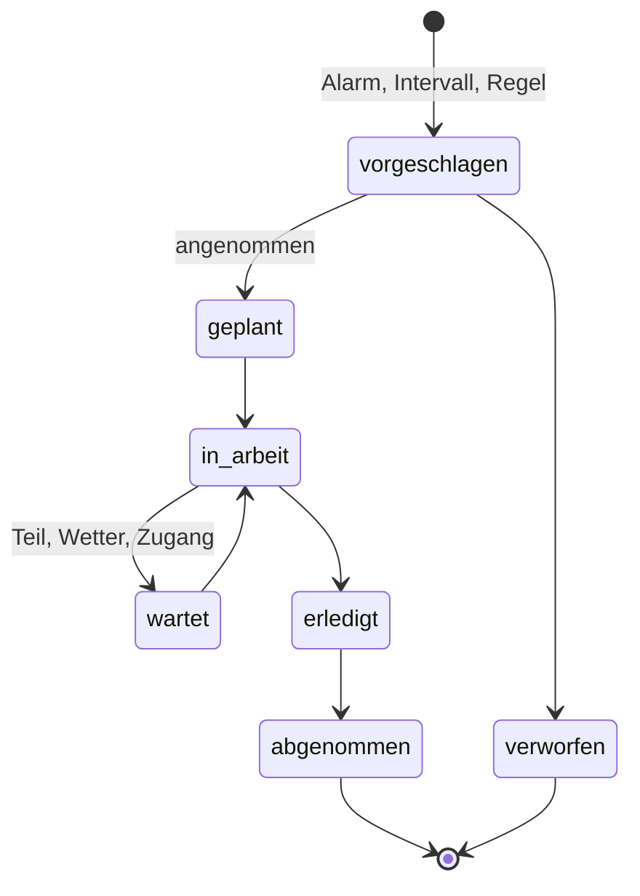

# OpenTSx – Anlage erkunden: exploratives UI, visuelles Inventar und Wartung (Konzept)

> Status: **Konzept und statischer Prototyp**, 2026-10-12. Vierte Ansicht des Studios
> ([09-STUDIO-LABVIEW-STEUERPULT](09-STUDIO-LABVIEW-STEUERPULT.md)) neben Statistik, Was-wäre-wenn und Node-Graph.
> Gehört zu P7e (Personal Service Layer) und P9 (Digitaler Zwilling, [07-DIGITAL-TWIN-BSP](07-DIGITAL-TWIN-BSP.md)).
> Prototyp: [`docs/prototypes/anlagen-explorer.html`](../prototypes/anlagen-explorer.html) (eine Datei, ohne
> Netzwerkzugriff). Beispielinventar:
> [`opentsx-twin/src/main/resources/twin/inventar-beispiel.yaml`](../../opentsx-twin/src/main/resources/twin/inventar-beispiel.yaml).
> Szenarien: H2-Kette mit Windpark (07), Haus im Erzgebirge ([08](08-HAUS-ZWILLING.md)), Boot Etap 22
> ([10](10-BOOT-ZWILLING.md)).
>
> **Alle Anlagendaten im Prototyp und im Beispielinventar sind erfunden und als Beispiel gekennzeichnet.** Hinweise
> auf Normen, Lizenzen und Fremdsysteme sind nach bestem Wissen formuliert; was nicht am Original geprüft ist, steht
> als **„zu prüfen“** da.

---

## 1. Kurzfassung

* **Wozu:** Man kennt Portfolios mit Fotos, Dokumenten und technischen Datenblättern. Die Ansicht **„Anlage
  erkunden“** macht daraus eine begehbare Darstellung des Systems: ein **visuelles Inventar** mit Abbildungen der
  Wirklichkeit, eingebettet in eine Karte (Windpark), einen Grundriss (Haus) oder einen Decksplan (Boot).
* **Wie:** Navigation wie in einem Strategiespiel. Übersicht → Objekt → Komponente, Hover zeigt eine kleine Karte mit
  Foto, Kennzahlen, Livewert und Wartungsstatus, ein Klick öffnet das Datenblatt mit Dokumenten, Historie,
  Messreihen und Wartung.
* **Gemeinsamer Anker:** Jedes sichtbare Element ist eine **Atom-Instanz des Schaltplans** oder ein Unterobjekt
  davon. Livewerte, Kennzahlen, Was-wäre-wenn, Smart Topics und Wartung hängen an **derselben Id**. Das Inventar
  erfindet keine zweite Anlagenstruktur.
* **Foto-realistisch heißt echt:** bevorzugt echte Fotos, Drohnen- und 360°-Bilder des Eigentümers, mit Herkunft und
  Lizenz je Bild. Illustrationen sind erlaubt, aber immer als solche gekennzeichnet. Nichts Generiertes wird als
  echtes Foto ausgegeben.
* **Wartung:** Aufträge, Inspektionen, Befunde, Ersatzteile und Intervalle hängen am Inventar. Alarme aus dem
  Zwilling werden zu Auftragsvorschlägen, erledigte Aufträge zu Ereignissen im Zwilling. Wartungsereignisse laufen
  als Topic `tsx.<domain>.maintenance.v1`.
* **Live-Zustand:** infinimesh liefert die Geräteebene (`reported`, online/offline), das OpenTSx-Inventar die
  Bedeutung (Ort, Bilder, Dokumente, Wartung, Atom-Id), §10.

---

## 2. Einordnung: die vierte Ansicht des Studios

| Ansicht | Frage | Anker |
|---------|-------|-------|
| Statistik | Was sagen die Zahlen? | Reihen (`SeriesKey`) |
| Prognose & Was-wäre-wenn | Was könnte passieren, was wäre wenn? | Lauf-Id, Snapshot |
| Node-Graph | Wie ist das System verschaltet? | Schaltplan (`TwinPlan`), Atom-Id, Port |
| **Anlage erkunden** | **Wo steht was, wie sieht es aus, in welchem Zustand ist es, was ist zu tun?** | **Atom-Id (+ Unterobjektpfad), Ort** |

Die vier Ansichten sind Sichten auf dasselbe Modell. Daraus folgen drei Sprünge, die in jeder Richtung gehen:

* **Explorer → Node-Graph:** „Im Schaltplan zeigen“ markiert den Knoten `ely` mit seinen Drähten.
* **Explorer → Statistik:** „Messwerte“ öffnet die Reihen, deren Tags auf die Atom-Id zeigen.
* **Explorer → Was-wäre-wenn:** „Wartung verschieben“ startet eine Alternative mit geändertem Verfügbarkeitsfenster
  (§7.5).

Die Rolle im MVC+P-Vertrag (07 §2.2): Der Explorer ist eine weitere **View** des Atoms. Das Inventar ergänzt das
Atom um Dinge, die das Modell nicht braucht, die Menschen aber zum Verstehen und Warten brauchen: Ort, Aussehen,
Typenschild, Dokumente und Wartungsgeschichte.

---

## 3. Räumliche Ebenen

Jedes System bekommt eine **Grundfläche** (Karte oder Plan) mit eigenem Koordinatensystem. Inventarobjekte tragen
eine Position darin.

### 3.1 Windpark mit Elektrolyseur: Geo-Karte

| Ebene (LoD) | Sichtbar | Koordinaten |
|-------------|----------|-------------|
| 0 Region | Park als ein Symbol, Netzverknüpfungspunkt, Elektrolyseur, Abnehmer, Verlauf der H2-Leitung | WGS84 |
| 1 Park | einzelne WEA (T01 …), Umspannwerk/Übergabestation, Zähler, Batteriespeicher, Elektrolyseur-Container, Leitungstrasse mit Druckmessstellen | WGS84 |
| 2 Objekt | eine WEA: Turm, Gondel, Rotor als Schemabild oder Foto; Komponentenpunkte (Gondel, Getriebe, Generator, Umrichter, Trafo, Blattlager) | Bildkoordinaten des Objektbilds (Plan-Id) |
| 3 Komponente | Typenschild, Datenblatt, Sensoren (IEC-Datenpunkte), Wartungshistorie | – |

Überlagerungen: **Wake-Sektoren** je Windrichtung (aus 07 §8, Simulationsreferenz bzw. P8-Schätzung, deutlich
getrennt), Leitungsdruck entlang der Trasse, Abregelung je Anlage.

Bezug zum Code: Das Atom `park` der H2-Kette (`h2-chain.yaml`) ist heute eine aggregierte Erzeugung mit 12 MW. Im
Inventar wird es in Unterobjekte `park/T01` … `park/T04` (je 3 MW, Beispiel) aufgelöst. Die Benennung T01 … folgt
dem Windpark-Simulator (`opentsx-windpark/scenarios/ostsee-demo.yaml`). Sobald WEA-Atome existieren (07 §9a, offen),
wird aus dem Unterobjekt ein eigenes Atom; die Id bleibt gleich.

### 3.2 Haus: Bauplan

| Ebene | Sichtbar | Koordinaten |
|-------|----------|-------------|
| 0 Grundstück | Haus, Holzlager, Zählerschrank, ggf. Tankbefüllstutzen | Lageplan (m) oder WGS84 |
| 1 Geschoss | **Kellergeschoss** (Heizraum mit Ölkessel und 150-l-Speicher, Tankraum mit 2 × 2.000 l, Gefriertruhe, Zähler), **Erdgeschoss** (Wohnzimmer mit Kaminofen, Küche mit Herd, Kühlschrank, Radio, TV), **Obergeschoss** (Schlafzimmer, Bad, Arbeitszimmer mit Router) | Grundriss in m, je Geschoss eine Plan-Id |
| 2 Gerät | Kessel mit Brenner, Umwälzpumpe, Abgasweg; Tank mit Füllstandsanzeige | Bildkoordinaten |
| 3 Komponente | Brennerdüse, Ölfilter, Typenschild, Schornsteinfeger-Protokoll | – |

Die Atome aus `haus-erzgebirge.yaml` (`boiler`, `stove`, `tank`, `meter`, `dhw`, `woodstore`, `appliances`) sind die
Anker; die Geräte aus `appliances.inventory` (z. B. `kuehlschrank`, `gefriertruhe`) werden Unterobjekte
`appliances/kuehlschrank`. Das Gebäude selbst (`building`) ist der Rahmen des Plans.

### 3.3 Boot Etap 22: Decks- und Kajütplan

| Ebene | Sichtbar | Koordinaten |
|-------|----------|-------------|
| 0 Revier | Liegeplatz, Ankerplätze, Törnroute | WGS84 |
| 1 Boot | Draufsicht (Decksplan ≈ 6,6 m): Solarmodule auf Deck/Bimini, Starlink-Antenne, UKW-Antenne am Masttopp, Landstromeinspeisung; Kajüte: Powerstation, Raspberry Pi, UKW-Funkgerät, Ladeplätze für Laptops und Telefon | Plan in m ab Bug, Mittschiffslinie |
| 2 Gerät | Powerstation mit Anschlüssen (12 V, USB-C, 230 V, Solar, AC-Eingang) | Bildkoordinaten |
| 3 Komponente | Kabel, Sicherung, Steckverbinder, Seriennummer | – |

Die Atome aus `boot-etap22.yaml` (`station`, `solar`, `shore`, `starlink`, `vhf`, `raspi`, `laptop1`, `laptop2`,
`phone`) sind die Anker. Die Maße des Plans sind schematisch; die Etap 22 hat je nach Quelle rund 6,6–6,7 m Länge
(zu prüfen am Bootsbrief).

### 3.4 Gemeinsame Bedienelemente

| Element | Verhalten |
|---------|-----------|
| **Level-of-Detail** | Zoom oder Doppelklick wechselt die Ebene (Übersicht → Objekt → Komponente); Symbole vereinfachen sich beim Herauszoomen, Beschriftungen erscheinen ab einer Mindestgröße |
| **Hover-Karte** | Abbildung (Foto oder gekennzeichnete Illustration), 2–4 Kennzahlen, Livewert mit **Herkunftsabzeichen** (`Origin` des Zwillings: `MEASURED`, `REPORTED`, `FORECAST`, `ESTIMATED`, `SYNTHETIC`), Zustand, offene Wartung, Gerätestatus aus infinimesh |
| **Klick → Datenblatt** | Seitenleiste mit Reitern: Übersicht (Galerie, Typenschild), Dokumente (Datenblatt, Handbuch, Zertifikat, Garantie), Wartung (Aufträge, Intervalle, Historie), Messwerte (Reihen, Smart Topics, Ports aus dem Schaltplan) |
| **Brotkrumen** | System › Ebene › Objekt › Komponente, jede Stufe anklickbar |
| **Mini-Karte** | zeigt den sichtbaren Ausschnitt, Klick springt dorthin |
| **Suche** | nach Id, Name, Typ, Seriennummer, IEC-/RDS-Kennzeichen |
| **Filter** | Zustand (ok/Warnung/Störung), **Wartung fällig**, Herkunft der Livewerte, Typ |
| **Zeitregler** | Zustand zum Zeitpunkt t: Werte aus dem Schattenlauf bzw. Replay (KafScale, Iceberg-Zeitreise); Wartungsstand zum Zeitpunkt t |
| **Ebenenschalter** | Livewerte, Alarme, Wartung, Wake-Sektoren, Leitungsdruck, Beschriftungen |

---

## 4. „Foto-realistisch“: Optionen und Empfehlung

| Option | Wirkung | Aufwand | Risiko | Empfehlung |
|--------|---------|---------|--------|------------|
| **Echte Fotos des Eigentümers** (Handy, Drohne, 360°-Panorama) | höchste Glaubwürdigkeit, zeigt den echten Zustand (Rost, Ölspuren, Verkabelung) | gering je Bild, Pflege nötig | Privatsphäre (Haus, Boot), Fluggenehmigung bei Drohnen (zu prüfen je Standort) | **bevorzugt**, Herkunft und Lizenz je Bild |
| **Orthofotos/Luftbilder als Grundkarte** | Park und Leitungstrasse in echter Umgebung | gering, wenn offen lizenziert | Lizenz und Namensnennung; Aktualität | für Windpark und Revier; Quellen unten |
| **Straßenkarte** (OpenStreetMap-Daten) | Orientierung | gering | Nutzungsbedingungen der öffentlichen Kachelserver | eigene Vektorkacheln oder ein Anbieter mit passenden Bedingungen statt `tile.openstreetmap.org` |
| **Isometrische Renderings / 3D (glTF 2.0)** | spielartige Anmutung, Komponenten im Raum | hoch (Modelle) | Herstellermodelle meist nicht frei | spätere Stufe E4 |
| **Generierte Illustrationen** | schnell, einheitlich | gering | **Verwechslung mit echten Fotos** | nur als Platzhalter, immer mit Kennzeichnung „Illustration“ |

Quellen für Grundkarten (Stand der Kenntnis, **alle Lizenzangaben zu prüfen**):

* **Amtliche Orthofotos** (DOP20) der Länder-Geoportale; mehrere Länder stellen sie inzwischen unter offenen Lizenzen
  bereit (z. B. Datenlizenz Deutschland – Namensnennung 2.0). Für den Park an der Ostsee das Geoportal
  Mecklenburg-Vorpommern bzw. Schleswig-Holstein, für das Haus Sachsen (GeoSN). Lizenz je Land prüfen.
* **basemap.de** (BKG und Länder) als amtliche Grundkarte; Lizenz und Nutzungsbedingungen zu prüfen.
* **OpenStreetMap-Daten** (ODbL) für Wege und Gebäude; Seezeichen über **OpenSeaMap**. Nicht für die Navigation
  an Bord, nur zur Orientierung.

**Bildherkunft im Inventar.** Jedes Medium trägt `kind` (`photo`, `drone`, `pano360`, `orthophoto`, `render`,
`illustration`), `reality` (`real` oder `illustration`), Quelle, Datum, Urheber, Lizenz und Prüfsumme. Die Oberfläche
zeigt `illustration` immer mit sichtbarem Etikett. Das ist die Herkunftsleiter aus 07 §4.4, übertragen auf Bilder:
Was modelliert oder erzeugt ist, darf nicht aussehen wie belegt.

---

## 5. Inventar-Datenmodell (Asset-Register)

### 5.1 Grundsätze

1. **Asset-Id = Atom-Id**, Unterobjekte als Pfad: `h2-chain/ely`, `h2-chain/park/T02`,
   `haus-erzgebirge/appliances/kuehlschrank`, `boot-etap22/station`. Die Twin-Id steht vorn, damit Ids über Systeme
   eindeutig sind.
2. **Ort** entweder WGS84 (`lat`, `lon`, optional Höhe) oder Plankoordinaten (`plan`, `x`, `y` in m, Plan mit
   Maßstab und Ursprung).
3. **Hierarchie** über `parent`. Sie folgt der Ortslogik (Park › WEA › Gondel › Generator) und ist unabhängig von der
   Verschaltung. Die Verschaltung bleibt im Schaltplan.
4. **Fachliche Kennzeichen** sind optionale Felder, keine Pflicht: RDS-PP, IEC 61400-25, ISO 14224, FGW-Kennungen.
5. **Dokumente und Medien** liegen im Objektspeicher, das Inventar hält nur Verweis, Prüfsumme und Metadaten.

### 5.2 Bezüge zu Normen (Einordnung, Details zu prüfen)

| Bezug | Wofür | Einsatz im Inventar | Stand |
|-------|-------|---------------------|-------|
| **RDS-PP** (Referenzkennzeichnung für Kraftwerke, VGB-Richtlinie auf Basis von IEC/EN 81346; für Wind eine eigene Anwendungsrichtlinie) | eindeutige, herstellerübergreifende Kennzeichnung von Anlage, System und Komponente | Feld `refDesignation.rdsPp`, z. B. `=G001 MDK10` für ein Getriebe (Beispiel, **Schlüsselwerte zu prüfen**) | zu prüfen: Dokumentnummer (VGB-S-823-…) und Codes |
| **IEC 61400-25-2** (Informationsmodell Wind, logische Knoten) | Datenpunkte je Komponente | Feld `iec61400_25.logicalNodes` (z. B. `WTUR`, `WGEN`, `WNAC`, `WROT`, `WCNV`, `WTRF`); die Reihen kommen aus dem Datenpunktkatalog `opentsx-windpark/src/main/resources/windpark/channel-catalog.yaml`, der heute schon auf IEC 61400-25-2 abbildet | im Repo umgesetzt (Katalog) |
| **FGW TR 7** mit **ZEUS** (Zustands-Ereignis-Ursachen-Schlüssel) | einheitliche Beschreibung von Zuständen, Ereignissen und Ursachen in der Instandhaltung von EE-Anlagen | Feld `zeus` an Wartungsereignissen (§7.6) | zu prüfen: Aufbau der Schlüssel und Lizenz des Regelwerks (kostenpflichtig) |
| **ISO 14224** (Zuverlässigkeits- und Instandhaltungsdaten, Taxonomie, Ausfallart/-mechanismus/-ursache) | generische Wartungstaxonomie, aus Öl und Gas stammend | Felder `iso14224.equipmentClass`, `failureMode` | Übertragung auf Haus/Boot ist unsere Wahl; Klassen und Codes zu prüfen |
| **DIN 31051 / DIN EN 13306** | Begriffe: Wartung, Inspektion, Instandsetzung, Verbesserung | Werte von `workType` | Begriffe gängig, Feinheiten zu prüfen |

Für Haus und Boot gibt es keine vergleichbar etablierte Kennzeichnung. Dort reicht der Pfad mit sprechenden Namen.
Typenschild und Seriennummer genügen für Gewährleistung und Ersatzteile.

### 5.3 Schema-Skizze `opentsx.inventory.v1`

```yaml
schema: opentsx.inventory.v1
system: h2-chain                       # = twin-Id des Schaltplans
plans:                                 # Grundflächen
  - id: geo
    kind: geo                          # WGS84
    basemap: { source: "DOP20 MV", licence: "dl-de/by-2-0 (zu prüfen)" }
  - id: wea-schema
    kind: image                        # Bildkoordinaten 0..1 auf einem Objektbild
assets:
  - id: h2-chain/park/T02              # Atom-Id (+ Unterobjektpfad)
    atom: park                         # Anker im Schaltplan
    parent: h2-chain/park
    type: wind-turbine
    name: WEA T02
    location: { plan: geo, lat: 54.4512, lon: 13.9441 }
    nameplate:                         # Typenschild
      manufacturer: "(Beispiel)"
      model: GENERIC-3MW
      serial: "EX-0000-T02"
      ratedKw: 3000
      commissioned: 2014-06-30
    refDesignation: { rdsPp: "=G002", iec61400_25: { logicalDevice: T02, logicalNodes: [WTUR, WGEN, WNAC, WROT] } }
    iso14224: { equipmentClass: "wind turbine (zu prüfen)" }
    media:
      - id: m-t02-drone-2026
        kind: drone
        reality: real                  # real | illustration
        uri: s3://opentsx-inventory/h2-chain/park/T02/drohne-2026-05.jpg
        sha256: "…"
        takenAt: 2026-05-14
        author: Eigentümer
        licence: "intern"
    documents:
      - id: d-t02-datenblatt
        kind: datasheet                # datasheet | manual | certificate | warranty | protocol | drawing
        title: Datenblatt GENERIC-3MW
        uri: s3://opentsx-inventory/docs/generic-3mw-datenblatt.pdf
        sha256: "…"
        validUntil: null
    series:                            # Messreihen und Smart Topics am selben Anker
      - { metric: wind.turbine.power_active, tags: { turbine: T02 } }
      - { smartTopic: st.wind.t02.power_curve_dev }
    ports: [p_gen_kw]                  # Ports des Atoms, die das Objekt betreffen
    maintenance:
      intervals:
        - { id: wartung-jahr, kind: time, every: P1Y, last: 2025-11-03 }
        - { id: oelwechsel-getriebe, kind: operatingHours, every: 20000, counter: wind.turbine.operating_hours }
        - { id: blattinspektion, kind: condition, rule: "Leistungskurvenabweichung < -5 % über 14 Tage" }
    infinimesh: { namespace: windpark-ost, device: t02-scada-gw }   # optional, §10
    access: { visibility: team, owner: betreiber }
```

Pflicht sind `id`, `type`, `name` und entweder `atom` oder `parent`. Alles andere ist optional, damit ein Inventar
klein anfangen kann (ein Foto, ein Datenblatt).
Eine Datei beschreibt ein System (`system:` auf oberster Ebene) oder mehrere (`systems:` als Liste, so im
[Beispielinventar](../../opentsx-twin/src/main/resources/twin/inventar-beispiel.yaml)). Prüfregel für E1: Jede
`atom`-Angabe existiert im Schaltplan desselben Zwillings, jede Id beginnt mit der Twin-Id.

### 5.4 Ablage

| Teil | Ort | Bemerkung |
|------|-----|-----------|
| Inventardatei (YAML) | im Repo nur als Beispiel; echte Inventare unter `config/private/` bzw. im Betreiber-Repo | versioniert, gehasht wie der Schaltplan |
| Asset-Tabelle | Iceberg `inventory.assets` (eine Zeile je Asset und Version, `valid_from`/`valid_to`) | Zeitreise beantwortet „wie war der Stand am Tag X“ |
| Dokumente, Medien | Objektspeicher (MinIO/S3, D6), Schlüssel nach Asset-Pfad, Prüfsumme SHA-256 | Inhalt unveränderlich; neue Version = neues Objekt |
| Metadaten | Iceberg-Tabellen `inventory.media`, `inventory.documents` | Herkunft, Lizenz, `reality` |
| Katalog | OpenMetadata: Tabellen als Entitäten, Lineage Asset → Reihen; Atom-Id als Custom Property | wie ein Asset-Register in OpenMetadata am besten abgebildet wird, ist **zu prüfen** (kein eigener Entitätstyp für physische Anlagen bekannt) |
| Wartung | Topic `tsx.<domain>.maintenance.v1` → Iceberg `maintenance.events` | §7 |

Die Inventardatei ist die Eingabe, die Tabellen sind der abgeleitete, versionierte Stand. Der Studio-Export
(`StudioExport`) liest künftig zusätzlich die Inventardatei und schreibt ein Feld `inventory` je Szenario in die
JSON; der Explorer braucht dann keine eigenen Daten.

---

## 6. Interaktionsregeln

| Regel | Begründung |
|-------|------------|
| **Hover zeigt, Klick öffnet.** Hover verändert nichts, Klick öffnet das Datenblatt und setzt die Brotkrume. | Spielgewohnheit; Hover bleibt billig und folgenlos |
| **Touch:** erstes Tippen = Hover-Karte, zweites Tippen oder Knopf „Details“ = Datenblatt | Touch hat kein Hover |
| **Tastatur:** jedes Symbol ist fokussierbar (Tab), Fokus zeigt die Hover-Karte, Enter öffnet, Esc schließt | Zugänglichkeit |
| **Zustand nie nur über Farbe:** Form/Symbol (✓, !, ×) und Text zusätzlich | Farbsehschwäche |
| **Herkunftsabzeichen** an jedem Wert, **Etikett** an jeder Illustration | Herkunftsleiter |
| **Datenblatt schwebt am rechten Kartenrand** (Desktop), die Karte wird dabei nicht neu umbrochen; das Objekt rückt nach links. Auf dem Telefon Bottom-Sheet | Kontext bleibt sichtbar, Symbole bleiben unter dem Zeiger (Doppelklick funktioniert) |
| **Leistung:** Kacheln für Grundkarten, Vorschaubilder (≤ 40 kB) in der Hover-Karte, Originale erst im Datenblatt; Bilder `loading="lazy"`; ab ~500 Symbolen Clustering | Telefon und schwaches Netz an Bord |
| **Offline:** Boot und Haus funktionieren mit lokal zwischengespeichertem Inventar | auf See oft kein Netz |
| **Kein Steuern im Vorbeigehen:** Befehle nur über eigenen Dialog mit Freigabe (§10.3) | Sicherheit |

---

## 7. Kopplung an Wartungsmanagement und Wartungstracking

### 7.1 Begriffe

| Begriff | Inhalt |
|---------|--------|
| **Wartungsplan / Intervall** | was, wie oft: zeitbasiert (P1Y), nach Betriebsstunden/Zählern (20.000 h, 500 l Öl), zustandsbasiert (Regel auf einer Reihe oder einem Smart Topic) |
| **Auftrag** (Work Order) | konkrete Arbeit an einem Asset mit Termin, Zuständigem, Status, Aufwand |
| **Inspektion** | Prüfung mit Checkliste und Messwerten (z. B. Abgasmessung des Schornsteinfegers) |
| **Befund** | Ergebnis einer Inspektion mit Schwere, Foto, ISO-14224-Ausfallart bzw. ZEUS-Schlüssel |
| **Ersatzteil** | Artikel, Menge, Lieferant, Verweis auf Datenblatt |

### 7.2 Status-Lebenszyklus eines Auftrags



### 7.3 Vom Zwilling zum Auftrag

* **Alarm → Vorschlag:** Ereignisse aus Dynamik oder Shadow (Druckgrenze, Leistungskurvenabweichung, Kessel-Taktung,
  SoC-Warnung, Gerät offline) erzeugen einen Auftragsvorschlag mit Verweis auf Ereignis und Lauf-Id. Ein Mensch nimmt
  ihn an oder verwirft ihn; der Vorschlag selbst ändert nichts.
* **Intervall → Vorschlag:** Fälligkeiten aus Zeit oder Zählerständen (Betriebsstunden aus der Reihe, Öldurchsatz aus
  `boiler.fuel_lph`) werden vorab gemeldet (z. B. 30 Tage vorher).
* **Zustand → Vorschlag:** Regeln auf Smart Topics (Prognose der Restlaufzeit, Drift) mit Herkunft `FORECAST` bzw. `ESTIMATED`.

### 7.4 Vom Auftrag zum Zwilling

* Ein geplanter oder laufender Auftrag ist ein **Eingriff** (`Intervention`) im Zwilling: Verfügbarkeit des Atoms
  = 0 bzw. Grenzleistung im Zeitfenster. Herkunft `REPORTED`, sobald gemeldet.
* Erledigte Aufträge setzen Zähler zurück (Betriebsstunden seit Wartung) und können Parameter ändern (neue Düse →
  Wirkungsgrad, Kalibrierung in 08 §7 neu anstoßen).
* Kennzahlen: technische Verfügbarkeit, MTBF/MTTR je Asset-Typ, Anteil geplanter Arbeiten, Kosten je Asset.

### 7.5 Was-wäre-wenn „Wartung verschieben“

Die Alternative verschiebt das Verfügbarkeitsfenster (z. B. WEA-Wartung von einem windstarken in einen windschwachen
Tag, Kesselwartung aus dem Januar in den Spätsommer). Ausgewertet wird wie in P8: Alternative − Referenz auf
derselben Ausgangslage, mit Ertragsverlust, Fahrplanabweichung und Risiko (Zustandsprognose) als Kennzahlen.
Ergebnis ist ein **Vorschlag**, gekennzeichnet als modelliert.

### 7.6 Wartungsereignisse als Topic (Entwurf `opentsx.maintenance.v1`)

Topic `tsx.<domain>.maintenance.v1`, Schlüssel = Asset-Id. Jede Statusänderung ist ein eigenes Ereignis
(Ereignisprotokoll, nicht nur letzter Stand). Das ist zugleich der **Prüfpfad**: wer hat wann was geändert und warum.

```json
{
  "schema": "opentsx.maintenance.v1",
  "eventId": "wo-2026-0042#3",
  "workOrderId": "wo-2026-0042",
  "asset": "h2-chain/park/T02",
  "type": "status",
  "status": "erledigt",
  "workType": "Instandsetzung",
  "title": "Pitchlager Blatt B nachschmieren",
  "trigger": { "kind": "alarm", "ref": "twin:h2-chain@run-…#ev-118", "origin": "MEASURED" },
  "window": { "from": "2026-10-14T07:00:00Z", "to": "2026-10-14T11:00:00Z" },
  "availability": 0.0,
  "findings": [ { "severity": "minor", "iso14224FailureMode": "zu prüfen", "zeus": "zu prüfen", "media": ["m-…"] } ],
  "parts": [ { "article": "Fett, 400 g", "qty": 2 } ],
  "laborH": 3.5,
  "by": "techniker:extern-1",
  "approvedBy": "operator:mk",
  "ts": "2026-10-14T11:05:00.000000Z",
  "reason": ""
}
```

Regeln: deterministische `eventId` (KafScale ohne idempotenten Producer, wie bei Kommandos in 09 §4a); Zeiten UTC mit
Mikrosekunden; Fotos und Protokolle als Medien im Inventar, nicht im Ereignis.

### 7.7 Anbindung bestehender Wartungssysteme (CMMS)

OpenTSx soll kein vollständiges Instandhaltungssystem werden. Drei Wege, vom einfachsten an:

| Weg | Inhalt | Für |
|-----|--------|-----|
| **Eigenes leichtes Tracking** | Aufträge und Befunde nur als Ereignisse im Topic, gepflegt über das Datenblatt im Explorer | Haus, Boot, kleine Anlagen |
| **Import/Export** | CSV/JSON der Aufträge und Intervalle; Abgleich über Asset-Id bzw. Seriennummer | Übergang, Dienstleister |
| **CMMS über API** | Spiegelung der Aufträge in beide Richtungen; das CMMS bleibt führend für Aufträge, OpenTSx für Zustand, Zwilling und Vorschläge | Betreiber mit CMMS |

Typische Systeme: **openMAINT** (Open Source, Asset- und Instandhaltungsverwaltung auf Basis von CMDBuild; Lizenz und
API zu prüfen) und im Unternehmensumfeld **SAP PM** bzw. dessen Nachfolger im S/4HANA-Asset-Management. Für
Windparks führen Betriebsführer oft eigene Systeme mit ZEUS-Codierung; die Schnittstelle ist dann projektspezifisch.

---

## 8. Sicherheit und Datenschutz

* **Haus und Boot sind privat.** Fotos von Innenräumen, Grundrisse, Seriennummern und Liegeplätze bleiben lokal
  (`config/private/`, lokaler Objektspeicher), wie die Abrechnungen in 08 §10. Im Repository liegen nur das
  erfundene Beispielinventar und Illustrationen.
* **Metadaten bereinigen:** EXIF-GPS aus Fotos entfernen, wenn das Bild geteilt wird; Gesichter und Kennzeichen
  vorher prüfen.
* **Zugriff:** `access.visibility` je Asset (`private`, `team`, `partner`, `public`) und Rollen (Eigentümer, Betreiber,
  Dienstleister). Ein Dienstleister sieht nur die Assets seiner Aufträge.
* **Windpark:** Lagepläne kritischer Infrastruktur (Übergabestation, Leitungstrasse) nicht öffentlich; Freigabe durch
  den Betreiber.
* **Steuern** nur mit Freigabe und lokalen Verriegelungen (§10.3).

---

## 9. Prototyp

[`docs/prototypes/anlagen-explorer.html`](../prototypes/anlagen-explorer.html) zeigt die Bedienung für alle drei
Systeme, ohne Netzwerkzugriff und ohne Bibliotheken:

* **Systemauswahl** Windpark & H2 · Haus · Boot Etap 22
* **Windpark:** stilisierte Küste und Gelände, vier WEA, Übergabestation, Batterie, Elektrolyseur, H2-Leitung mit
  Druckmessstelle, Abnehmer; Ebene „Wake-Sektor“ zum Einblenden
* **Haus:** Grundrisse Keller, Erdgeschoss, Obergeschoss als Reiter
* **Boot:** Draufsicht Deck und Kajüte einer ≈ 6,6-m-Yacht
* Hover-Karte mit Illustrationsplatz („Illustration – Foto folgt“), Kennzahlen, Herkunftsabzeichen, Wartungsstatus und
  infinimesh-Gerät (online/offline)
* Klick → Datenblatt mit Reitern Übersicht, Dokumente, Wartung, Messwerte
* Zoom (Mausrad, Knöpfe, Tasten +/−) und Verschieben, Mini-Karte, Brotkrumen, Suche über alle Systeme, Filter
  „Wartung fällig“ und „Nur Abweichungen“, Ebenenschalter, Hell/Dunkel, Telefonbreite (Datenblatt als Bottom-Sheet)
* Level-of-Detail im Windpark: herausgezoomt wird der Park zu einem Symbol (Ebene 0), Doppelklick auf eine WEA
  öffnet die Komponentenansicht (Ebene 2: Rotor, Getriebe, Generator, Azimut, Umrichter, Trafo, Anemometer mit
  IEC-61400-25-Knoten)
* Atome ohne Ort (Markt, Direktvermarkter, Betriebsvorgaben, Wetter, Gebäude, Nutzungsmodus) stehen in einer Leiste
  unter dem Plan, damit jedes Atom erreichbar bleibt
* Tastatur: Tab fokussiert Symbole (Hover-Karte), Enter öffnet, Esc schließt; Touch: erstes Tippen Karte, zweites
  Tippen oder Tippen auf die Karte öffnet das Datenblatt
* Adressierbar über `?sys=…&plan=…&open=<asset-id>`

Nicht im Prototyp: Zeitregler und echte Livewerte (E2), Anlegen und Bearbeiten von Aufträgen (E3), echte Fotos und
Dokumente. Die Knöpfe dafür sind sichtbar, aber deaktiviert.

Die Ids im Prototyp entsprechen den Atom-Ids der Schaltpläne und des Beispielinventars. Die Beispieldaten stehen
heute als Objekte im Skript der Seite (Liste `ASSETS`). In E1 ersetzt ein `tools/build_explorer.py` sie aus
Inventardatei und Studio-Export, so wie `build_studio.py` die Studio-Seite füllt.

---

## 10. Anbindung infinimesh

### 10.1 Rollenteilung

| | infinimesh | OpenTSx-Inventar |
|---|------------|------------------|
| Aufgabe | **Geräteebene:** Identität, Verbindung, Zustand (Device Shadow `reported`/`desired`) | **Bedeutung:** Ort, Bilder, Dokumente, Wartung, Atom-Id, Kennzeichen |
| Struktur | Namespaces, Geräte mit Tags | System › Ebene › Objekt › Komponente |
| Historie | letzter Zustand; Strom über das Kafka-Addon | Reihen in KafScale/Iceberg, Wartungsereignisse |
| Dokumente, Fotos, Wartung | keine | ja |

Die Verbindung ist ein optionales Feld je Asset: `infinimesh: { namespace, device }`. Ein Gerät kann mehrere Assets
versorgen (ein Raspberry Pi meldet Powerstation, Starlink und Solar); dann tragen alle diese Assets dieselbe
Geräte-Id, und die Reihen unterscheiden sich über Tags.

**Zu prüfen** (nicht am infinimesh-Code verifiziert): Hierarchie von Konten, Namespaces und Geräten in der aktuellen
Version von `infinimesh/core`, Form der Tags, ob es ein „zuletzt gesehen“/online-Feld gibt oder ob es aus dem
Zeitstempel des letzten `reported` abgeleitet werden muss, und das genaue Nachrichtenformat des Kafka-Addons.

### 10.2 Lesen: Hover und Datenblatt

* **Hover-Karte:** letzter `reported`-Wert mit Herkunft `MEASURED`, Zeitstempel und Gerätestatus (Punkt grün =
  online, grau = offline, rot = Fehler). Ist der Wert älter als eine Schwelle (z. B. 3 × Meldeintervall), wird er als
  veraltet markiert, nicht still weiter angezeigt.
* **Datenblatt, Reiter Messwerte:** Historie nicht aus infinimesh, sondern aus OpenTSx:
  infinimesh-Kafka-Addon → KafScale (`infinimesh.shadows`) → Normalizer → Episoden in `tsx.<domain>.observations.v2`
  → Iceberg. Das ist der vorgeschlagene Weg aus P9.0 (Modul `opentsx-infinimesh`).

### 10.3 Schreiben: Kommandos nur mit Freigabe

* Aus dem Explorer gibt es nur einen **Kommando-Dialog**, kein Schalten per Klick auf das Symbol.
* Vertrag `opentsx.command.v1` aus 09 §4a; nach Freigabe wird das Kommando in den `desired`-Zustand gespiegelt.
* **Lokale Verriegelungen haben Vorrang**, Kommandos haben `validUntil` und verfallen; die Quittung
  (`opentsx.command-ack.v1`) erscheint im Datenblatt und als Eingriff im Zwilling.
* Sicherheitsrelevante Geräte (UKW-Funk, Brenner, Schutzabregelung des Elektrolyseurs) sind im Inventar mit
  `commandable: false` markiert.

### 10.4 Gerätestatus und Wartung

* **Gerät offline oder Fehler** über eine Schwelle hinaus → Auftragsvorschlag „Verbindung prüfen“ (§7.3).
* **Erledigter Auftrag** → Ereignis `maintenance.v1` → Eingriff im Zwilling (Verfügbarkeit wieder 1) → Kennzahlen.

### 10.5 Namespaces und Navigation

Namespaces bilden Systeme bzw. Eigentümer ab, und damit die oberste Ebene der Navigation:

| Namespace (Vorschlag) | System | Eigentümer/Rolle |
|-----------------------|--------|------------------|
| `windpark-ost` | `h2-chain` (Park, Station, Batterie) | Parkbetreiber |
| `h2-ely` | `h2-chain` (Elektrolyseur, Leitung, Abnehmer) | Elektrolyseurbetreiber |
| `haus-erzgebirge` | `haus-erzgebirge` | Hauseigentümer |
| `boot-etap22` | `boot-etap22` | Eigner |

Ein System kann mehrere Namespaces haben (verschiedene Eigentümer in einer Kette). Der Explorer zeigt dann
Eigentümergrenzen als Linie auf der Karte; Rechte richten sich nach dem Namespace. Ob infinimesh Namespaces
verschachteln kann, ist zu prüfen; der Entwurf setzt das nicht voraus.

---

## 11. Umsetzungsstufen

| Stufe | Inhalt | Ergebnis |
|-------|--------|----------|
| **E0** | statischer Prototyp mit Beispieldaten (diese Seite) | Bedienkonzept prüfbar |
| **E1** | `opentsx.inventory.v1` als JSON-Schema, Validierung gegen den Schaltplan (jede `atom`-Referenz existiert), Inventardatei im Studio-Export, Reiter „Anlage erkunden“ im Studio | Explorer aus echter Datei |
| **E2** | Livewerte aus Shadow/KafScale (und infinimesh), Zeitregler über Replay/Iceberg-Zeitreise, Sprünge zu Statistik und Node-Graph | lebendige Karte |
| **E3** | Wartungs-Topic, Auftragsvorschläge aus Alarmen und Intervallen, Aufträge als Eingriffe im Zwilling, Was-wäre-wenn „Wartung verschieben“, CSV-Import/Export | Wartungstracking |
| **E4** | Orthofoto-Grundkarten, 360°-Panoramen, glTF-Modelle, CMMS-Anbindung | Ausbau |

---

## 12. Offene Entscheidungen (Vorschläge)

| Nr. | Thema | Vorschlag |
|-----|-------|-----------|
| D30 | Anker des Inventars | Asset-Id = Twin-Id/Atom-Id (+ Unterobjektpfad); keine zweite Anlagenstruktur |
| D31 | Bildpolitik | echte Fotos bevorzugt; jedes Medium mit Herkunft, Lizenz und `reality`; Illustrationen immer sichtbar gekennzeichnet; nichts Generiertes als Foto |
| D32 | Ablage | Inventar-YAML als Eingabe; Iceberg-Tabellen (versioniert) plus Objektspeicher mit SHA-256; OpenMetadata als Katalog |
| D33 | Wartung | eigenes leichtes Tracking als Ereignisprotokoll `tsx.<domain>.maintenance.v1`; CMMS bleibt führend, wo vorhanden; Aufträge sind Eingriffe im Zwilling |
| D34 | Kennzeichen | RDS-PP, IEC 61400-25 und ZEUS optional für Wind; ISO 14224 als generische Taxonomie; keine Pflicht für Haus/Boot |
| D35 | infinimesh | Gerätezustand aus infinimesh, Bedeutung aus dem Inventar; Kopplung nur über `{namespace, device}`; Kommandos nur mit Freigabe |
| D36 | Darstellung | 2D (SVG/Canvas, Kacheln) zuerst; 3D erst in E4 |
