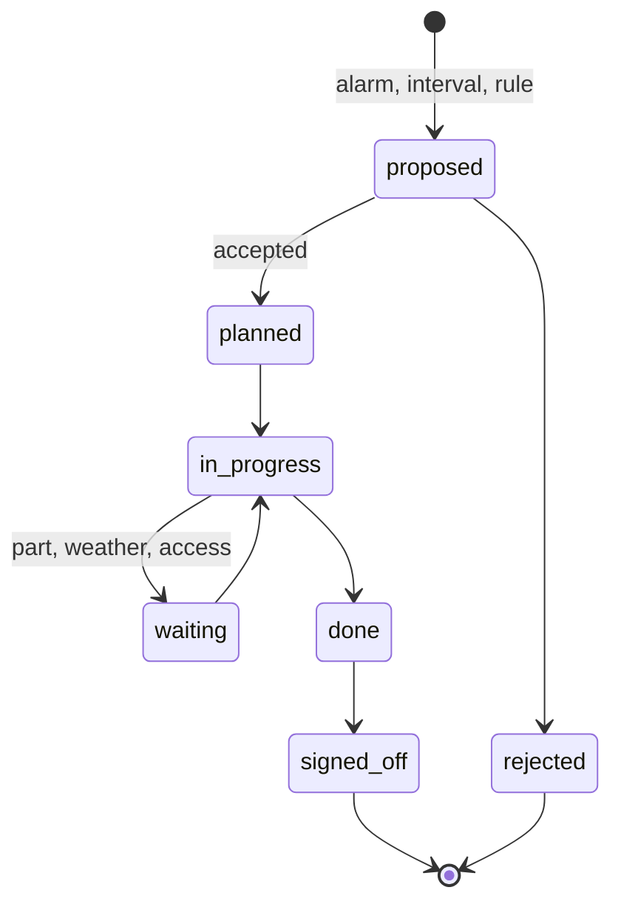

# OpenTSx: "Explore the plant", exploratory UI, visual inventory and maintenance (concept)

> Status: **concept and static prototype**, 2026-10-12. Fourth view of the Studio
> ([09-STUDIO-LABVIEW-STEUERPULT](09-STUDIO-LABVIEW-STEUERPULT.md)) next to statistics, what-if and node graph.
> Belongs to P7e (Personal Service Layer) and P9 (digital twin, [07-DIGITAL-TWIN-BSP](07-DIGITAL-TWIN-BSP.md)).
> Prototype: [`docs/prototypes/anlagen-explorer.html`](../prototypes/anlagen-explorer.html) (one file, without
> network access). Example inventory:
> [`opentsx-twin/src/main/resources/twin/inventar-beispiel.yaml`](../../opentsx-twin/src/main/resources/twin/inventar-beispiel.yaml).
> Scenarios: H2 chain with wind farm (07), house in the Ore Mountains ([08](08-HAUS-ZWILLING.md)), boat Etap 22
> ([10](10-BOOT-ZWILLING.md)).
>
> **All plant data in the prototype and in the example inventory are invented and labeled as examples.** Notes on
> standards, licenses and third-party systems are written to the best of our knowledge; what was not checked against
> the original is marked as **"to be checked"**.

---

## 1. Summary

* **What for:** Portfolios with photos, documents and technical data sheets are familiar. The view **"Explore the
  plant"** turns them into a representation of the system that one can walk through: a **visual inventory** with
  pictures of reality, embedded in a map (wind farm), a floor plan (house) or a deck plan (boat).
* **How:** Navigation as in a strategy game. Overview → object → component; hover shows a small card with photo, key
  figures, live value and maintenance status; a click opens the data sheet with documents, history, measured series
  and maintenance.
* **Shared anchor:** Every visible element is an **atom instance of the wiring plan** or a sub-object of one. Live
  values, key figures, what-if, Smart Topics and maintenance are attached to **the same id**. The inventory invents no
  second plant structure.
* **Photorealistic means real:** preferably real photos, drone and 360° images by the owner, with origin and license
  per image. Illustrations are allowed, but always labeled as such. Nothing generated is passed off as a real photo.
* **Maintenance:** Work orders, inspections, findings, spare parts and intervals are attached to the inventory. Alarms
  from the twin become work order proposals, completed work orders become events in the twin. Maintenance events run as
  the topic `tsx.<domain>.maintenance.v1`.
* **Live state:** infinimesh supplies the device level (`reported`, online/offline), the OpenTSx inventory supplies
  the meaning (location, images, documents, maintenance, atom id), section 10.

---

## 2. Context: the fourth view of the Studio

| View | Question | Anchor |
|------|----------|--------|
| Statistics | What do the numbers say? | series (`SeriesKey`) |
| Forecast and what-if | What could happen, what would happen if? | run id, snapshot |
| Node graph | How is the system wired? | wiring plan (`TwinPlan`), atom id, port |
| **Explore the plant** | **What stands where, what does it look like, what state is it in, what needs to be done?** | **atom id (+ sub-object path), location** |

The four views are views of the same model. Three jumps follow from this, and they work in either direction:

* **Explorer → node graph:** "Show in the wiring plan" marks the node `ely` with its wires.
* **Explorer → statistics:** "Readings" opens the series whose tags point to the atom id.
* **Explorer → what-if:** "Reschedule maintenance" starts an alternative with a changed availability window
  (section 7.5).

The role in the MVC+P contract (07, section 2.2): The explorer is one more **View** of the atom. The inventory adds
to the atom things that the model does not need, but that people need to understand and maintain it: location,
appearance, nameplate, documents and maintenance history.

---

## 3. Spatial levels

Every system gets a **base surface** (map or plan) with a coordinate system of its own. Inventory objects carry a
position in it.

### 3.1 Wind farm with electrolyzer: geo map

| Level (LoD) | Visible | Coordinates |
|-------------|---------|-------------|
| 0 Region | park as one symbol, grid connection point, electrolyzer, offtaker, course of the H2 line | WGS84 |
| 1 Park | single turbines (T01 …), substation/grid transfer station, meter, battery storage, electrolyzer container, line route with pressure measuring points | WGS84 |
| 2 Object | one turbine: tower, nacelle, rotor as a schematic picture or photo; component points (nacelle, gearbox, generator, converter, transformer, blade bearing) | image coordinates of the object picture (plan id) |
| 3 Component | nameplate, data sheet, sensors (IEC data points), maintenance history | n/a |

Overlays: **wake sectors** per wind direction (from 07, section 8, simulation reference or P8 estimate, clearly kept
apart), line pressure along the route, curtailment per turbine.

Relation to the code: The atom `park` of the H2 chain (`h2-chain.yaml`) is today an aggregated generation of 12 MW.
In the inventory it is split into sub-objects `park/T01` … `park/T04` (3 MW each, example). The naming T01 …
follows the wind farm simulator (`opentsx-windpark/scenarios/ostsee-demo.yaml`). Once turbine atoms exist (07,
section 9a, open), the sub-object becomes an atom of its own; the id stays the same.

### 3.2 House: building plan

| Level | Visible | Coordinates |
|-------|---------|-------------|
| 0 Plot | house, wood store, meter cabinet, the tank filling connection where present | site plan (m) or WGS84 |
| 1 Floor | **Basement** (boiler room with oil boiler and 150 l storage tank, tank room with 2 × 2,000 l, chest freezer, meter), **Ground floor** (living room with wood stove, kitchen with cooker, fridge, radio, TV), **Upper floor** (bedroom, bathroom, study with router) | floor plan in m, one plan id per floor |
| 2 Device | boiler with burner, circulation pump, flue; tank with level gauge | image coordinates |
| 3 Component | burner nozzle, oil filter, nameplate, chimney sweep report | n/a |

The atoms from `haus-erzgebirge.yaml` (`boiler`, `stove`, `tank`, `meter`, `dhw`, `woodstore`, `appliances`) are the
anchors; the appliances from `appliances.inventory` (for example `kuehlschrank`, `gefriertruhe`) become sub-objects
`appliances/kuehlschrank`. The building itself (`building`) is the frame of the plan.

### 3.3 Boat Etap 22: deck and cabin plan

| Level | Visible | Coordinates |
|-------|---------|-------------|
| 0 Sailing area | berth, anchorages, cruise route | WGS84 |
| 1 Boat | top view (deck plan ≈ 6.6 m): solar panels on deck/bimini, Starlink antenna, VHF antenna at the masthead, shore power inlet; cabin: power station, Raspberry Pi, VHF radio, charging spots for laptops and phone | plan in m from the bow, centerline |
| 2 Device | power station with outlets (12 V, USB-C, 230 V, solar, AC input) | image coordinates |
| 3 Component | cable, fuse, connector, serial number | n/a |

The atoms from `boot-etap22.yaml` (`station`, `solar`, `shore`, `starlink`, `vhf`, `raspi`, `laptop1`, `laptop2`,
`phone`) are the anchors. The dimensions of the plan are schematic; depending on the source, the Etap 22 is about
6.6 to 6.7 m long (to be checked against the boat registration document).

### 3.4 Shared controls

| Element | Behavior |
|---------|----------|
| **Level of detail** | zoom or double-click changes the level (overview → object → component); symbols simplify when zooming out, labels appear from a minimum size |
| **Hover card** | picture (photo or labeled illustration), 2 to 4 key figures, live value with **origin badge** (`Origin` of the twin: `MEASURED`, `REPORTED`, `FORECAST`, `ESTIMATED`, `SYNTHETIC`), state, open maintenance, device status from infinimesh |
| **Click → data sheet** | side panel with tabs: Overview (gallery, nameplate), Documents (data sheet, manual, certificate, warranty), Maintenance (work orders, intervals, history), Readings (series, Smart Topics, ports from the wiring plan) |
| **Breadcrumbs** | system › level › object › component, every step clickable |
| **Mini-map** | shows the visible section, a click jumps there |
| **Search** | by id, name, type, serial number, IEC/RDS designations |
| **Filter** | state (ok/warning/fault), **maintenance due**, origin of the live values, type |
| **Time slider** | state at time t: values from the shadow run or replay (KafScale, Iceberg time travel); maintenance state at time t |
| **Layer switch** | live values, alarms, maintenance, wake sectors, line pressure, labels |

---

## 4. "Photorealistic": options and recommendation

| Option | Effect | Effort | Risk | Recommendation |
|--------|--------|--------|------|----------------|
| **Real photos by the owner** (phone, drone, 360° panorama) | highest credibility, shows the real state (rust, oil traces, wiring) | low per image, needs upkeep | privacy (house, boat), flight permit for drones (to be checked per site) | **preferred**, origin and license per image |
| **Orthophotos and aerial images as a base map** | park and line route in their real surroundings | low if openly licensed | license and attribution; how recent it is | for wind farm and sailing area; sources below |
| **Street map** (OpenStreetMap data) | orientation | low | terms of use of the public tile servers | own vector tiles or a provider with suitable terms instead of `tile.openstreetmap.org` |
| **Isometric renderings / 3D (glTF 2.0)** | game-like look, components in 3D space | high (models) | manufacturer models mostly not free | later stage E4 |
| **Generated illustrations** | fast, uniform | low | **confusion with real photos** | only as a placeholder, always labeled "Illustration" |

Sources for base maps (state of knowledge, **all license details to be checked**):

* **Official orthophotos** (DOP20) of the state geoportals; several states now provide them under open licenses (for
  example Data licence Germany, attribution, version 2.0). For the park on the Baltic Sea the geoportal of
  Mecklenburg-Vorpommern or Schleswig-Holstein, for the house Saxony (GeoSN). Check the license per state.
* **basemap.de** (BKG and the states) as the official base map; license and terms of use to be checked.
* **OpenStreetMap data** (ODbL) for paths and buildings; sea marks through **OpenSeaMap**. Not for navigation on
  board, only for orientation.

**Image origin in the inventory.** Every medium carries `kind` (`photo`, `drone`, `pano360`, `orthophoto`, `render`,
`illustration`), `reality` (`real` or `illustration`), source, date, author, license and checksum. The user interface
always shows `illustration` with a visible label. This is the origin ladder from 07, section 4.4, carried over to
images: What is modeled or generated must not look like evidence.

---

## 5. Inventory data model (asset register)

### 5.1 Principles

1. **Asset id = atom id**, sub-objects as a path: `h2-chain/ely`, `h2-chain/park/T02`,
   `haus-erzgebirge/appliances/kuehlschrank`, `boot-etap22/station`. The twin id comes first so that ids are unique
   across systems.
2. **Location** either WGS84 (`lat`, `lon`, optional altitude) or plan coordinates (`plan`, `x`, `y` in m, plan with
   scale and origin point).
3. **Hierarchy** through `parent`. It follows the location logic (park › turbine › nacelle › generator) and is
   independent of the wiring. The wiring stays in the wiring plan.
4. **Domain designations** are optional fields, not required: RDS-PP, IEC 61400-25, ISO 14224, FGW identifiers.
5. **Documents and media** live in the object store; the inventory holds only the reference, checksum and metadata.

### 5.2 References to standards (context, details to be checked)

| Reference | What for | Use in the inventory | Status |
|-----------|----------|----------------------|--------|
| **RDS-PP** (reference designation system for power plants, a VGB guideline based on IEC/EN 81346; wind has its own application guideline) | unique, vendor-independent designation of plant, system and component | field `refDesignation.rdsPp`, for example `=G001 MDK10` for a gearbox (example, **key values to be checked**) | to be checked: document number (VGB-S-823-…) and codes |
| **IEC 61400-25-2** (information model for wind, logical nodes) | data points per component | field `iec61400_25.logicalNodes` (for example `WTUR`, `WGEN`, `WNAC`, `WROT`, `WCNV`, `WTRF`); the series come from the data point catalog `opentsx-windpark/src/main/resources/windpark/channel-catalog.yaml`, which already maps to IEC 61400-25-2 today | implemented in the repo (catalog) |
| **FGW TR 7** with **ZEUS** (state event cause key) | uniform description of states, events and causes in the maintenance of renewable energy plants | field `zeus` on maintenance events (section 7.6) | to be checked: structure of the keys and license of the rule set (paid) |
| **ISO 14224** (reliability and maintenance data, taxonomy, failure mode, mechanism and cause) | generic maintenance taxonomy from oil and gas | fields `iso14224.equipmentClass`, `failureMode` | carrying it over to house and boat is our choice; classes and codes to be checked |
| **DIN 31051 / DIN EN 13306** | terms: servicing, inspection, repair, improvement | values of `workType` | terms common, details to be checked |

House and boat have no comparably established designation. There the path with descriptive names is enough.
Nameplate and serial number are enough for warranty and spare parts.

### 5.3 Schema sketch `opentsx.inventory.v1`

```yaml
schema: opentsx.inventory.v1
system: h2-chain                       # = twin id of the wiring plan
plans:                                 # base surfaces
  - id: geo
    kind: geo                          # WGS84
    basemap: { source: "DOP20 MV", licence: "dl-de/by-2-0 (zu prüfen)" }
  - id: wea-schema
    kind: image                        # image coordinates 0..1 on an object picture
assets:
  - id: h2-chain/park/T02              # atom id (+ sub-object path)
    atom: park                         # anchor in the wiring plan
    parent: h2-chain/park
    type: wind-turbine
    name: WEA T02
    location: { plan: geo, lat: 54.4512, lon: 13.9441 }
    nameplate:                         # nameplate
      manufacturer: "(Beispiel)"
      model: GENERIC-3MW
      serial: "EX-0000-T02"
      ratedKw: 3000
      commissioned: 2014-06-30
    refDesignation: { rdsPp: "=G002", iec61400_25: { logicalDevice: T02, logicalNodes: [WTUR, WGEN, WNAC, WROT] } }
    iso14224: { equipmentClass: "wind turbine (zu prüfen)" }
    media:
      - id: m-t02-drone-2026
        kind: drone
        reality: real                  # real | illustration
        uri: s3://opentsx-inventory/h2-chain/park/T02/drohne-2026-05.jpg
        sha256: "…"
        takenAt: 2026-05-14
        author: Eigentümer
        licence: "intern"
    documents:
      - id: d-t02-datenblatt
        kind: datasheet                # datasheet | manual | certificate | warranty | protocol | drawing
        title: Datenblatt GENERIC-3MW
        uri: s3://opentsx-inventory/docs/generic-3mw-datenblatt.pdf
        sha256: "…"
        validUntil: null
    series:                            # measured series and Smart Topics on the same anchor
      - { metric: wind.turbine.power_active, tags: { turbine: T02 } }
      - { smartTopic: st.wind.t02.power_curve_dev }
    ports: [p_gen_kw]                  # ports of the atom that concern the object
    maintenance:
      intervals:
        - { id: wartung-jahr, kind: time, every: P1Y, last: 2025-11-03 }
        - { id: oelwechsel-getriebe, kind: operatingHours, every: 20000, counter: wind.turbine.operating_hours }
        - { id: blattinspektion, kind: condition, rule: "Leistungskurvenabweichung < -5 % über 14 Tage" }
    infinimesh: { namespace: windpark-ost, device: t02-scada-gw }   # optional, section 10
    access: { visibility: team, owner: betreiber }
```

Required are `id`, `type`, `name` and either `atom` or `parent`. Everything else is optional, so that an inventory
can start small (one photo, one data sheet).
One file describes one system (`system:` at the top level) or several (`systems:` as a list, as in the
[example inventory](../../opentsx-twin/src/main/resources/twin/inventar-beispiel.yaml)). Check rule for E1: every
`atom` entry exists in the wiring plan of the same twin, every id starts with the twin id.

### 5.4 Storage

| Part | Location | Remark |
|------|----------|--------|
| Inventory file (YAML) | in the repo only as an example; real inventories under `config/private/` or in the operator's repo | versioned, hashed like the wiring plan |
| Asset table | Iceberg `inventory.assets` (one row per asset and version, `valid_from`/`valid_to`) | time travel answers "what was the state on day X" |
| Documents, media | object store (MinIO/S3, D6), keyed by asset path, checksum SHA-256 | content immutable; a new version = a new object |
| Metadata | Iceberg tables `inventory.media`, `inventory.documents` | origin, license, `reality` |
| Catalog | OpenMetadata: tables as entities, lineage asset → series; atom id as a custom property | how an asset register is best mapped in OpenMetadata is **to be checked** (no entity type of its own known for physical plants) |
| Maintenance | topic `tsx.<domain>.maintenance.v1` → Iceberg `maintenance.events` | section 7 |

The inventory file is the input; the tables are the derived, versioned state. The Studio export (`StudioExport`)
will in future also read the inventory file and write a field `inventory` per scenario into the JSON; the explorer
then needs no data of its own.

---

## 6. Interaction rules

| Rule | Reason |
|------|--------|
| **Hover shows, click opens.** Hover changes nothing; a click opens the data sheet and sets the breadcrumb. | gaming habit; hover stays cheap and without consequence |
| **Touch:** first tap = hover card, second tap or button "Details" = data sheet | touch has no hover |
| **Keyboard:** every symbol is focusable (Tab), focus shows the hover card, Enter opens, Esc closes | accessibility |
| **State never by color alone:** shape or symbol (✓, !, ×) and text in addition | color vision deficiency |
| **Origin badge** on every value, **label** on every illustration | origin ladder |
| **The data sheet floats at the right edge of the map** (desktop); the map is not reflowed; the object moves to the left. On the phone a bottom sheet | context stays visible, symbols stay under the pointer (double-click works) |
| **Performance:** tiles for base maps, thumbnails (≤ 40 kB) in the hover card, originals only in the data sheet; images `loading="lazy"`; clustering from ~500 symbols | phone and weak network on board |
| **Offline:** boat and house work with a locally cached inventory | often no network at sea |
| **No control in passing:** commands only through a dialog of their own with approval (section 10.3) | safety |

---

## 7. Coupling to maintenance management and maintenance tracking

### 7.1 Terms

| Term | Content |
|------|---------|
| **Maintenance plan / interval** | what, how often: time-based (P1Y), by operating hours or counters (20,000 h, 500 l oil), condition-based (rule on a series or a Smart Topic) |
| **Work order** | concrete work on an asset with date, assignee, status, effort |
| **Inspection** | check with a checklist and measured values (for example flue gas measurement by the chimney sweep) |
| **Finding** | result of an inspection with severity, photo, ISO 14224 failure mode or ZEUS key |
| **Spare part** | article, quantity, supplier, reference to the data sheet |

### 7.2 Status lifecycle of a work order



### 7.3 From the twin to the work order

* **Alarm → proposal:** Events from dynamics or Shadow (pressure limit, power curve deviation, boiler cycling, SoC
  warning, device offline) create a work order proposal with a reference to the event and the run id. A human accepts
  or rejects it; the proposal itself changes nothing.
* **Interval → proposal:** Due dates from time or counter readings (operating hours from the series, oil throughput
  from `boiler.fuel_lph`) are reported in advance (for example 30 days ahead).
* **Condition → proposal:** Rules on Smart Topics (forecast of the remaining useful life, drift) with origin `FORECAST`
  or `ESTIMATED`.

### 7.4 From the work order to the twin

* A planned or running work order is an **intervention** (`Intervention`) in the twin: availability of the atom
  = 0 or a power limit in the time window. Origin `REPORTED` once it is reported.
* Completed work orders reset counters (operating hours since maintenance) and can change parameters (new nozzle →
  efficiency, trigger the calibration in 08, section 7 again).
* Key figures: technical availability, MTBF/MTTR per asset type, share of planned work, cost per asset.

### 7.5 What-if "Reschedule maintenance"

The alternative moves the availability window (for example turbine maintenance from a windy to a calm day, boiler
maintenance from January to late summer). The evaluation works as in P8: alternative − reference on the same
starting situation, with yield loss, schedule deviation and risk (state forecast) as key figures.
The result is a **proposal**, marked as modeled.

### 7.6 Maintenance events as a topic (draft `opentsx.maintenance.v1`)

Topic `tsx.<domain>.maintenance.v1`, key = asset id. Every status change is an event of its own (event log, not
only the latest state). This is also the **audit trail**: who changed what, when and why.

```json
{
  "schema": "opentsx.maintenance.v1",
  "eventId": "wo-2026-0042#3",
  "workOrderId": "wo-2026-0042",
  "asset": "h2-chain/park/T02",
  "type": "status",
  "status": "erledigt",
  "workType": "Instandsetzung",
  "title": "Pitchlager Blatt B nachschmieren",
  "trigger": { "kind": "alarm", "ref": "twin:h2-chain@run-…#ev-118", "origin": "MEASURED" },
  "window": { "from": "2026-10-14T07:00:00Z", "to": "2026-10-14T11:00:00Z" },
  "availability": 0.0,
  "findings": [ { "severity": "minor", "iso14224FailureMode": "zu prüfen", "zeus": "zu prüfen", "media": ["m-…"] } ],
  "parts": [ { "article": "Fett, 400 g", "qty": 2 } ],
  "laborH": 3.5,
  "by": "techniker:extern-1",
  "approvedBy": "operator:mk",
  "ts": "2026-10-14T11:05:00.000000Z",
  "reason": ""
}
```

Rules: deterministic `eventId` (KafScale without an idempotent producer, as with commands in 09, section 4a); times
in UTC with microseconds; photos and reports as media in the inventory, not in the event.

### 7.7 Connecting existing maintenance systems (CMMS)

OpenTSx is not meant to become a full maintenance system. Three paths, starting with the simplest:

| Path | Content | For |
|------|---------|-----|
| **Own lightweight tracking** | work orders and findings only as events in the topic, maintained through the data sheet in the explorer | house, boat, small plants |
| **Import/export** | CSV/JSON of the work orders and intervals; matching by asset id or serial number | transition, service providers |
| **CMMS through an API** | mirroring of work orders in both directions; the CMMS stays the system of record for work orders, OpenTSx for state, twin and proposals | operators with a CMMS |

Typical systems: **openMAINT** (open source, asset and maintenance management based on CMDBuild; license and API to
be checked) and in an enterprise setting **SAP PM** or its successor in S/4HANA asset management. For wind farms,
operations managers often run their own systems with ZEUS coding; the interface is then project-specific.

---

## 8. Security and data protection

* **House and boat are private.** Photos of interiors, floor plans, serial numbers and berths stay local
  (`config/private/`, local object store), like the bills in 08, section 10. The repository holds only the invented
  example inventory and illustrations.
* **Strip metadata:** Remove EXIF GPS from photos when the image is shared; check faces and license plates first.
* **Access:** `access.visibility` per asset (`private`, `team`, `partner`, `public`) and roles (owner, operator,
  service provider). A service provider sees only the assets of their work orders.
* **Wind farm:** Site plans of critical infrastructure (grid transfer station, line route) are not public; approval
  by the operator.
* **Control** only with approval and local interlocks (section 10.3).

---

## 9. Prototype

[`docs/prototypes/anlagen-explorer.html`](../prototypes/anlagen-explorer.html) shows how the view is operated for all
three systems, without network access and without libraries:

* **System selection** Wind farm and H2 · House · Boat Etap 22
* **Wind farm:** stylized coast and terrain, four turbines, grid transfer station, battery, electrolyzer, H2 line with a
  pressure measuring point, offtaker; a "Wake sector" layer that can be switched on
* **House:** floor plans of basement, ground floor and upper floor as tabs
* **Boat:** top view of deck and cabin of a ≈ 6.6 m yacht
* Hover card with an illustration slot ("Illustration: photo to follow"), key figures, origin badge, maintenance status
  and infinimesh device (online/offline)
* Click → data sheet with the tabs Overview, Documents, Maintenance, Readings
* Zoom (mouse wheel, buttons, keys +/−) and panning, mini-map, breadcrumbs, search across all systems, filters
  "Maintenance due" and "Only deviations", layer switch, light/dark, phone width (data sheet as a bottom sheet)
* Level of detail in the wind farm: zoomed out, the park becomes one symbol (level 0); a double-click on a turbine
  opens the component view (level 2: rotor, gearbox, generator, yaw drive, converter, transformer, anemometer with
  IEC 61400-25 nodes)
* Atoms without a location (market, direct marketer, operating rules, weather, building, usage mode) sit in a bar
  below the plan, so that every atom stays reachable
* Keyboard: Tab focuses symbols (hover card), Enter opens, Esc closes; touch: the first tap shows the card, a second
  tap or a tap on the card opens the data sheet
* Addressable through `?sys=…&plan=…&open=<asset-id>`

Not in the prototype: time slider and real live values (E2), creating and editing work orders (E3), real photos and
documents. The buttons for them are visible but disabled.

The ids in the prototype match the atom ids of the wiring plans and of the example inventory. The example data sit today
as objects in the script of the page (list `ASSETS`). In E1 a `tools/build_explorer.py` replaces them with data from the
inventory file and the Studio export, the way `build_studio.py` fills the Studio page.

---

## 10. Connecting infinimesh

### 10.1 Division of roles

| | infinimesh | OpenTSx inventory |
|---|------------|-------------------|
| Task | **Device level:** identity, connection, state (device shadow `reported`/`desired`) | **Meaning:** location, images, documents, maintenance, atom id, designations |
| Structure | namespaces, devices with tags | system › level › object › component |
| History | last state; stream through the Kafka add-on | series in KafScale/Iceberg, maintenance events |
| Documents, photos, maintenance | none | yes |

The link is an optional field per asset: `infinimesh: { namespace, device }`. One device can serve several assets
(a Raspberry Pi reports power station, Starlink and solar); then all these assets carry the same device id, and the
series differ by tags.

**To be checked** (not verified against the infinimesh code): the hierarchy of accounts, namespaces and devices in
the current version of `infinimesh/core`, the form of the tags, whether there is a "last seen"/online field or
whether it must be derived from the timestamp of the last `reported`, and the exact message format of the Kafka
add-on.

### 10.2 Reading: hover and data sheet

* **Hover card:** last `reported` value with origin `MEASURED`, timestamp and device status (dot green = online,
  gray = offline, red = error). If the value is older than a threshold (for example 3 × the reporting interval), it
  is marked as stale, not silently shown on.
* **Data sheet, Readings tab:** history not from infinimesh but from OpenTSx:
  infinimesh Kafka add-on → KafScale (`infinimesh.shadows`) → Normalizer → episodes in `tsx.<domain>.observations.v2`
  → Iceberg. This is the proposed path from P9.0 (module `opentsx-infinimesh`).

### 10.3 Writing: commands only with approval

* From the explorer there is only a **command dialog**, no switching by clicking the symbol.
* Contract `opentsx.command.v1` from 09, section 4a; after approval the command is mirrored into the `desired` state.
* **Local interlocks take precedence**; commands have `validUntil` and expire; the acknowledgment
  (`opentsx.command-ack.v1`) appears in the data sheet and as an intervention in the twin.
* Safety-relevant devices (VHF radio, burner, protective curtailment of the electrolyzer) are marked in the inventory
  with `commandable: false`.

### 10.4 Device status and maintenance

* **Device offline or error** beyond a threshold → work order proposal "Check connection" (section 7.3).
* **Completed work order** → event `maintenance.v1` → intervention in the twin (availability back to 1) → key figures.

### 10.5 Namespaces and navigation

Namespaces map systems or owners, and with them the top level of the navigation:

| Namespace (proposal) | System | Owner/role |
|----------------------|--------|------------|
| `windpark-ost` | `h2-chain` (park, station, battery) | park operator |
| `h2-ely` | `h2-chain` (electrolyzer, line, offtaker) | electrolyzer operator |
| `haus-erzgebirge` | `haus-erzgebirge` | homeowner |
| `boot-etap22` | `boot-etap22` | owner |

A system can have several namespaces (different owners in one chain). The explorer then shows ownership boundaries
as a line on the map; rights follow the namespace. Whether infinimesh can nest namespaces is to be checked; the draft
does not assume it.

---

## 11. Implementation stages

| Stage | Content | Result |
|-------|---------|--------|
| **E0** | static prototype with example data (this page) | operating concept can be checked |
| **E1** | `opentsx.inventory.v1` as a JSON schema, validation against the wiring plan (every `atom` reference exists), inventory file in the Studio export, tab "Explore the plant" in the Studio | explorer from a real file |
| **E2** | live values from Shadow/KafScale (and infinimesh), time slider through replay/Iceberg time travel, jumps to statistics and node graph | live map |
| **E3** | maintenance topic, work order proposals from alarms and intervals, work orders as interventions in the twin, what-if "Reschedule maintenance", CSV import/export | maintenance tracking |
| **E4** | orthophoto base maps, 360° panoramas, glTF models, CMMS connection | expansion |

---

## 12. Open decisions (proposals)

| No. | Topic | Proposal |
|-----|-------|----------|
| D30 | Anchor of the inventory | asset id = twin id/atom id (+ sub-object path); no second plant structure |
| D31 | Image policy | real photos preferred; every medium with origin, license and `reality`; illustrations always visibly labeled; nothing generated as a photo |
| D32 | Storage | inventory YAML as the input; Iceberg tables (versioned) plus an object store with SHA-256; OpenMetadata as the catalog |
| D33 | Maintenance | own lightweight tracking as the event log `tsx.<domain>.maintenance.v1`; a CMMS stays the system of record where present; work orders are interventions in the twin |
| D34 | Designations | RDS-PP, IEC 61400-25 and ZEUS optional for wind; ISO 14224 as a generic taxonomy; not required for house/boat |
| D35 | infinimesh | device state from infinimesh, meaning from the inventory; coupling only through `{namespace, device}`; commands only with approval |
| D36 | Presentation | 2D (SVG/canvas, tiles) first; 3D only in E4 |
