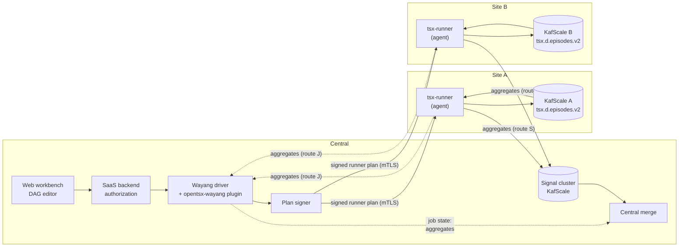

# Concept 20: Rust Kafka runner orchestrated by Apache Wayang

> Status: **concept**, 2026-11-16, not implemented. Checked against this repository at `548f316`, against Apache
> Wayang ([`apache/incubator-wayang`](https://github.com/apache/incubator-wayang) at `713faa7d`, 2026-11-12) and
> against the crate and project versions named in section 3. Related: [05](05-SMART-TOPICS.md) (federated global
> model), [11](11-SMART-TOPIC-PROZESSOR-DEVOPS.md) (Go Smart Topic processor, `opentsx.dag.v1`),
> [Kafka native streaming](../devops/kafka-native-streaming.md) (the Java vector processor that runs today).

## 1. Goal

A runner written in Rust executes OpenTSx operators on Kafka records. It reads topics and writes topics, nothing
else. Apache Wayang plans the job and sends one runner plan to each site. All sites share the same topic names,
the same Avro schemas and the same operator catalog. Raw data stays at its site. Only mergeable aggregates and
signals leave it, either to a central signal cluster or back to the Wayang driver.

The runner fills the place of Kafka Streams in an OpenTSx deployment, with three differences:

- It works within KafScale's limits: no idempotent producer, no transactions, no compaction, no timestamp seek.
- Its plan comes from Wayang, which gets it from the DAG built in the web workbench.
- It runs in federation mode: one logical job over many sites, each with its own broker.

Out of scope: training (it stays a batch job, [11](11-SMART-TOPIC-PROZESSOR-DEVOPS.md), D28), joins over raw data of
two sites, and anything that needs history search (pattern search, twin, causal analysis).

## 2. Current state

| Item | State | Evidence |
|---|---|---|
| Wayang in OpenTSx | Design prose only. No Wayang code and no Wayang dependency in any `pom.xml`. | `grep -rli wayang --include=pom.xml .` returns no file; mentions in [05](05-SMART-TOPICS.md) line 147, [06](06-SYSTEMREKONSTRUKTION-OPTIMIERUNG.md) line 231, [user manual 14](../user-manual/14-saas-service-layer.md) line 59, `EVOLUTION/TASK-015-multivariate-analysis.md` line 247, `TASK-016-smart-topics.md` line 34, `TASK-017-digital-twin.md` line 85 |
| Streaming runtime that runs today | Java vector processor in `opentsx-retrieval`: manual assignment, explicit offsets, checkpoint file per runner written after the broker acknowledged the output, control topic `tsx.<domain>.dags.v1`, status topic `tsx.<domain>.dag-status.v1` | [kafka-native-streaming.md](../devops/kafka-native-streaming.md); `VectorProcessor.java:46-59`; `TopicLayout.java:117-125` |
| DAG validation | Unique node ids, existing inputs, no cycles, supported sinks only, checked before the control record is written | `opentsx-retrieval/src/main/java/org/opentsx/retrieval/vector/DagPlan.java:17` |
| Go processor proposal | `opentsx.dag.v1` (YAML), Go core on the KafScale processor template, shared test vectors, at-least-once plus deterministic ids (D25 to D29) | [11](11-SMART-TOPIC-PROZESSOR-DEVOPS.md), sections 5, 6, 7, 10 |
| Legacy flow format | Processing flow descriptor (`name`, `version`, `input`, `steps`, `output`) on the 2.x `TimeSeriesObject` API, run by Flink | `docs/devguide/schemas/processing-flow-descriptor-schema.json`; `opentsx-flink-core/README.md` line 7 |
| Processor description | `opentsx.processor.v1`: operator id, kind, outputs, `runtimes` with `workbench`, `java`, `python` | `docs/datamodel-2026/schemas/opentsx.processor.v1.schema.json:102-114` |
| Series identity | `seriesId` = lower-case hex of xxHash64, seed 0, over the canonical form of metric and tags | `opentsx-model/src/main/avro/SeriesKey.avsc` |
| Episode | `[tStart, tEnd)` in microseconds, values, optional quality byte per value, mergeable `EpisodeSummary`, `revision`, `Provenance` | `Episode.avsc`, `EpisodeSummary.avsc`, `Provenance.avsc` |
| Wire format | Avro single-object encoding, `C3 01` plus CRC-64-AVRO fingerprint, no schema registry; fingerprints and byte-exact records in shared vectors | `opentsx-model/src/test/resources/testvectors/wire-format.json` (for example `Episode` = `8985f02b48c77195`) |
| Record key and partitioning | Episode records use key `seriesId` and record timestamp `tStart` in milliseconds; the Java default partitioner places them | `BucketWriter.java:26`, `:107-108`; `KafScaleFeed.java:180` |
| Mergeable statistics | Welford mean and M2 with Chan merge; DDSketch with `ceil(log_gamma abs)` indexing, collapse of the lowest bins, canonical binary format v1 | `StatsAccumulator.java:62-86`; `QuantileSketch.java:10-28`, `:101-110`, `:220-233` |
| KafScale client rules | `enable.idempotence=false`, `acks=all`, `max.in.flight.requests.per.connection=1`, zstd, delivery timeout three minutes; consumers without group id, manual assignment and seek | `KafScaleClients.java:16-50` |
| KafScale capabilities | No timestamp seek, no idempotent producer, no standalone commit, no group rejoin, compaction accepted but not done (KafScale v1.6.0) | [`opentsx-kafscale-conformance/README.md`](../../opentsx-kafscale-conformance/README.md), results of 2026-10-09 |
| Shared operator test vectors | `align-vector.v1.json`, `clean-ops.v1.json`, `pair-es.v1.json`, `pair-xcorr.v1.json` | `docs/datamodel-2026/testvectors/` |

Two facts shape everything below:

1. **Consumer groups do not work on KafScale.** The runner uses manual assignment, like every OpenTSx reader.
2. **Wayang's own Kafka operators do not fit.** `KafkaTopicSource` subscribes with a consumer group and polls
   once for 15 s. `KafkaTopicSink` writes values without a key and does not set `enable.idempotence` (section 3.1).

## 3. Research findings

### 3.1 Apache Wayang

Checked in the source at `713faa7d`. Paths are relative to the repository root.

| Topic | Finding | Evidence |
|---|---|---|
| Status | Top-level Apache project since November 2025; latest release 1.1.1 (2026-02-11), Java 17 since 1.1.0 | [ASF announcement, 2025-12-03](https://news.apache.org/foundation/entry/the-apache-software-foundation-announces-new-top-level-projects-3); [projects.apache.org](https://projects.apache.org/json/projects/wayang.json); `RELEASE_NOTES` |
| Platform | `org.apache.wayang.core.platform.Platform`, abstract: `configureDefaults`, `getExecutorFactory`, `createLoadProfileToTimeConverter`, `createTimeToCostConverter` | `wayang-commons/wayang-core/src/main/java/org/apache/wayang/core/platform/Platform.java:38-131` |
| Operator | `ExecutionOperator` with `getPlatform`, `getSupportedInputChannels`, `getSupportedOutputChannels`, cost keys | `.../core/plan/wayangplan/ExecutionOperator.java:47-192` |
| Channel | `Channel` plus `ChannelDescriptor(Class, reusable, suitableForBreakpoint)`; conversions through `ChannelConversion` and `ChannelConversionGraph` | `.../core/platform/ChannelDescriptor.java:32`; `.../core/optimizer/channels/ChannelConversion.java:35` |
| Mapping | `Mapping.getTransformations()` returns `PlanTransformation(SubplanPattern, ReplacementSubplanFactory)` | `.../core/mapping/Mapping.java:26-31`; `wayang-platforms/wayang-java/.../mapping/MapMapping.java:38-57` |
| Plugin | `Plugin`: `getRequiredPlatforms`, `getMappings`, `getChannelConversions`, `setProperties` | `.../core/plugin/Plugin.java:39-109` |
| Cost model | `LoadProfileEstimator` specs as JSON with JUEL expressions in `wayang-<platform>-defaults.properties` | `wayang-java-defaults.properties:29-34` |
| Optimizer and executor | `PlanEnumerator`; `Executor.execute(ExecutionStage, OptimizationContext, ExecutionState)`; `PushExecutorTemplate`; `CrossPlatformExecutor` | `PlanEnumerator.java:67`; `Executor.java:29-60`; `PushExecutorTemplate.java:47` |
| Smallest platform | `wayang-semantic`: `OllamaPlatform`, `OllamaExecutor extends PushExecutorTemplate`, `SemanticPlugin`, six Java files | `wayang-platforms/wayang-semantic/` |
| Remote work | JDBC platforms do not move data through the driver. `JdbcExecutor` composes SQL for a stage and stores it in a `SqlQueryChannel`; the database runs it when a downstream conversion pulls it | `JdbcExecutor.java:148`, `:456-483`; `SqlQueryChannel.java:38`; `SqlToStreamOperator.java:104` |
| Kafka operators | `KafkaTopicSource` (consumer group, `subscribe`, `auto.offset.reset=earliest`, SASL_SSL/PLAIN defaults), `KafkaTopicSink` (String values, no key); Java and Spark execution operators | `wayang-commons/wayang-basic/.../operators/KafkaTopicSource.java:59-201`, `KafkaTopicSink.java:43-91`; `wayang-java/.../JavaKafkaTopicSource.java:103` |
| Plan API | `wayang-api-json`: Scala ZIO-HTTP server, `POST /wayang-api-json/submit-plan/json`, synchronous; operators as JSON with `id`, `cat`, `input`, `output`, `operatorName`, `executionPlatform`, `data`; UDFs as Scala source compiled at runtime; no Kafka operator in the JSON API | `wayang-api/wayang-api-json/src/main/scala/Main.scala:31-86`; `OperatorFromJson.scala:83-88`; `SerializableLambda.scala:23-29` |
| Federation | None in Apache Wayang. One driver JVM runs a plan through `CrossPlatformExecutor`. "federat" appears only in `guides/spark-datasets.md:31` | grep over the source tree |
| Scalytics | Vendor claims: "Execute analytics, feature engineering, and inference where data lives", "No raw sensitive data leaves restricted zones". No public protocol documentation found. Not verified | [scalytics.io/federatedintelligence](https://www.scalytics.io/federatedintelligence) |
| Non-JVM platform | None. No Rust platform and no generic remote executor protocol | source tree |

Papers: Kruse et al., "Apache Wayang: A Unified Data Analytics Framework", SIGMOD Record 52(3), 2023,
[doi:10.1145/3631504.3631510](https://doi.org/10.1145/3631504.3631510); "RHEEM: Enabling Cross-Platform Data
Processing", PVLDB 11(11), 2018, [doi:10.14778/3236187.3236195](https://doi.org/10.14778/3236187.3236195);
"RHEEMix in the data jungle", VLDB Journal 29(6), 2020,
[doi:10.1007/s00778-020-00612-x](https://doi.org/10.1007/s00778-020-00612-x).

Consequence: federation is new work in the OpenTSx plugin, not a Wayang feature to switch on. The JDBC pattern is
the model to copy: a channel carries a description of work, not data.

### 3.2 Rust crates and projects

Versions from crates.io on 2026-11-16.

| Need | Choice | Version, licence | Finding | Evidence |
|---|---|---|---|---|
| Kafka client | `rdkafka` | 0.39.0, MIT; bundles librdkafka 2.12.1 | `BaseConsumer` with `assign`, `seek`, `store_offset`; features `ssl`, `sasl`, `zstd`, `cmake-build`; OAUTHBEARER via `ClientContext::generate_oauth_token` | `rdkafka` `src/client.rs:130`; `Cargo.toml` |
| librdkafka defaults | | | `enable.idempotence=false`, `acks=-1`, **`partitioner=consistent_random`** (CRC32). Java compatibility needs `partitioner=murmur2_random` | [CONFIGURATION.md](https://github.com/confluentinc/librdkafka/blob/master/CONFIGURATION.md) |
| Avro | `apache-avro` | 0.22.0, Apache-2.0 | `GenericSingleObjectWriter`, `SpecificSingleObjectWriter<T>` and readers; `RabinFingerprintHeader` writes `C3 01` plus the fingerprint little-endian, as the Avro specification requires | `src/headers.rs` in the 0.22.0 crate |
| xxHash64 | `twox-hash` | 2.1.5, MIT | `XxHash64::oneshot(seed, bytes)` | crate source |
| DDSketch | own port of `QuantileSketch` | | `sketches-ddsketch` 0.4.2 uses floor indexing and the Java DDSketch byte format. OpenTSx uses `ceil` indexing and its own format v1. The crate does not produce OpenTSx sketches | `sketches-ddsketch` `Config::new` comments; `QuantileSketch.java:13-28`, `:221` |
| Sandbox | `wasmtime` | 50.0.1, Apache-2.0 WITH LLVM-exception | fuel (`consume_fuel`, `set_fuel`), epoch interruption, `StoreLimitsBuilder::memory_size`; WASI 0.2 components are tier 1, WASIp3 experimental | wasmtime `docs/stability-tiers.md` |
| Supply chain | `cargo-auditable` 0.7.7, `cargo-cyclonedx` 0.5.10, `cargo-deny` 0.20.2, cosign 3.1.4, `actions/attest-build-provenance` 4.2.2 | | dependency list embedded in the binary; CycloneDX SBOM; licence and advisory gate; Sigstore signatures and SLSA v1.0 provenance | project READMEs |

Stream processors, checked for reuse:

| Project | Licence, version | Use |
|---|---|---|
| Arroyo | MIT or Apache-2.0, v0.15.0; acquired by Cloudflare 2025-04-10 ([blog](https://blog.cloudflare.com/cloudflare-acquires-arroyo-pipelines-streaming-ingestion-beta/)) | Reference for watermarks and windows. Do not embed: a full distributed engine; the crate on crates.io is 0.7.0 from 2023. |
| Timely and Differential Dataflow | MIT, `timely` 0.32.0, `differential-dataflow` 0.26.0 | Possible later for incremental joins. Not now: no Kafka connector, 0.x APIs that change often. |
| Fluvio SmartModules | Apache-2.0, 0.50.1 | Reference for a WASM filter, map and aggregate ABI. Needs a Fluvio cluster. |
| Redpanda Data Transforms | Redpanda core BSL; SDK `redpanda-transform-sdk` 1.1.0 Apache-2.0 | Reference for limits: one input topic, up to eight outputs, at-least-once, no network or disk, single-record transforms ([docs](https://docs.redpanda.com/current/develop/data-transforms/how-transforms-work/)). Runs only inside Redpanda. |
| RisingWave | Apache-2.0, v3.1.1 | Full streaming database. Not a library. |
| Materialize | BSL 1.1 until 2030-11-16 | Ideas only. Do not copy code. |
| Bytewax | Apache-2.0, v0.21.1 | Not a dependency: "no longer commercially viable", community-maintained (README). |
| Apache Iggy | Apache-2.0, incubating | Not Kafka protocol. |

Consequence: no existing engine fits. The runner is a small purpose-built binary on `rdkafka`, `apache-avro` and
`twox-hash`, with ports of the OpenTSx operators. This matches the scope of the Go core in
[11](11-SMART-TOPIC-PROZESSOR-DEVOPS.md), section 6.

### 3.3 Kafka Streams semantics on KafScale

| Kafka Streams | Needs | On KafScale | Runner |
|---|---|---|---|
| `processing.guarantee=exactly_once_v2` | transactions, which need idempotence, which needs `InitProducerId` ([KIP-98](https://cwiki.apache.org/confluence/display/KAFKA/KIP-98+-+Exactly+Once+Delivery+and+Transactional+Messaging), [KIP-447](https://cwiki.apache.org/confluence/display/KAFKA/KIP-447%3A+Producer+scalability+for+exactly+once+semantics)) | not possible | at-least-once plus deterministic output ids |
| State store changelogs | `cleanup.policy=compact` for key-value stores, `delete,compact` for windowed stores ([manage topics](https://kafka.apache.org/40/streams/developer-guide/manage-topics/)) | compaction not done | local checkpoint file with offsets and operator state, as the Java processor does |
| Repartition topics | a key change before a grouping or join writes an internal topic with `cleanup.policy=delete` ([DSL](https://kafka.apache.org/40/streams/developer-guide/dsl-api/)) | possible | explicit repartition node with its own `TopicLayout` kind (section 6) |
| Co-partitioning for joins | same partition count and same partitioner on both inputs (same source) | possible | checked in the site contract |
| Consumer groups and rebalancing | group membership | rejoin broken | manual assignment, one runner instance per partition set |
| Stream time and grace | data-driven time, windows close after end plus grace ([core concepts](https://kafka.apache.org/40/streams/core-concepts/)) | possible | event time on the epoch grid, `lateness`, revisions ([11](11-SMART-TOPIC-PROZESSOR-DEVOPS.md), 7a) |

Kafka clients from 3.0 on default to `enable.idempotence=true`
([KIP-679](https://cwiki.apache.org/confluence/display/KAFKA/KIP-679%3A+Producer+will+enable+the+strongest+delivery+guarantee+by+default);
effective from 3.0.1, 3.1.1 and 3.2.0 after [KAFKA-13598](https://issues.apache.org/jira/browse/KAFKA-13598)).
librdkafka defaults to `false`. The runner sets it to `false` explicitly in both cases.

## 4. Decisions (proposed)

| Id | Decision | Reason |
|---|---|---|
| R1 | One Rust binary, `tsx-runner`, executes `opentsx.dag.v1` plans. It reads and writes Kafka topics through the KafScale proxy and nothing else. | The owner's scope; section 3.2 shows no engine to reuse. |
| R2 | A Wayang platform plugin, `opentsx-wayang`, maps Wayang operators to runner operators and sends runner plans. Topic references, not data, flow through its channels. | Wayang has no federation and no non-JVM platform; the JDBC platform shows how work runs outside the driver (section 3.1). |
| R3 | The plan the runner gets is `opentsx.dag.v1` plus a site envelope (section 5.3). There is no second DAG format. | [11](11-SMART-TOPIC-PROZESSOR-DEVOPS.md), D27, and the Java processor already use `opentsx.dag.v1`. |
| R4 | Operator ids are the ids of `opentsx.processor.v1`. The schema gets a fourth runtime key, `rust`. | One catalog; the workbench already writes these ids (`opentsx-saas-frontend/src/workbench/ops.ts:784-911`). |
| R5 | An operator enters the runner only when it passes the shared test vectors that the Java and workbench versions pass. | The rule of [11](11-SMART-TOPIC-PROZESSOR-DEVOPS.md), 7a, row "Equality of preview and operation". |
| R6 | Delivery is at-least-once. Every output record has a deterministic id. Readers keep one record per id. | No idempotence and no transactions on KafScale (section 3.3). |
| R7 | State lives in a local checkpoint file, written only after the broker acknowledged all output before it. | Same rule as `VectorProcessor.java:56-59`; no compaction for changelogs. |
| R8 | Producers set `partitioner=murmur2_random`, `enable.idempotence=false`, `acks=all`, `max.in.flight.requests.per.connection=1`, `compression.type=zstd`. | librdkafka defaults to `consistent_random`, which places a `seriesId` key on a different partition than the Java producer (section 3.2). The rest mirrors `KafScaleClients.java:38-50`. |
| R9 | In federation mode a site emits only mergeable aggregates and signals. Raw episodes stay at the site. | The owner's goal; section 8 shows which operators qualify. |
| R10 | Each `seriesId` belongs to exactly one site. | Per-series stateful operators (resampling, segmentation) give wrong results when one series is split across sites (section 8.3). |
| R11 | Native operators only in the first phases. WASM operators come later, for user code, in `wasmtime` with fuel and memory limits. | Native ports are checked against test vectors; WASM adds a second toolchain and floating-point questions. |
| R12 | Plans are signed. A site runs a plan only after it checked the signature, version, expiry and its own conformance (section 10). | Plans travel to sites outside the central trust boundary. |
| R13 | The REST agent is the default launch path. SSH launch is a fallback for sites without an inbound port (section 11). | Section 11 compares both. |

## 5. Architecture



### 5.1 Java side: the Wayang plugin

Module `opentsx-wayang`, depending on `org.apache.wayang:wayang-core` and `wayang-basic` 1.1.1. It holds the minimum a
platform needs (section 3.1):

| Class | Role |
|---|---|
| `TsxRunnerPlatform extends Platform` | config name `tsxrunner`; loads `wayang-tsxrunner-defaults.properties`; returns `TsxRunnerExecutor` |
| `TopicChannel` with `ChannelDescriptor(TopicChannel.class, true, true)` | names a topic, its schema fingerprint and its partition count. It holds no records. Reusable, because a topic can be read by many consumers. |
| `AggregateChannel` | carries the merged aggregates of a federated stage back to the driver (route J) |
| `TsxSource`, `TsxSink`, `TsxOperator` (one class per catalog family) implementing `ExecutionOperator` | read the operator id and parameters from `opentsx.processor.v1` |
| `TsxMappings` | map the OpenTSx logical operators onto the runner operators |
| `TsxRunnerExecutor extends PushExecutorTemplate` | turns an `ExecutionStage` into one runner plan per site, signs it, sends it, polls status, collects route J results |
| `TsxRunnerPlugin implements Plugin` | registers platform, mappings and conversions |
| `TopicToCollectionConversion` | reads a result topic into a Java `CollectionChannel`, for stages that continue on the Java platform |

The plugin does not reuse `KafkaTopicSource` or `KafkaTopicSink` from `wayang-basic`: they subscribe with a
consumer group and write without a key (section 3.1).

The cost model is a properties file with `LoadProfileEstimator` specs. Its first values come from the measurements
in section 13; until then the plugin forces the runner for its own operators.

### 5.2 Rust side: the runner

`tsx-runner` is one statically linked binary for `linux/amd64` and `linux/arm64`. It has three modes:

| Mode | Use |
|---|---|
| `agent` | long-running service with an mTLS REST API: accept a signed plan, report status, stop |
| `run` | runs one plan file and exits; used by SSH launch and by tests |
| `conform` | runs the site conformance checks of section 7 and prints a signed report |

Inside, one task per assigned partition set:

1. Fetch with `BaseConsumer`, manual `assign` and `seek`, no group id.
2. Decode Avro single-object records; reject a fingerprint not in the plan.
3. Run the operator chain in process, in topological order.
4. Encode and produce; collect delivery reports.
5. After all deliveries before it are acknowledged, write the checkpoint (offsets plus operator state).

There is no thread pool per operator and no internal shuffle. A key change goes through a repartition topic
(section 6).

### 5.3 Plan format

Three levels, each derived from the one before:

| Level | Format | Produced by |
|---|---|---|
| Workbench DAG | `opentsx.dag.v1` with node ids, `op`, `in`, `params`, sinks | web workbench |
| Wayang plan | `WayangPlan` built from the DAG by `opentsx-wayang` (one logical operator per node) | plugin, in the driver |
| Runner plan | `opentsx.runner-plan.v1`: the `opentsx.dag.v1` sub-graph of one stage plus the site envelope | `TsxRunnerExecutor` |

The site envelope:

```json
{
  "schema": "opentsx.runner-plan.v1",
  "job": "<job id>",
  "planVersion": 7,
  "expires": "2026-11-17T00:00:00Z",
  "site": "<site id>",
  "dagHash": "<xxHash64 hex of the canonical opentsx.dag.v1 document>",
  "catalogVersion": "<operator catalog version>",
  "inputs": [{"topic": "tsx.<domain>.episodes.v2", "fingerprint": "8985f02b48c77195", "partitions": 12}],
  "outputs": [{"topic": "tsx.<domain>.aggregates.v2", "cluster": "signal", "fingerprint": "<fingerprint>"}],
  "start": "earliest",
  "federation": {"mode": "signal-cluster", "expectedSites": ["<site id>", "<site id>"]},
  "dag": { }
}
```

The envelope is signed as a JWS ([RFC 7515](https://www.rfc-editor.org/rfc/rfc7515.html)) over its canonical JSON.
`dagHash` uses the canonical form and xxHash64 already used for the twin plan hash
([19](19-GRAPH-LAYERS.md), section 2, `TwinPlan.hash()`). Field names above are a proposal.

### 5.4 Operator catalog and ids

The runner catalog is a subset of `opentsx.processor.v1` ids. First candidates are the operators that already run in
the Java streaming path or have shared vectors:

| Operator id | Java today | Vectors | Federated output | Phase |
|---|---|---|---|---|
| `decode.avro-soe` | yes | `wire-format.json` | n/a | R1 |
| `dq.checks` (`dq.plausible-range` in the workbench) | yes | `clean-ops.v1.json` | counts per check (mergeable) | R2 |
| `convert.unit` | yes | `clean-ops.v1.json` | n/a | R2 |
| `resample` | yes | `clean-ops.v1.json` | n/a | R2 |
| `stats.welford-ddsketch` (`stats.window` in the workbench) | yes (`opentsx-stats`) | `QuantileSketchTest.testVector` (Java) and `test_stats.py` (Python), same bytes | `SeriesStats`, mergeable | R2 |
| `align.vector` | yes | `align-vector.v1.json` | n/a (per site) | R3 |
| `pair.xcorr` | workbench only | `pair-xcorr.v1.json` | per pair, not mergeable across sites | R3 |
| `pair.es` | workbench only | `pair-es.v1.json` | per pair, not mergeable across sites | R3 |
| `segment.threshold` | yes (`opentsx-retrieval`) | none shared yet | segment counts (mergeable) | R3 |
| SAX word | pattern engine fills `EpisodeSummary.sax` | none | not mergeable | later |

An operator id with a version (`stats.welford-ddsketch@1`) is the unit of the catalog. A plan names the version. A
site rejects a plan that names an operator version its binary does not contain.

## 6. Flow shapes

All shapes keep the record key `seriesId`, except where an operator changes the key on purpose.

| Shape | Example | Rule |
|---|---|---|
| 1:1 | `tsx.d.episodes.v2` to `tsx.d.clean.v2` through `dq.checks`, `resample` | one input partition maps to one task; output keeps key `seriesId`, so the output partition follows from `murmur2(seriesId)` |
| 1:m | `episodes` to `clean` and `aggregates` | one task, several sinks; each sink has its own producer, as the Java processor needs one producer per new topic (KOI-2026-10-13-02 in [11](11-SMART-TOPIC-PROZESSOR-DEVOPS.md), 5b) |
| n:1 | `episodes` and `synthetic` to `features` | inputs must have the same partition count and the same partitioner; the task reads partition p of every input. Checked in the site contract. |
| n:m | several inputs, several sinks | combination of the two rules above |
| Key change | `align.vector` with `key: turbine`, `pair.*` over two series | a repartition sink writes to `tsx.<domain>.repartition.<dag>.<node>.v2` keyed by the new key; a second stage reads it. Kind proposed, not in `TopicLayout` yet. |

Ordering and time:

- Order holds per partition. With key `seriesId`, the episodes of one series are in order
  (`producesAndConsumesInOrderPerKey` in the conformance suite).
- Time is event time. An episode covers `[tStart, tEnd)` in microseconds (`Episode.avsc`). Windows and ticks lie on
  the grid since 1970-01-01T00:00:00Z ([11](11-SMART-TOPIC-PROZESSOR-DEVOPS.md), 5a, row "Clock"), so every site cuts
  identical windows.
- A window closes when every input series of the task has passed its end plus `lateness`. Late data creates a
  revision, as in [11](11-SMART-TOPIC-PROZESSOR-DEVOPS.md), 7a.
- Without timestamp seek, `start` is `earliest`, `latest` or an explicit offset map. A time-based start needs the
  episode index (`EpisodeIndex.find`, `opentsx-kafka-v2`) to translate time into offsets.

## 7. Site contract

A site is admitted to a federated job only when all of the following hold. The runner's `conform` mode checks them
and signs the report with the site key.

| Check | Pass condition |
|---|---|
| Topic names | every input and output name follows `tsx.<domain>.<kind>.v2` (`TopicLayout.java:189-191`) |
| Partition counts | equal to the counts in the job's contract, for every n:1 input pair |
| Schema fingerprints | the first and last record of each partition decode with a fingerprint listed in the contract |
| Avro vectors | the runner binary reproduces every record of `wire-format.json` byte for byte |
| Series id vectors | `series-id.json` and `xxh64.json` pass |
| Operator vectors | every operator version in the plan passes its shared vectors |
| KafScale capabilities | the required tests of `opentsx-kafscale-conformance` pass against the site broker |
| Series ownership | the site's `seriesId` set does not overlap any other site's set (R10); sites send the set as a sorted list hashed with xxHash64, and the central side checks overlaps on the full lists |
| Runner identity | the binary's version and SBOM digest match a signed release |

The report carries the binary version, catalog version, fingerprints, partition counts and the hash of the series
set. The driver keeps the reports of the job and sends a plan only to sites whose report matches the contract.

## 8. Federation

### 8.1 Two routes for results

| Route | Path | Use when |
|---|---|---|
| S, signal cluster | runners produce aggregates and signals to topics on a central KafScale; a central merge task (also `tsx-runner`) reads them | continuous jobs; many sites; the driver may be offline |
| J, job state | runners return aggregates through the agent API; `TsxRunnerExecutor` merges them into an `AggregateChannel` | bounded jobs (one window range); a Wayang plan continues on the Java platform |

Both routes carry the same records: `SeriesStats`-like aggregates keyed by `(job, site, window, group)` where `group`
is the grouping key of the aggregate (a tag value such as `channel`, or `all`).

### 8.2 Why the merged result equals the centralized result

Let the sites hold disjoint value sets A₁ … A_k of one group and one window (R10 and the epoch grid make the sets
disjoint and the windows identical).

| Statistic | Merge | Equal to centralized |
|---|---|---|
| count, NaN count, gap count | sum | exactly; integer addition commutes and associates |
| min, max | min, max | exactly |
| mean, M2 (variance) | Chan et al.: n = nₐ + n_b, δ = μ_b − μₐ, μ = μₐ + δ·n_b/n, M2 = M2ₐ + M2_b + δ²·nₐ·n_b/n (`StatsAccumulator.java:62-86`) | exactly in real arithmetic for any split ([Chan, Golub, LeVeque 1983, doi:10.1080/00031305.1983.10483115](https://doi.org/10.1080/00031305.1983.10483115); [Welford 1962, doi:10.1080/00401706.1962.10490022](https://doi.org/10.1080/00401706.1962.10490022)). In IEEE 754 doubles the result depends on the merge order. It is not bit-identical; the check uses a relative tolerance (section 12). |
| DDSketch bins | add bin counts (`QuantileSketch.java:101-110`) | exactly, given the same `alpha` and `maxBins`. Integer bin counts commute. Collapse moves the lowest bin into the next one (`:228-233`). The kept bins are always the `maxBins` highest indexes seen, and all collapsed mass ends in the lowest kept bin, whatever the order. So the merged sketch, and its canonical encoding, equals the sketch of the pooled values. This follows from the code; a test must confirm it (section 12). |
| quantiles | from the merged sketch | equal to the quantile of the centralized sketch; within relative error `alpha` of the true quantile ([Masson, Rim, Lee, PVLDB 12(12) 2019, doi:10.14778/3352063.3352135](https://doi.org/10.14778/3352063.3352135)) |
| DQ check counts, segment counts | sum | exactly |

### 8.3 Where it does not hold

| Operator | Why not | Federated alternative |
|---|---|---|
| exact median or exact quantile | needs all values | DDSketch quantile with error `alpha` |
| `pair.xcorr`, `pair.es` with A and B at different sites | needs both series aligned at one place | only pairs where both series are at the same site; or per-pair co-moment sums (n, Σx, Σy, Σxy, Σx², Σy²) for zero-lag Pearson correlation, computed where both are present |
| `resample`, `segment.threshold`, `align.vector` over one series split across sites | state per series | R10 forbids the split |
| DDSketch index across runtimes | Java `Math.log` may differ from the correctly rounded result by 1 ulp ([Java SE 17 `Math.log`](https://docs.oracle.com/en/java/javase/17/docs/api/java.base/java/lang/Math.html#log(double))); Rust `f64::ln` uses the platform libm. A value on a bin boundary can land in different bins in Java and Rust. | all sites of one job run the same runner build; cross-runtime vectors avoid boundary values; a boundary test documents the gap |
| model training (FedAvg) | not an aggregate of statistics | stays in the Python training path of [05](05-SMART-TOPICS.md); the runner only triggers it |

### 8.4 Completeness

The merge knows `expectedSites` from the plan. A merged window is `final` when every expected site has reported
it; otherwise it is written with `final=false` and the list of missing sites. A site that reports the same window
twice (replay) sends identical values with the same id; the merge keeps one.

## 9. Delivery, state and recovery on KafScale

| Point | Rule |
|---|---|
| Delivery | at-least-once. The runner commits nothing to the broker. Progress is the checkpoint. |
| Output id | derived episode: xxHash64 of `seriesId`, `tStart`, `tEnd`, `dagHash`, `revision` (same inputs as the clean-episode id of [11](11-SMART-TOPIC-PROZESSOR-DEVOPS.md), 7a, row "Identity"). Aggregate: xxHash64 of `job`, `site`, `window`, `group`, `revision`. |
| Duplicates | readers keep one record per id; the central merge keeps one record per `(site, window, group, revision)` |
| Checkpoint | file per task: offsets per partition, operator state, `dagHash`, catalog version; written to a temporary file, fsynced and renamed after all deliveries before it are acknowledged |
| Producer retries | unbounded within `delivery.timeout.ms=180000`, as `KafScaleClients.DELIVERY_TIMEOUT`; KafScale refuses produce for about a minute when its object store is degraded (`KafScaleClients.java:19-22`) |
| Refused fetch | reset to the positions before the fetch and retry, as `Patience` does in Java ([11](11-SMART-TOPIC-PROZESSOR-DEVOPS.md), 7a, row "Refused fetch"); a test against a broker is required |
| One writer | one runner instance per site and partition set. The agent refuses a second plan for the same job. A lease is out of scope while KafScale groups do not work. |

Failure modes:

| Failure | Effect | Recovery |
|---|---|---|
| runner crash | output since the last checkpoint is written again | restart from checkpoint; readers drop duplicates by id |
| broker refuses produce longer than the delivery timeout | task state `failed` | restart from the last checkpoint with a new producer after one minute, as the Java processor does |
| checkpoint unreadable | the Java processor starts over and logs an error ([kafka-native-streaming.md](../devops/kafka-native-streaming.md)) | runner fails closed: state `failed`, no output, operator review |
| site offline | its windows stay open at the merge | merge writes `final=false` with the missing site; the site catches up from its checkpoint |
| plan expired while running | agent stops the job after the current checkpoint | driver sends a new plan version |
| schema fingerprint not in plan | record not processed | task `failed` with the offset and fingerprint; no skip, because skipping hides data loss |

## 10. Security model

Assets: raw episodes at each site, plans, the signing key, site credentials, aggregates.

| Threat | Control |
|---|---|
| forged or altered plan | JWS signature over the envelope; the site pins the public key of the plan signer |
| replay of an old plan | monotonic `planVersion` per job and `expires`; the site rejects a lower version or an expired plan, as TUF does against rollback and freeze attacks ([TUF specification](https://theupdateframework.github.io/specification/latest/)) |
| plan that exfiltrates raw data | the site has a local policy: allowed output clusters and allowed output kinds; in federation mode only aggregate and signal kinds may go to a cluster outside the site |
| operator code from outside | operators are compiled into the signed binary (R11); a plan names operator ids, never code. Wayang's JSON API compiles Scala source from the request (`SerializableLambda.scala:23-29`); the plugin does not use that path. |
| tampered binary | release with `cargo-auditable`, CycloneDX SBOM, cosign signature and SLSA provenance from CI; the agent reports its digest in the conformance report |
| compromised runner reaches other hosts | systemd unit with `DynamicUser=yes`, `RestrictAddressFamilies=AF_INET AF_INET6 AF_UNIX`, `IPAddressDeny=any` and `IPAddressAllow=` the KafScale proxy and the signal cluster ([systemd.exec](https://www.freedesktop.org/software/systemd/man/latest/systemd.exec.html), [systemd.resource-control](https://www.freedesktop.org/software/systemd/man/latest/systemd.resource-control.html)); optional Landlock (Linux 5.13 and later) for file access |
| broker access with stolen credentials | TLS client certificates or SASL OAUTHBEARER, prefixed ACLs on `tsx.<domain>.` ([KIP-290](https://cwiki.apache.org/confluence/display/KAFKA/KIP-290%3A+Support+for+Prefixed+ACLs)) |
| WASM user operators (later) | `wasmtime` with fuel or epoch deadline, `StoreLimits` memory cap, no WASI sockets or filesystem |

**Not verified:** whether KafScale or its proxy supports TLS, mTLS, SASL or ACLs. The KafScale README lists no
security features in scope. Until this is checked, the transport security of rows "broker access" holds only with a
TLS-terminating proxy in front of KafScale. This is a blocker for production federation (section 15).

## 11. Launch: REST agent or SSH

| Aspect | REST agent (`tsx-runner agent`) | SSH launch (`tsx-runner run`) |
|---|---|---|
| Authentication | mTLS, site certificate; workload identity possible with SPIFFE X.509-SVIDs ([SPIFFE](https://spiffe.io/docs/latest/spiffe-about/spiffe-concepts/)) | OpenSSH user certificate from a CA with `force-command=` and `source-address=` ([ssh-keygen](https://man.openbsd.org/ssh-keygen.1)); `restrict` in `authorized_keys` ([sshd](https://man.openbsd.org/sshd.8)) |
| Attack surface | a new listening port and our own HTTP and JSON parsing | sshd, which most sites already run and audit; no new port |
| Status and stop | API endpoints | status topic only; stop by a control record or by killing the process over SSH |
| Long-running jobs | agent supervises and restarts tasks | needs systemd or a supervisor on the site |
| Sites without inbound access | agent can poll the driver instead of listening (outbound only) | not possible without inbound SSH |
| Operations | one more service per site | one more key and CA to manage |

Recommendation R13: the agent, in outbound polling mode by default, so a site opens no inbound port. SSH launch stays
for sites that require it. Both paths run the same signature and conformance checks before the first fetch.

## 12. Observability

The runner writes the same control and status records as the Java processor, so the workbench and `GET /v1/dags`
work unchanged:

| Topic | Record | Runner use |
|---|---|---|
| `tsx.<domain>.dags.v1` | `opentsx.dag-control.v1` | read by the agent when the site runs in topic-controlled mode |
| `tsx.<domain>.dag-status.v1` | `opentsx.dag-status.v1`: `state`, `records`, `watermark`, `waitingFor`, `skippedBlocks`, `error` | written on each state change and every 30 s |

New fields, proposed: `site`, `job`, `planVersion`, `binary` (version and digest). Prometheus metrics per task: lag
per partition, records in and out, operator time, checkpoint age, delivery failures.

## 13. Testing

| Test | What | Pass |
|---|---|---|
| Avro bytes | encode every record of `opentsx-model/src/test/resources/testvectors/wire-format.json` | byte-identical hex; fingerprints equal |
| Series ids | `series-id.json`, `xxh64.json`, `time-deltas.json`, `bucket-checksum.json` | identical values |
| Operators | each operator against its vector file in `docs/datamodel-2026/testvectors/` | identical where Java and workbench are identical; `pair-xcorr` to 12 decimals, as the port of record |
| Sketch | reproduce the bytes of `QuantileSketchTest.testVector` (`opentsx-stats/src/test/java/org/opentsx/stats/QuantileSketchTest.java:105-115`); merge in every order of 1 to 8 parts | byte-identical encoding for every order (section 8.2) |
| Stream equals batch | feed vectors in random chunk sizes and orders of series | same output as one batch, as `VectorStreamTest` does in Java |
| KafScale conformance | the required tests of `opentsx-kafscale-conformance`, ported to `rdkafka`, against KafScale v1.6.0 in CI | all pass; partitioner check: Java and Rust place the same `seriesId` on the same partition |
| Crash recovery | kill the runner between produce and checkpoint; restart | duplicates only with identical ids; reader output equals a run without crash |
| Federated equals centralized | split one data set by `seriesId` over k = 2, 4, 8 simulated sites; merge; compare with one run over all data | counts, min, max, sketch bytes identical; mean and variance within relative 1e-12 (proposal, to be fixed from measured error) |

## 14. Evaluation plan

For a paper. Every number is measured, never estimated.

| Question | Metric | Setup |
|---|---|---|
| Throughput | episodes/s and values/s per core, per operator chain | one site, KafScale v1.6.0, fixed partition counts 1, 4, 12; operator chains: decode only, `dq.checks` + `resample`, `stats.welford-ddsketch` |
| Latency | p50, p95, p99 of `produce time of output` minus `produce time of input` | same chains; record timestamps from both topics |
| Data moved | bytes leaving each site, federated against centralized | wind-farm simulator data, k sites; centralized ships all episodes, federated ships aggregates |
| Equivalence | absolute and relative error of mean, variance, quantiles; equality of counts and sketch bytes | section 13, last row, at scale |
| Recovery | time to resume and duplicate count after a kill | kill at random points, 30 runs |
| Resource use | RSS, CPU, binary and image size | same runs |

Baselines:

| Baseline | Why |
|---|---|
| Java vector and clean processor (`opentsx-retrieval`) | the OpenTSx path that runs today, same topics |
| Kafka Streams with `at_least_once` on Apache Kafka 3.9 | the reference the owner names; it does not run on KafScale (compaction), so it runs on Apache Kafka, and the paper must say so |
| Flink StatsJob (`opentsx-flink-core`) | the existing heavier engine for statistics |

Each comparison runs the same operator semantics and the same data. Report hardware, versions and configuration.
Threats to validity: KafScale reads from object storage, so latency includes segment flush; Kafka Streams runs on a
different broker.

## 15. Phased plan

| Phase | Content | Acceptance |
|---|---|---|
| R0 | Decisions in section 17 made; KafScale security checked | written answer per decision; security finding with evidence |
| R1 | `tsx-runner run`: decode, encode, pass-through 1:1 on KafScale with checkpoint | Avro and series id vectors pass; KafScale conformance port passes in CI; crash test passes |
| R2 | operators `dq.checks`, `convert.unit`, `resample`, `stats.welford-ddsketch`; status topic | operator vectors pass; output of a domain equals the Java processor's output record for record (ids and values) |
| R3 | flow shapes 1:m, n:1, repartition; `align.vector`, `pair.xcorr`, `pair.es`, `segment.threshold` | shape tests on KafScale; operator vectors pass |
| R4 | `opentsx-wayang` plugin, single site; signed plans; agent with mTLS | a workbench DAG runs through Wayang to one runner; tampered, expired and old plans are refused (tests) |
| R5 | federation: site contract, `conform` mode, routes S and J, central merge | federated-equals-centralized test passes at k = 2, 4, 8; a site with overlapping series is refused |
| R6 | evaluation of section 14 | measured tables, reproducible from a script in the repository |
| R7 | WASM operators for user code | fuel and memory limits enforced by tests; vectors pass for one sample operator |

## 16. Relation to concept 11

[11](11-SMART-TOPIC-PROZESSOR-DEVOPS.md) proposes a Go processor on the KafScale processor template. It reads closed
segments from S3 and optionally the Kafka protocol, and it reaches latency of seconds to minutes on the S3 path.

| Part of 11 | This concept |
|---|---|
| `opentsx.dag.v1` (D27) | kept unchanged; the runner plan wraps it |
| operator scope of the stream core (D26, section 6) | kept; same operators, same test vectors |
| at-least-once plus deterministic ids (D29) | kept |
| control and status topics (D39) | kept |
| Go as the runtime (D25) | replaced by Rust, if the owner accepts R1; see decision O1 |
| S3 segment input | not covered; the runner reads the Kafka protocol only. S3 input stays a property of the Go template. |
| federation | new in this concept; 11 has none |

The proposal is to merge: one DAG format, one catalog, one test-vector set, one non-JVM runtime. Building both a
Go and a Rust core doubles the parity work for every operator.

## 17. Open decisions

| Id | Question | Options |
|---|---|---|
| O1 | Which non-JVM runtime? | Rust runner (this concept); Go processor (11); both |
| O2 | Is S3 segment input needed? | no (Kafka protocol only); yes, then Go template or a Rust segment decoder after `kafscale-spec.md` |
| O3 | Default federation route | S (signal cluster); J (job state); both |
| O4 | Launch path | REST agent with outbound polling (R13); SSH only; both |
| O5 | Plan signature format | JWS (JSON); COSE_Sign1 ([RFC 9052](https://www.rfc-editor.org/rfc/rfc9052.html), CBOR) |
| O6 | Where `opentsx-wayang` lives | module in this repository; separate repository |
| O7 | Tolerance for federated mean and variance | fixed relative bound; bound from measured error per data set |
| O8 | New `TopicLayout` kinds | `aggregates`, `signals`, `repartition.<dag>.<node>` as proposed; other names |

## 18. Risks

| Risk | Effect | Mitigation |
|---|---|---|
| KafScale has no transport security or ACLs (not verified) | raw data and plans exposed on the site network | R0 check; TLS-terminating proxy; no federation over untrusted networks before it is solved |
| floating-point drift between Java, Python and Rust | parity vectors fail; DDSketch bins differ at boundaries | vectors with tolerance where Java and Python already differ; same runner build at all sites of a job |
| Wayang's model is batch and single-driver | continuous jobs do not fit `ExecutionStage` semantics; the driver becomes a single point of failure for route J | continuous jobs use route S; the driver only deploys and observes |
| partitioner mismatch | Rust and Java writers place the same series on different partitions; n:1 shapes and per-series order break | R8; conformance test on placement |
| two non-JVM runtimes | double porting effort | decision O1 |
| series split across sites | wrong per-series results | R10 and the overlap check in the site contract |
| no consumer groups | no automatic failover | one instance per partition set; restart from checkpoint |
