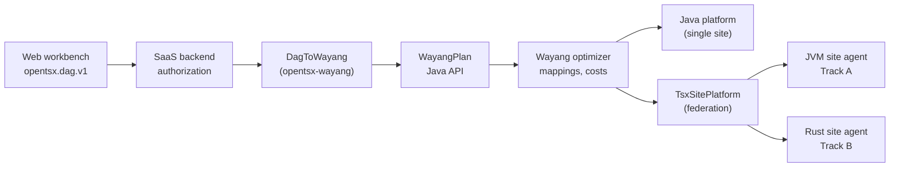
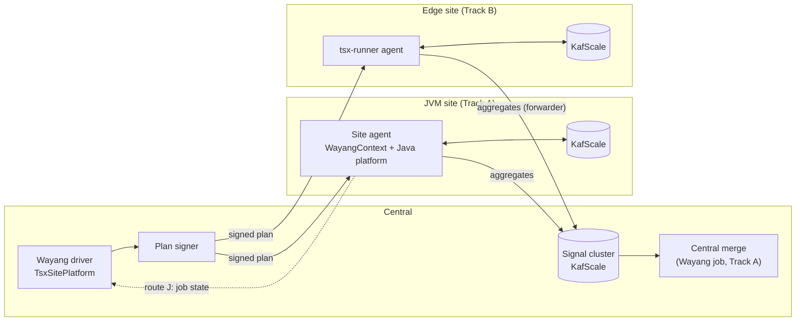

# Concept 20: time-series operators on Apache Wayang, a Java track and a Rust edge track

> Status: **concept**, 2026-11-16, not implemented. Checked against this repository at `548f316` and against Apache
> Wayang release 1.1.1 (tag `wayang-1.1.1`, commit `61deee43`, 2026-02-09) and `main` at `713faa7d` (2026-11-12).
> Crate and tool versions are named where they are used. Related: [05](05-SMART-TOPICS.md) (federated global model),
> [11](11-SMART-TOPIC-PROZESSOR-DEVOPS.md) (Go Smart Topic processor, `opentsx.dag.v1`),
> [Kafka native streaming](../devops/kafka-native-streaming.md) (the Java processor that runs today).

## 1. Goal

OpenTSx time-series operators run as Apache Wayang operators on Kafka topics, at many sites, under one plan. Raw
data stays at its site. Only mergeable aggregates and signals leave it.

Two implementation tracks share one operator catalog, one topic and schema contract and one set of test vectors:

| Track | What | Where it runs | Order |
|---|---|---|---|
| **A**, TSOperators for Java | native Wayang operators: logical operator, Java execution operator, mapping and cost function per OpenTSx operator; reuse of the existing OpenTSx Java code | JVM sites (servers, cluster nodes) | first |
| **B**, Rust edge runner | the same operators, ported to a small Rust binary, reached from Wayang as a separate platform | low-capacity hardware: ARM gateways, a Raspberry Pi on board, meter and substation sites | second, after the catalog and vectors of Track A are stable |

Kafka is the only source and sink in both tracks. Out of scope: training (it stays a batch job,
[11](11-SMART-TOPIC-PROZESSOR-DEVOPS.md), D28), joins over raw data of two sites, and history search (pattern
search, twin, causal analysis).

## 2. Current state

| Item | State | Evidence |
|---|---|---|
| Wayang in OpenTSx | Design prose only. No Wayang code and no Wayang dependency in any `pom.xml`. | `grep -rli wayang --include=pom.xml .` returns no file; mentions in [05](05-SMART-TOPICS.md) line 147, [06](06-SYSTEMREKONSTRUKTION-OPTIMIERUNG.md) line 231, [user manual 14](../user-manual/14-saas-service-layer.md) line 59, `EVOLUTION/TASK-015-multivariate-analysis.md` line 247, `TASK-016-smart-topics.md` line 34, `TASK-017-digital-twin.md` line 85 |
| Build | Java release 17 (`pom.xml:38`), CI on Java 17 and 21 ([CONTRIBUTING.md](../../CONTRIBUTING.md)); `kafka.version` 3.9.2, `avro.version` 1.12.1, `hadoop.version` 3.5.0 (`pom.xml:49-54`) | `pom.xml` |
| Streaming runtime that runs today | Java processor in `opentsx-retrieval`: manual assignment, explicit offsets, checkpoint per runner written after the broker acknowledged the output, control topic `tsx.<domain>.dags.v1`, status topic `tsx.<domain>.dag-status.v1` | [kafka-native-streaming.md](../devops/kafka-native-streaming.md); `VectorProcessor.java:46-59`; `TopicLayout.java:119-125` |
| DAG validation | unique node ids, existing inputs, no cycles, supported sinks only, before the control record is written | `opentsx-retrieval/src/main/java/org/opentsx/retrieval/vector/DagPlan.java:17` |
| Go processor proposal | `opentsx.dag.v1`, Go core on the KafScale processor template, shared vectors, at-least-once plus deterministic ids (D25 to D29) | [11](11-SMART-TOPIC-PROZESSOR-DEVOPS.md), sections 5, 6, 7, 10 |
| Processor description | `opentsx.processor.v1`: operator id, kind, outputs, `runtimes` with `workbench`, `java`, `python` | `docs/datamodel-2026/schemas/opentsx.processor.v1.schema.json:102-114` |
| Series identity | `seriesId` = lower-case hex of xxHash64, seed 0, over the canonical form of metric and tags | `SeriesKey.avsc`; `SeriesKeys.java:37-41` |
| Episode | `[tStart, tEnd)` in microseconds, values, optional quality byte per value, mergeable `EpisodeSummary`, `revision`, `Provenance` | `Episode.avsc`, `EpisodeSummary.avsc`, `Provenance.avsc` |
| Wire format | Avro single-object encoding, `C3 01` plus CRC-64-AVRO fingerprint, no schema registry; shared vectors | `OpenTsxAvro.java:71-123`; `opentsx-model/src/test/resources/testvectors/wire-format.json` (`Episode` = `8985f02b48c77195`) |
| Record key and partitioning | episode records use key `seriesId` and record timestamp `tStart`; the Java default partitioner places them | `BucketWriter.java:26`, `:107-108`; `KafScaleFeed.java:180` |
| KafScale client rules | `enable.idempotence=false`, `acks=all`, `max.in.flight.requests.per.connection=1`, zstd, delivery timeout three minutes; consumers without group id, manual assignment and seek, `Patience.poll` for refused fetches | `KafScaleClients.java:16-72`; `Patience.java:24-75` |
| KafScale capabilities | no timestamp seek, no idempotent producer, no standalone commit, no group rejoin, compaction accepted but not done; `Admin.listOffsets` earliest and latest work (KafScale v1.6.0) | [`opentsx-kafscale-conformance/README.md`](../../opentsx-kafscale-conformance/README.md) |
| Shared operator vectors | `align-vector.v1.json`, `clean-ops.v1.json`, `pair-es.v1.json`, `pair-xcorr.v1.json`; sketch bytes shared by Java and Python | `docs/datamodel-2026/testvectors/`; `QuantileSketchTest.java:105-115`; `python-package/tests/test_stats.py:10-17` |

## 3. Research findings

### 3.1 Apache Wayang

Status: top-level Apache project since November 2025
([ASF announcement, 2025-12-03](https://news.apache.org/foundation/entry/the-apache-software-foundation-announces-new-top-level-projects-3)).
Latest release 1.1.1, 2026-02-11 ([projects.apache.org](https://projects.apache.org/json/projects/wayang.json)).
Release 1.1.1 compiles with `maven.compiler.release` 17 (`pom.xml:115` of the tag), so it runs on the Java 17 and 21
of the OpenTSx CI. Running it on 21 is not tested yet (phase A0).

Class names below were checked in tag `wayang-1.1.1`. Paths start at the Wayang repository root.

| Concept | Class | Evidence |
|---|---|---|
| Logical operators | `org.apache.wayang.core.plan.wayangplan.UnarySource<T>`, `UnaryToUnaryOperator<I, O>`, `BinaryToUnaryOperator<I0, I1, O>`, `UnarySink<T>`, all `extends OperatorBase implements ElementaryOperator` | `wayang-commons/wayang-core/src/main/java/org/apache/wayang/core/plan/wayangplan/UnarySource.java:26`, `UnaryToUnaryOperator.java:26`, `BinaryToUnaryOperator.java:26`, `UnarySink.java:26` |
| Java execution operator | `org.apache.wayang.java.operators.JavaExecutionOperator extends ExecutionOperator`, method `evaluate(ChannelInstance[] inputs, ChannelInstance[] outputs, JavaExecutor, OperatorContext)` returning `Tuple<Collection<ExecutionLineageNode>, Collection<ChannelInstance>>` | `wayang-platforms/wayang-java/src/main/java/org/apache/wayang/java/operators/JavaExecutionOperator.java:39-60` |
| Java platform | `org.apache.wayang.java.platform.JavaPlatform.getInstance()`; `org.apache.wayang.java.Java.basicPlugin()` | `JavaPlatform.java:33-43`; `Java.java:29-70` |
| Mapping | `org.apache.wayang.core.mapping.Mapping` with `getTransformations()`; Java mappings listed in `org.apache.wayang.java.mapping.Mappings` | `Mapping.java:26`; `wayang-java/.../mapping/Mappings.java:61-62` |
| Plugin | `org.apache.wayang.core.plugin.Plugin`: `getRequiredPlatforms`, `getMappings`, `getChannelConversions`, `setProperties` | `Plugin.java:39` |
| Platform | `org.apache.wayang.core.platform.Platform` (abstract) | `Platform.java:38` |
| Executor | `org.apache.wayang.core.platform.PushExecutorTemplate` (abstract) | `PushExecutorTemplate.java:47` |
| Cost functions | `org.apache.wayang.core.optimizer.costs.LoadProfileEstimators.createFromSpecification`; specs as JSON with JUEL expressions in `wayang-<platform>-defaults.properties`, for example `wayang.java.kafkatopicsource.load.main = {"in":0, "out":1, "cpu":"${425*out0 + 1400000}", "ram":"${100*out0}", "p":0.9}` | `LoadProfileEstimators.java:54`; `wayang-java/src/main/resources/wayang-java-defaults.properties:497` |
| Remote work | JDBC platforms keep data out of the driver: `JdbcExecutor` builds SQL per stage into a `SqlQueryChannel`, the database runs it when a downstream conversion pulls it | `JdbcExecutor.java:148`, `:456-483`; `SqlToStreamOperator.java:104` (at `main`) |
| Plan API | `wayang-api-json`: `POST /wayang-api-json/submit-plan/json` and `.../drawflow-format`, synchronous; user functions travel as Scala source and are compiled at runtime; no Kafka operator in the JSON API | `wayang-api/wayang-api-json/src/main/scala/Main.scala:33`, `:50`; `SerializableLambda.scala:23-29` (at `main`) |
| Federation | none; one driver JVM runs a plan through `CrossPlatformExecutor`. Scalytics describes a commercial federation ([scalytics.io](https://www.scalytics.io/federatedintelligence)); no public protocol found, not verified | source tree grep |
| Streaming | none in the Java platform; `JavaKafkaTopicSource` reads one batch (section 3.2) | `JavaKafkaTopicSource.java:103` |

Papers: Kruse et al., "Apache Wayang: A Unified Data Analytics Framework", SIGMOD Record 52(3), 2023,
[doi:10.1145/3631504.3631510](https://doi.org/10.1145/3631504.3631510); "RHEEM: Enabling Cross-Platform Data
Processing", PVLDB 11(11), 2018, [doi:10.14778/3236187.3236195](https://doi.org/10.14778/3236187.3236195);
"RHEEMix in the data jungle", VLDB Journal 29(6), 2020,
[doi:10.1007/s00778-020-00612-x](https://doi.org/10.1007/s00778-020-00612-x).

### 3.2 Wayang's Kafka source and sink

Checked in tag `wayang-1.1.1`. `B` is `wayang-commons/wayang-basic/src/main/java/org/apache/wayang/basic/operators`,
`J` is `wayang-platforms/wayang-java/src/main/java/org/apache/wayang/java/operators`.

| Property | What the code does | Evidence | Fits KafScale and OpenTSx |
|---|---|---|---|
| Value format | `KafkaConsumer<String, String>`, `StringDeserializer`; the Java source emits `ConsumerRecord::value` as a `Stream<String>` | `B/KafkaTopicSource.java` `getDefaultProperties`; `J/JavaKafkaTopicSource.java:103-110` | no: episodes are binary Avro single-object records |
| Consumer group | fixed `group.id` `wayang-kafka-java-source-client-2`, `subscribe(topicName)` | `B/KafkaTopicSource.java:124`, `:175` | no: group rejoin and standalone commits fail on KafScale |
| Offset commit | no explicit commit; with a group id the Kafka client default `enable.auto.commit=true` applies, so offsets are committed in the background | `B/KafkaTopicSource.java` (no commit call); [Kafka consumer configs](https://kafka.apache.org/documentation/#consumerconfigs_enable.auto.commit) | no: at-least-once needs commit after the sink acknowledged |
| Read extent | one `poll(Duration.ofMillis(15000))` per execution | `J/JavaKafkaTopicSource.java:103` | no: a bounded read needs explicit start and end offsets |
| Start position | `auto.offset.reset=earliest` | `B/KafkaTopicSource.java:176` | partly |
| Client config | `getDefaultProperties()`: `SASL_SSL`, `PLAIN`, bootstrap and credentials from environment variables; `loadConfig(path)` reads a properties file instead | `B/KafkaTopicSource.java:139-201`; `B/KafkaTopicSink.java:160-215` | a properties file can carry the proxy address and `enable.idempotence=false` |
| Sink record | `ProducerRecord<String, String>(topicName, value)`: no key; value formatted to a String by a `TransformationDescriptor` | `J/JavaKafkaTopicSink.java:101`; `B/KafkaTopicSink.java:63-91` | no: OpenTSx needs key `seriesId` and Avro bytes |
| Idempotence | not set; kafka-clients from 3.0 default to `enable.idempotence=true` ([KIP-679](https://cwiki.apache.org/confluence/display/KAFKA/KIP-679%3A+Producer+will+enable+the+strongest+delivery+guarantee+by+default)) | grep over the module | no without a properties file: KafScale has no `InitProducerId` |
| Client version | `kafka-clients` 3.9.1 in `wayang-basic` | `wayang-commons/wayang-basic/pom.xml:94-95` | OpenTSx manages 3.9.2 (`pom.xml:49`); the root `dependencyManagement` wins |

**Conclusion.** The operators do not fit, and a properties file fixes only the client config. Track A adds its own
source and sink operators (section 5.2). They build clients with `KafScaleClients`, so every connection goes to the
configured proxy address, idempotence is off and topic names come from `TopicLayout`. Contributing key, byte and
offset support upstream is possible later; it is not a dependency of this plan.

The `wayang-java` module (tag `wayang-1.1.1` and `main`) contains `src/main/resources/wayang-kafka-defaults.properties` with what looks
like credentials of a hosted Kafka service. OpenTSx must not load that file; the plugin sets its own client
properties.

### 3.3 Dependency footprint (AGENTS.md rule 5)

Compile-scope dependencies declared in the Wayang 1.1.1 poms (direct only; the transitive tree is not resolved yet):

| Module | Declared compile dependencies |
|---|---|
| `wayang-core` | snakeyaml, commons-io, hadoop-hdfs, hadoop-common, juel-api, juel-impl, gson, commons-lang3, antlr4-runtime, log4j-api, log4j-core, wayang-utils-profile-db, jackson, aws-java-sdk-s3, httpclient |
| `wayang-basic` | wayang-core, kafka-clients, parquet-hadoop, google-cloud-storage, Azure blob, key vault and identity, iceberg-core/api/parquet/data 1.6.0, hadoop-common, hadoop-client, **slf4j-simple** |
| `wayang-java` | wayang-basic, opencsv, parquet-avro, parquet-hadoop, avro, slf4j-api |

Conflicts with OpenTSx: Hadoop 3.3.6 against 3.5.0, Iceberg 1.6.0 against 1.10.2 (`opentsx-store-iceberg/pom.xml:19`),
`slf4j-simple` as a compile dependency next to the OpenTSx logging binding.

Rule for Track A: `opentsx-wayang` depends on `wayang-core`, `wayang-basic` and `wayang-java` 1.1.1, pinned, with
exclusions for the cloud-storage, Iceberg and `slf4j-simple` artifacts. It does not depend on `opentsx-store-iceberg`.
Phase A0 runs `mvn dependency:tree` and the Wayang Java platform tests with the exclusions in place. If Wayang's
core classes need an excluded artifact at runtime, the exclusion is dropped and the conflict documented.

### 3.4 Kafka Streams semantics on KafScale

| Kafka Streams | Needs | On KafScale | Both tracks |
|---|---|---|---|
| `processing.guarantee=exactly_once_v2` | transactions, which need idempotence, which needs `InitProducerId` ([KIP-98](https://cwiki.apache.org/confluence/display/KAFKA/KIP-98+-+Exactly+Once+Delivery+and+Transactional+Messaging), [KIP-447](https://cwiki.apache.org/confluence/display/KAFKA/KIP-447%3A+Producer+scalability+for+exactly+once+semantics)) | not possible | at-least-once plus deterministic output ids |
| state store changelogs | `cleanup.policy=compact` ([manage topics](https://kafka.apache.org/40/streams/developer-guide/manage-topics/)) | compaction not done | local checkpoint with offsets and operator state |
| repartition topics | a key change before grouping or join ([DSL](https://kafka.apache.org/40/streams/developer-guide/dsl-api/)) | possible | explicit repartition sink (section 7) |
| co-partitioning | same partition count, same partitioner | possible | checked in the site contract |
| consumer groups | membership and rebalancing | rejoin broken | manual assignment |
| stream time, grace | windows close after end plus grace ([core concepts](https://kafka.apache.org/40/streams/core-concepts/)) | possible | event time on the epoch grid, `lateness`, revisions ([11](11-SMART-TOPIC-PROZESSOR-DEVOPS.md), 7a) |

### 3.5 Rust crates for Track B

Versions from crates.io on 2026-11-16.

| Need | Choice | Version, licence | Finding |
|---|---|---|---|
| Kafka client | `rdkafka` | 0.39.0, MIT; bundles librdkafka 2.12.1 | `BaseConsumer` with `assign`, `seek`, `store_offset`; features `ssl`, `sasl`, `zstd`, `cmake-build`; OAUTHBEARER via `ClientContext::generate_oauth_token` (`src/client.rs:130`) |
| librdkafka defaults | | | `enable.idempotence=false`, `acks=-1`, **`partitioner=consistent_random`**; Java compatibility needs `partitioner=murmur2_random` ([CONFIGURATION.md](https://github.com/confluentinc/librdkafka/blob/master/CONFIGURATION.md)) |
| Avro | `apache-avro` | 0.22.0, Apache-2.0 | `GenericSingleObjectWriter`, `SpecificSingleObjectWriter<T>`; `RabinFingerprintHeader` writes `C3 01` plus the fingerprint little-endian (`src/headers.rs`) |
| xxHash64 | `twox-hash` | 2.1.5, MIT | `XxHash64::oneshot(seed, bytes)` |
| DDSketch | port of `QuantileSketch` | | `sketches-ddsketch` 0.4.2 uses floor indexing and the Java DDSketch byte format; OpenTSx uses `ceil` indexing and its own format v1 (`QuantileSketch.java:13-28`, `:221`) |
| Sandbox | `wasmtime` | 50.0.1 | fuel, epoch interruption, `StoreLimitsBuilder::memory_size`; WASI 0.2 components tier 1 |
| Supply chain | `cargo-auditable` 0.7.7, `cargo-cyclonedx` 0.5.10, `cargo-deny` 0.20.2, cosign 3.1.4, `actions/attest-build-provenance` 4.2.2 | | embedded dependency list, CycloneDX SBOM, licence and advisory gate, Sigstore signatures, SLSA v1.0 provenance |

Stream engines checked for reuse, none adopted: Arroyo (MIT or Apache-2.0, acquired by Cloudflare 2025-04-10,
[blog](https://blog.cloudflare.com/cloudflare-acquires-arroyo-pipelines-streaming-ingestion-beta/)) is a full
distributed engine; Timely and Differential Dataflow (MIT, 0.32.0 and 0.26.0) have no Kafka connector; Fluvio
SmartModules need a Fluvio cluster; Redpanda Data Transforms run only inside Redpanda
([docs](https://docs.redpanda.com/current/develop/data-transforms/how-transforms-work/)); RisingWave is a database;
Materialize is BSL 1.1; Bytewax is community-maintained after its company stopped; Apache Iggy is not Kafka protocol.

## 4. Shared contract of both tracks

| Id | Decision | Reason |
|---|---|---|
| C1 | One operator catalog: ids and versions of `opentsx.processor.v1`. The schema gets a runtime key `rust` next to `java`. | The workbench already writes these ids (`opentsx-saas-frontend/src/workbench/ops.ts:784-911`). |
| C2 | An operator version enters a track only when it passes the shared vectors that the reference implementation passes. | Rule of [11](11-SMART-TOPIC-PROZESSOR-DEVOPS.md), 7a, row "Equality of preview and operation". |
| C3 | Topic names from `TopicLayout` (`tsx.<domain>.<kind>.v2`), records in Avro single-object encoding, key `seriesId`, Java-compatible murmur2 partitioning. | `TopicLayout.java:189-191`; `BucketWriter.java:107-108`. |
| C4 | Clients connect to the KafScale proxy only, with `enable.idempotence=false`, `acks=all`, one request in flight. | `KafScaleClients.java:36-50`; CLAUDE.md. |
| C5 | At-least-once delivery, deterministic output ids, readers keep one record per id. | Section 3.4. |
| C6 | Checkpoint per task with offsets and operator state, written after all output before it is acknowledged. | `VectorProcessor.java:56-59`. |
| C7 | Event time on the epoch grid; episodes `[tStart, tEnd)`; late data creates a revision. | [11](11-SMART-TOPIC-PROZESSOR-DEVOPS.md), 5a and 7a. |
| C8 | One plan format for sites of both tracks: `opentsx.runner-plan.v1` (section 9.2), wrapping `opentsx.dag.v1`. | One federation path for JVM and Rust sites. |
| C9 | Each `seriesId` belongs to exactly one site. | Per-series stateful operators break when a series is split (section 10.3). |

## 5. Track A: TSOperators for Java

### 5.1 Module

`opentsx-wayang`, a new reactor module next to `opentsx-retrieval`, built with the root `pom.xml` (release 17,
tested on 17 and 21). Dependencies:

| Dependency | Why |
|---|---|
| `org.apache.wayang:wayang-core`, `wayang-basic`, `wayang-java` 1.1.1, pinned, exclusions per section 3.3 | the platform API and the Java platform |
| `opentsx-model` | `OpenTsxAvro`, `SeriesKeys`, Avro types |
| `opentsx-kafka-v2` | `KafScaleClients`, `TopicLayout`, `Patience`, `LogReader` |
| `opentsx-stats` | `StatsEngine`, `StatsAccumulator`, `QuantileSketch`, `DataQuality` |
| `opentsx-retrieval` | `CleanChain`, `Resampling`, `Segmenter`, `StreamingSegmenter`, `Sax`, `Paa`, `VectorAligner` |

No dependency on `opentsx-core`: it pulls Swing charting, Mahout, POI and Hadoop client artifacts
(`opentsx-core/pom.xml`). Code from it is ported into `opentsx-wayang` only together with a vector test.

### 5.2 Classes per operator

Every OpenTSx operator becomes four pieces, following the Wayang pattern of section 3.1:

| Piece | Track A class (proposed) | Wayang type |
|---|---|---|
| logical operator | `TsxOperator` subclasses, for example `StatsWindowOperator extends UnaryToUnaryOperator<Episode, SeriesStats>`; `PairXcorrOperator extends BinaryToUnaryOperator<Episode, Episode, Episode>` | logical |
| Java execution operator | `JavaStatsWindowOperator extends StatsWindowOperator implements JavaExecutionOperator` | Java platform |
| mapping | `StatsWindowMapping implements Mapping` | registered by `TsxJavaPlugin` |
| cost function | `wayang.java.tsx.stats-window.load.main = {...}` in `wayang-tsx-defaults.properties` | `LoadProfileEstimators` |

Source and sink, replacing Wayang's Kafka operators (section 3.2):

| Class | Behaviour |
|---|---|
| `TsxTopicSource extends UnarySource<Episode>` and `JavaTsxTopicSource` | reads `[from, to)` per partition with manual assignment and seek, as `LogReader.java:21` does; `from` from the checkpoint, `to` from `endOffsets` at job start (`LogReader.java:68`); decodes with `OpenTsxAvro.decode`; refused fetches through `Patience.poll` |
| `TsxTopicSink extends UnarySink<SpecificRecord>` and `JavaTsxTopicSink` | `KafScaleClients.producer`; key `seriesId`, value `OpenTsxAvro.encode`, header `tsx-schema` (`TopicLayout.HEADER_SCHEMA`); waits for all acknowledgements before the job reports success |
| `TsxCheckpoint` | written by the executor after the sink succeeded: offsets per partition, operator state, `dagHash` |

Wayang runs a plan once; its Java platform has no continuous mode (section 3.1). Track A therefore runs a
continuous DAG as a series of **bounded increments**: each Wayang job processes the offsets between the last
checkpoint and the end offsets read at its start, carries operator state in and out through the checkpoint, and
writes a new checkpoint. Latency is the increment interval plus the job start time. Both are measured in phase A1.

### 5.3 Reuse of OpenTSx Java code

| Operator id | Existing Java code | Shared vectors | Track A work |
|---|---|---|---|
| `decode.avro-soe`, encode | `OpenTsxAvro.java:36-123`; `SeriesKeys.java:37-41` | `wire-format.json`, `series-id.json`, `xxh64.json` | wrap |
| `stats.welford-ddsketch` (`stats.window` in the workbench) | `StatsEngine.java:48-153` (`onEpisode`, `onObservation`), `StatsAccumulator.java:62-86` (merge), `QuantileSketch.java:101-110` (merge) | `QuantileSketchTest.testVector` | wrap |
| `dq.checks` | `DataQuality.java:29-70` (`evaluate(SeriesStats, Expectation)`); clean chain `dq.checks` in `CleanChain.java:35` | `clean-ops.v1.json` | wrap |
| `convert.unit`, `resample`, `model.wind-shear`, `model.power-curve`, `feature.lag`, `feature.rolling` | `CleanChain.java:35`, `:112` (`of`), `:290-326` (`newState`, `restore`, `apply`); `Resampling.java:20` | `clean-ops.v1.json` | wrap; `CleanChain` state already serializes to JSON (`restore`), which fits the checkpoint |
| `segment.threshold`, `segment.extremum`, fixed duration and count | `Segmenter.java:38-92`, `StreamingSegmenter.java:43-72` (`onEpisode`, `flush`) | none shared; Java tests only | wrap; add vectors |
| SAX word | `Sax.java:16-49` (`breakpoints`, `word`, `mindist`), `Paa.java:9`; fills `EpisodeSummary.sax` | none | wrap; add vectors |
| `align.vector` | `VectorAligner.java:99` (`align`); streaming in `VectorStream` | `align-vector.v1.json` | wrap |
| `pair.xcorr` | **no Java code in OpenTSx.** The workbench port (`opentsx-saas-frontend/src/workbench/xcorr.ts`) follows `KreuzKorrelation` and `CCFunction` of kamir/WikiExplorer.NG, Apache License 2.0, which `tools/pair_xcorr_vectors.sh` runs to make the vectors | `pair-xcorr.v1.json` | port from the original Java, test against the vectors |
| `pair.es` | Java `ESCalc.calc(int[], int[])` in `opentsx-core/src/main/java/org/opentsx/algorithms/eventsynchronisation/ESCalc.java:33`, integer event times; the workbench and Python (`python-package/opentsx/algorithms/event_sync.py:42`) follow `event_sync.py` with surrogates (`Mulberry32`, `isi_shuffle`) | `pair-es.v1.json` | port from `event_sync.py`; check `ESCalc` against the vectors before any reuse |
| DFA | `opentsx-core/src/main/java/org/opentsx/algorithms/detrending/methods/DFA.java:5` (`extends DFACore`, `calc()`), stateful legacy API | none | later; needs vectors and a stateless entry point |

### 5.4 Translation path



1. The workbench writes `opentsx.dag.v1`, as today.
2. `DagToWayang` builds a `WayangPlan` with the Java API: one logical operator per node, one `TsxTopicSource` per
   input topic, one `TsxTopicSink` per sink. It validates as `DagPlan` does today.
3. The plugin does not use `wayang-api-json`: that API has no Kafka operator and compiles Scala source received in
   the request (section 3.1), which a site must not accept.
4. Single site: `WayangContext` with `Java.basicPlugin()` and `TsxJavaPlugin` runs the plan in the driver JVM.
5. Federation: section 9.

### 5.5 Optional engines

Spark and Flink execution operators can follow through additional mappings once the Java operators pass the
vectors. They are not part of this plan: Wayang's Spark and Flink operators bring their own Kafka handling, and
OpenTSx already has a Flink path (`opentsx-flink-core`).

## 6. Track B: Rust edge runner

### 6.1 Scope

`tsx-runner` is one statically linked binary. It executes the same operator ids and versions as Track A, on the
same topics, with the same checkpoint rules (C1 to C9). It reads and writes Kafka through the site's KafScale proxy
and nothing else. Producers set `partitioner=murmur2_random` in addition to C4 (section 3.5).

Modes: `agent` (mTLS REST service, outbound polling by default), `run` (one plan file, for SSH launch and tests),
`conform` (site checks of section 8, signed report).

Inside, one task per assigned partition set: fetch with `BaseConsumer` (manual `assign`, `seek`, no group id),
decode, run the operator chain in process, produce, collect delivery reports, then write the checkpoint. Unlike
Track A, the runner is continuous: no job start per increment.

### 6.2 Resource targets

The numbers below are **budgets to verify**, chosen for the target hardware class. None is measured.

| Resource | Budget | How it is checked |
|---|---|---|
| Cross-compile targets | `aarch64-unknown-linux-musl`, `armv7-unknown-linux-musleabihf`, `x86_64-unknown-linux-musl`, static; librdkafka built with `cmake-build` | CI build per target; a run on real arm64 and armv7 hardware. Static musl builds of `rdkafka` with TLS are not verified yet. |
| Resident memory | at most 64 MiB with 1,000 series and the R-B2 operator chain | `/proc/<pid>/status` VmHWM over a 24 h run |
| CPU | at most one core at 10,000 values/s through decode, `dq.checks`, `resample`, `stats.welford-ddsketch` | `perf stat` or `/proc/<pid>/stat` |
| Binary size | at most 20 MiB stripped | file size of the release artifact |
| Startup | first fetch within 1 s of process start, checkpoint load included | timestamps in the log |
| Offline operation | runs against the site broker with no route to the central side; output for the signal cluster stays in the site topic | test with the central side unreachable |
| Catch-up | after 24 h offline, the site's aggregates reach the signal cluster in order, without loss, and the merge marks the windows `final` | test, section 13 |

Offline operation follows from the topology: the runner writes federated aggregates to a site topic
(`tsx.<domain>.aggregates.v2`, proposed kind), and a forwarder (also `tsx-runner`) copies them to the signal cluster
when the link is up, from its own checkpoint. On a boat or at a substation the link may be down for days; site
retention must cover that gap.

### 6.3 Operators on low-capacity hardware

| Operator | Edge (Track B) | Reason |
|---|---|---|
| `decode.avro-soe`, `dq.checks`, `convert.unit`, `resample`, `feature.lag`, `feature.rolling` | yes | bounded state per series |
| `stats.welford-ddsketch` | yes | bounded state: moments plus at most `maxBins` bins (`QuantileSketch.java:33`) per window |
| `segment.threshold`, fixed duration and count | yes | bounded buffers (`SampleBuffer`) |
| `align.vector` | yes, with a cap on open ticks | state grows with open ticks ([11](11-SMART-TOPIC-PROZESSOR-DEVOPS.md), 5b, "Limits") |
| SAX word | yes | per episode |
| `pair.xcorr` | only for short windows and few lags | cost grows with window length times lags |
| `pair.es` | JVM | surrogate shuffles multiply the cost by the shuffle count |
| DFA, pattern search (MASS, DTW), twin, ONNX scoring | JVM | history or large models |

## 7. Flow shapes

All shapes keep the record key `seriesId`, except where an operator changes the key on purpose.

| Shape | Example | Rule |
|---|---|---|
| 1:1 | `tsx.d.episodes.v2` to `tsx.d.clean.v2` through `dq.checks`, `resample` | one input partition, one task; output partition follows from `murmur2(seriesId)` |
| 1:m | `episodes` to `clean` and `aggregates` | one task, several sinks; one producer per sink topic (KOI-2026-10-13-02 in [11](11-SMART-TOPIC-PROZESSOR-DEVOPS.md), 5b) |
| n:1 | `episodes` and `synthetic` to `features` | same partition count and partitioner on all inputs; the task reads partition p of every input; checked in the site contract |
| n:m | several inputs, several sinks | both rules above |
| key change | `align.vector` with `key: turbine`, `pair.*` over two series | a repartition sink writes `tsx.<domain>.repartition.<dag>.<node>.v2` keyed by the new key; a second stage reads it (proposed kind) |

Order holds per partition; with key `seriesId` the episodes of one series stay in order
(`producesAndConsumesInOrderPerKey` in the conformance suite). Windows and ticks lie on the grid since
1970-01-01T00:00:00Z, so every site and both tracks cut identical windows. A window closes when every input series
of the task has passed its end plus `lateness`. Without timestamp seek, a start is `earliest`, `latest` or an
offset map; a start by time goes through the episode index (`EpisodeIndex.find`).

## 8. Site contract

A site, JVM or Rust, is admitted to a federated job only when all checks pass. Track A runs them in its site agent,
Track B in `tsx-runner conform`. The report is signed with the site key.

| Check | Pass condition |
|---|---|
| topic names | every input and output follows `tsx.<domain>.<kind>.v2` |
| partition counts | equal to the job contract for every n:1 input pair |
| schema fingerprints | the first and last record of each partition decode with a fingerprint listed in the contract |
| Avro and series id vectors | `wire-format.json`, `series-id.json`, `xxh64.json` pass |
| operator vectors | every operator version in the plan passes its shared vectors |
| KafScale capabilities | the required tests of `opentsx-kafscale-conformance` pass against the site broker |
| partitioner | a probe record per partition lands where Java's murmur2 puts it |
| series ownership | no overlap with any other site's `seriesId` set (C9) |
| runtime identity | binary or JAR version and SBOM digest match a signed release |

## 9. Federation

### 9.1 Topology



Wayang has no federation (section 3.1). The plan adds it as a platform in the driver:

| Class | Role |
|---|---|
| `TsxSitePlatform extends Platform` | stands for "a set of sites"; its executor sends one plan per site |
| `TopicChannel` with `ChannelDescriptor(TopicChannel.class, true, true)` | names a topic, fingerprint and partition count; carries no records, like `SqlQueryChannel` carries SQL |
| `AggregateChannel` | merged aggregates returned to the driver (route J) |
| `TsxSiteExecutor extends PushExecutorTemplate` | builds, signs and sends site plans; polls status; collects route J results |

The **JVM site agent** (Track A) is a small Java service in `opentsx-wayang`. It verifies the plan and runs it in a
local `WayangContext` with the Java platform, increment by increment. The **Rust agent** (Track B) runs the same plan
in `tsx-runner`. Both report status to `tsx.<domain>.dag-status.v1`.

### 9.2 Plan envelope

```json
{
  "schema": "opentsx.runner-plan.v1",
  "job": "<job id>",
  "planVersion": 7,
  "expires": "2026-11-17T00:00:00Z",
  "site": "<site id>",
  "dagHash": "<xxHash64 hex of the canonical opentsx.dag.v1 document>",
  "catalogVersion": "<operator catalog version>",
  "inputs": [{"topic": "tsx.<domain>.episodes.v2", "fingerprint": "8985f02b48c77195", "partitions": 12}],
  "outputs": [{"topic": "tsx.<domain>.aggregates.v2", "cluster": "site", "fingerprint": "<fingerprint>"}],
  "start": "earliest",
  "federation": {"route": "signal-cluster", "expectedSites": ["<site id>", "<site id>"]},
  "dag": { }
}
```

Signed as a JWS ([RFC 7515](https://www.rfc-editor.org/rfc/rfc7515.html)) over its canonical JSON. `dagHash` uses
the canonical form and xxHash64 of the twin plan hash (`TwinPlan.java:116`). Field names are a proposal.

### 9.3 Routes

| Route | Path | Use when |
|---|---|---|
| S, signal cluster | sites write aggregates to a site topic; a forwarder copies them to the signal cluster; a central Wayang job (Track A, `TsxTopicSource` plus a merge operator) reads and merges | continuous jobs, edge sites with intermittent links |
| J, job state | the JVM site agent returns aggregates of a bounded job to `TsxSiteExecutor`, which merges into an `AggregateChannel` | bounded jobs whose result continues in a Wayang plan |

Aggregates are keyed by `(job, site, window, group)`; `group` is the grouping key (a tag value such as `channel`, or
`all`).

### 9.4 Why the merged result equals the centralized result

Sites hold disjoint value sets of one group and one window (C9 and the epoch grid).

| Statistic | Merge | Equal to centralized |
|---|---|---|
| count, NaN count, gap count | sum | exactly |
| min, max | min, max | exactly |
| mean, M2 | Chan et al.: n = nₐ + n_b, δ = μ_b − μₐ, μ = μₐ + δ·n_b/n, M2 = M2ₐ + M2_b + δ²·nₐ·n_b/n (`StatsAccumulator.java:62-86`) | exactly in real arithmetic for any split ([Chan, Golub, LeVeque 1983, doi:10.1080/00031305.1983.10483115](https://doi.org/10.1080/00031305.1983.10483115); [Welford 1962, doi:10.1080/00401706.1962.10490022](https://doi.org/10.1080/00401706.1962.10490022)). In IEEE 754 doubles the result depends on the merge order: equal within a relative tolerance, not bit for bit |
| DDSketch bins | add bin counts (`QuantileSketch.java:101-110`) | exactly, with the same `alpha` and `maxBins`, when all values were indexed by one runtime. Collapse moves the lowest bin into the next one (`:228-233`); the kept bins are always the `maxBins` highest indexes seen and all collapsed mass ends in the lowest kept bin, in any order. This follows from the code; a test must confirm it |
| quantiles | from the merged sketch | equal to the centralized sketch's quantile; within relative error `alpha` of the true quantile ([Masson, Rim, Lee, PVLDB 12(12) 2019, doi:10.14778/3352063.3352135](https://doi.org/10.14778/3352063.3352135)) |
| DQ check counts, segment counts | sum | exactly |

### 9.5 Where it does not hold

| Case | Why | Alternative |
|---|---|---|
| exact median or quantile | needs all values | DDSketch quantile within `alpha` |
| `pair.xcorr`, `pair.es` with A and B at different sites | needs both series aligned at one place | only pairs within one site; for zero-lag Pearson correlation, co-moment sums (n, Σx, Σy, Σxy, Σx², Σy²) where both are present |
| per-series stateful operators over a split series | state per series | C9 forbids the split |
| DDSketch bins in a mixed federation | Java `Math.log` may differ from the correctly rounded result by 1 ulp ([Java SE 17 `Math.log`](https://docs.oracle.com/en/java/javase/17/docs/api/java.base/java/lang/Math.html#log(double))); Rust `f64::ln` uses the platform libm. A value on a bin boundary can land in neighbouring bins on JVM and Rust sites | the merged sketch stays within `alpha`; byte equality with a centralized run holds only when all sites run one runtime; a boundary test documents the gap |
| model training (FedAvg) | not a statistic | stays in the Python training path of [05](05-SMART-TOPICS.md) |

The merge knows `expectedSites`. A merged window is `final` when every expected site has reported it; otherwise it
is written with `final=false` and the missing sites. Replayed site output carries the same id and is kept once.

## 10. Delivery, state and recovery

| Point | Rule |
|---|---|
| delivery | at-least-once; nothing is committed to the broker; progress is the checkpoint |
| output id | derived episode: xxHash64 of `seriesId`, `tStart`, `tEnd`, `dagHash`, `revision` (same inputs as the clean-episode id in [11](11-SMART-TOPIC-PROZESSOR-DEVOPS.md), 7a). Aggregate: xxHash64 of `job`, `site`, `window`, `group`, `revision` |
| checkpoint | per task: offsets, operator state, `dagHash`, catalog version; temporary file, fsync, rename, after all earlier deliveries are acknowledged |
| producer retries | unbounded within `delivery.timeout.ms=180000` (`KafScaleClients.DELIVERY_TIMEOUT`); KafScale refuses produce for about a minute when its object store is degraded (`KafScaleClients.java:19-22`) |
| refused fetch | reset to the positions before the fetch and retry, as `Patience` does |
| one writer | one instance per site and partition set; an agent refuses a second plan for the same job |

| Failure | Effect | Recovery |
|---|---|---|
| crash | output since the last checkpoint is written again | restart from checkpoint; readers drop duplicates by id |
| produce refused past the delivery timeout | task `failed` | restart from the last checkpoint with a new producer after one minute |
| checkpoint unreadable | the Java processor today starts over and logs an error ([kafka-native-streaming.md](../devops/kafka-native-streaming.md)) | both tracks fail closed: `failed`, no output, operator review |
| site offline | its windows stay open at the merge | `final=false` with the missing site; catch-up from the site checkpoint |
| plan expired | agent stops after the current checkpoint | driver sends a new plan version |
| unknown schema fingerprint | record not processed | task `failed` with offset and fingerprint; no skip |

## 11. Security model

Assets: raw episodes at each site, plans, the plan signing key, site credentials, aggregates.

| Threat | Control |
|---|---|
| forged or altered plan | JWS signature; sites pin the plan signer's public key |
| replay of an old plan | monotonic `planVersion` per job and `expires`; sites reject lower versions and expired plans, as TUF does against rollback and freeze attacks ([TUF](https://theupdateframework.github.io/specification/latest/)) |
| plan that exfiltrates raw data | local site policy: allowed output clusters and kinds; in federation only aggregate and signal kinds may leave the site |
| code injection | plans name operator ids, never code; no Scala source compilation as in `wayang-api-json` |
| tampered artifact | Track A: signed JAR or image from CI; Track B: `cargo-auditable`, CycloneDX SBOM, cosign signature, SLSA provenance; both report their digest in the conformance report |
| compromised process reaches other hosts | systemd unit with `DynamicUser=yes`, `RestrictAddressFamilies=AF_INET AF_INET6 AF_UNIX`, `IPAddressDeny=any`, `IPAddressAllow=` proxy and signal cluster ([systemd.exec](https://www.freedesktop.org/software/systemd/man/latest/systemd.exec.html), [systemd.resource-control](https://www.freedesktop.org/software/systemd/man/latest/systemd.resource-control.html)); optional Landlock (Linux 5.13 and later) |
| stolen broker credentials | TLS client certificates or SASL OAUTHBEARER; prefixed ACLs on `tsx.<domain>.` ([KIP-290](https://cwiki.apache.org/confluence/display/KAFKA/KIP-290%3A+Support+for+Prefixed+ACLs)) |
| WASM user operators (Track B, later) | `wasmtime` with fuel or epoch deadline, memory cap, no WASI sockets or filesystem |

**Not verified:** whether KafScale or its proxy supports TLS, mTLS, SASL or ACLs; the KafScale README lists no
security feature in scope. Until checked, transport security holds only with a TLS-terminating proxy in front of
KafScale.

### 11.1 Launch: REST agent or SSH

| Aspect | REST agent | SSH launch |
|---|---|---|
| authentication | mTLS site certificate; workload identity possible with SPIFFE X.509-SVIDs ([SPIFFE](https://spiffe.io/docs/latest/spiffe-about/spiffe-concepts/)) | OpenSSH user certificate with `force-command=` and `source-address=` ([ssh-keygen](https://man.openbsd.org/ssh-keygen.1)); `restrict` in `authorized_keys` ([sshd](https://man.openbsd.org/sshd.8)) |
| attack surface | a listening port and our own HTTP and JSON parsing; none with outbound polling | sshd, usually already present; no new port |
| status, stop | API | status topic; stop by control record or by signal over SSH |
| long-running jobs | agent supervises tasks | needs systemd or a supervisor |
| sites without inbound access | outbound polling works | not possible |

Recommendation: the agent with outbound polling, for both tracks. SSH launch stays for sites that require it. Both
run the signature and conformance checks before the first fetch.

## 12. Observability

Both tracks write the records the Java processor writes today, so the workbench and `GET /v1/dags` work unchanged:
`opentsx.dag-control.v1` on `tsx.<domain>.dags.v1` and `opentsx.dag-status.v1` (`state`, `records`, `watermark`,
`waitingFor`, `skippedBlocks`, `error`) on `tsx.<domain>.dag-status.v1`, on each state change and every 30 s. New
fields, proposed: `site`, `job`, `planVersion`, `track`, `artifact` (version and digest). Metrics per task: lag per
partition, records in and out, operator time, checkpoint age, delivery failures.

## 13. Testing

| Test | Track | Pass |
|---|---|---|
| Avro bytes against `wire-format.json` | A, B | byte-identical hex, equal fingerprints |
| `series-id.json`, `xxh64.json`, `time-deltas.json`, `bucket-checksum.json` | A, B | identical values |
| operator vectors in `docs/datamodel-2026/testvectors/` | A, B | identical where Java and workbench are identical; `pair-xcorr` to 12 decimals |
| sketch bytes of `QuantileSketchTest.testVector`; merge in every order of 1 to 8 parts | A, B | byte-identical for every order |
| stream equals batch: vectors in random chunk sizes and series orders | A, B | same output as one batch, as `VectorStreamTest` does |
| Track A equals Track B: same input topic, both tracks | A, B | identical records except the DDSketch boundary case of section 9.5, which is listed |
| KafScale conformance, required tests, KafScale v1.6.0 in CI | A (existing suite), B (port) | all pass; placement probe equal for Java and Rust producers |
| crash between produce and checkpoint | A, B | duplicates only with identical ids; reader output equals a run without crash |
| federated equals centralized: split by `seriesId` over k = 2, 4, 8 sites; one-runtime and mixed | A, B | counts, min, max equal; sketch bytes equal in one-runtime runs; mean and variance within relative 1e-12 (proposal, fixed from measured error) |
| offline and catch-up | B | section 6.2 |

## 14. Evaluation plan

For an IEEE paper. Every number is measured, never estimated. Report hardware, versions and configuration.

| Question | Metric | Setup |
|---|---|---|
| throughput | episodes/s and values/s per core | one site, KafScale v1.6.0, partitions 1, 4, 12; chains: decode only, `dq.checks` + `resample`, `stats.welford-ddsketch` |
| latency | p50, p95, p99 of output produce time minus input produce time | same chains; Track A per increment interval |
| data moved | bytes leaving each site, federated against centralized | wind-farm simulator data, k sites |
| equivalence | error of mean, variance, quantiles; equality of counts and sketch bytes | section 13, at scale |
| recovery | time to resume, duplicate count after a kill | 30 kills at random points |
| footprint | RSS, CPU, start time, artifact size | all runs |

Comparisons:

| Comparison | Hardware | Purpose |
|---|---|---|
| Track A against Kafka Streams (`at_least_once`) | same server | the engine the owner names as counterpart. Kafka Streams needs compaction, so it runs on Apache Kafka 3.9, Track A on both Apache Kafka and KafScale; the paper states this |
| Track A against the Java processor in `opentsx-retrieval` | same server | cost of the Wayang layer for the same operators |
| Track B against Track A | the same small device: one arm64 board and one armv7 board (models named in the report) | resource use and throughput on low-capacity hardware |
| federated against centralized, mixed tracks | k sites, JVM and edge | equivalence and data moved |

**Measurement protocol for Track B against Track A on small hardware:**

1. Fix the device, OS image, kernel, CPU governor (`performance`) and storage; record them.
2. Run a local KafScale or connect to one KafScale over a fixed network; record which.
3. Feed one recorded input topic (simulator, fixed seed) with 100, 1,000 and 10,000 series.
4. Run each track alone, three times per size, 30 minutes per run after a 5-minute warm-up. Track A runs on the JDK
   used in CI (17 and 21), with the heap set explicitly and recorded.
5. Sample RSS, CPU time and lag every second from `/proc`; record start time to first fetch and to first output.
6. Check that both tracks produced identical output records (section 13) before any number is reported.
7. Publish raw samples and the scripts in the repository.

## 15. When to use which track

| Situation | Track |
|---|---|
| server or cluster site with a JVM, operators that exist in Java, need for Wayang plans that continue on other Wayang platforms | A |
| ARM gateway, on-board computer, meter or substation device with little memory, no JVM wanted, intermittent link | B |
| operators that exist only on the JVM (`pair.es` with surrogates, DFA, pattern search, twin, ONNX scoring) | A |
| one domain with server sites and edge sites feeding the same result topics | both: same catalog, same contract, same aggregate schema; the merge treats sites alike. Byte-equal sketches are only promised within one runtime (section 9.5) |
| first deployment, before Track B exists | A everywhere |

## 16. Phased plan

Track A first. Track B starts when phase A3 is accepted.

| Phase | Content | Acceptance |
|---|---|---|
| A0 | decisions of section 18 made; KafScale security checked; `mvn dependency:tree` and Wayang Java tests with the exclusions of section 3.3 on Java 17 and 21 | written answer per decision; dependency tree in the pull request; tests green on 17 and 21 |
| A1 | `opentsx-wayang`: `TsxTopicSource`, `TsxTopicSink`, `TsxCheckpoint`, increment runner; decode and encode | Avro and series id vectors pass; KafScale conformance job green; crash test passes; increment latency measured |
| A2 | operators `dq.checks`, clean chain, `stats.welford-ddsketch`, mappings and cost functions; status topic | operator vectors pass; output equals the Java processor's record for record (ids and values) |
| A3 | `align.vector`, segmentation, SAX, `pair.xcorr` (port), `pair.es` (port); vectors for segmentation and SAX added; **catalog and vectors frozen as version 1** | all operator vectors pass in Java and the workbench; frozen catalog published |
| A4 | `DagToWayang`; JVM site agent; signed plans; `TsxSitePlatform`; route S and J; central merge | a workbench DAG runs through Wayang on two JVM sites; tampered, expired and old plans refused; federated-equals-centralized passes for k = 2, 4, 8 |
| A5 | evaluation of Track A (section 14) | measured tables reproducible from a script in the repository |
| B1 | `tsx-runner run`: decode, encode, pass-through, checkpoint; cross builds for the three targets | vectors pass on all targets; KafScale conformance port green; placement probe equal to Java |
| B2 | edge operators of section 6.3 from catalog version 1 | operator vectors pass; Track A equals Track B on the same topic |
| B3 | agent with outbound polling, plan verification, `conform`, forwarder, offline catch-up | section 6.2 offline and catch-up tests pass; signed conformance report accepted by the driver |
| B4 | mixed federation and Track B evaluation on small hardware | federated-equals-centralized in mixed mode with the listed boundary gap; protocol of section 14 run on arm64 and armv7 |
| B5 | WASM user operators | fuel and memory limits enforced by tests; one sample operator passes its vectors |

## 17. Relation to concept 11

[11](11-SMART-TOPIC-PROZESSOR-DEVOPS.md) proposes a Go processor on the KafScale processor template, reading closed
segments from S3 and optionally the Kafka protocol.

| Part of 11 | This concept |
|---|---|
| `opentsx.dag.v1` (D27) | kept; Track A translates it into a Wayang plan, the site plan wraps it |
| stream-core operator scope (D26, section 6) | kept; it matches the edge list of section 6.3 |
| at-least-once plus deterministic ids (D29) | kept (C5) |
| control and status topics (D39) | kept (section 12) |
| Go as the runtime (D25) | Track A replaces it on JVM sites; Track B replaces it on edge sites if O1 chooses Rust |
| S3 segment input | not covered; both tracks read the Kafka protocol only |
| federation | new here; 11 has none |

Building both a Go and a Rust edge runtime doubles the parity work per operator. The proposal is one non-JVM runtime.

## 18. Open decisions

| Id | Question | Options |
|---|---|---|
| O1 | edge runtime | Rust (Track B); Go (concept 11); none, JVM only |
| O2 | S3 segment input | not needed; Go template; Rust segment decoder after `kafscale-spec.md` |
| O3 | default federation route | S; J; both |
| O4 | launch path | agent with outbound polling; SSH only; both |
| O5 | plan signature | JWS; COSE_Sign1 ([RFC 9052](https://www.rfc-editor.org/rfc/rfc9052.html)) |
| O6 | Track A increment interval and whether a long-running Java operator outside Wayang's model is acceptable for lower latency | fixed interval; per DAG; long-running operator |
| O7 | tolerance for federated mean and variance | fixed bound; bound from measured error |
| O8 | new `TopicLayout` kinds | `aggregates`, `signals`, `repartition.<dag>.<node>` as proposed; other names |
| O9 | Wayang dependency handling | exclusions as in section 3.3; a slimmer upstream module contributed to Wayang; accept the full footprint |

## 19. Risks

| Risk | Effect | Mitigation |
|---|---|---|
| Wayang's dependency footprint and version conflicts (Hadoop, Iceberg, `slf4j-simple`) | larger artifacts, classpath conflicts in OpenTSx | exclusions verified in A0; isolated module; O9 |
| Wayang is batch and single-driver | continuous DAGs need increments; latency set by job start | measure in A1; route S for continuous federation; O6 |
| KafScale transport security unknown | data and plans exposed on site networks | A0 check; TLS-terminating proxy |
| floating-point differences between Java, Python and Rust | vectors fail; sketch bins differ at boundaries in mixed federations | tolerance where Java and Python already differ; boundary gap documented |
| partitioner mismatch in Track B | Rust and Java writers place a series on different partitions | `murmur2_random`; placement probe in the site contract |
| `pair.xcorr` has no Java code in OpenTSx | Track A port may diverge | port from the original Java used for the vectors; vectors to 12 decimals |
| series split across sites | wrong per-series results | C9 and the overlap check |
| no consumer groups | no automatic failover | one instance per partition set; restart from checkpoint |
