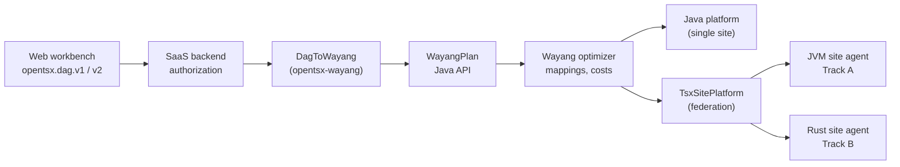
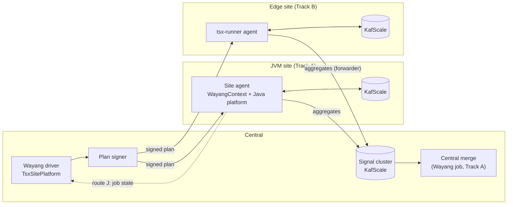

# Concept 20: time-series operators on Apache Wayang, a Java track and a Rust edge track

> Status: **concept**, 2026-11-20. The module has its Java platform plugin,
> KafScale source and sink, checkpointed increments, and the pure Java
> `TsxPairXcorr` and `TsxPairEs` kernels. Shared vectors cover statistics,
> segmentation, SAX, and data-quality results. `tsx-runner` 0.1.0 executes
> the isolated local B2 catalog through explicit context. Its legacy local
> profile retains three cleaning operations. The bounded and continuous UI targets use a custom
> Wayang Rust stage and HTTP workers.
> A separate isolated signed `run` profile admits continuous Episode
> pass-through. The B3 site configuration adds signed bounded statistics,
> outbound mTLS plan pulls, qualified conformance and aggregate catch-up;
> production fleet activation remains separate; D-T14 requires no ARMv7
> hardware. Checked against Apache
> Wayang release 1.1.1 (tag `wayang-1.1.1`, commit `61deee43`, 2026-02-09) and `main` at `713faa7d` (2026-11-12).
> Crate and tool versions are named where they are used. Related:
> [Vector and DAG rules](VECTOR-AND-DAG-SPEC.md) (`opentsx.dag.v1`, `align.vector`, vector processor),
> [Kafka native streaming](../devops/kafka-native-streaming.md) (the Java processor that runs today).
> Normative rules: [20-WAYANG-TS-OPERATORS-SPEC.md](20-WAYANG-TS-OPERATORS-SPEC.md) (S1 to S7). Tasks and acceptance
> criteria: [TASK-020](../../EVOLUTION/TASK-020-wayang-ts-operators.md).

The [unified delivery plan](../devguide/integration/wayang-unified-plan.md) combines bounded storage and
multi-node Rust orchestration. Its [shared-contract implementation](../devguide/integration/wayang-shared-contracts.md)
validates assignment envelopes in Java and Rust; it does not deploy runners.
The separate [local Rust profile](../devguide/integration/rust-runner-local.md) executes pass-through,
plausible-range checks, unit conversion and an optional trailing resample on a capped whole-topic cut.
The separate [B2 catalog profile](../devguide/integration/rust-runner-b2.md)
uses explicit local context to execute fourteen Track B target entries and
bounded `pair.xcorr`, with typed output and retained operator state.
Its existing `convert.unit` stage executes an
[artifact-embedded WASM module](../devguide/integration/rust-runner-b5.md)
through Wasmtime 50.0.1/Pulley. Fixed fuel, memory and stack caps and an
import-free ABI bound guest execution; parameters and host record semantics
remain unchanged. No plan carries code or sandbox-limit overrides.
The [signed Rust profile](../devguide/integration/rust-runner-b1.md) uses its
own local authority and continuous pass-through loop. It does not expand the
local cleaning profile or implement a public fleet service.
The [B3 site profile](../devguide/integration/rust-runner-b3.md) separately
admits bounded decode-to-statistics fragments with owner-local qualification,
fresh job checks and signed control. Its site outbox retains full partials
while the signal cluster is unreachable. It does not extend signed admission
to the remaining local B2 operators. The [bounded mixed W3 harness](../devguide/integration/wayang-mixed-federation.md)
selects two Java sites and one actual qualified Rust CLI site. It retains
conformance, runtime identity, per-partial and per-window comparisons; actual
acceptance is recorded in the [qualification report](measurements/rust-b4-mixed-20261120/REPORT.md).
The physical ARM64
B4.2 measurement remains open (D-T14: ARM64 only).

## 1. Goal

OpenTSx time-series operators run as Apache Wayang operators on Kafka topics, at many sites, under one plan. Raw
data stays at its site. Only mergeable aggregates and signals leave it.

Two implementation tracks share one operator catalog, one topic and schema contract and one set of test vectors:

| Track | What | Where it runs | Order |
|---|---|---|---|
| **A**, TSOperators for Java | native Wayang operators: logical operator, Java execution operator, mapping and cost function per OpenTSx operator; reuse of the existing OpenTSx Java code | JVM sites (servers, cluster nodes) | first |
| **B**, Rust edge runner | the same operators, ported to a small Rust binary, reached from Wayang as a separate platform | low-capacity hardware: ARM gateways, a Raspberry Pi on board, meter and substation sites | a small deployment proof follows shared contracts; each operator still needs stable reference vectors before admission |

Kafka is the source and sink of this continuous edge profile. The unified plan defines bounded Iceberg work
as a separate profile with immutable inputs and publication guarantees. Out of scope: training (it stays a batch job,
see [Train and deploy a statistical Smart Topic](../devguide/model-smart-topics.md)), joins over raw data of two
sites, and history search (pattern search, twin, causal analysis).

## 2. Current state

`tsx-runner` 0.1.0 executes trusted-local bounded requests, with explicit resource caps and checkpointed
completion after broker acknowledgement. Its standalone replay fixture runs three independent deployments.
The separate [bounded UI rollout](../devguide/integration/wayang-rust-compose.md) compiles one original v2 DAG
through a real custom Wayang Rust platform and one connected execution stage. The authenticated backend journals
the exact UI text, source cuts, clock and plan in PostgreSQL before its standalone coordinator dispatches the stage.
Workers own distinct whole topics, prepare privately, then publish after cross-topic series ownership checks.
This local UI profile does not establish signed fleet activation or production
fencing. The isolated signed
runner separately verifies one continuous pass-through assignment against local
policy before broker access.

The isolated B2 catalog passes all 57 shared numerical cases. Actual Java
Wayang/Rust parity covers the complete W scenario: 3,600 episode identities
and 2,160,000 values across 36 increments, 72 restarts and 36 completed retries,
with zero differences. The
[B2 operating guide](../devguide/integration/rust-runner-b2.md) identifies the
profile boundaries; [TASK-020 B2](../../EVOLUTION/TASK-020-wayang-ts-operators.md#b2-edge-operators)
records the three acceptance results. This qualification does not extend the
legacy Java UI admission or signed B1 pass-through profile.

| Item | State | Evidence |
|---|---|---|
| Bounded Rust orchestration | Explicit workbench target, PostgreSQL journal/coordinator, `RustRollout` compiler, custom `RustPlatform`/`RustExecutor`, private HTTP preparation and acknowledged completion | [local guide](../devguide/integration/wayang-rust-compose.md), `opentsx-saas-backend/app/services/wayang_service.py`, `opentsx-wayang/src/main/java/org/opentsx/wayang/rust/`, `rust/tsx-runner/src/worker.rs` |
| Isolated signed Rust run | Continuous whole-topic pass-through, compact Ed25519 JWS, local bindings/policy, durable activation intent and acknowledged progress checkpoints; full B1 qualification remains open | [signed runner guide](../devguide/integration/rust-runner-b1.md), `rust/tsx-runner/src/run_plan.rs`, [TASK-020 B1](../../EVOLUTION/TASK-020-wayang-ts-operators.md#b1-rust-runner-foundation) |
| Qualified bounded Rust sites | Signed decode-to-statistics, TLS 1.3 mTLS pulls/conformance, owner-local executed qualification evidence, exact membership/scopes and acknowledged offline aggregate forwarding | [B3 guide](../devguide/integration/rust-runner-b3.md), `rust/tsx-runner/src/site_plan.rs`, `rust/tsx-runner/src/conformance.rs`, `rust/tsx-runner/src/forwarder.rs` |
| Embedded Rust WASM conversion | Existing local `convert.unit` executes a reviewed artifact module with Pulley, fixed fuel/memory/stack bounds and no imports; signed admission is unchanged | [B5 guide](../devguide/integration/rust-runner-b5.md), `rust/tsx-runner/src/wasm.rs`, `rust/tsx-runner/tests/wasm_operator.rs` |
| Wayang in OpenTSx | `TsxJavaPlugin` registers the Java platform and KafScale transport; `TsxIncrement` runs checkpointed increments; `TsxPairXcorr` and `TsxPairEs` are pure Java pair kernels. Shared vectors cover statistics, segmentation, SAX, and data-quality results. | `opentsx-wayang/pom.xml`, `TsxJavaPlugin.java`, `TsxIncrement.java`, `TsxPairXcorr.java`, `TsxPairXcorrVectorsTest.java`, `TsxPairEs.java`, `TsxPairEsVectorsTest.java`, `tools/java_operator_vectors.py` |
| Build | Java release 17 (`pom.xml:39`), CI on Java 17 and 21 ([CONTRIBUTING.md](../../CONTRIBUTING.md)); `kafka.version` 3.9.2, `avro.version` 1.12.1, `hadoop.version` 3.5.0 (`pom.xml:50-55`) | `pom.xml` |
| Streaming runtime that runs today | Java processor in `opentsx-retrieval`: manual assignment, explicit offsets, checkpoint per runner written after the broker acknowledged the output, control topic `tsx.<domain>.dags.v1`, status topic `tsx.<domain>.dag-status.v1` | [kafka-native-streaming.md](../devops/kafka-native-streaming.md); `VectorProcessor.java:52-63`; `TopicLayout.java:134-140` |
| DAG validation | unique node ids, existing inputs, no cycles, supported sinks only, before the control record is written | `opentsx-retrieval/src/main/java/org/opentsx/retrieval/vector/DagPlan.java:17` |
| DAG and streaming contract | `opentsx.dag.v1`, stream operator catalog, shared vectors, at-least-once delivery with deterministic clean-episode ids | [VECTOR-AND-DAG-SPEC.md](VECTOR-AND-DAG-SPEC.md#1-dag-document), sections 1, 4 and 5 |
| Processor description | `opentsx.processor.v1`: operator id, kind, ports, params, semantics, `runtimes` with `workbench`, `java`, `python`, `go`, `processor`; instances in `systems/processors/`, validated by `SystemDocTest` | `docs/datamodel-2026/schemas/opentsx.processor.v1.schema.json`; `opentsx-retrieval/src/test/java/org/opentsx/retrieval/system/SystemDocTest.java:71-79` |
| DAG export | the workbench writes `opentsx.dag.v1`, or `opentsx.dag.v2` (with `schema: opentsx.dag.v2`) when the flow has a series sink; `source.kind: kafscale-broker`, `checkpoint: { backend: file }` | `opentsx-saas-frontend/src/workbench/flow.ts:713-725`; [SYSTEM-DOCUMENT-SPEC](SYSTEM-DOCUMENT-SPEC.md#s51-sink-fields), section 5.1 |
| Series identity | `seriesId` = lower-case hex of xxHash64, seed 0, over the canonical form of metric and tags | `SeriesKey.avsc`; `SeriesKeys.java:37-41` |
| Episode | `[tStart, tEnd)` in microseconds, values, optional quality byte per value, mergeable `EpisodeSummary`, `revision`, `Provenance` | `Episode.avsc`, `EpisodeSummary.avsc`, `Provenance.avsc` |
| Wire format | Avro single-object encoding, `C3 01` plus CRC-64-AVRO fingerprint, no schema registry; shared vectors | `OpenTsxAvro.java:73-125`; `opentsx-model/src/test/resources/testvectors/wire-format.json` (`Episode` = `8985f02b48c77195`) |
| Record key and partitioning | episode records use key `seriesId` and record timestamp `tStart`; the Java default partitioner places them | `BucketWriter.java:26`, `:107-108`; `KafScaleFeed.java:182` |
| KafScale client rules | `enable.idempotence=false`, `acks=all`, `max.in.flight.requests.per.connection=1`, zstd, delivery timeout three minutes; consumers without group id, manual assignment and seek, `Patience.poll` for refused fetches | `KafScaleClients.java:16-72`; `Patience.java:24-75` |
| KafScale capabilities | no timestamp seek, no idempotent producer, no standalone commit, no group rejoin, compaction accepted but not done; `Admin.listOffsets` earliest and latest work (KafScale v1.6.0) | [`opentsx-kafscale-conformance/README.md`](../../opentsx-kafscale-conformance/README.md) |
| Shared operator vectors | `align-vector.v1.json`, `clean-ops.v1.json`, `pair-es.v1.json`, `pair-xcorr.v1.json`, `stats-window.v1.json`, `segment-threshold.v1.json`, `segment-extremum.v1.json`, `sax-word.v1.json`, `dq-result.v1.json`; sketch bytes shared by Java and Python | `docs/datamodel-2026/testvectors/`; `tools/java_operator_vectors.py`; `QuantileSketchTest.java:105-115`; `python-package/tests/test_stats.py:10-17` |

## 3. Research findings

### 3.1 Apache Wayang

Status: top-level Apache project since November 2025
([ASF announcement, 2025-12-03](https://news.apache.org/foundation/entry/the-apache-software-foundation-announces-new-top-level-projects-3)).
Latest release 1.1.1, 2026-02-11 ([projects.apache.org](https://projects.apache.org/json/projects/wayang.json)).
Release 1.1.1 compiles with `maven.compiler.release` 17 (`pom.xml:115` of the tag), so it runs on the Java 17 and 21
of the OpenTSx CI. `WayangSmokeTest` executes a plan locally on Java 21.

Class names below were checked in tag `wayang-1.1.1`. Paths start at the Wayang repository root.

| Concept | Class | Evidence |
|---|---|---|
| Logical operators | `org.apache.wayang.core.plan.wayangplan.UnarySource<T>`, `UnaryToUnaryOperator<I, O>`, `BinaryToUnaryOperator<I0, I1, O>`, `UnarySink<T>`, all `extends OperatorBase implements ElementaryOperator` | `wayang-commons/wayang-core/src/main/java/org/apache/wayang/core/plan/wayangplan/UnarySource.java:26`, `UnaryToUnaryOperator.java:26`, `BinaryToUnaryOperator.java:26`, `UnarySink.java:26` |
| Java execution operator | `org.apache.wayang.java.operators.JavaExecutionOperator extends ExecutionOperator`, method `evaluate(ChannelInstance[] inputs, ChannelInstance[] outputs, JavaExecutor, OperatorContext)` returning `Tuple<Collection<ExecutionLineageNode>, Collection<ChannelInstance>>` | `wayang-platforms/wayang-java/src/main/java/org/apache/wayang/java/operators/JavaExecutionOperator.java:39-64` |
| Java platform | `org.apache.wayang.java.platform.JavaPlatform.getInstance()`; `org.apache.wayang.java.Java.basicPlugin()` | `JavaPlatform.java:33-43`; `Java.java:42-44` |
| Mapping | `org.apache.wayang.core.mapping.Mapping` with `getTransformations()`; Java mappings listed in `org.apache.wayang.java.mapping.Mappings` | `Mapping.java:26-31`; `wayang-java/.../mapping/Mappings.java:32-66` |
| Plugin | `org.apache.wayang.core.plugin.Plugin`: `getRequiredPlatforms`, `getMappings`, `getChannelConversions`, `setProperties` | `Plugin.java:39-109` |
| Platform | `org.apache.wayang.core.platform.Platform` (abstract) | `Platform.java:38` |
| Executor | `org.apache.wayang.core.platform.PushExecutorTemplate` (abstract) | `PushExecutorTemplate.java:47` |
| Cost functions | `org.apache.wayang.core.optimizer.costs.LoadProfileEstimators.createFromSpecification`; specs as JSON with JUEL expressions in `wayang-<platform>-defaults.properties`, for example `wayang.java.kafkatopicsource.load.main = {"in":0, "out":1, "cpu":"${425*out0 + 1400000}", "ram":"${100*out0}", "p":0.9}` | `LoadProfileEstimators.java:85-129`; `wayang-platforms/wayang-java/src/main/resources/wayang-java-defaults.properties:497-502` |
| Remote work | JDBC platforms keep data out of the driver: `JdbcExecutor` builds SQL per stage into a `SqlQueryChannel`, the database runs it when a downstream conversion pulls it | `JdbcExecutor.java:148`, `:456-483`; `SqlToStreamOperator.java:104` (at `main`) |
| Plan API | `wayang-api-json`: `POST /wayang-api-json/submit-plan/json` and `.../drawflow-format`, synchronous; user functions travel as Scala source and are compiled at runtime; no Kafka operator in the JSON API | `wayang-api/wayang-api-json/src/main/scala/Main.scala:33`, `:50`; `SerializableLambda.scala:25-30` (at `main`) |
| Federation | none; one driver JVM runs a plan through `CrossPlatformExecutor`. Scalytics describes a commercial federation ([scalytics.io](https://www.scalytics.io/federatedintelligence)); no public protocol found, not verified | source tree grep |
| Streaming | none in the Java platform; `JavaKafkaTopicSource` reads one batch (section 3.2) | `JavaKafkaTopicSource.java:103` |

Papers: Kruse et al., "Apache Wayang: A Unified Data Analytics Framework", SIGMOD Record 52(3), 2023,
[doi:10.1145/3631504.3631510](https://doi.org/10.1145/3631504.3631510); "RHEEM: Enabling Cross-Platform Data
Processing", PVLDB 11(11), 2018, [doi:10.14778/3236187.3236195](https://doi.org/10.14778/3236187.3236195);
"RHEEMix in the data jungle", VLDB Journal 29(6), 2020,
[doi:10.1007/s00778-020-00612-x](https://doi.org/10.1007/s00778-020-00612-x).

### 3.2 Wayang's Kafka source and sink

Checked in tag `wayang-1.1.1`. `B` is `wayang-commons/wayang-basic/src/main/java/org/apache/wayang/basic/operators`,
`J` is `wayang-platforms/wayang-java/src/main/java/org/apache/wayang/java/operators`.

| Property | What the code does | Evidence | Fits KafScale and OpenTSx |
|---|---|---|---|
| Value format | `KafkaConsumer<String, String>`, `StringDeserializer`; the Java source emits `ConsumerRecord::value` as a `Stream<String>` | `B/KafkaTopicSource.java:121`, `:169-170`; `J/JavaKafkaTopicSource.java:108-115` | no: episodes are binary Avro single-object records |
| Consumer group | fixed `group.id` `wayang-kafka-java-source-client-2`, `subscribe(topicName)` | `B/KafkaTopicSource.java:124`, `:175` | no: group rejoin and standalone commits fail on KafScale |
| Offset commit | no explicit commit; with a group id the Kafka client default `enable.auto.commit=true` applies, so offsets are committed in the background | `B/KafkaTopicSource.java` (no commit call); [Kafka consumer configs](https://kafka.apache.org/documentation/#consumerconfigs_enable.auto.commit) | no: at-least-once needs commit after the sink acknowledged |
| Read extent | one `poll(Duration.ofMillis(15000))` per execution | `J/JavaKafkaTopicSource.java:103` | no: a bounded read needs explicit start and end offsets |
| Start position | `auto.offset.reset=earliest` | `B/KafkaTopicSource.java:176` | partly |
| Client config | `getDefaultProperties()`: `SASL_SSL`, `PLAIN`, bootstrap and credentials from environment variables; `loadConfig(path)` reads a properties file instead | `B/KafkaTopicSource.java:139-201`; `B/KafkaTopicSink.java:160-203` | a properties file can carry the proxy address and `enable.idempotence=false` |
| Sink record | `ProducerRecord<String, String>(topicName, value)`: no key; value formatted to a String by a `TransformationDescriptor` | `J/JavaKafkaTopicSink.java:101`; `B/KafkaTopicSink.java:47`, `:66` | no: OpenTSx needs key `seriesId` and Avro bytes |
| Idempotence | not set; kafka-clients from 3.0 default to `enable.idempotence=true` ([KIP-679](https://cwiki.apache.org/confluence/display/KAFKA/KIP-679%3A+Producer+will+enable+the+strongest+delivery+guarantee+by+default)) | grep over the module | no without a properties file: KafScale has no `InitProducerId` |
| Client version | `kafka-clients` 3.9.1 in `wayang-basic` | `wayang-commons/wayang-basic/pom.xml:94-95` | OpenTSx manages 3.9.2 (`pom.xml:50`); the root `dependencyManagement` wins |

**Conclusion.** The operators do not fit, and a properties file fixes only the client config. Track A adds its own
source and sink operators (section 5.2). They build clients with `KafScaleClients`, so every connection goes to the
configured proxy address, idempotence is off and topic names come from `TopicLayout`. Contributing key, byte and
offset support upstream is possible later; it is not a dependency of this plan.

The `wayang-java` module (tag `wayang-1.1.1` and `main`) contains `src/main/resources/wayang-kafka-defaults.properties` with what looks
like credentials of a hosted Kafka service. OpenTSx must not load that file; the plugin sets its own client
properties.

### 3.3 Dependency footprint (AGENTS.md rule 5)

Compile-scope dependencies declared in the poms of tag `wayang-1.1.1` (direct only; the transitive tree is not
resolved yet):

| Module | Declared compile dependencies |
|---|---|
| `wayang-core` | snakeyaml, commons-io, hadoop-hdfs, hadoop-common, juel-api, juel-impl, gson, commons-lang3, antlr4-runtime, log4j-api, log4j-core, wayang-utils-profile-db, jackson-core, jackson-databind, jackson-annotations, aws-java-sdk-s3, httpclient |
| `wayang-basic` | wayang-core, wayang-utils-profile-db, log4j-api, log4j-core, hadoop-common, parquet-hadoop, commons-lang3, kafka-clients, google-cloud-storage, google-cloud-storage-control, s3, json, azure-storage-blob, azure-security-keyvault-secrets, azure-identity |
| `wayang-java` | wayang-core (provided), wayang-basic, hadoop-common, hadoop-hdfs, parquet-avro, avro, slf4j-api, **log4j-slf4j-impl** |

Conflicts with OpenTSx:

- Hadoop: Wayang 1.1.1 sets `hadoop.version` 3.3.6 (`pom.xml:132` of the tag); OpenTSx manages 3.5.0 (`pom.xml:55`),
  and its `dependencyManagement` wins inside the OpenTSx reactor.
- Logging: `log4j-slf4j-impl` is an SLF4J binding to Log4j 2; OpenTSx manages `slf4j-api` 2.0.20 and `slf4j-simple`
  (`pom.xml:57`, `:259-266`). Two bindings on one classpath is a conflict.
- `main` after 1.1.1 adds Iceberg 1.6.0 and `slf4j-simple` to `wayang-basic`
  (`wayang-commons/wayang-basic/pom.xml:37`, `:170-171` at `713faa7d`); OpenTSx uses Iceberg 1.10.2
  (`opentsx-store-iceberg/pom.xml:19`). This matters at the next Wayang upgrade.

Found in phase A0 (`opentsx-wayang`, `WayangSmokeTest`):

- Wayang declares Hadoop with `${external.platforms.scope}`, which is `provided` (`pom.xml:131` of the tag). The
  Java platform still needs it at run time: `ChannelConversions` loads `org.apache.hadoop.io.Writable`. OpenTSx
  supplies the shaded `hadoop-client-api` and `hadoop-client-runtime` 3.5.0 it already manages (`pom.xml:165-174`).
- `Java.basicPlugin()` registers the Amazon S3, Google Cloud Storage and Azure mappings
  (`wayang-java/.../mapping/Mappings.java:63-65` of the tag); building a plan with it fails with
  `NoClassDefFoundError: software/amazon/awssdk/core/ResponseInputStream` once those SDKs are excluded. OpenTSx
  therefore uses its own `TsxJavaPlugin` with only the mappings it needs.

Rule for Track A: `opentsx-wayang` depends on `wayang-core`, `wayang-basic` and `wayang-java` 1.1.1, pinned, with
exclusions for the cloud-storage artifacts and `log4j-slf4j-impl`. It does not depend on `opentsx-store-iceberg`.
Phase A0 runs `mvn dependency:tree` and the Wayang Java platform tests with the exclusions in place. If Wayang's
classes need an excluded artifact at runtime, the exclusion is dropped and the conflict documented.

### 3.4 Programming model borrowed from Kafka Streams

Kafka Streams is the orientation for the shape of the programming model only. Neither track builds a Kafka
Streams-like runtime and neither is measured against Kafka Streams.

| Taken over | Meaning here |
|---|---|
| topics in, topics out | every plan reads topics and writes topics; nothing else |
| stateless against keyed or windowed operators | each catalog operator declares its state: none, keyed by `seriesId`, or windowed on the epoch grid (S1) |
| flow shapes 1:1, 1:m, n:1, n:m | section 7 |

| Not taken over | Reason |
|---|---|
| RocksDB state stores and changelog topics | changelogs rely on `cleanup.policy=compact` ([manage topics](https://kafka.apache.org/40/streams/developer-guide/manage-topics/)), which KafScale does not do; state lives in the local checkpoint (C6) |
| automatic repartition topics | a key change is an explicit sink named in the plan, only for operators that need another key (section 7) |
| exactly-once | needs transactions and idempotence, which need `InitProducerId` ([KIP-98](https://cwiki.apache.org/confluence/display/KAFKA/KIP-98+-+Exactly+Once+Delivery+and+Transactional+Messaging)); KafScale has none; at-least-once plus deterministic ids instead (C5) |
| consumer groups and rebalancing | group rejoin and standalone commits fail on KafScale; manual assignment instead |

### 3.5 Rust crates for Track B

Versions from crates.io on 2026-11-16.

| Need | Choice | Version, licence | Finding |
|---|---|---|---|
| Kafka client | `rdkafka` | 0.39.0, MIT; bundles librdkafka 2.12.1 | `BaseConsumer` with `assign`, `seek`, `store_offset`; features `ssl`, `sasl`, `zstd`, `cmake-build`; OAUTHBEARER via `ClientContext::generate_oauth_token` (`src/client.rs:130`) |
| librdkafka defaults | | | `enable.idempotence=false`, `acks=-1`, **`partitioner=consistent_random`**; Java compatibility needs `partitioner=murmur2_random` ([CONFIGURATION.md](https://github.com/confluentinc/librdkafka/blob/master/CONFIGURATION.md)) |
| Avro | `apache-avro` | 0.22.0, Apache-2.0 | `GenericSingleObjectWriter`, `SpecificSingleObjectWriter<T>`; `RabinFingerprintHeader` writes `C3 01` plus the fingerprint little-endian (`src/headers.rs`) |
| xxHash64 | `twox-hash` | 2.1.5, MIT | `XxHash64::oneshot(seed, bytes)` |
| DDSketch | port of `QuantileSketch` | | `sketches-ddsketch` 0.4.2 uses floor indexing and the Java DDSketch byte format; OpenTSx uses `ceil` indexing and its own format v1 (`QuantileSketch.java:13-28`, `:221`) |
| Sandbox | `wasmtime` | 50.0.1 | embedded conversion; see B5 |
| Supply chain | `cargo-auditable` 0.7.7, `cargo-cyclonedx` 0.5.10, `cargo-deny` 0.20.2, cosign 3.1.4, `actions/attest-build-provenance` 4.2.2 | | embedded dependency list, CycloneDX SBOM, licence and advisory gate, Sigstore signatures, SLSA v1.0 provenance |

Stream engines checked for reuse, none adopted: Arroyo (MIT or Apache-2.0, acquired by Cloudflare 2025-04-10,
[blog](https://blog.cloudflare.com/cloudflare-acquires-arroyo-pipelines-streaming-ingestion-beta/)) is a full
distributed engine; Timely and Differential Dataflow (MIT, 0.32.0 and 0.26.0) have no Kafka connector; Fluvio
SmartModules need a Fluvio cluster; Redpanda Data Transforms run only inside Redpanda
([docs](https://docs.redpanda.com/current/develop/data-transforms/how-transforms-work/)); RisingWave is a database;
Materialize is BSL 1.1; Bytewax is community-maintained after its company stopped; Apache Iggy is not Kafka protocol.

## 4. Shared contract of both tracks

| Id | Decision | Reason |
|---|---|---|
| C1 | One operator catalog: ids and versions of `opentsx.processor.v1`. The schema gets runtime keys `wayang` (Track A) and `rust` (Track B), a `state` and a `merge` field (S1). | The workbench already writes these ids (`opentsx-saas-frontend/src/workbench/ops.ts:834-930`). |
| C2 | An operator version enters a track only when it passes the shared vectors that the reference implementation passes. | Rule of [Vector and DAG rules](VECTOR-AND-DAG-SPEC.md#5-streaming-contract), section 5, row "Equality of preview and operation". |
| C3 | Topic names from `TopicLayout` (`tsx.<domain>.<kind>.v2`), records in Avro single-object encoding, key `seriesId`, Java-compatible murmur2 partitioning. | `TopicLayout.java:204-206`; `BucketWriter.java:107-108`. |
| C4 | Clients connect to the KafScale proxy only, with `enable.idempotence=false`, `acks=all`, one request in flight. | `KafScaleClients.java:36-50`. |
| C5 | At-least-once delivery, deterministic output ids, readers keep one record per id. | Section 3.4. |
| C6 | Checkpoint per task with offsets and operator state, written after all output before it is acknowledged. | `VectorProcessor.java:56-59`. |
| C7 | Event time on the epoch grid; episodes `[tStart, tEnd)`; an episode whose first sample lies before the end of the previous episode of its series is skipped and counted in `skippedBlocks`; no revision is written. | [Vector and DAG rules](VECTOR-AND-DAG-SPEC.md#5-streaming-contract), sections 2.2 and 5. |
| C8 | One plan format for sites of both tracks: `opentsx.runner-plan.v1` (section 9.2), wrapping the `opentsx.dag.v1` or `opentsx.dag.v2` document the workbench exported. | One federation path for JVM and Rust sites. |
| C9 | Each `seriesId` belongs to exactly one site. | Per-series stateful operators break when a series is split (section 10.3). |

## 5. Track A: TSOperators for Java

### 5.1 Module

`opentsx-wayang`, a new reactor module next to `opentsx-retrieval`, built with the root `pom.xml` (release 17,
tested on 17 and 21). Dependencies:

| Dependency | Why |
|---|---|
| `org.apache.wayang:wayang-core`, `wayang-basic`, `wayang-java` 1.1.1, pinned, exclusions per section 3.3 | the platform API and the Java platform |
| `opentsx-model` | `OpenTsxAvro`, `SeriesKeys`, Avro types |
| `opentsx-kafka-v2` | `KafScaleClients`, `TopicLayout`, `Patience`, `LogReader` |
| `opentsx-stats` | `StatsEngine`, `StatsAccumulator`, `QuantileSketch`, `DataQuality` |
| `opentsx-retrieval` | `CleanChain`, `Resampling`, `Segmenter`, `StreamingSegmenter`, `Sax`, `Paa`, `VectorAligner` |

No dependency on `opentsx-core`: it pulls Swing charting, Mahout, POI and Hadoop client artifacts
(`opentsx-core/pom.xml`). Code from it is ported into `opentsx-wayang` only together with a vector test.

### 5.2 Classes per operator

Track A uses logical operators, Java execution operators, mappings and load estimators.
A consecutive run of `CleanChain.OPS` nodes becomes one
[`TsxSeriesChain`](../../opentsx-wayang/src/main/java/org/opentsx/wayang/TsxSeriesChain.java#L12).
The steps share per-series state and assign output keys and episode ids after the last step.
The run's last DAG node id identifies its checkpoint state, as specified in S2.3.
The implemented statistics operator is
[`TsxStatsWindow`](../../opentsx-wayang/src/main/java/org/opentsx/wayang/TsxStatsWindow.java#L10).

| Piece | Implemented Track A classes or keys | Wayang type |
|---|---|---|
| logical operator | `TsxSeriesChain`, `TsxStatsWindow` | logical |
| Java execution operator | `JavaTsxSeriesChain`, `JavaTsxStatsWindow` | Java platform |
| mapping | `TsxOperatorMappings.SeriesChainMapping`, `TsxOperatorMappings.StatsWindowMapping` | registered by `TsxJavaPlugin` |
| load estimator | `wayang.java.tsx.serieschain.load`, `wayang.java.tsx.statswindow.load` in `wayang-tsx-defaults.properties` | `LoadProfileEstimators` |

See the [registered mappings](../../opentsx-wayang/src/main/java/org/opentsx/wayang/TsxJavaPlugin.java#L31)
and [load specifications](../../opentsx-wayang/src/main/resources/wayang-tsx-defaults.properties#L17).

Source and sink, replacing Wayang's Kafka operators (section 3.2):

| Class | Behaviour |
|---|---|
| `TsxTopicSource extends UnarySource<SpecificRecord>` and `JavaTsxTopicSource` | reads `[from, to)` per partition with manual assignment and seek, as `LogReader.java:21` does; `from` from the checkpoint, `to` from `endOffsets` at job start (`LogReader.java:68`); decodes with `OpenTsxAvro.decode`; refused fetches through `Patience.poll` |
| `TsxTopicSink extends UnarySink<SpecificRecord>` and `JavaTsxTopicSink` | `KafScaleClients.producer`; key `seriesId`, value `OpenTsxAvro.encode`, header `tsx-schema` (`TopicLayout.HEADER_SCHEMA`); waits for all acknowledgements before the job reports success |
| `TsxCheckpoint` | written by the executor after the sink succeeded: offsets per partition, operator state, `specHash` |

Wayang runs a plan once; its Java platform has no continuous mode (section 3.1). Track A therefore runs a
continuous DAG as a series of **bounded increments**: each Wayang job processes the offsets between the last
checkpoint and the end offsets read at its start, carries operator state in and out through the checkpoint, and
writes a new checkpoint. Latency is the increment interval plus the job start time. Both are measured in phase A1.

### 5.3 Reuse of OpenTSx Java code

| Operator id | Existing Java code | Shared vectors | Track A work |
|---|---|---|---|
| `decode.avro-soe`, encode | `OpenTsxAvro.java:92-123`; `SeriesKeys.java:37-41` | `wire-format.json`, `series-id.json`, `xxh64.json` | wrap |
| `stats.welford-ddsketch` (`stats.window` in the workbench) | `StatsEngine.java:48-153` (`onEpisode`, `onObservation`), `StatsAccumulator.java:62-86` (merge), `QuantileSketch.java:101-110` (merge) | `stats-window.v1.json`, `QuantileSketchTest.testVector` | wrap |
| `dq.checks` | clean chain `dq.checks` in `CleanChain.java:35` | `clean-ops.v1.json` | wrap |
| `dq.result` | `DataQuality.java:67-126` (`evaluate`) | `dq-result.v1.json` | wrap |
| `convert.unit`, `resample`, `model.wind-shear`, `model.power-curve`, `feature.lag`, `feature.rolling` | `CleanChain.java:35`, `:112` (`of`), `:290-326` (`newState`, `restore`, `apply`); `Resampling.java:20` | `clean-ops.v1.json` | wrap; `CleanChain` state already serializes to JSON (`restore`), which fits the checkpoint |
| `segment.threshold`, `segment.extremum`, fixed duration and count | `Segmenter.java:38-92`, `StreamingSegmenter.java:66-92` (`onEpisode`, `flush`) | `segment-threshold.v1.json`, `segment-extremum.v1.json` for threshold and extremum | wrap |
| SAX word | `Sax.java:16-49` (`breakpoints`, `word`, `mindist`), `Paa.java:9`; fills `EpisodeSummary.sax` | `sax-word.v1.json` | wrap |
| `align.vector` | `VectorAligner.java:100` (`align`); streaming in `VectorStream` | `align-vector.v1.json` | wrap |
| `pair.xcorr` | `TsxPairXcorr` in `opentsx-wayang` follows the workbench port of `KreuzKorrelation` and `CCFunction` of kamir/WikiExplorer.NG, Apache License 2.0 | `pair-xcorr.v1.json`, read directly by `TsxPairXcorrVectorsTest` | pure Java kernel; execution mapping is outside the kernel |
| `pair.es` | `TsxPairEs` and `Mulberry32` in `opentsx-wayang` port `event_sync.py` and `es.ts`, including surrogate shuffles, without depending on `opentsx-core` | `pair-es.v1.json`, read directly by `TsxPairEsVectorsTest` | pure Java kernel; execution mapping is outside the kernel |
| DFA | `opentsx-core/src/main/java/org/opentsx/algorithms/detrending/methods/DFA.java:5` (`extends DFACore`, `calc()`), stateful legacy API | none | later; needs vectors and a stateless entry point |

### 5.4 Translation path

The A2 implementation in `opentsx-wayang` compiles local clean episode DAGs with
`DagToWayang.compile`. It validates parameters from `systems/processors/` and
fuses consecutive clean nodes into `TsxSeriesChain` as specified in S2.3.
`TsxStatsWindow` is available through the Java API for incremental episodes and
observations, completed inputs, and explicit keyed windows including empty
input. Statistics sink translation and federation are outside this compiler.



1. The workbench writes `opentsx.dag.v1`, or `opentsx.dag.v2` when the flow has a series sink, as today. There is no
   second DAG format.
2. `DagToWayang.compile` validates the local clean-series path through `DagPlan`; processor descriptions supply
   parameter types, bounds, enums and defaults. Its `plan` method connects the increment's `TsxTopicSource` to
   one fused `TsxSeriesChain` and a `TsxTopicSink` for the selected series sink. The run's last node id identifies
   its checkpoint state, as specified in S2.3. Statistics sink translation and remote fragment compilation remain
   outside this local compiler.
3. The plugin does not use `wayang-api-json`: that API has no Kafka operator and compiles Scala source received in
   the request (section 3.1), which a site must not accept.
4. Single site: `WayangContext` with `TsxJavaPlugin` runs the plan in the driver JVM. The plugin registers only
   the supported Java mappings.
5. Federation: section 9.

### 5.5 Optional engines

Spark and Flink execution operators can follow through additional mappings once the Java operators pass the
vectors. They are not part of this plan: Wayang's Spark and Flink operators bring their own Kafka handling, and
OpenTSx already has a Flink path (`opentsx-flink-core`).

## 6. Track B: Rust edge runner

This section distinguishes the implemented profiles from the fleet target.
Trusted-local replay and HTTP workers are documented in the
[local bounded guide](../devguide/integration/rust-runner-local.md), with the
subset in
[SPEC S1.9](20-WAYANG-TS-OPERATORS-SPEC.md#s19-execute-the-trusted-local-bounded-rust-subset).
Explicit local context selects the separate B2 catalog profile in
[SPEC S1.13](20-WAYANG-TS-OPERATORS-SPEC.md#s113-execute-the-isolated-local-rust-b2-catalog).
It preserves whole-topic ownership, explicit resource ceilings and
acknowledgement-before-checkpoint recovery. Its typed outputs include
SeriesStats, vectors and DQ signals. The worker reports its fifteen operations
under `catalogExecution.operators`; the legacy `operators` list retains four
entries for Java UI admission.
The local conversion stage uses the embedded B5 module. Its three binary64
arguments are value, factor and offset; its result preserves separate
multiplication and addition. The host retains units, gaps, identities,
timestamps and checkpoints. Fuel or memory failure aborts processing without
native fallback. The [B5 guide](../devguide/integration/rust-runner-b5.md)
and [SPEC S7.5](20-WAYANG-TS-OPERATORS-SPEC.md#s75-process-isolation) define
the artifact-only boundary and host-owned limits.
The [isolated signed profile](../devguide/integration/rust-runner-b1.md)
verifies a continuous pass-through plan and its original whole-topic assignment,
artifact, site, node, catalog and local policy before broker access. It uses one
locally permitted binding, one complete Episode input and one Episode sink. It
has no cleaning graph or federation egress. Its B1 configuration does not select
the separate B3 `agent` or `conform` interface.
The [B3 bounded site profile](../devguide/integration/rust-runner-b3.md)
uses a separate local configuration, role keys and qualified runtime pin. It
executes only decode-to-statistics, reads immutable complete-topic cuts and
publishes full site-outbox partials with closed-cut evidence. An acknowledged
forwarder copies those records after signal connectivity returns. Its ordinary
runtime has no admin or probe-topic rights. The broader fleet operator table
below remains a target.

CI defines native x86_64 and ARM64 execution, all three B1 static musl builds,
ELF/digest/version checks and supplementary ARMv7 QEMU execution. Its reports
distinguish native execution from emulation; a workflow definition alone is not
a successful build result. Under D-T14 the native x86_64 and ARM64 jobs satisfy
B1.2; ARMv7 stays a QEMU check. The
[B1 operating guide](../devguide/integration/rust-runner-b1.md) identifies the
qualification evidence.

### 6.1 Scope

`tsx-runner` is one statically linked binary. It executes the same operator ids and versions as Track A, on the
same topics, with the same checkpoint rules (C1 to C9). It reads and writes Kafka through the site's KafScale proxy
and nothing else. Producers set `partitioner=murmur2_random` in addition to C4 (section 3.5).

The runner has three signed modes. `agent` pulls signed plans from the driver
over outbound mTLS. `conform` runs the job-bound site checks of section 8 and
submits a signed report. `run` executes one signed plan from a file or standard
input. The [B3 site configuration](../devguide/integration/rust-runner-b3.md)
selects all three modes. Its plans execute signed bounded statistics only:
`decode.avro-soe` followed by `stats.welford-ddsketch` over the fixed finite cut
of one complete topic. With the isolated
[B1 configuration](../devguide/integration/rust-runner-b1.md), `run` executes
signed continuous pass-through instead. Trusted-local `replay` and `serve`
remain separate interfaces.

Inside, one owner executes each assigned whole topic: fetch every partition with `BaseConsumer`
(manual `assign`, `seek`, no group id),
decode, run the operator chain in process, produce, collect delivery reports, then write the checkpoint. Unlike
Track A, the B1 `run` loop is continuous: no job start per increment.

### 6.2 Resource targets

The numbers below are **budgets to verify**, chosen for the target hardware class. None is measured.

| Resource | Budget | How it is checked |
|---|---|---|
| Cross-compile targets | `aarch64-unknown-linux-musl`, `armv7-unknown-linux-musleabihf`, `x86_64-unknown-linux-musl`, static; librdkafka built with `cmake-build` | CI build per target; a run on real arm64 and armv7 hardware. Static musl builds of `rdkafka` with TLS are not verified yet. |
| Resident memory | at most 64 MiB with 1,000 series and the R-B2 operator chain | `/proc/<pid>/status` VmHWM over a 24 h run |
| CPU | at most one core at 10,000 values/s through decode, `dq.checks`, `resample`, `stats.welford-ddsketch` | `perf stat` or `/proc/<pid>/stat` |
| Binary size | at most 20 MiB stripped | file size of the release artifact |
| Startup | first fetch within 1 s of process start, checkpoint load included | timestamps in the log |
| Offline operation | runs against the site broker with no route to the central side; output for the signal cluster stays in the site topic | test with the central side unreachable |
| Catch-up | after 24 h offline, the site's aggregates reach the signal cluster in order, without loss, and the merge marks the windows `final` | test, section 13 |

Offline operation follows from the topology: the runner writes federated aggregates to a site topic
(`tsx.<domain>.aggregates.v2`, proposed kind), and a forwarder (also `tsx-runner`) copies them to the signal cluster
when the link is up, from its own checkpoint. On a boat or at a substation the link may be down for days; site
retention must cover that gap.

### 6.3 Operators on low-capacity hardware

| Operator | Edge (Track B) | Reason |
|---|---|---|
| `decode.avro-soe`, `dq.checks`, `convert.unit`, `resample`, `feature.lag`, `feature.rolling` | yes | bounded state per series |
| `stats.welford-ddsketch` | yes | bounded state: moments plus at most `maxBins` bins (`QuantileSketch.java:33`) per window |
| `segment.threshold`, fixed duration and count | yes | bounded buffers (`SampleBuffer`) |
| `align.vector` | yes, with a cap on open ticks | state grows with open ticks ([Vector and DAG rules](VECTOR-AND-DAG-SPEC.md#35-limits), 3.5) |
| SAX word | yes | per episode |
| `pair.xcorr` | only for short windows and few lags | cost grows with window length times lags |
| `pair.es` | JVM | surrogate shuffles multiply the cost by the shuffle count |
| DFA, pattern search (MASS, DTW), twin, ONNX scoring | JVM | history or large models |

### 6.4 Run the bounded UI orchestration profile

The implemented profile accepts one to three whole Kafka topics and one supported v2 cleaning chain.
`RustRollout` reuses `DagToWayang.parameters`, preserves original UI node IDs and raw-text `specHash`, and gives
each complete per-topic fragment its own ID/hash. It freezes every internal partition from zero to its observed end.
Sources, optional unions, a fused chain and the sink map to custom Rust execution operators in one Wayang stage.
Topology channels carry no episode payloads in the driver. Node placement follows topic order and sorted worker IDs;
placeholder costs are not a measured placement model. All workers must match the artifact digest and state ABI.

The PostgreSQL journal accepts exact source text once per installation and persists the accepted clock and plan.
Normal authentication and administrator permission apply. A standalone coordinator owns a database advisory lock;
PostgreSQL owns deployment control while the Java driver keeps a separate private publication ledger.
Driver control and worker publication bind separate internal networks; a private token protects control.
This is not the signed runner-plan protocol or production authorization in sections 8 to 11.

Every worker fully prepares its bounded input and candidate output privately before any activation. The stage checks
input-series and derived-series ownership across all preparations, then activates in parallel. Broker acknowledgements
precede the worker checkpoint and receipt. The local gateway verifies captured grants and registered output.
A lost HTTP response after durable acknowledgement returns the cached receipt; an unknown broker outcome remains
quarantined and blocks replacement while PostgreSQL topic ownership remains held. Completed
retry returns the stored receipt. Partial activation can expose at-least-once output, without atomic publication or
rollback across workers. The [acceptance helper](../../tools/verify_wayang_rust_compose.py) exercises the real browser
and compares output with the Java reference; its generated evidence records the actual run outcome.

Continuous input, failover, signed delivery, broader kernels and durable Iceberg publication remain outside this
profile. A topic that exceeds its assigned worker's capacity is refused rather than split across workers.

### 6.5 Continue complete-topic cuts on fixed workers

The [continuous local profile](../devguide/integration/wayang-rust-continuous.md) retains the same original DAG,
clock and topic-to-worker bindings across successive finite Wayang stages. PostgreSQL saves each exact plan before
dispatch. Workers restore their own preceding pipeline state and validate sequence, predecessor and every partition
cursor. The per-topic record budget bounds each increment, with rotating internal partition priority; ownership
still covers the complete topic. Empty input creates no new increment.

Cumulative series manifests prevent a later topic from taking an earlier series identity. Acknowledged worker
heads and cumulative backend counters survive service restart. The durable Stop operation reconciles dispatched
work before releasing backend ownership. Worker history keeps one immutable chain/head and at most one candidate;
the backend retains two completed cycles plus pending work. A single-owner gateway serializes publication and
whole-topic epoch rotation, using segregated KafScale proxies and broker ACL. Same-DAG resume preserves state and
cursors; changed-DAG restart replays the same complete inputs from zero into a distinct fresh output after
revocation. Unknown broker outcomes block handover. The gateway has explicit local capacity limits and no
automatic failover. Specifications S1.11 and S1.12 define these local boundaries; broker-restart qualification,
signed fleet operation, state migration and durable Iceberg publication remain separate.

## 7. Flow shapes

All shapes keep the record key `seriesId`, except where an operator changes the key on purpose.

| Shape | Example | Rule |
|---|---|---|
| 1:1 | `tsx.d.episodes.v2` to `tsx.d.clean.v2` through `dq.checks`, `resample` | one task owns the complete input topic; internal output partition follows from `murmur2(seriesId)` |
| 1:m | `episodes` to `clean` and `aggregates` | one task, several sinks; one producer per sink topic ([Vector and DAG rules](VECTOR-AND-DAG-SPEC.md#32-runners), 3.2, row "One producer per runner") |
| n:1 | `episodes` and `synthetic` to `features` | co-locate the complete input topics; validate key/clock compatibility; partitions remain internal reads, never separate node assignments |
| n:m | several inputs, several sinks | both rules above |
| key change | `align.vector` with `key: turbine`, `pair.*` over two series | an explicit sink writes a new topic `tsx.<domain>.repartition.<dag>.<node>.v2` keyed by the new key; the next stage owns that topic in full (proposed kind) |

Order holds per partition; with key `seriesId` the episodes of one series stay in order
(`producesAndConsumesInOrderPerKey` in the conformance suite). Windows and ticks lie on the grid since
1970-01-01T00:00:00Z, so every site and both tracks cut identical windows. A window closes when every input series
of the task has passed its end plus `lateness`. Without timestamp seek, a start is `earliest`, `latest` or an
offset map; a start by time goes through the episode index (`EpisodeIndex.find`).

## 8. Site contract

A site, JVM or Rust, is admitted to a federated job only when all checks pass. Track A runs them in its site agent,
Track B in `tsx-runner conform`. The report is signed with the site key.
The isolated B1 Rust configuration retains its pass-through contract. The B3
site configuration implements `conform` using locally pinned actual vector,
broker-protocol and Java/Rust placement evidence, followed by fresh job
identity, policy, metadata, retained-cut, fingerprint and complete-series checks.
Its report distinguishes prior executed qualification from current broker
observations. An unsigned protocol report alone is not signed site admission,
and a laboratory runtime pin is not production release enrollment.

| Check | Pass condition |
|---|---|
| topic names | every input and output follows `tsx.<domain>.<kind>.v2` |
| partition counts | equal to the job contract for every n:1 input pair |
| schema fingerprints | the first and last record of each partition decode with a fingerprint listed in the contract |
| Avro and series id vectors | `wire-format.json`, `series-id.json`, `xxh64.json` pass |
| operator vectors | every operator version in the plan passes its shared vectors |
| KafScale capabilities | the required tests of `opentsx-kafscale-conformance` pass against the site broker |
| partitioner | a probe record per partition lands where Java's murmur2 puts it |
| series ownership | no overlap with any other site's `seriesId` set (C9) |
| runtime identity | binary or JAR version and SBOM digest match a signed release |

## 9. Federation

### 9.1 Topology



Wayang has no federation (section 3.1). The plan adds it as a platform in the driver:

| Class | Role |
|---|---|
| `TsxSitePlatform extends Platform` | represents the remote runtime; its executor dispatches complete fragment assignments to admitted nodes, including multiple nodes at one site |
| `TopicChannel` | binds source identity, topic, schema, key and actual partitions; carries metadata rather than raw records. Reuse and breakpoint suitability require explicit qualified semantics; a live topic is not completed materialization. |
| `AggregateChannel` | merged aggregates returned to the driver (route J) |
| `TsxSiteExecutor extends ExecutorTemplate` | compiles a complete execution stage, performs bounded fragment fanout, verifies deployment handles and collects bounded route J results at an explicit completion boundary |

The **JVM site agent** (Track A) is a small Java service in `opentsx-wayang`. It verifies the plan and runs it in a
local `WayangContext` with the Java platform, increment by increment. The **Rust runtime** (Track B) executes its
assigned complete fragments and whole topics in `tsx-runner`. Both report status to `tsx.<domain>.dag-status.v1`.

### 9.2 Plan envelope

The site plan is `opentsx.runner-plan.v1` ([schema](schemas/opentsx.runner-plan.v1.schema.json)), signed as a
compact JWS. Its fields, the hash (`specHash`, SHA-256 of the DAG document text as `VectorProcessor.java:261`
computes it today) and the rejection rules are in [S2.4 and S7.1](20-WAYANG-TS-OPERATORS-SPEC.md#s24-site-plan).

### 9.3 Routes

| Route | Path | Use when |
|---|---|---|
| S, signal cluster | sites write aggregates to a site topic; a forwarder copies them to the signal cluster; a central Wayang job (Track A, `TsxTopicSource` plus a merge operator) reads and merges | continuous jobs, edge sites with intermittent links |
| J, job state | the JVM site agent returns aggregates of a bounded job to `TsxSiteExecutor`, which merges into an `AggregateChannel` | bounded jobs whose result continues in a Wayang plan |

Aggregates are keyed by `(job, site, window, group)`; `group` is the grouping key (a tag value such as `channel`, or
`all`).

### 9.4 Why the merged result equals the centralized result

Sites hold disjoint value sets of one group and one window (C9 and the epoch grid).

| Statistic | Merge | Equal to centralized |
|---|---|---|
| count, NaN count, gap count | sum | exactly |
| min, max | min, max | exactly |
| mean, M2 | Chan et al.: n = nₐ + n_b, δ = μ_b − μₐ, μ = μₐ + δ·n_b/n, M2 = M2ₐ + M2_b + δ²·nₐ·n_b/n (`StatsAccumulator.java:62-86`) | exactly in real arithmetic for any split ([Chan, Golub, LeVeque 1983, doi:10.1080/00031305.1983.10483115](https://doi.org/10.1080/00031305.1983.10483115); [Welford 1962, doi:10.1080/00401706.1962.10490022](https://doi.org/10.1080/00401706.1962.10490022)). In IEEE 754 doubles the result depends on the merge order: equal within a relative tolerance, not bit for bit |
| DDSketch bins | add bin counts (`QuantileSketch.java:101-110`) | equal for uncollapsed bins with the same `alpha` and `maxBins` under one runtime; zero buckets and bounded-bin collapse need dedicated acceptance vectors |
| quantiles | from the merged sketch | centralized sketch equality requires the qualified no-collapse domain; relative error `alpha` is qualified to nonzero magnitudes outside the zero bucket without collapsed tails ([Masson, Rim, Lee, PVLDB 12(12) 2019, doi:10.14778/3352063.3352135](https://doi.org/10.14778/3352063.3352135)) |
| DQ check counts, segment counts | sum | exactly |

### 9.5 Where it does not hold

| Case | Why | Alternative |
|---|---|---|
| exact median or quantile | needs all values | DDSketch with the qualified zero-bucket/collapse accuracy domain |
| `pair.xcorr`, `pair.es` with A and B at different sites | needs both series aligned at one place | only pairs within one site; for zero-lag Pearson correlation, co-moment sums (n, Σx, Σy, Σxy, Σx², Σy²) where both are present |
| per-series stateful operators over a split series | state per series | C9 forbids the split |
| DDSketch bins in a mixed federation | Java `Math.log` may differ from the correctly rounded result by 1 ulp ([Java SE 17 `Math.log`](https://docs.oracle.com/en/java/javase/17/docs/api/java.base/java/lang/Math.html#log(double))); Rust `f64::ln` uses the platform libm. A value on a bin boundary can land in neighbouring bins on JVM and Rust sites | apply the qualified accuracy domain; byte equality additionally needs one runtime and no collapse; boundary, zero-bucket and collapsed-tail tests document the limits |
| model training (FedAvg) | not a statistic | stays in the Python training path ([Train and deploy a statistical Smart Topic](../devguide/model-smart-topics.md)) |

The merge binds expected membership to the generation. A merged window is `final` only with admitted closed-window
or source-cut evidence from every expected assignment. Open partials are insufficient. Missing evidence produces
`final=false` with missing membership. Byte-identical replay is kept once; conflicting content under the same
key/revision or stale generations is refused. The evidence envelope is an explicit U09 delivery gate.

## 10. Delivery, state and recovery

| Point | Rule |
|---|---|
| delivery | at-least-once; nothing is committed to the broker; progress is the checkpoint |
| output id | derived episode hash; partial aggregate key and revision; merged key omits site |
| checkpoint | per task: offsets, operator state, `specHash`, catalog version; temporary file, fsync, rename, after all earlier deliveries are acknowledged |
| producer retries | unbounded within `delivery.timeout.ms=180000` (`KafScaleClients.DELIVERY_TIMEOUT`); KafScale refuses produce for about a minute when its object store is degraded (`KafScaleClients.java:19-22`) |
| refused fetch | reset to the positions before the fetch and retry, as `Patience` does |
| one writer | one owner per assigned whole topic and fragment; local refusal alone does not enforce distributed ownership |

A derived episode ID is `"c"` plus xxHash64 hex of `seriesId|from|to|specHash`, as `SeriesStream.java:152-153` does.
A partial aggregate uses Kafka key `job|site|group series id|windowType|windowStart` and header `tsx-revision`;
merged keys omit site. See [S4.2](20-WAYANG-TS-OPERATORS-SPEC.md#s42-aggregate-record) and
[S6.2](20-WAYANG-TS-OPERATORS-SPEC.md#s62-deterministic-ids).

| Failure | Effect | Recovery |
|---|---|---|
| crash | output since the last checkpoint is written again | restart from checkpoint; readers drop duplicates by id |
| produce refused past the delivery timeout | task `failed` | restart from the last checkpoint with a new producer after one minute |
| checkpoint unreadable | the Java processor today starts over and logs an error ([kafka-native-streaming.md](../devops/kafka-native-streaming.md)) | both tracks fail closed: `failed`, no output, operator review |
| site offline | its windows stay open at the merge | `final=false` with the missing site; catch-up from the site checkpoint |
| plan expired | agent stops after the current checkpoint | driver sends a new plan version |
| unknown schema fingerprint | record not processed | task `failed` with offset and fingerprint; no skip |

## 11. Security model

Assets: raw episodes at each site, plans, the plan signing key, site credentials, aggregates.

| Threat | Control |
|---|---|
| forged or altered plan | JWS signature; sites pin the plan signer's public key |
| replay of an old plan | monotonic `planVersion` per job and `expires`; sites reject lower versions and expired plans, as TUF does against rollback and freeze attacks ([TUF](https://theupdateframework.github.io/specification/latest/)) |
| plan that exfiltrates raw data | local site policy: allowed output clusters and kinds; in federation only aggregate and signal kinds may leave the site |
| code injection | plans name operator ids, never code; no Scala source compilation as in `wayang-api-json` |
| tampered artifact | Track A: signed JAR or image from CI; Track B: `cargo-auditable`, CycloneDX SBOM, cosign signature, SLSA provenance; both report their digest in the conformance report |
| compromised process reaches other hosts | systemd unit with `DynamicUser=yes`, `RestrictAddressFamilies=AF_INET AF_INET6 AF_UNIX`, `IPAddressDeny=any`, `IPAddressAllow=` proxy and signal cluster ([systemd.exec](https://www.freedesktop.org/software/systemd/man/latest/systemd.exec.html), [systemd.resource-control](https://www.freedesktop.org/software/systemd/man/latest/systemd.resource-control.html)); optional Landlock (Linux 5.13 and later) |
| stolen broker credentials | client certificates at the TLS-terminating proxy; KafScale ACLs with prefix rules on `tsx.<domain>.` and principal source `proxy_addr` (KafScale has no SASL, see below) |
| WASM conversion | Embedded module with fixed limits and no imports |

**KafScale security, checked in [KafScale tag v1.6.0, commit `2809a3a`](https://github.com/KafScale/platform/tree/v1.6.0)** (phase A0):

| Feature | Supported | Evidence |
|---|---|---|
| TLS on the Kafka listener | no; broker and proxy accept plain TCP | `pkg/broker/server.go:53` and `cmd/proxy/main.go:272` (`net.Listen("tcp", ...)`). TLS exists only for the LFS proxy's HTTP endpoint (`cmd/proxy/lfs_http_tls.go:26-40`) and its connection to the broker (`cmd/proxy/lfs_backend_tls.go:26-32`) |
| SASL | no on the server side; the API key list has no `SaslHandshake` (17) or `SaslAuthenticate` (36) | `pkg/protocol/api.go:18-41`; SASL appears only as a client of the LFS proxy (`cmd/proxy/lfs_backend_auth.go:53-83`) |
| Kafka ACL API | no; no `DescribeAcls`, `CreateAcls`, `DeleteAcls` (29 to 31) | `pkg/protocol/api.go:18-41` |
| KafScale ACLs | yes, off by default: `KAFSCALE_ACL_ENABLED`, rules from `KAFSCALE_ACL_JSON` or `KAFSCALE_ACL_FILE`, `KAFSCALE_ACL_FAIL_OPEN`; actions `produce`, `fetch`, `group_read`, `group_write`, `group_admin`, `admin` on `topic`, `group`, `cluster`; a trailing `*` matches a prefix | `cmd/broker/main.go:2368-2385`; `pkg/acl/acl.go:1-148` |
| Principal | `KAFSCALE_PRINCIPAL_SOURCE`: `client_id` (default; the broker warns that `client.id` is spoofable) or `proxy_addr` via the PROXY protocol (`KAFSCALE_PROXY_PROTOCOL`) | `cmd/broker/main.go:2283-2347` |
| `InitProducerId` | no; API key 22 is not in the list, which confirms the missing idempotent producer | `pkg/protocol/api.go:18-41` |

Consequence (D-T11): transport security comes from a TLS-terminating proxy in front of KafScale. Authorization uses
KafScale ACLs with prefix rules on `tsx.<domain>.` and the principal from the PROXY protocol (`proxy_addr`), so that
the identity comes from the terminating proxy and not from the spoofable `client.id`.

### 11.1 Launch: REST agent or SSH

| Aspect | REST agent | SSH launch |
|---|---|---|
| authentication | mTLS site certificate; workload identity possible with SPIFFE X.509-SVIDs ([SPIFFE](https://spiffe.io/docs/latest/spiffe-about/spiffe-concepts/)) | OpenSSH user certificate with `force-command=` and `source-address=` ([ssh-keygen](https://man.openbsd.org/ssh-keygen.1)); `restrict` in `authorized_keys` ([sshd](https://man.openbsd.org/sshd.8)) |
| attack surface | a listening port and our own HTTP and JSON parsing; none with outbound polling | sshd, usually already present; no new port |
| status, stop | API | status topic; stop by control record or by signal over SSH |
| long-running jobs | agent supervises tasks | needs systemd or a supervisor |
| sites without inbound access | outbound polling works | not possible |

Recommendation: the agent with outbound polling, for both tracks. SSH launch stays for sites that require it. Both
run the signature and conformance checks before the first fetch.

## 12. Observability

`TsxStatus` (Track A) and the Rust `run` profile (Track B) write `opentsx.dag-status.v1` to
`tsx.<domain>.dag-status.v1` on each state change and at least every 30 s. Track A repeats every 30 s
(`TsxStatus.java:92`), the Rust `run` profile every 15 s (`run_loop.rs:20`). The Kafka key is the job id
(`TsxStatus.java:79`, `run_loop.rs:310`). Site agents of both tracks send the same record to the plan service
instead (S5.3; `SiteStatus.java:76-83`, `agent.rs:1107`). A Rust site agent in the `orbit` profile buffers records
it cannot send and delivers them in order at the next contact (S5.4).

A job record has the processor fields `dag`, `state`, `specHash`, `records`, `watermark`, `waitingFor`,
`skippedBlocks`, `error` and `at`, plus `job`, `planVersion` and `track` (S5.4). `dag` equals `job`. The Rust runner
and the site agents also write `site` and `artifact` (version and digest). Neither track writes or reads
`opentsx.dag-control.v1` on `tsx.<domain>.dags.v1`.

`GET /v1/dags` lists every status record that carries `job` under `jobs`: the latest record per key, as written, with
or without a control record of that name (`KafScaleFeed.java:321`, `:376`). The processor never writes `job`.
`dags` holds the control records with the processor's sink reports (key `<dag>/<sink>`) and refusals (key `<dag>`).
Job records do not appear under `dags`. The workbench Deployments panel shows them in a separate list below the
deployments: job id, track, site when present, state, input record count and report age
(`opentsx-saas-frontend/src/workbench/DeploymentsPanel.tsx:189-209`). It offers no Stop for a job, because neither
track reads the control topic. A job in any state but `stopped` or `failed` without a report for 120 s is flagged
(`deployments.ts:100`). When the response has no `jobs`, the panel says so.

Metrics per task: lag per partition, records in and out, operator time, checkpoint age, delivery failures.

## 13. Testing

| Test | Track | Pass |
|---|---|---|
| Avro bytes against `wire-format.json` | A, B | byte-identical hex, equal fingerprints |
| `series-id.json`, `xxh64.json`, `time-deltas.json`, `bucket-checksum.json` | A, B | identical values |
| operator vectors in `docs/datamodel-2026/testvectors/` | A, B | identical where Java and workbench are identical; `pair-xcorr` to 12 decimals |
| sketch bytes of `QuantileSketchTest.testVector`; merge in every order of 1 to 8 parts | A, B | byte-identical for every order |
| stream equals batch: vectors in random chunk sizes and series orders | A, B | same output as one batch, as `VectorStreamTest` does |
| Track A equals Track B: same input topic, both tracks | A, B | identical records except the DDSketch boundary case of section 9.5, which is listed |
| KafScale conformance, required tests, KafScale v1.6.0 in CI | A (existing suite), B (port) | all pass; placement probe equal for Java and Rust producers |
| crash between produce and checkpoint | A, B | duplicates only with identical ids; reader output equals a run without crash |
| federated equals centralized: split by `seriesId` over k = 2, 4, 8 sites; one-runtime and mixed | A, B | counts, min, max equal; sketch-byte equality only in the one-runtime/no-collapse domain; qualified zero-bucket/tail checks; mean and variance within the declared tolerance |
| offline and catch-up | B | section 6.2 |

## 14. Evaluation plan

For an IEEE paper. Every number is measured, never estimated. Report hardware, versions and configuration.

| Question | Metric | Setup |
|---|---|---|
| throughput | episodes/s and values/s per core | one site, KafScale v1.6.0, partitions 1, 4, 12; chains: decode only, `dq.checks` + `resample`, `stats.welford-ddsketch` |
| latency | p50, p95, p99 of output produce time minus input produce time | same chains; Track A per increment interval |
| data moved | bytes leaving each site, federated against centralized | wind-farm simulator data, k sites |
| equivalence | error of mean, variance, quantiles; equality of counts and sketch bytes | section 13, at scale |
| recovery | time to resume, duplicate count after a kill | 30 kills at random points |
| footprint | RSS, CPU, start time, artifact size | all runs |

Baselines:

| Baseline | Hardware | Purpose |
|---|---|---|
| (a) centralized against federated: the same operator plan once with all raw data moved to one site, once federated over k sites | k sites plus one central site | equality of results (section 9.4) and bytes moved |
| (b) the existing OpenTSx Java streaming path (the processor in `opentsx-retrieval` and the statistics processor in `opentsx-stats`) | same server | in-repository reference for throughput and latency of the same operators |
| (c) Track B against Track A | the same small device: one physical arm64 board (D-T14; model named in the report) | resource use and throughput on low-capacity hardware |

### 14.1 Measure Track A increments

The [A1.7 harness](../../tools/wayang_increment_latency.py)
measures the actual `TsxIncrement` passthrough and `dq.checks` plus `resample PT1M`
plans on the complete W simulation. Each condition has one partition, a fresh JVM
and a disposable KafScale v1.6.0 broker with in-memory storage. Intervals of
5, 30 and 60 seconds, 30 increments and three sequential repetitions give
18 conditions and 540 increments. Inputs are paced across each interval; the
first increment starts after one full interval. No warm-up samples are discarded.

Per-increment samples record first input Fetch from job invocation, wall time,
record counts, scheduling lateness and output latency p50/p95/p99. Per-output
latency subtracts successful input Produce ingress from output Produce ingress at
a loopback protocol observer. These are monotonic transport clocks. Kafka record
timestamps preserve event time. For aggregate output, the input clock belongs to
the latest contributing episode with matching raw series identity and
overlapping event-time range. The raw samples retain every contributing id and
separate acknowledgement clocks. Observer parsing and forwarding are included.

The [operations guide](../user-manual/12-operations.md#127-measure-wayang-increment-latency)
gives the rerun command and prerequisites. The generated
[measurement report](measurements/wayang-increment-latency-2026-11-17/REPORT.md)
and its [record](measurements/wayang-increment-latency-2026-11-17/metadata.json) retain hardware, OS, JDK, explicit
heap, source hashes and exact commands. The raw CSV files are not in this repository. Private classpath copies prevent
later shared Maven-cache writes from changing a condition. macOS idle-sleep prevention is tied
to the Python process and released in cleanup. This does not reserve CPU or
remove other shared-host contention. The local, single-partition, in-memory
baseline has no threshold and does not establish the broader throughput matrix,
durable-storage behavior, a remote-network result or Track B parity.

### 14.2 Compare Track B and Track A on small hardware

1. Fix the device, OS image, kernel, CPU governor (`performance`) and storage; record them.
2. Run a local KafScale or connect to one KafScale over a fixed network; record which.
3. Feed one recorded input topic (simulator, fixed seed) with 100, 1,000 and 10,000 series, paced at one sample per
   series and second (D-T15).
4. Run each track alone, three times per size, 30 minutes per run after a 5-minute warm-up. Track A runs on the JDK
   used in CI (17 and 21), with the heap set explicitly and recorded.
5. Sample RSS, CPU time and lag every second from `/proc`; record start time to first fetch and to first output.
6. Check that both tracks produced identical output records (section 13) before any number is reported.
7. Publish the scripts, the report and the record with the SHA-256 of every raw sample in the repository; keep the raw
   samples out of it ([measurement reports](measurements/README.md)).

The [board evidence tool](../../tools/wayang_board_evaluation.py) prepares this
81-condition matrix for one ARM64 board (D-T14): the pass-through, clean and
statistics chains on a paced feed of one sample per series and second (D-T15),
Java 17/21/Rust and three repetitions per series count. Its validator checks supplied
source/artifact/sample/output proof integrity. It does not start workloads,
collect physical measurements or attest hardware. `board_identity.py` and
`board_resource_sampler.py` record step 1 and step 5 in its formats, with the
lag from `board_lag.py`. `BoardWorkload` in `opentsx-wayang` drives one
condition and `BoardOutputProofTest` writes its step 6 output proof; the
[Jetson runbook](../devguide/integration/wayang-board-jetson.md) prepares a
Jetson Nano 4 GB. The board remains unmeasured for B4.2; hosted ARM64 checks do
not replace it. The
[mixed federation guide](../devguide/integration/wayang-mixed-federation.md#prepare-physical-board-evidence)
keeps this preparation separate from the bounded W3 correctness harness.

### 14.3 Measure bounded JVM federation

You need JDK 17 or 21, Maven 3.9+, Git, Python 3.10+ and Go with the pinned
`go1.25.2` toolchain available. Start from a clean checkout with no untracked
runtime, fixture or tool sources. Use a new `<output-dir>` and set `<jdk-home>`
to the JDK installation directory. Run from the repository root:

```bash
python3 tools/wayang_federation_measurement.py --output <output-dir> --java-home <jdk-home>
python3 -m json.tool <output-dir>/run.json
```

The [harness](../../tools/wayang_federation_measurement.py) builds KafScale
v1.6.0 from its pinned source, freezes the Java classpath and executes the
complete W3 scenario with three site instances in one execution JVM and four
independent in-memory brokers. Transient build and conformance subprocesses
are excluded from that execution topology. Source hashes and HEAD are checked
before and after execution. Each route checks the actual received records.

The [report](measurements/wayang-federation-2026-11-17/REPORT.md) and
[metadata](measurements/wayang-federation-2026-11-17/metadata.json) retain the
executed commands, source/runtime hashes, hardware, OS, JDK and results. The site samples (`bytes.csv`), window
comparisons (`windows.csv`) and run evidence (`run.json`) are not in this repository; `artifactsSha256` in the metadata
lists their SHA-256.
The input is synthetic W data. All 420 windows and 2,520 merge-order comparisons
pass with exact counts, extrema and uncollapsed sketch bytes. The approved
bounded-W3 tolerance for mean and M2 is relative `3e-12`.

Kafka samples count complete Produce request frames with the existing
`KafScaleClients` producer settings: `zstd`, `acks=all` and `linger.ms=50`.
They exclude other Kafka requests, responses and TCP/IP overhead. HTTP samples
count aggregate-delivery bodies. TLS samples count encrypted client-to-server
stream bytes during execution, including plan polls, status and delivery ACKs;
they exclude responses and setup conformance. These are distinct metrics.
Centralized elapsed time covers raw transfer and acknowledgements; federated
clocks also include site computation and merge. They do not establish a latency
or speed comparison. This run qualifies the bounded local profile; it does not
establish the one/three/ten-site matrix of A5 or remote-network performance.

### 14.4 Evaluate the bounded Track A baselines

The [A5 harness](../../tools/wayang_track_a_evaluation.py) evaluates baselines
(a) and (b) with the complete synthetic W scenario. Its default matrix has
three repetitions of federation at 1, 3 and 10 sites and streaming at 1, 4
and 12 partitions. Streaming runs decode-only, `dq.checks` plus `resample PT1M`
and `stats.welford-ddsketch` through Track A and the native Java path. The
resulting 9 federation and 54 streaming conditions run sequentially with
fresh execution JVMs and disposable in-memory KafScale v1.6.0 brokers.

All Kafka clients use a KafScale Proxy. The harness reuses the guarded
metadata and Proxy protocol overlays and verifies the Proxy and metadata tests
before compiling the broker, Proxy and isolated cluster launcher. Each
cluster has one private broker and its own embedded etcd. Public metadata reads
refresh durable state and propagate read failures. Transport source
and binary hashes are retained in `metadata.json`. This local fixture does
not establish unmodified-upstream or multi-broker behavior. Recorded reports
retain their own source and transport scope; this harness change supplies
no new performance measurement.

Federation keeps complete turbines together. One JVM runs the signed site
instances; each site and the central receiver have their own broker. Build
and transient conformance subprocesses are additional setup processes. The
centralized baseline executes a Wayang statistics plan over the received
raw records. Central raw-transfer and statistics-computation clocks remain
separate. Counts, extrema, sketch bytes and numerical errors are checked
against the reference before a condition is accepted. Kafka Produce frames,
aggregate HTTP bodies and encrypted TLS client-stream bytes retain the
distinct layer definitions of section 14.3.

Streaming uses a bounded acknowledged backlog and one Track A increment,
with `intervalSeconds: 0`. Native clean executes `VectorProcessor` and native
statistics executes `StatsProcessor`. Native decode uses `OpenTsxAvro` in
a plain Kafka loop because `VectorProcessor` rejects an empty operator chain.
Both decode paths include canonical re-encoding and acknowledged writes;
the measurement does not isolate decoder CPU time.
The native decode result does not establish a `VectorProcessor` decode binding.

Activation wall time includes runtime construction, planning or deployment,
processing, acknowledged output and checkpoint persistence. Independent
checkpoint inspection, output scans and reference checks are outside that
clock. Throughput counts input episodes and values; per-core rates divide
by the recorded available logical processors, without inferring single-core
speed. Job CPU time includes the in-JVM observer and harness and excludes
Go broker CPU.

Latency uses successful output Produce ingress minus the latest contributing
successful input Produce ingress at the loopback protocol observer. Raw
samples retain contributor ids and acknowledgement clocks. Kafka event and
envelope timestamps are not latency clocks. Clean equivalence checks ids,
series keys, event times and values; it does not require equal `createdAt`
fields or Kafka envelope timestamps.

Every condition retains once-per-second RSS and cumulative CPU samples for
the driver, owned brokers and observed subprocesses across setup and
execution, including independent validation. Short-lived processes between
samples can be missed. Sampled driver CPU is the largest observed cumulative
process CPU time, not the exact CPU-at-exit total. Process start, main entry,
activation-to-first-fetch and activation-to-first-output are distinct clocks.
Metadata records artifact sizes, hardware, versions, heap, commands and
source/runtime hashes. No CPU reservation or performance threshold is applied.

The [report](measurements/wayang-track-a-evaluation-2026-11-18/REPORT.md)
records the completed 63-condition run on 2026-11-18 with JDK 21 on an Apple
M3 Max host. The nine federation conditions compare 3,780 windows and 17,640
partials and retain 126 site/route byte rows. Counts, extrema and sketch
bytes are exact; recorded q01, q50 and q99 sketch-quantile differences are
zero. All six recorded mean/M2 relative-error fields stay within `3e-12`;
the largest is `2.7235050829345894e-12`. Explicit merge-order checks cover
one order at one site, all six at three sites, and canonical plus reverse
order at ten sites, for 11,340 comparisons. This is not a check of all ten-site
permutations.

All 54 streaming conditions passed the real-runtime, output, checkpoint and
source-clock checks. The report retains each repetition's throughput and
latency rather than applying a performance threshold. Metadata identifies
the clean measured source commit and frozen runtime and lists the SHA-256 of
every raw sample; the raw samples are not in this repository.

Use the [operations instructions](../user-manual/12-operations.md#128-evaluate-the-bounded-track-a-baselines)
to run the harness and inspect its raw evidence. These finite backlog results
remain separate from the paced A1.7 measurements in section 14.1. They do not
establish paced statistics or partition coverage, the 30-kill recovery
protocol, durable-storage or remote-network performance, Track B parity or
the small-device matrix in section 14.2.

## 15. When to use which track

| Situation | Track |
|---|---|
| server or cluster site with a JVM, operators that exist in Java, need for Wayang plans that continue on other Wayang platforms | A |
| ARM gateway, on-board computer, meter or substation device with little memory, no JVM wanted, intermittent link | B |
| operators that exist only on the JVM (`pair.es` with surrogates, DFA, pattern search, twin, ONNX scoring) | A |
| one domain with server sites and edge sites feeding the same result topics | both: same catalog, same contract, same aggregate schema; the merge treats sites alike. Byte-equal sketches are only promised within one runtime (section 9.5) |
| first deployment, before Track B exists | A everywhere |

## 16. Phased plan

Use U00 to U09 of the unified plan to prove UI-to-Wayang-to-two-Rust-node deployment before full catalog expansion.
Operator admission still requires its Java reference and cross-runtime vectors.
Milestones, numbered acceptance criteria and the
owner decisions are in [TASK-020](../../EVOLUTION/TASK-020-wayang-ts-operators.md).

## 17. Relation to the Go processor proposal

A Go processor on the KafScale processor template, reading closed segments from S3 and optionally the Kafka
protocol, is a proposal and is not implemented ([Today vs. planned](../devops/today-vs-planned.md)).

| Part of the proposal | This concept |
|---|---|
| `opentsx.dag.v1` ([VECTOR-AND-DAG-SPEC.md, section 1](VECTOR-AND-DAG-SPEC.md#1-dag-document)) | kept; Track A translates it into a Wayang plan, the site plan wraps it |
| stream-core operator scope ([VECTOR-AND-DAG-SPEC.md, section 4](VECTOR-AND-DAG-SPEC.md#4-stream-operator-catalog)) | kept; it matches the edge list of section 6.3 |
| at-least-once plus deterministic ids ([VECTOR-AND-DAG-SPEC.md, section 5](VECTOR-AND-DAG-SPEC.md#5-streaming-contract)) | kept (C5) |
| control and status topics ([VECTOR-AND-DAG-SPEC.md, section 3.1](VECTOR-AND-DAG-SPEC.md#31-control-and-status-topics)) | kept (section 12) |
| Go as the runtime | Track A replaces it on JVM sites; Track B replaces it on edge sites if O1 chooses Rust |
| S3 segment input | not covered; both tracks read the Kafka protocol only |
| federation | new here; the proposal has none |

Building both a Go and a Rust edge runtime doubles the parity work per operator. The proposal is one non-JVM runtime.

## 18. Open decisions

The owner decisions, with options and a recommendation each, are D-T1 to D-T13 in
[TASK-020](../../EVOLUTION/TASK-020-wayang-ts-operators.md#decisions-owner). D-T13 admits FPGA kernels on raw sensor data as Tier 3, behind the Rust runner.

## 19. Risks

| Risk | Effect | Mitigation |
|---|---|---|
| Wayang's dependency footprint and version conflicts (Hadoop, Iceberg, `slf4j-simple`) | larger artifacts, classpath conflicts in OpenTSx | exclusions verified in A0; isolated module; O9 |
| Wayang is batch and single-driver | continuous DAGs need increments; latency set by job start | measure in A1; route S for continuous federation; O6 |
| KafScale has no TLS or SASL on its Kafka listener (checked in A0) | data exposed on site networks without the proxy | TLS-terminating proxy and KafScale ACLs (D-T11) |
| floating-point differences between Java, Python and Rust | vectors fail; sketch bins differ at boundaries in mixed federations | tolerance where Java and Python already differ; boundary gap documented |
| partitioner mismatch in Track B | Rust and Java writers place a series on different partitions | `murmur2_random`; placement probe in the site contract |
| `pair.xcorr` has no Java code in OpenTSx | Track A port may diverge | port from the original Java used for the vectors; vectors to 12 decimals |
| series split across sites | wrong per-series results | C9 and the overlap check |
| no consumer groups | no automatic failover | one owner per whole topic; restart its complete internal positions from a compatible checkpoint |
