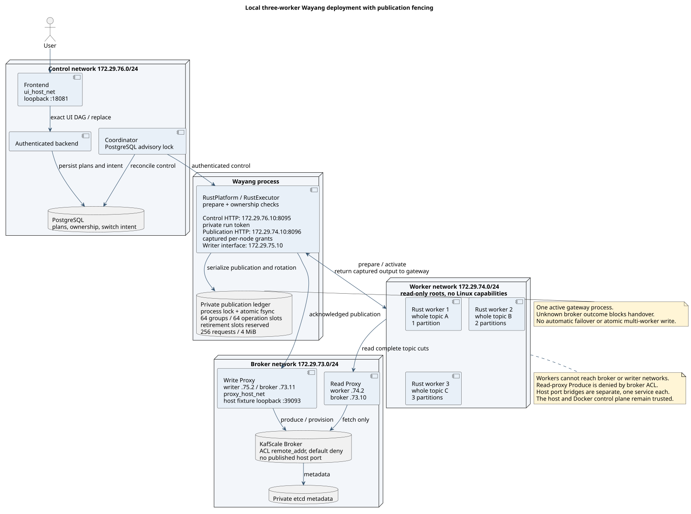

# Run a workbench DAG on three Rust workers through Wayang

Use the local capped deployment profile with Apache Wayang 1.1.1 and `tsx-runner` 0.1.0.

You need Linux or macOS, Docker Compose, JDK 21, Maven, npm, Node 24.22.2, Playwright 1.62.1 with Chromium,
and an unprivileged host user. Use disposable local data. The helper builds Linux binaries in pinned compiler
containers without building container images.

## Preserve the DAG and whole-topic placement

Select **Legacy** in the Workbench header, open **Smart Topic** and select **Bounded Wayang on Rust**.
**Run bounded with Wayang** submits the exact
`opentsx.dag.v2` text to the authenticated backend. PostgreSQL stores the original text, `specHash`, accepted
clock, physical plan and `planHash`. A standalone coordinator reconciles persisted work under a PostgreSQL
advisory lock. The Java driver owns the separate private publication ledger that enforces output authority.

The compiler accepts one to three distinct whole input topics and one distinct episode sink. Topic order maps
to workers sorted by node ID. Every internal partition stays on its topic's worker. Partition-count changes,
missing positions, retention that removes offset zero and capacity violations reject admission rather than split a topic.
All workers must match the admitted artifact digest and state ABI. An initial fenced sink must be empty.

Supported operations remain `decode.avro-soe`, `dq.checks` with `PLAUSIBLE_RANGE`, `convert.unit` and an optional
trailing `resample`. The UI maps `dq.plausible-range` to `dq.checks`. Other operators reject. Cleaning parameters,
resource limits and numerical semantics are unchanged by fencing.

`RustMappings` selects physical sources, optional unions, a fused cleaning chain and sink on one `RustPlatform`.
`RustExecutor` executes the connected stage once. These Wayang channels carry topology rather than raw input
payloads. Original UI node IDs, ordered parameters and raw-text hashes remain attached to the plan. Placement is
static; placeholder costs are not a measured node-selection policy. There is no numerical Java fallback.



Editable [PlantUML](uml/wayang-rust-deployment.puml) and [PNG](uml/wayang-rust-deployment.png).

## Publish through the current authority

Every worker prepares its capped input and candidate output privately. The stage requires all preparations and
checks cross-topic input and derived-series ownership before activation. The gateway registers each exact request
hash, prepared output digest and count after those checks.

Workers read through `kafscale-read`. Their output goes to the Java publication gateway through a private captured
grant. The gateway validates the grant, epoch, original request bytes, ordered records, digest and count before
any Kafka write. It publishes only through `kafscale-write`. OpenTSx producers use Apache Kafka Broker or KafScale
Proxy; no fixture or worker publishes directly to KafScale Broker.

The driver serializes execution, replacement and retirement for its single-chain worker pool. Concurrent fresh
deployments cannot both admit publication authority for the same workers. Publication uses a separate gateway
lock, so worker publication can complete while a control operation waits for its result.

The gateway serializes publication and authority rotation under one lock. It persists a `publishing` intent
before Kafka I/O, waits for every output acknowledgement and persists `acknowledged` before returning a receipt.
A lost HTTP response after durable acknowledgement returns the cached receipt without another Kafka send.
A crash or broker error with an unknown write outcome leaves `publishing` or `uncertain` evidence. That request
is quarantined: identical retry, replacement and Stop cannot assume that no records were written.

The worker commits its completed checkpoint only after verifying the gateway receipt. A prepared journal captures
its grant once; installing a newer grant cannot refresh an old candidate's authority. An exact completed retry
returns the retained receipt. Partial activation can expose an output prefix; there is no atomic multi-worker
publication, Kafka transaction or exactly-once claim.

The backend saves a verified execution result and its gateway epoch before retiring publication authority.
Bounded recovery reuses that saved result and the same retirement operation after a lost reply. It does not execute
the plan again or release topic ownership before the retirement acknowledgement.

## Keep control credentials and the ledger private

The Compose topology has four internal role networks:

| Network | Members and purpose |
| --- | --- |
| `broker_net`, `172.29.73.0/24` | Broker, etcd and the two proxies. Broker-facing Proxy IPs `.10` and `.11` identify read and write authority. |
| `worker_net`, `172.29.74.0/24` | Read Proxy, three workers and the driver's publication interface. |
| `writer_net`, `172.29.75.0/24` | Write Proxy and driver. The host fixture reaches only the loopback-published write Proxy port. |
| `control_net`, `172.29.76.0/24` | Backend, coordinator, PostgreSQL, frontend and driver control interface. |

Two separate non-internal bridges support host port publication: `proxy_host_net` contains only `kafscale-write`,
and `ui_host_net` contains only `frontend`. They are separate so the frontend does not gain a direct write-Proxy
network path. Workers, the read Proxy, broker, etcd, driver and backend do not join either host bridge.

The broker uses `remote_addr` ACL identity, default deny and fail-closed configuration. The read Proxy receives
only topic `fetch` permission; the write Proxy receives publication and provisioning permission. Metadata
auto-creation is disabled. The broker has no published host port. Workers have read-only roots, drop all Linux
capabilities and use `no-new-privileges`. A forged Kafka `client.id` cannot turn the read Proxy into a writer.

Driver control binds `172.29.76.10:8095` and requires `X-OpenTSx-Run-Token`. Publication binds
`172.29.74.10:8096`, with the worker-network alias `wayang-publication`, and requires the per-node grant.
Fenced worker mutations require the actual controller TCP peer `172.29.74.10`; forwarded headers do not authorize
them. Backend and coordinator obtain the existing `DAG_RUN_TOKEN` from their private environment.

The helper stores `run-token`, `publication-acl.json`, driver arguments, worker state and the publication ledger
under `target/wayang-rust-private/<random>/`. Private files use mode `0600`; state directories use `0700`.
The driver's `/publication` mount contains the checksummed atomic ledger and an exclusive process lock. Reuse
that directory on driver restart. Missing initialized ledgers, corrupt contents, conflicting process owners and
storage failures fail closed. Never clear or copy an uncertain ledger to admit a replacement.

## Respect the local gateway capacity

| Inventory | Limit |
| --- | --- |
| Deployment groups | 64 |
| Recorded authority operations | 64 |
| Registered request entries | 256 |
| Serialized ledger envelope | 4,194,304 bytes, or 4 MiB |
| Driver control HTTP body | 1,048,576 bytes, or 1 MiB |
| Publication HTTP body | 85,000,000 bytes |

The control body may contain the completed old plan/result and a replacement plan. Its 1 MiB transport ceiling
does not change the 32,768-byte original DAG limit. The publication data interface has its own larger body cap.

Retired identities and operation receipts remain recorded. Each active group reserves one operation slot for
retirement, so recorded operations plus active-group reservations cannot exceed 64. New admission or switching
rejects before consuming that reserve. A full ledger rejects further work. These are local
caps, not tenant quotas or a scalable deployment registry. The gateway has one process owner and no automatic
failover. PostgreSQL control recovery does not replace publication-ledger recovery. The host and Docker control
plane remain trusted; the host fixture listener is not a production client-authentication boundary.

## Run the isolated acceptance helper

Read the installed interface from the repository root:

```bash
python3 tools/verify_wayang_rust_compose.py --help
```

For the fencing acceptance, replace `<node-executable>` with your absolute Node 24.22.2 executable and
`<playwright-package-directory>` with your installed Playwright 1.62.1 package directory. Port `18082` must be free.
Run from the repository root with JDK 21 selected:

```bash
WAYANG_UI_PORT=18082 python3 tools/verify_wayang_rust_compose.py --profile fencing --keep \
  --node <node-executable> --playwright-module <playwright-package-directory>
```

Read `target/wayang-rust-compose/result.json` after the helper exits successfully. It requires all seven phases,
three complete-topic assignments, submitted-DAG Java parity, stale-grant rejection and unchanged denial offsets.

The bounded profile uses the real workbench controls and compares actual submitted-DAG output with continuing
Java implementations. The continuous and fencing profiles exercise their own lifecycle boundaries; read the
[continuous guide](wayang-rust-continuous.md). Generated reports establish only the run that produced them.

`KAFSCALE_BROKER_PORT` defaults to `39093` and selects the Proxy listener; `WAYANG_UI_PORT` defaults to `18081`.
The write Proxy advertises `kafscale-write`; the private host resolver maps it to loopback for Java fixtures.
`--node` selects the Node executable, `--playwright-module` selects the installed browser module, `--skip-build`
requires matching source hashes, and `--keep` retains this project's private state. The helper refuses occupied
ports and existing project resources rather than stopping unrelated services.

The helper builds the [pinned KafScale bundle](../../../opentsx-kafscale-conformance/README.md#build-the-pinned-transport-bundle),
starts separate etcd, broker, read/write proxies, PostgreSQL and three workers, then runs the application and driver.
The local bundle uses pinned KafScale v1.6.0 source with a guarded
[EtcdStore build overlay](../../../tools/kafscale_metadata_overlay.py), in addition to the broker version stamp.
The overlay serializes `CreateTopic`, `CreatePartitions`, `DeleteTopic` and watcher `refreshSnapshot` through one
store-local mutex. Public metadata reads refresh the durable snapshot and propagate refresh errors.
Its scope is the single-broker, single-metadata-writer fixture. Multi-broker metadata
coordination remains unqualified. The original pinned checkout stays unchanged; the built fixture includes the
overlay and must be identified by its recorded source/overlay and binary hashes.
The guarded [Proxy protocol overlay](../../../tools/kafscale_proxy_protocol_overlay.py) checks the pinned Proxy
source checksum, removes the duplicate frame-length prefix from re-encoded Produce/Fetch requests and uses
protocol constructors for synthetic error-partition defaults. Successful fan-out keeps the backend eligible
for later requests. The builder runs its protocol regressions against the overlaid upstream `cmd/proxy` package
before compiling the bundle. This local fixture includes both overlays;
its provenance does not identify an unmodified upstream release.

It supplies fresh private application credentials, `DAG_RUN_TOKEN` and ACL files before Compose validation.
Only the frontend and write Proxy are published on host loopback. The in-memory S3 test backend stays alive during
worker and driver restart; this is no broker-restart or durable external-storage qualification.

Sanitized evidence belongs in `target/wayang-rust-compose/`. Private candidates and grants remain under the
separate private directory and must not be uploaded as artifacts or printed in logs.

## Inspect the contract and remaining work

Read [SPEC S1.12](../../datamodel-2026/20-WAYANG-TS-OPERATORS-SPEC.md#s112-fence-local-publication-and-replace-a-continuous-deployment),
the [gateway](../../../opentsx-wayang/src/main/java/org/opentsx/wayang/rust/RustPublicationGateway.java),
[rollout stage](../../../opentsx-wayang/src/main/java/org/opentsx/wayang/rust/RustRollout.java),
[worker grant transport](../../../rust/tsx-runner/src/publication.rs),
[worker lifecycle](../../../rust/tsx-runner/src/worker.rs) and
[backend journal](../../../opentsx-saas-backend/app/services/wayang_service.py).

This local protocol does not implement the signed S5/S7 fleet protocol, gateway high availability, automatic
worker failover, state migration, dynamic rescaling, durable Iceberg publication or broader Rust operators.
See the [unified plan](wayang-unified-plan.md) for those separate gates.
