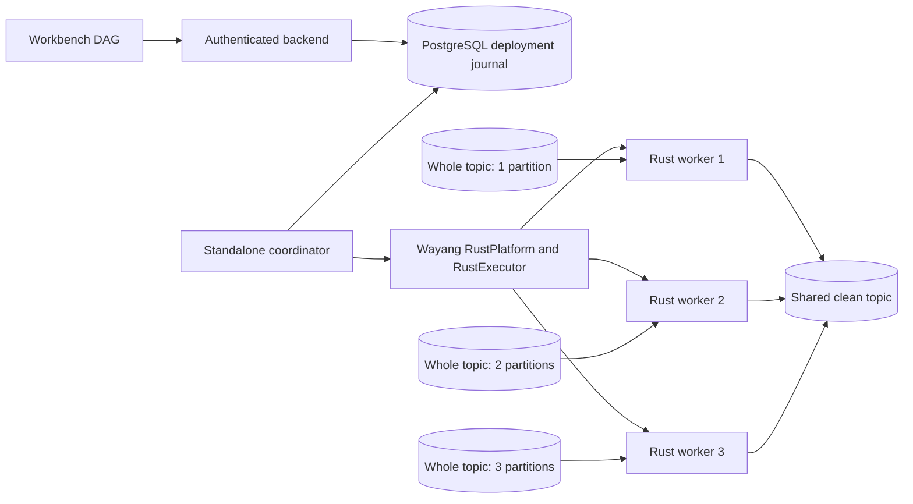
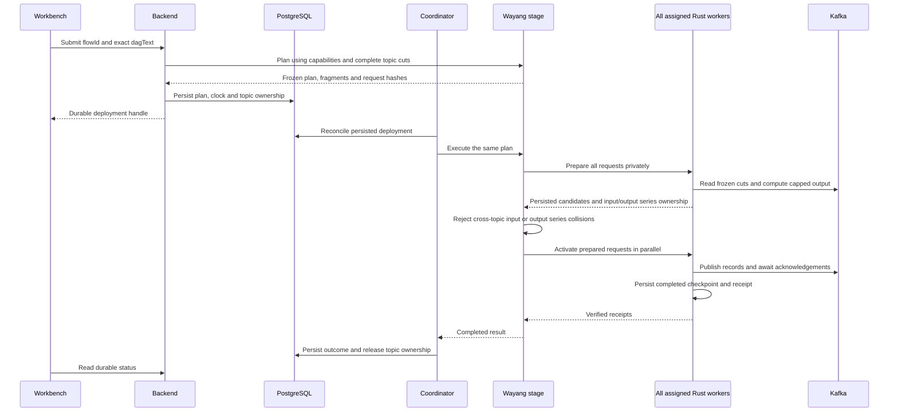

# Run a workbench DAG on three Rust workers through Wayang

Run a workbench DAG with Apache Wayang 1.1.1 and `tsx-runner` 0.1.0, verified through the UI on 2026-11-17
with three Compose workers, exact retry and service restart.

You need Linux or macOS, Docker with Compose, JDK 21, Maven, npm, Node 24.22.2, Playwright 1.62.1 and its Chromium
browser. The helper uses `fcntl` and an unprivileged host user. It downloads existing runtime/compiler images and
builds the Linux Rust binary in `rust:1.99.1-bookworm`; it does not build container images. Use disposable local data.

## Follow the bounded execution boundary

Open **Smart Topic**, then select **Bounded Wayang on Rust** under **Deployment target**. The
**Run bounded with Wayang** action submits the exact `opentsx.dag.v2` text to the authenticated backend.
PostgreSQL stores that text, its `specHash`, the accepted clock, the complete physical plan and its
`planHash`. A separate coordinator owns the PostgreSQL advisory lock and reconciles queued or running deployments.
The Java driver is stateless with respect to authoritative deployment control.



Wayang receives connected logical topic sources, `UnionAllOperator` nodes when needed, an optional fused cleaning
chain and a topic sink. `RustMappings` selects physical operators on one `RustPlatform`; `RustExecutor` executes the
complete stage once. Its channels carry internal topology, without materializing episode payloads in Java.
Original UI node IDs and ordered operation parameters remain attached to the logical and physical operators.
The stage fans out complete fragments to the workers. There is no remote call per numerical operation or Java
execution fallback. The load/cost defaults are placeholders; placement is static, not cost-based node selection.

The local compiler admits one to three distinct whole source topics and one distinct episode sink. Topic order is
paired with workers sorted by node ID. All workers must advertise the same artifact digest and compatible state ABI.
The supported operations are `decode.avro-soe`, `dq.checks` with `PLAUSIBLE_RANGE`, `convert.unit` and an optional
trailing `resample`. The UI aliases `dq.plausible-range` to `dq.checks`. Unsupported operators fail admission.
The backend and worker enforce their existing byte, record, sample, series and state caps.

Each assignment owns every partition of its source topic. The driver freezes ordered internal positions from zero
to each observed end offset and refuses retained inputs whose beginning is no longer zero. Each fragment has its own
ID and text hash; all fragments preserve the exact original UI text and original `specHash`. Partition count changes,
missing positions and oversized topics fail closed. Splitting a topic between workers is never a placement fallback.

## Keep preparation, acknowledgement and retry distinct



Preparation reads and computes the complete bounded input privately on every worker. No worker publishes until all
preparations succeed and the stage checks that input and derived series ownership do not collide across topics.
Activation can partially publish before a different worker fails. Output is at least once; this profile provides
neither atomic publication across workers nor transactional Kafka rollback.

The exact DAG text is accepted once per installation so a retry retains its original cut, clock and identities.
A conflicting owner receives a conflict instead of a new run with another clock. Changing whitespace changes the raw
`specHash`. Repeating the same submission does not refresh its input cut. Completion requires all output
acknowledgements and valid receipts. Each worker stores its retained
pipeline state, next positions and receipt in a checksummed local checkpoint. An open resample tail remains in state.
An exact completed retry returns the saved receipt without publishing more records.

An uncertain activation is retryable with the same request hash and saved candidate bytes. The
`activationRetryable` status keeps the deployment under reconciliation and retains its PostgreSQL topic ownership.
It does not authorize moving the topic to another node, changing the cut, or choosing another clock.
Worker or coordinator restart reuses the persisted plan and worker state. Automatic failover and rescaling are outside
this profile.

## Run the isolated acceptance helper

The helper uses project `opentsx-wayang-rust` and refuses occupied ports or an existing project. It starts PostgreSQL,
a KafScale v1.6.0 Proxy with a loopback-only broker, private embedded etcd metadata and the in-memory S3 test
backend, plus the application, driver and three workers. The helper builds the
[pinned transport bundle](../../../opentsx-kafscale-conformance/README.md#build-the-pinned-transport-bundle)
without building a container image. The broker stays alive during worker/coordinator restart.
This test supplies no S3 durability or broker-restart proof. Fixture and worker producers use the Proxy.
Only the frontend and Proxy listener are published on loopback. Driver, worker and PostgreSQL ports stay internal.
The generated administrator uses normal login and role checks; `TEST_LOGIN` remains false.

The Compose profile requires nonempty `POSTGRES_PASSWORD`, `SECRET_KEY` and
`FIRST_SUPERUSER_PASSWORD` values. The helper creates fresh values for each run
and supplies them through its process environment and private `generated.env`.
It validates the configuration with `config --quiet` before starting services.
Missing or empty credential variables reject configuration; credentials have no
fallback values. Keep the private environment file out of logs and artifacts.

Check the installed command interface:

```bash
python3 tools/verify_wayang_rust_compose.py --help
```

Run from the repository root after installing the prerequisites:

```bash
python3 tools/verify_wayang_rust_compose.py
```

`KAFSCALE_BROKER_PORT` defaults to `39093`; `WAYANG_UI_PORT` defaults to `18081`. Set an available value explicitly if
one is occupied. Use `--node <node-executable>` for Node 24.22.2 outside `PATH`, and
`--playwright-module <module-directory>` for an existing Playwright 1.62.1 installation. `--skip-build` requires
artifacts matching the current source hash. `--keep` retains this project's containers, database and private state
for inspection.
The helper never stops another Compose project. Normal cleanup removes this project's data and retains build caches.

The browser uses the real operation controls to build plausible-range checks, unit conversion and a 20-second mean
resample. It submits one DAG for topics with one, two and three internal partitions. The Java fixture checks twelve
output episodes after initial execution, exact UI retry and worker/driver/coordinator restart. It recomputes expected
output from the actual submitted DAG through `DagToWayang.parameters`, `CleanChain` and `SeriesStream`.
Canonical Avro bytes, identities, axes, keys, Kafka timestamps, partitioning, schema headers and receipts are checked.
Only the expected runtime producer label and accepted provenance clock are normalized for the Java comparison.

Sanitized evidence is written under `target/wayang-rust-compose/`, including `submitted-dag.txt`, per-phase public
deployment views, `verified-<phase>.json` and `result.json`. Generated credentials, driver arguments and worker state
are private under `target/wayang-rust-private/<random>/`; keep that directory out of artifacts and logs.

## Check credential guards without starting services

Run the deterministic
[helper tests](../../../tools/test_verify_wayang_rust_compose.py) from the
repository root:

```bash
python3 -m unittest tools/test_verify_wayang_rust_compose.py
```

The tests cover all four credential substitutions, reject fixtures that replace
required interpolation with a fallback or allow empty values, and verify that
the helper supplies its generated credentials before configuration validation.
These guards check the existing profile behavior without starting Docker
services or printing credential values.

## Inspect the implementation and remaining limits

Read the [UI builder](../../../opentsx-saas-frontend/src/workbench/wayang.ts),
[backend journal](../../../opentsx-saas-backend/app/services/wayang_service.py),
[coordinator](../../../opentsx-saas-backend/app/wayang_worker.py),
[Wayang compiler and stage action](../../../opentsx-wayang/src/main/java/org/opentsx/wayang/rust/RustRollout.java),
[executor](../../../opentsx-wayang/src/main/java/org/opentsx/wayang/rust/RustExecutor.java) and
[worker lifecycle](../../../rust/tsx-runner/src/worker.rs).
The [acceptance helper](../../../tools/verify_wayang_rust_compose.py) and
[Java fixture](../../../opentsx-wayang/src/test/java/org/opentsx/wayang/RustRolloutComposeFixture.java) define the checks.

This is a trusted local bounded deployment, not the signed fleet protocol in specification S5/S7.
The separate [continuous profile](wayang-rust-continuous.md) adds acknowledged increments and stateful service restart.
Automatic failover, broad operator coverage, operational tenant quotas, artifact signatures and durable Iceberg
publication remain separate work in the [unified plan](wayang-unified-plan.md). HTTP generation/hash checks do not
establish production authentication, network isolation or distributed stale-writer fencing.
