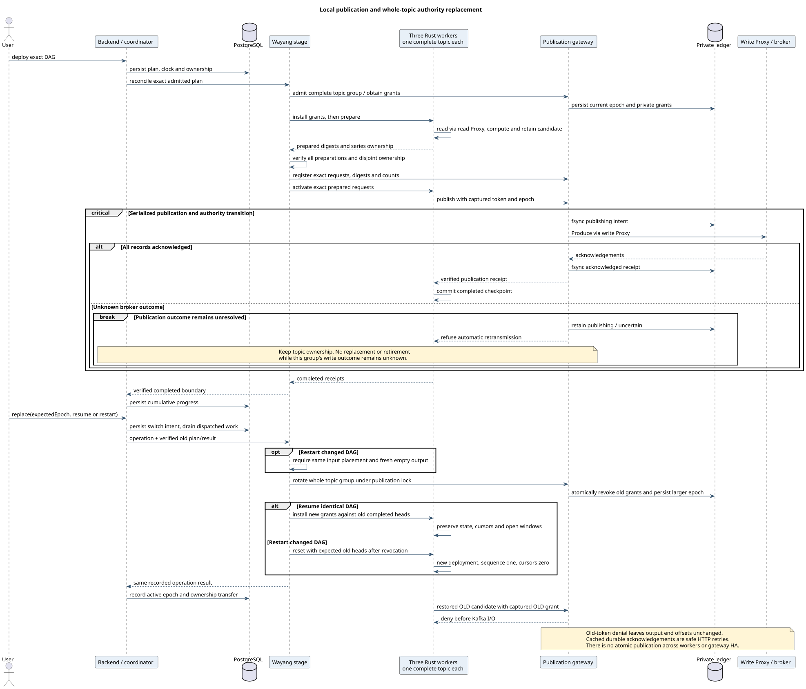

# Continue and replace whole-topic Rust deployments through Wayang

Use the local continuous profile with Apache Wayang 1.1.1 and `tsx-runner` 0.1.0.

You need the prerequisites and private network setup in the [three-worker guide](wayang-rust-compose.md).
Use disposable local data and retain the same worker and publication state across service restart.

## Advance complete-topic cuts

Select **Legacy** in the Workbench header and open **Smart Topic**. Select **Continuous Wayang on Rust**
under **Deployment target** and use **Run continuously with Wayang**.
Administrator permission, or any signed-in account when the backend has `DAG_RUN_ROLE=user`, and flow ownership
apply. The supported subset remains Avro decode, plausible-range checks, unit conversion and an optional trailing
resample. There is no wider Rust catalog or numerical Java fallback.

Each deployment retains the exact UI text, `specHash`, accepted clock, fragments, placement, binary digest and
limits. Every finite increment covers every internal partition of each assigned topic, including empty spans.
The next cut begins at the preceding verified positions and restores operator state locally rather than replaying
the prefix. Rotating partition priority bounds busy input without changing whole-topic ownership.

The per-topic record budget is `min(records, inputBytes / payloadBytes, samples / episodeSamples)` with integer
division. Payload, state, output and lifetime-series limits apply independently. Every worker prepares privately;
cumulative input and output ownership prevents later increments from introducing a cross-topic series collision.

A late or overlapping episode whose first event timestamp precedes the retained series end is skipped. Its cursor
and input count still advance. Continuous processing does not add late-data revisions. Unfinished resample windows
remain in retained state; Stop does not flush them. The existing ceiling is 100,000 valid samples per open window.

## Separate plans, state and publication authority

PostgreSQL retains the continuous control, pending plans, latest two completed cycle rows and cumulative progress.
The coordinator persists dispatch before remote execution and retains topic ownership through idle, uncertainty
and a pending replacement. The worker keeps one completed head and at most one candidate in
`increments/checkpoint.json`. Sequence and predecessor hashes bind each successor to the preceding acknowledged
state. Caller-supplied state and file paths are forbidden.

A transient preparation failure retains the exact plan and all private candidates for identical retry. Every
preparation and ownership check must still succeed before activation. A confirmed preparation refusal is distinct
from an unknown publication outcome.

`publicationEpoch` is separate from immutable assignment `generation` and `fence`. The private gateway ledger
records output authority for the entire input-topic group and sink. The driver installs one opaque grant per node
and epoch. Each prepared candidate captures its grant once. The worker publishes only that captured authority
through the gateway; it never obtains current authority merely by changing a public JSON epoch.

The gateway stores send intent before Kafka I/O and durable acknowledgement before returning a receipt. A lost
HTTP response after that durable acknowledgement can return the same receipt. An unknown broker outcome is
quarantined and blocks publication retry, replacement and retirement. The bounded local ledger limits and
network/ACL enforcement are specified in the [three-worker guide](wayang-rust-compose.md#respect-the-local-gateway-capacity).
There is no automatic gateway failover or operator command that discards uncertainty. The local fixture uses
pinned KafScale v1.6.0 plus guarded metadata and Proxy protocol build overlays documented in the
[transport setup](wayang-rust-compose.md#run-the-isolated-acceptance-helper). Its single-broker metadata
serialization is separate from gateway fencing and does not qualify a multi-broker deployment. Public metadata
reads refresh the durable snapshot and propagate refresh errors. The protocol
overlay corrects Produce/Fetch re-encoding and synthetic error defaults, and keeps successful fan-out backends
eligible. Bundle provenance records the actual local overlays rather than an unmodified upstream binary.

## Resume the identical DAG with a new publication epoch

After at least one completed increment, the UI offers **Resume deployment ... with fencing** when the capability
is available. It submits the current `expectedEpoch` and `mode: resume` for the owned continuous deployment.
The backend persists a switch operation before remote calls, drains dispatched work and pauses successor planning.

The driver verifies the last completed plan and result. Under the same lock used by publication, the gateway
revokes the old grants and durably installs a larger epoch for the entire topic group and sink. The driver then
idempotently installs new worker grants against each expected completed head. A failed installation never
reactivates old authority; reconciliation repeats the recorded operation.

Resume preserves deployment ID, exact source text/hash, accepted clock, whole-topic placement, completed heads,
cursors and operator state. It preserves an open resample window and does not replay the topic prefix. It is an
explicit publication-authority change, not automatic migration or takeover by another node.

## Restart a changed DAG into a fresh output

The UI offers **Restart changed DAG for deployment ...**. Keep the same complete input-topic set and placement,
change the DAG, and choose a distinct fresh output topic. The backend verifies flow ownership and persists a new
continuous deployment and its switch operation before activation. A conflicting output owner is rejected.

The driver requires the replacement sink to be empty, verifies the old completed boundary and rotates authority
before resetting worker chains. Reset requires the expected old completed head and no pending candidate. It
clears the old operator head only after revocation. The replacement starts at sequence `"1"`, with every internal
partition at offset zero, its own source hash and accepted clock. Retained input must still permit that replay.
The old output topic remains intact. There is no state conversion or silent reset under the old deployment ID.

Identical replacement retries reuse their recorded operation. Another request body for the same expected epoch
conflicts. Public deployment views expose `publicationEpoch` and switch progress, never grants or their tokens.



Editable [PlantUML](uml/wayang-rust-rollout.puml) and [PNG](uml/wayang-rust-rollout.png).

## Stop after resolving dispatched output

**Stop deployment** records durable intent. Undispatched work can stop immediately; dispatched work must reach a
conclusive result. The gateway revokes the active epoch before the backend releases topic ownership. A pending
switch or unknown publication outcome retains ownership and blocks a completed stop. Stop does not flush an open
resample tail. A stopped deployment identity remains retired; submitting its old text is not implicit reactivation.
The worker pool retains its one completed continuous chain. Stop does not reset it for an unrelated deployment, and resume
is available only while the deployment is active. Request changed-DAG restart before Stop, or use a fresh isolated
worker pool for another local experiment. Never discard an uncertain publication ledger to reuse a pool.

## Inspect the acceptance evidence

Read the helper's installed profiles from the repository root:

```bash
python3 tools/verify_wayang_rust_compose.py --help
```

Run the fencing profile with the [tested helper invocation](wayang-rust-compose.md#run-the-isolated-acceptance-helper).

The continuous profile checks new data, identical idle retry, execution-service restart, a single-worker outage,
backlog recovery and Stop. The fencing profile adds same-DAG resume, changed-DAG replay into a fresh output,
captured old-candidate rejection and transport bypass checks. The helper and Java fixture compare records with
actual submitted-DAG Java output. An already completed retry alone is not evidence of stale-writer fencing.

A valid stale-owner check activates an old prepared candidate using its captured old grant after rotation and
checks actual publication rejection plus unchanged output end offsets. Also inspect attempts through the read
Proxy with a forged `client.id`, direct broker IP, write Proxy IP and host gateway. Network configuration alone is
not proof that those attempts failed in the running environment.

Sanitized reports belong in `target/wayang-rust-compose/`; private state and credentials stay in the separate
private directory. Use generated evidence from the current run rather than earlier success files. The in-memory
broker remains alive during worker and driver restart, so those results do not establish broker durability.

Read [SPEC S1.12](../../datamodel-2026/20-WAYANG-TS-OPERATORS-SPEC.md#s112-fence-local-publication-and-replace-a-continuous-deployment),
the [gateway tests](../../../opentsx-wayang/src/test/java/org/opentsx/wayang/rust/RustPublicationGatewayTest.java),
[worker fencing regressions](../../../rust/tsx-runner/tests/publication_fencing.rs),
[backend switch tests](../../../opentsx-saas-backend/tests/test_wayang_switch.py) and
[topology guards](../../../tools/test_kafscale_fenced_topology.py).

Signed fleet activation, gateway high availability, backup/restore reconciliation, automatic worker failover,
state migration, topic-incarnation qualification, dynamic rescaling, broader operators and durable Iceberg
publication remain separate work in the [unified plan](wayang-unified-plan.md).
