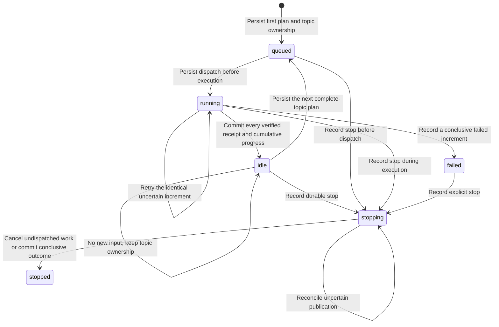

# Run continuous input on three Rust workers through Wayang

Run a continuous workbench DAG with Apache Wayang 1.1.1 and `tsx-runner` 0.1.0, verified through the real UI and
three Compose workers on 2026-11-18.

You need the prerequisites of the [three-worker Compose guide](wayang-rust-compose.md): Docker with Compose,
JDK 21, Maven, npm, Node 24.22.2 and Playwright 1.62.1 with Chromium. Use disposable local data and an unprivileged
host user. The profile uses existing pinned images and builds a Rust binary, without building container images.

## Keep each topic on one worker

Open **Smart Topic**, choose **Continuous Wayang on Rust** under **Deployment target**, select the complete input
topics and cleaning output, then use **Run continuously with Wayang**. Normal administrator authentication and flow
ownership apply. Supported operations remain Avro decode, plausible-range checks, unit conversion and an optional
trailing resample. There is no numerical Java fallback or wider Rust operator catalog.

The deployment retains the exact UI text, `specHash`, accepted provenance clock, compiled fragments, worker bindings,
artifact digest and limits. The whole topic remains the deployment unit. Every increment includes every internal
partition of each assigned topic, including empty spans; a topic is never split between workers.

Wayang executes the connected Rust source/union/clean-chain/sink stage for each finite increment. Each increment
starts at the preceding acknowledged positions, restores its saved operator state locally and reads only its new
cut. It does not replay the full topic prefix. All workers prepare privately and expose cumulative input/output
series ownership before any worker activates. This also detects a collision that appears in a later increment.

The record budget per topic is the minimum of `records`, `inputBytes / payloadBytes` and `samples / episodeSamples`,
using integer division. The current limits give four records. Rotating partition priority prevents a busy internal
partition from permanently excluding its siblings. Complete partition coverage and fixed placement remain intact.
Payload, retained state, output and lifetime series caps still reject before publication; they are not unlimited
streaming resource budgets.

Cleaning retains its existing event-time policy: a late or overlapping episode whose first timestamp is before
the saved series end is skipped. Its Kafka cursor and input count still advance. This profile does not revise
earlier output or claim late-data completeness.

## Follow the persisted lifecycle



PostgreSQL stores continuous control and cycle rows in the additive `wayang_continuous` and `wayang_cycles` tables.
The existing coordinator owns one database advisory lock. It persists each exact cycle plan before dispatch,
retains topic ownership between increments and keeps only the latest two completed cycle rows plus pending work.
Cumulative counters and the latest completed positions survive that pruning. Leases have no wall-clock expiry.

If a preparation response is lost after the worker saves its private candidate, the driver retains that candidate
and the admitted plan for identical retry. A transient preparation failure does not cancel the other workers'
private candidates. No worker activates until every preparation and the cross-topic ownership checks succeed.
Permanent preparation refusals and ownership collisions still fail closed. A worker outage does not move its topic
to another worker; restart the same worker with its retained state.
The driver reports `worker preparation requires identical retry; retain private candidates` as its reconciliation
reason. The coordinator retries the persisted plan; no new UI deployment request is needed.

The driver returns no new plan on global idle. A new plan preserves placement, partition counts and clock, advances
the sequence by one and links its `previousPlanHash`. Retention gaps, truncated inputs, changed topic partition
counts, changed output inventory and incompatible workers fail closed. Topic recreation is not qualified by this
local profile; the broker remains alive during the acceptance test.

The worker request `opentsx.local-increment.v1` adds `sequence` and `previousRequestHash` to the six bounded-request
fields. The inner assignment is a finite bounded cut. The first sequence is `"1"`, has a null predecessor and
starts every partition at zero. A successor requires the completed head hash, the next sequence and exact prior
`next` positions. Caller-supplied operator state or file paths are not accepted.

Each worker atomically retains one completed head and at most one prepared or uncertain candidate in
`increments/checkpoint.json` under its configured state directory. The head contains operator state and cumulative
series ownership. Completed output payload history is removed; the latest exact retry returns its receipt without
broker I/O. Stale, skipped, forked and changed-context requests are refused. An uncertain candidate keeps its saved
output bytes until acknowledgement and durable head commit.

Publication remains at least once. An interruption after acknowledgement but before durable state commit can replay
identical output. Activation across three workers is not atomic. The unfinished resample tail remains in the
checkpoint; Stop does not flush it. An open window retains the existing ceiling of 100,000 valid samples.

## Stop without abandoning an uncertain write

Use **Stop deployment** in the continuous panel. The authenticated stop route records a durable request.
Undispatched work can stop immediately; an already dispatched increment is reconciled first. An uncertain write
keeps the deployment in `stopping` with topic ownership retained. A confirmed stop enters `stopped` and releases
the backend's topic ownership. Retrying the same UI text returns the same deployment and does not resume a stopped
deployment. Reusing that text with another execution profile returns a conflict.

One worker retains one immutable continuous chain, including after Stop. Replacing that chain requires an explicit
reset of its disposable worker state after its deployment has conclusively stopped. The application has no implicit
reset, retirement, migration or failover command. Process restart reuses the same state and node binding.

## Verify new data and restart in Compose

Check the helper interface from the repository root:

```bash
python3 tools/verify_wayang_rust_compose.py --help
```

Run the continuous acceptance profile:

```bash
python3 tools/verify_wayang_rust_compose.py --profile continuous
```

`KAFSCALE_BROKER_PORT` defaults to `39093`; `WAYANG_UI_PORT` defaults to `18081`. Use available loopback ports.
The existing `--node`, `--playwright-module`, `--skip-build` and `--keep` options retain their documented behavior.
The helper refuses another running instance of project `opentsx-wayang-rust` and preserves unrelated projects.

The real browser creates the DAG through the operation controls. The acceptance sequence is:

1. Submit once and consume one short episode per partition of topics with one, two and three partitions.
2. Retry the exact UI text while idle; retain the same deployment, clock, positions and output.
3. Append a second episode per partition and consume it without another deployment request.
4. Stop only the coordinator, Wayang driver and three workers. Keep Kafka, PostgreSQL and the backend alive.
   Append through four episodes per partition while execution is down, then restart the same services and state.
5. Consume that backlog automatically. Append a fifth episode per partition and consume it without redeployment.
6. Stop only `runner-2` and append a sixth episode per partition. Verify the visible error and unchanged confirmed
   progress while Kafka, PostgreSQL, the backend, coordinator, driver and workers one and three keep running.
7. Start the same `runner-2` with its retained state and consume the sixth episode automatically.
8. Append a seventh episode per partition and consume it without another deployment request.
9. Stop through the actual UI and verify that all confirmed positions and output remain unchanged.

The local acceptance on 2026-11-18 completed all nine phases. Its seven acknowledged increments consumed 42 input
records and produced 42 distinct output episodes. The one-, two- and three-partition topics retained their original
workers; every final internal `next` position was `"7"`. During the single-worker outage, all eight other services
kept running and confirmed progress stayed at five increments and 30 records. Restarting that worker consumed the
backlog automatically. Exact retry and Stop produced no additional output.

`RustContinuousComposeFixture` derives reference output from the actual submitted DAG through continuing Java
`SeriesStream` state. Its short episodes leave resample windows open across both increment and restart boundaries.
Verification checks canonical Avro bytes, episode and series identities, values, axes, Kafka keys, timestamps,
partitioning, schema headers, cumulative counters and all six internal partition watermarks. Only the expected
runtime producer label and accepted provenance clock are normalized for comparison.

Sanitized evidence is written to `target/wayang-rust-compose/`. The continuous profile records nine per-phase browser,
public deployment and Java verification reports plus `result.json`. Credentials and worker state remain private in
the separate directory documented by the Compose guide. Each new run invalidates old success evidence.
`worker-outage.json` records the interrupted worker, appended input prefix and the other eight live services.

The single-worker Compose outage starts while the deployment is idle. The separate Java planner regressions inject
lost preparation responses and verify retained candidates, exact retry and refusal before activation.

## Inspect the implementation boundary

Read the [continuous planner](../../../opentsx-wayang/src/main/java/org/opentsx/wayang/rust/RustRollout.java),
[coordinator journal](../../../opentsx-saas-backend/app/services/wayang_service.py),
[worker head and candidate store](../../../rust/tsx-runner/src/worker.rs),
[increment regressions](../../../rust/tsx-runner/tests/increments.rs) and
[acceptance fixture](../../../opentsx-wayang/src/test/java/org/opentsx/wayang/RustContinuousComposeFixture.java).

This trusted local profile does not qualify broker restart or durable external storage. Signed activation,
distributed stale-writer fencing, automatic failover, dynamic rescaling, operational quotas, broader Rust kernels
and durable Iceberg publication remain outside its contract. See the [delivery plan](wayang-unified-plan.md).
