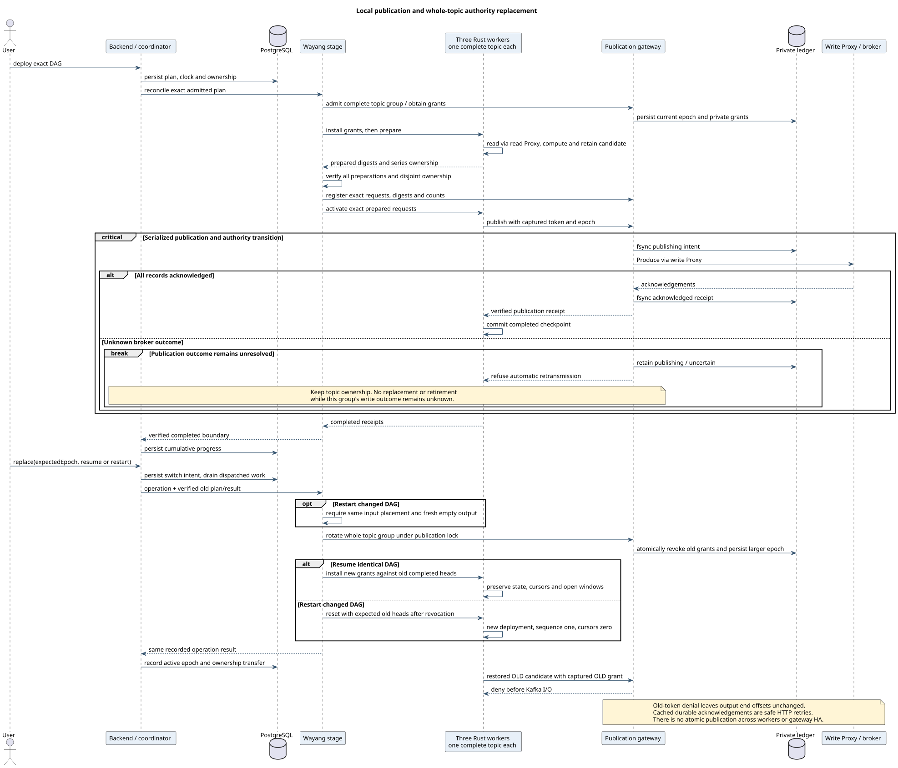

# Deliver UI DAGs through Wayang to Java and Rust nodes

Use this unified plan for the shared-contract implementation on PR #258 base
`dc5f05043158a7ddf80ac156f9690ca92cf93788`, inspected on 2026-11-16.

You need [concept 20](../../datamodel-2026/20-WAYANG-TS-OPERATORS.md), its
[specification](../../datamodel-2026/20-WAYANG-TS-OPERATORS-SPEC.md) and
[TASK-020](../../../EVOLUTION/TASK-020-wayang-ts-operators.md).
**Target: an OpenTSx UI DAG, admitted by the backend, compiled by Wayang and deployed as complete fragments to
multiple Rust nodes.** Java supplies the reference kernels and an alternative execution runtime.
The implemented foundation is [offline shared-contract validation](wayang-shared-contracts.md).
The remote driver, Rust runner and multi-node rollout remain delivery work. The existing Java
[`DagToWayang`](../../../opentsx-wayang/src/main/java/org/opentsx/wayang/DagToWayang.java) compiles local clean DAGs
with episode sinks; it does not deploy remote fragments.

## Keep one logical DAG and two execution profiles

The UI keeps `opentsx.dag.v1`/`v2`. Separate three descriptions:

1. The logical DAG identifies the user's operators, parameters, ports and requested outputs.
2. The admitted physical deployment fixes catalog/artifact identities, fragments, node placement, channels,
   resources, execution profile and generation.
3. Each execution assignment binds one fragment to one runtime node and complete topics.

The smallest deployable unit is always the whole topic, regardless of partition count.
Every partition is read and tracked internally by that topic's assigned runner. Placement, resource admission,
handover and failover operate on the whole topic. An oversized topic is refused or placed on a capable node;
splitting its partitions across nodes is not a fallback.

Wayang optimizes only admitted alternatives. Residency, ownership, supported operations and resource constraints
are hard admission conditions, not penalties that a cheaper plan can override. One Rust platform represents the
runtime engine; its node inventory contains the actual resources.
Dispatch complete fragments so series state does not cross a remote call for each cleaning step.

Editable [deployment UML](uml/wayang-rust-deployment.puml) and [PNG](uml/wayang-rust-deployment.png).

| Profile | Input/recovery contract | Output/success contract |
| --- | --- | --- |
| Bounded, including Iceberg | Pin a source cut; persist original records, schema/algorithm documents and a checksum-verified seal. Retry the entire sealed prefix from empty state for the first capped route. | Verify private output and retained-state manifests, then publish an authoritative result pointer. Success means a verified finite result. |
| Continuous Kafka/Rust | Persist concrete starts and per-partition state; checkpoint only acknowledged output. Keep at-least-once delivery and deterministic duplicate identities explicit. | Deployment acceptance returns a durable handle. Progress and analytics continue until stopped or failed; acceptance is not finite-result completion. |

The first assignment format covers Kafka cuts. A bounded Iceberg adapter must bind its sealed inventory to the
same semantic and artifact contracts; it is not implemented by the Kafka assignment validator.
Do not block the first two-Rust-node deployment proof on the complete Iceberg production route or full Java catalog.

## Build the orchestration boundary explicitly

The inspected UI exports DAGs, while current backend deployment forwards to the retrieval/vector processor.
The separate flow execute route dispatches Flink. See
[UI export](../../../opentsx-saas-frontend/src/workbench/flow.ts#L685),
[DAG route](../../../opentsx-saas-backend/app/api/dags.py#L97) and
[flow execution](../../../opentsx-saas-backend/app/api/flows.py#L125).
Add an explicit Wayang deployment choice and capability-aware validation; preserve existing dispatch behavior.

| Responsibility | Required deliverable |
| --- | --- |
| UI and backend admission | Pinned catalog/capability digest, normalized aliases/defaults, typed ports, resource/residency policy and stable node/field refusal locations. Draft export alone never authorizes execution. |
| `DagToWayang` | Validate the existing DAG; preserve source node IDs; produce complete fragments and whole-topic assignments in a typed physical deployment. Replicated graph branches each consume their topics in full. |
| Rust platform and executor | One custom platform, complete-stage compilation, bounded fanout to assigned nodes, idempotent commands, verified receipts and cancellation. Do not infer concurrency from Wayang's executor cache. |
| Channels | Explicit cluster/broker binding, topic incarnation, schema, key, partitioner, owner set, payload classification, buffering/backpressure and completion boundary for every cross-fragment edge. |
| Rust runner | Trusted packaged operators, exact shared wire/identity rules, bounded per-key state, every partition of each assigned topic, compatible checkpoints and generation-specific status. |
| Durable coordinator | Reuse the SaaS PostgreSQL/SQLAlchemy boundary for authoritative deployment state, assignments and delivery records. Implement migrations, supervision and restore fencing; do not use request background tasks as a scheduler. |
| Publication and readers | Bounded results use verified manifests and one atomic pointer/outcome transaction. Continuous output needs a separately enforceable stale-writer policy; a database pointer does not fence a Kafka producer. |

Use a custom stage executor to assemble and dispatch the fragment group. A continuous deployment operation
finishes when its durable deployment receipt is verified; its output is a deployment handle.
Bounded data or aggregate completion needs its own channel/result boundary. A live topic is not a completed
materialization. The [architecture assessment](wayang-orchestration-review.md) records the upstream API constraints.

Editable [rollout UML](uml/wayang-rust-rollout.puml) and [PNG](uml/wayang-rust-rollout.png).

## Set the first rollout and state rules

The proposed first multi-node prototype assigns different whole topics to two nodes and uses a small supported chain.
No automatic failover or rescaling is admitted until stale-output enforcement is qualified.
Different aliases for one broker/topic must resolve to one authoritative source identity before ownership checks.
Prove whole-topic ownership and complete internal cursor coverage against the admitted inventory.
Partition count or incarnation changes require readmission of the whole topic.

Use durable prepare, activate and retire transitions. Preparation performs no output writes. Activation names
the admitted generation and assignment set. Retirement stops output and records the final state boundary.
Partial activation has a recorded failed/degraded outcome; it is not an atomic start across machines.
Lost acknowledgements return the same receipt for the same command digest; changed content under that command
identity is a conflict. Rollback never silently resets state or relabels published output.

Offline autonomy needs an explicit grant and clock policy. Do not move ownership while a disconnected node
still has authority to emit. Before replacement, prove revocation/termination or qualify expiry and stale-output
rejection. Generation/fence fields in a JSON document provide no enforcement by themselves.
Database restore requires stopping/revoking pre-restore generations before accepting restored ownership counters.

Checkpoint envelopes bind state ABI, operator/algorithm versions, source cut/continuation, fragment semantics,
last acknowledged outputs and exact next input positions. Reject incompatible state by default.
Reset requires an explicit new generation and admitted start policy; cross-runtime checkpoint portability is
not promised by operator-output parity. Fixed provenance clocks are part of same-request bounded replay.

## Resolve the remaining contracts before network activation

| Gap | Required decision and deterministic evidence |
| --- | --- |
| Logical and physical identity | Preserve raw-text `specHash`; separately version semantic/computation and physical deployment hashes. Define defaults, signed zero, NaNs and ordered inputs. Placement cannot silently change scientific identity. |
| Delivery cursor | Durable per-site delivery sequence independent of each job's `planVersion`; test job A version 10 followed by job B version 1, reconnect and duplicate acknowledgement. |
| Membership and capabilities | Bind node-to-site identity, artifact/catalog/state ABI, measured capacities and report freshness. Require every conformance check exactly once; validate inventory counts and unique IDs. |
| Data edges and new topics | Name every edge and source/target port; validate key affinity and multi-input co-location. A key-changing stage can create an explicit new topic, which is also assigned whole. Raw cross-site pairs/vector joins reject until their movement contract is accepted. |
| Continuous fencing | Specify an output boundary that rejects old authority. Local busy checks, manual assignment and lease expiry alone are insufficient. Test the disconnected old owner before enabling takeover. |
| Rollout availability | Specify required/optional assignments, deadline, partial activation behavior and operator-visible degraded state. Keep generation-bound expected membership. |
| Federation finality | Require closed-window/cut evidence, not merely one partial from every site. Reject conflicting payloads under the same key/revision and stale generations. |
| Scientific parity | Validate mergeability at cross-site boundaries; allow local cleaning before mergeable statistics. Qualify DDSketch's zero bucket/collapsed tails and floating-point tolerances. |
| Signal identity | Include the producing node/check/window discriminator before freezing event IDs; two DQ findings at the same series/time must survive deduplication. |
| Access and operations | Approve tenant/source/sink/location policy, signing/key rotation, revocation, quotas, retention, backup/restore, metrics and audit. Credentials and executable user code never enter a DAG or assignment. |

These are planned acceptance requirements. Security implementation, credentials and production rollout require
their explicit approval; none is enabled by the offline library.

## Deliver the shared foundation and the two-node proof first

Planning IDs below are local work packages, not created issue numbers. Owners are roles; dates require assigned capacity.

| Package | Dependencies | Deliverable and acceptance gate |
| --- | --- | --- |
| U00: shared foundation | PR #258 baseline | Implemented assignment schema, Java/Rust validators and shared generated vectors; run all cases and structural schema checks. Scope remains offline. |
| U01: deployment contract; architecture/backend | U00 | Freeze physical plan, output/channel bindings, source identity, complete ownership, capability/state ABI and structured refusals. Golden UI-to-fragment and valid/invalid physical-plan cases. |
| U02: driver lowering; Wayang owner | U01 | Real Wayang logical/physical plan and custom stage executor against deterministic fake transport; two assignments, bounded fanout, placement restrictions, receipts and no raw driver payloads. |
| U03: durable control; backend owner | U01 | PostgreSQL migrations, deployment/assignment journal, per-site delivery sequence, idempotent prepare/activate/retire and polling. Barrier tests for restart, stale events and lost acknowledgements. |
| U04: minimal Rust runner; Rust owner | U00, U01 | Pass-through, Avro, series IDs, Kafka client/partitioner conformance, checkpoints and one cleaning chain. Shared wire/operator vectors plus crash-before/after-ack cases; pinned CI artifacts. |
| U05: UI-to-two-node prototype; application/platform | U02, U03, U04 | Explicit UI target selection; two actual Rust processes receive different whole topics and channel bindings, including all internal partitions. Reject split-topic placement. Output matches direct Java, including restart and refused capabilities. Static topic ownership only. |
| U06: production ownership and rollout; platform/security | U05; approvals | Enforce stale-output rejection, policy/signatures, resource limits, staged rollout, retention and restore runbooks. Network-partition, partial activation and operating qualification before production. |
| U07: catalog expansion; algorithm owners | Per-operator vectors | Continue A2/A3 Java kernels and Rust ports without blocking U02/U04 on every operator. No duplicate generator or conflicting ownership of shared algorithm fixtures. |
| U08: bounded storage profile; storage/backend | U00, U01, U03; completion requires U02 and a qualified bounded executor plus selected U07 kernels | Snapshot acquisition, durable Avro seal, actual bounded Wayang execution, retained-state parity, private Iceberg staging and pointer-aware reads. Independently verify both tables and reconcile ambiguous publication. Storage work may start in parallel. |
| U09: federation and dynamic placement; architecture/platform | U05, qualified U06/U07 capabilities | Partial/final aggregate contracts, movement/backpressure, mixed-runtime parity and measured cost models. Rescaling needs state migration and safe ownership handover evidence. |

U05 is the first proof of the requested product behavior. U06 gates production; U08 preserves the selected
Iceberg route as an independently qualified profile. Spark remains a separate future backend decision and does
not substitute for the Rust deployment proof.

## Integrate parallel work without replacing its baseline

This foundation branches from the exact PR #258 head and keeps its Wayang 1.1.1 dependency setup and
`TsxJavaPlugin`. It does not replace them with the isolated research pilot's snapshot dependency or broad plugin.
The feature branch integrates default-branch commit `a64c22a`, including merged PR #258, A1 topic I/O/checkpoints,
A2 Java clean/statistics mappings, local clean DAG compilation, both pair kernels and shared operator vectors.
Parallel operator and vector work remains independently owned.
Required CI must be green before merge; this work performs no production deployment.

The parallel operator work owns `TsxPairXcorr`, `TsxPairEs`, their vectors and the statistics/segment/SAX/DQ
reference generators. The parallel A1 work owns source/sink/checkpoint and increment execution.
This slice adds model-level contract code, a standalone Rust contract library, a new assignment schema and its
own vector generator. It does not edit those kernels or duplicate their fixtures.
Reconcile the A1 checkpoint mismatch/reset rule and new assignment boundary before U04 consumes it.

For bounded Iceberg publication, the existing store appends episodes and series catalog separately; repeating a
write is not a transaction or catalog repair. See
[store commits](../../../opentsx-store-iceberg/src/main/java/org/opentsx/store/iceberg/IcebergSeriesStore.java#L87).
Prepare both private snapshots, reconcile catalog gaps, independently reopen/read them, then atomically publish
their manifest pointer and successful journal outcome. Readers must resolve that pointer and both pinned snapshots.
Retain unresolved artifacts until reconciliation; cleanup cannot infer failure from a missing acknowledgement.
