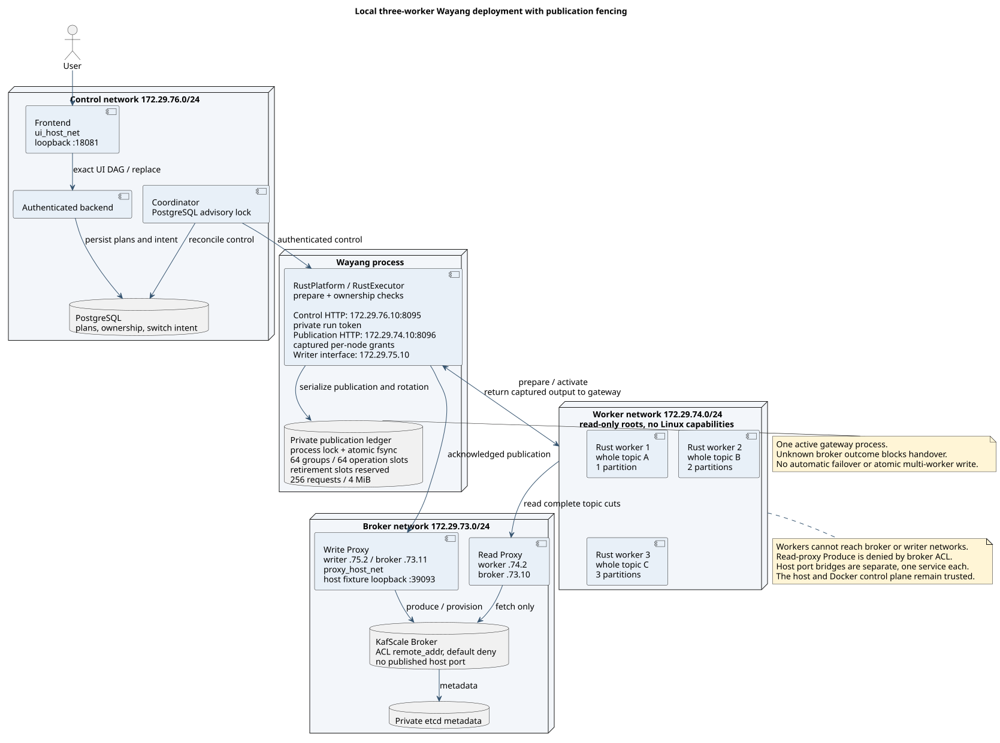

# Deliver UI DAGs through Wayang to Java and Rust nodes

Use this plan with the implemented local bounded and continuous profiles and Apache Wayang 1.1.1,
inspected on 2026-11-18.

You need [concept 20](../../datamodel-2026/20-WAYANG-TS-OPERATORS.md), its
[specification](../../datamodel-2026/20-WAYANG-TS-OPERATORS-SPEC.md) and
[TASK-020](../../../EVOLUTION/TASK-020-wayang-ts-operators.md).
The [bounded UI rollout](wayang-rust-compose.md) implements one workbench v2 DAG admitted by the authenticated
backend, persisted in PostgreSQL and executed through a real custom Wayang Rust platform on one to three HTTP workers.
The exact original UI text, source cuts and accepted clock stay fixed. The whole-topic execution fragments have
distinct IDs/hashes, while preserving the original `specHash`. Private preparation and cross-topic series ownership
checks precede activation. Completion requires every worker's acknowledged checkpoint and verified receipt.
Partial activation remains at least once and can expose a written prefix.

The [continuous UI profile](wayang-rust-continuous.md) advances acknowledged finite cuts on the same whole-topic
bindings. It persists every increment before dispatch, restores worker-local state, retains cumulative ownership
through idle and reconciles dispatched work before Stop. A capped, single-owner publication gateway enforces
local stale-grant rejection. Explicit same-DAG resume preserves state; changed-DAG restart replays the same whole
topics into a fresh output after revocation. Unknown broker outcomes block replacement and retirement.
Signed fleet operation, gateway high availability and automatic worker migration remain separate.
Transient preparation failures retain the admitted plan and private candidates for identical retry before activation.

The separate [standalone replay](rust-runner-local.md) fixture runs three independent bounded jobs.
[Shared-contract validation](wayang-shared-contracts.md) remains an offline library boundary.
The Java [`DagToWayang`](../../../opentsx-wayang/src/main/java/org/opentsx/wayang/DagToWayang.java) compiles all
16 frozen catalog bindings with explicit metadata and runtime context.
[`RustRollout`](../../../opentsx-wayang/src/main/java/org/opentsx/wayang/rust/RustRollout.java) reuses its parameter
validation and builds the connected remote Rust stage for its separate cleaning subset.

The [signed bounded JVM profile](../../../opentsx-wayang/README.md#execute-a-signed-bounded-jvm-statistics-stage)
qualifies immutable whole-topic assignments, job-bound conformance and both aggregate routes under
[S2.4](../../datamodel-2026/20-WAYANG-TS-OPERATORS-SPEC.md#s24-site-plan). Its integration topology has three site
instances in one JVM and four independent Proxy/broker clusters. Production Rust fleet activation,
high-availability ownership handover and bounded Iceberg publication remain separate delivery work.
The [B3 bounded Rust site profile](rust-runner-b3.md) uses the same Java plan
service with explicit Rust runtime/artifact/state-ABI qualification. Its signed
decode-to-statistics plans, complete-cut conformance and site-outbox forwarding
retain separate local authority. Mixed-runtime and continuous fleet acceptance
remain separate from that bounded profile.

## Keep one logical DAG and explicit execution guarantees

The UI keeps `opentsx.dag.v1`/`v2`. Separate three descriptions:

1. The logical DAG identifies the user's operators, parameters, ports and requested outputs.
2. The admitted physical deployment fixes catalog/artifact identities, fragments, node placement, channels,
   resources, execution profile and generation.
3. Each execution assignment binds one fragment to one runtime node and complete topics.

The smallest deployable unit is always the whole topic, regardless of partition count.
Every partition is read and tracked internally by that topic's assigned runner. Placement, resource admission,
handover and failover operate on the whole topic. An oversized topic is refused or placed on a capable node;
splitting its partitions across nodes is not a fallback.

Wayang optimizes only admitted alternatives. Residency, ownership, supported operations and resource constraints
are hard admission conditions, not penalties that a cheaper plan can override. One Rust platform represents the
runtime engine; its node inventory contains the actual resources.
Dispatch complete fragments so series state does not cross a remote call for each cleaning step.

Editable [deployment UML](uml/wayang-rust-deployment.puml) and [PNG](uml/wayang-rust-deployment.png).

| Profile | Input/recovery contract | Output/success contract |
| --- | --- | --- |
| Local bounded Kafka/Rust, implemented | Freeze complete source cuts and accepted clock in the PostgreSQL plan. Workers prepare capped input/output privately and retain saved candidate bytes for identical activation retry. | All worker receipts verify finite completion after output acknowledgements. Partial activation is at least once, without atomic publication. |
| Signed bounded JVM statistics, qualified | Admit immutable whole-topic cuts, signed deliveries, job-bound conformance and compatible checkpoints. | Publish and merge declared aggregate scopes through signal-cluster or job-state routes with closed-cut evidence and completeness revisions. This qualification does not establish production Rust ownership or continuous handover. |
| Bounded storage, including Iceberg | Pin a source cut; persist original records, schema/algorithm documents and a checksum-verified seal. Retry the entire sealed prefix from empty state for the first capped route. | Verify private output and retained-state manifests, then publish an authoritative result pointer. Success means a verified finite result. |
| Local continuous Kafka/Rust, implemented | Persist successive finite cuts, predecessor hashes, fixed whole-topic placement and worker-local state. Retain cumulative identity ownership and checkpoint only acknowledged output. | Return a durable deployment handle and cumulative progress. Idle retains ownership; Stop reconciles dispatched output. The local gateway rejects stale captured grants; explicit resume preserves state and changed-DAG restart replays into a fresh output. Unknown broker outcomes block handover; fleet HA and automatic failover remain unqualified. |

The first assignment format covers Kafka cuts. A bounded Iceberg adapter must bind its sealed inventory to the
same semantic and artifact contracts; it is not implemented by the Kafka assignment validator.
The local Rust deployment proof is independent of the complete Iceberg production route or full Java catalog.

## Build on the explicit orchestration boundary

The workbench has explicit bounded and continuous Wayang choices and capability validation. The authenticated
[deployment route](../../../opentsx-saas-backend/app/api/wayang.py) persists plans in PostgreSQL; a separate
[coordinator](../../../opentsx-saas-backend/app/wayang_worker.py) reconciles it under a database advisory lock.
Existing retrieval/vector and Flink deployment routes retain their behavior.
The table distinguishes the broader required boundary from this implemented local subset.

| Responsibility | Required deliverable |
| --- | --- |
| UI and backend admission | Pinned catalog/capability digest, normalized aliases/defaults, typed ports, resource/residency policy and stable node/field refusal locations. Draft export alone never authorizes execution. |
| `DagToWayang` | Validate the existing DAG; preserve source node IDs; produce complete fragments and whole-topic assignments in a typed physical deployment. Replicated graph branches each consume their topics in full. |
| Rust platform and executor | One custom platform, complete-stage compilation, bounded fanout to assigned nodes, idempotent commands, verified receipts and cancellation. Do not infer concurrency from Wayang's executor cache. |
| Channels | Explicit cluster/broker binding, topic incarnation, schema, key, partitioner, owner set, payload classification, buffering/backpressure and completion boundary for every cross-fragment edge. |
| Rust runner | Trusted packaged operators, exact shared wire/identity rules, bounded per-key state, every partition of each assigned topic, compatible checkpoints and generation-specific status. |
| Durable coordinator | Reuse the SaaS PostgreSQL/SQLAlchemy boundary for authoritative deployment state, assignments and delivery records. Implement migrations, supervision and restore fencing; do not use request background tasks as a scheduler. |
| Publication and readers | Bounded results use verified manifests and one atomic pointer/outcome transaction. Continuous output needs a separately enforceable stale-writer policy; a database pointer does not fence a Kafka producer. |

Use a custom stage executor to assemble and dispatch the fragment group. A continuous deployment operation
finishes when its durable deployment receipt is verified; its output is a deployment handle.
Bounded data or aggregate completion needs its own channel/result boundary. A live topic is not a completed
materialization. The [architecture assessment](wayang-orchestration-review.md) records the upstream API constraints.

Editable [rollout UML](uml/wayang-rust-rollout.puml) and [PNG](uml/wayang-rust-rollout.png).

## Set the rollout and state rules

The implemented local profiles assign distinct whole topics to one to three HTTP workers and use the three-operation
cleaning subset. The [bounded guide](wayang-rust-compose.md) and [continuous guide](wayang-rust-continuous.md) record
their contracts and acceptance helpers. The following rules remain production fleet acceptance requirements.
No automatic failover or rescaling is admitted until stale-output enforcement is qualified.
Different aliases for one broker/topic must resolve to one authoritative source identity before ownership checks.
Prove whole-topic ownership and complete internal cursor coverage against the admitted inventory.
Partition count or incarnation changes require readmission of the whole topic.

Use durable prepare, activate and retire transitions. Preparation performs no output writes. Activation names
the admitted generation and assignment set. Retirement stops output and records the final state boundary.
Partial activation has a recorded failed/degraded outcome; it is not an atomic start across machines.
Lost acknowledgements return the same receipt for the same command digest; changed content under that command
identity is a conflict. Rollback never silently resets state or relabels published output.

Offline autonomy needs an explicit grant and clock policy. Do not move ownership while a disconnected node
still has authority to emit. Before replacement, prove revocation/termination or qualify expiry and stale-output
rejection. Generation/fence fields in a JSON document provide no enforcement by themselves.
Database restore requires stopping/revoking pre-restore generations before accepting restored ownership counters.

Checkpoint envelopes bind state ABI, operator/algorithm versions, source cut/continuation, fragment semantics,
last acknowledged outputs and exact next input positions. Reject incompatible state by default.
Reset requires an explicit new generation and admitted start policy; cross-runtime checkpoint portability is
not promised by operator-output parity. Fixed provenance clocks are part of bounded replay and each immutable
continuous deployment.

## Resolve the remaining contracts before production fleet activation

The bounded JVM profile qualifies signed delivery, job-bound conformance and closed-cut aggregate evidence.
The following gates cover production Rust and mixed-runtime fleets, including stale-output enforcement and
ownership handover.

| Gap | Required decision and deterministic evidence |
| --- | --- |
| Logical and physical identity | Preserve raw-text `specHash`; separately version semantic/computation and physical deployment hashes. Define defaults, signed zero, NaNs and ordered inputs. Placement cannot silently change scientific identity. |
| Delivery cursor | Met for the signed site path (S5.3). `TsxPlanService` numbers deliveries per site and pages by that sequence; the Rust site agent advances its cursor only after the acknowledgement. `TsxPlanServiceDeliveryCursorTest` publishes job A version 10 and job B version 1 to one site, restarts the service and repeats the acknowledgement; the Rust agent test runs the same deliveries, loses the acknowledgement response, restarts and repeats the identical bytes before paging after sequence 2. Both tests fail when the cursor follows `planVersion`. |
| Membership and capabilities | Bind node-to-site identity, artifact/catalog/state ABI, measured capacities and report freshness. Require every conformance check exactly once; validate inventory counts and unique IDs. The signed site path (S3.3) meets all but capacities: `ConformanceMembershipTest` refuses a report from another node, reports outside the plan or from the future, an unknown check, repeated topic rows and repeated or unsorted series, and expected membership that names one node for two sites (also `expected_membership_refuses_one_node_for_two_sites` in Rust). Open: measured capacities (reports carry none; worker limits are declared profile constants), node identity in the site certificate, and the local worker's `GET /v1/capabilities`, which has no authentication or freshness. |
| Data edges and new topics | Name every edge and source/target port; validate key affinity and multi-input co-location. A key-changing stage can create an explicit new topic, which is also assigned whole. Raw cross-site pairs/vector joins reject until their movement contract is accepted. |
| Continuous fencing | The local capped gateway enforces old-grant rejection with segregated proxies and broker ACL. Production qualification still needs authenticated fleet identities, restore reconciliation, supervised gateway availability and independently executed stale-owner/bypass evidence; busy checks and lease expiry are insufficient. |
| Rollout availability | Specify required/optional assignments, deadline, partial activation behavior and operator-visible degraded state. Keep generation-bound expected membership. |
| Federation finality | Require closed-window/cut evidence, not merely one partial from every site. Reject conflicting payloads under the same key/revision and stale generations. |
| Scientific parity | Validate mergeability at cross-site boundaries; allow local cleaning before mergeable statistics. Qualify DDSketch's zero bucket/collapsed tails and floating-point tolerances. |
| Signal identity | Include the producing node/check/window discriminator before freezing event IDs; two DQ findings at the same series/time must survive deduplication. |
| Access and operations | Approve tenant/source/sink/location policy, signing/key rotation, revocation, quotas, retention, backup/restore, metrics and audit. Credentials and executable user code never enter a DAG or assignment. |

These are planned acceptance requirements. Security implementation, credentials and production rollout require
their explicit approval; none is enabled by the offline library.

## Preserve the local proof and qualify the remaining profiles

Planning IDs below are local work packages, not created issue numbers. Owners are roles; dates require assigned capacity.

| Package | Dependencies | Deliverable and acceptance gate |
| --- | --- | --- |
| U00: shared foundation | PR #258 baseline | Implemented assignment schema, Java/Rust validators and shared generated vectors; run all cases and structural schema checks. Scope remains offline. |
| U01: deployment contract; architecture/backend | U00 | Local bounded and continuous plan/request identities, complete cuts, predecessor/cursor continuity, output binding and binary/state ABI checks are implemented. Production incarnation/residency policy and general fleet contracts remain open. |
| U02: driver lowering; Wayang owner | U01 | Implemented custom Rust logical/physical operators, mappings, topology channel and complete-stage executor. Deterministic tests exercise three connected sources, preserved UI IDs, private prepare and receipt/retry failures. Costs remain placeholders and node placement remains static. |
| U03: durable control; backend owner | U01 | PostgreSQL deployment/topic ownership, continuous control, bounded cycle history and the advisory-lock coordinator are implemented. Exact source/clock and each pending plan survive restart; idle and uncertainty retain ownership. Durable Stop reconciles dispatched work and retires local publication authority before ownership release. Explicit resume/restart persist switch intent. Backup/restore reconciliation and fleet-wide retirement remain open. |
| U04: minimal Rust runner; Rust owner | U00, U01 | Local bounded replay and continuous increments implement pass-through, range checks, unit conversion and trailing resample. One atomic head/candidate checkpoint retains state, cumulative owners and exact retries. A completed head is retained per worker; controller-only resume/reset follows revocation and expected-head checks. Full cross-target/conformance qualification remains separate. |
| U05: UI-to-three-worker local prototype; application/platform | U02, U03, U04 | Explicit bounded/continuous targets and Compose profiles cover whole topics with one, two and three partitions. Continuous acceptance adds live input, downtime backlog, stateful restart, single-worker outage, later input and Stop against Java. The local fencing profile adds captured-old-grant and bypass checks plus both explicit replacement modes. Actual run evidence is required; this does not qualify production fleet operation. |
| U06: production ownership and rollout; platform/security | U05; approvals | Enforce stale-output rejection, policy/signatures, resource limits, staged rollout, retention and restore runbooks. Network-partition, partial activation and operating qualification before production. |
| U07: catalog expansion; algorithm owners | Per-operator vectors | Java Catalog 1 and all 16 native bindings are frozen and qualified. The admitted Rust subset remains separate; additional Rust ports require their executed shared vectors and runtime admission. Preserve the shared algorithm fixtures. |
| U08: bounded storage profile; storage/backend | U00, U01, U03; completion requires U02 and a qualified bounded executor plus selected U07 kernels | Snapshot acquisition, durable Avro seal, actual bounded Wayang execution, retained-state parity, private Iceberg staging and pointer-aware reads. Independently verify both tables and reconcile ambiguous publication. Storage work may start in parallel. |
| U09: federation and dynamic placement; architecture/platform | U05, qualified U06/U07 capabilities | Bounded JVM aggregate routes, closed-cut evidence and completeness revisions are qualified. Rust and mixed-runtime federation, movement/backpressure and measured placement costs remain separate. Rescaling needs state migration and safe ownership handover evidence. |

U05 is the first proof of the requested product behavior. U06 gates production; U08 preserves the selected
Iceberg route as an independently qualified profile. Spark remains a separate future backend decision and does
not substitute for the Rust deployment proof.
The standalone replay fixture exercises U04 directly. The separate UI/browser rollout helper exercises the actual
U02/U03/U05 local path; keep their evidence separate. Neither fixture establishes U06 or storage publication.

## Retain the existing Java and shared-contract implementations

The local rollout retains Wayang 1.1.1, `TsxJavaPlugin`, the Java operator mappings, existing vectors and the separate
`DagToWayang` local compiler. Its `RustPlugin` adds only the admitted remote Rust operators; it does not replace the
Java plugin or enable a broad fallback plugin. The shared schema and validators retain their offline scope.
The Rust HTTP worker consumes the same bounded request contract as the standalone runner and preserves its wire,
identity, capacity and acknowledgement/checkpoint rules. Source/fragment hashes do not supply authentication.
Required CI must be green before merge; the local acceptance performs no production deployment.

For bounded Iceberg publication, the existing store appends episodes and series catalog separately; repeating a
write is not a transaction or catalog repair. See
[store commits](../../../opentsx-store-iceberg/src/main/java/org/opentsx/store/iceberg/IcebergSeriesStore.java#L87).
Prepare both private snapshots, reconcile catalog gaps, independently reopen/read them, then atomically publish
their manifest pointer and successful journal outcome. Readers must resolve that pointer and both pinned snapshots.
Retain unresolved artifacts until reconciliation; cleanup cannot infer failure from a missing acknowledgement.
