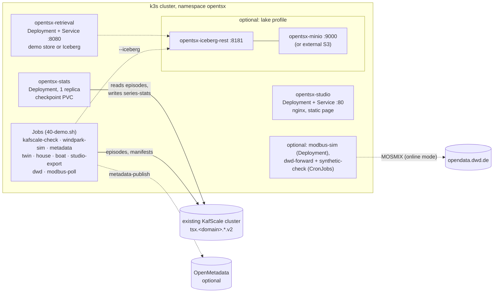

# DevOps guide: OpenTSx on k3s against an existing KafScale cluster

Run the Java services and examples on k3s through an existing KafScale Proxy endpoint.
Use Apache Kafka Broker or KafScale Proxy for producer connections. Never publish directly to KafScale Broker.
For local KafScale, build the [pinned transport bundle](../../opentsx-kafscale-conformance/README.md#build-the-pinned-transport-bundle)
and supply the private MinIO environment values from the [Proxy setup](../../opentsx-kafscale-conformance/README.md#start-the-local-proxy).
The local probe checks these prerequisites before invoking Compose. Read its report for the result of each executed step.

## Pages

| Page | Content |
|------|---------|
| [Operations](operations.md) | the local probe (`60-probe.sh`), service catalogue, environments, monitoring and alerting, logging, backup and restore, update and rollback, secrets, security, runbooks, roles, SLOs, capacity review |
| [Local k3s trial](anleitung-lokale-testinstallation.md) | entry point for the maintained Proxy setup, k3s installation and operations guides |
| [Setup plan](setup-plan.md) | prerequisites, network path to KafScale, step-by-step installation with checks after each step, configuration reference, upgrade, teardown |
| [Sizing plan](sizing-plan.md) | resources per component, storage formula and worked examples (wind farm, house, boat), what still has to be measured |
| [Demos](demos.md) | how to run each example on k3s and what output to expect |
| [Today vs. planned](today-vs-planned.md) | what is deployable now, and where the planned Go Smart Topic processor and MLflow training will slot in |
| [Troubleshooting](troubleshooting.md) | symptoms, causes, fixes |
| [History archive](history-archive.md) | market and weather history: one-off backfill, daily forward archiving of day-ahead data and MOSMIX as k3s CronJobs (`deploy/k3s/history/`) |

## What gets deployed



| Component | Kind | Image | Command (inside the image) |
|-----------|------|-------|---------------------------|
| statistics processor | Deployment (1 replica, `Recreate`) | `opentsx/tools` | `opentsx stats --kafscale … --checkpoint /state/stats.ckpt` |
| retrieval server | Deployment + Service | `opentsx/tools` | `opentsx retrieval-server --port 8080 --demo true` (lake: `--iceberg …`; `RETRIEVAL_SOURCE=kafscale`: `--kafscale …`) |
| Smart Topics Studio | Deployment + Service | `opentsx/studio` | nginx serving the page generated during the image build |
| KafScale check / topic provisioning | Job | `opentsx/tools` | `opentsx kafscale-check --kafscale … --provision true` |
| wind-farm simulator | Job | `opentsx/tools` | `opentsx windpark-sim --scenario … --kafscale …` |
| metadata (dry run / publish) | Job | `opentsx/tools` | `opentsx metadata --scenario … --dry-run /data/om-requests` |
| twin, house, boat | Jobs | `opentsx/tools` | `opentsx twin` / `house` / `boat` |
| Studio export | Job | `opentsx/tools` | `opentsx studio-export /tmp/studio.json` |
| DWD weather demo | Job | `opentsx/tools` | `opentsx dwd mosmix --offline <fixture>` (or `--station <id>`) + `opentsx dwd house …` |
| DWD forecast collector (`DWD_FORWARD=true`) | CronJob, daily | `opentsx/tools` | `opentsx dwd mosmix --station <id> --out /data/dwd/…csv` per station in `DWD_STATIONS` |
| Modbus simulator (`MODBUS_SIM=true`) | Deployment + Service :1502 | `opentsx/tools` | `opentsx modbus simulate --map example --port 1502 --bind 0.0.0.0` |
| Modbus poller | Job | `opentsx/tools` | `opentsx modbus poll --map … --host … --out episodes --file /data/modbus/…jsonl` |
| synthetic check (`MONITORING=true`) | CronJob, every 10 min | `opentsx/tools` | `kafscale-check`, checkpoint age, disk usage |
| Iceberg REST catalog, MinIO | Deployments (lake profile) | `apache/iceberg-rest-fixture:1.9.2`, `quay.io/minio/minio` | — |

KafScale itself is **not** deployed: the guide assumes an existing cluster (for a local one, see
[Proxy setup](../../opentsx-kafscale-conformance/README.md#start-the-local-proxy) and [Getting started](../user-manual/02-getting-started.md)).

## Quick start

To try everything on one machine (docker + k3s), one command does all steps below and writes a report:

```bash
deploy/k3s/60-probe.sh --local-kafscale                    # KafScale via compose, build, deploy, all demos -> probe-report-<time>.md
deploy/k3s/60-probe.sh --dry-run --local-kafscale          # the plan and a configuration check, nothing changed
```

Step by step:

```bash
deploy/k3s/00-prereqs.sh                                   # tools, cluster, KafScale reachable?
deploy/k3s/10-build.sh                                     # mvn install, stage jars, build opentsx/tools + opentsx/studio
deploy/k3s/11-import-images.sh                             # docker save | sudo k3s ctr images import -
deploy/k3s/20-configure.sh KAFSCALE_BOOTSTRAP=192.168.1.50:9092   # your Proxy, reachable from the pods
deploy/k3s/30-deploy.sh                                    # kubectl apply -k deploy/k3s/overlays/local
deploy/k3s/40-demo.sh kafscale-check                       # from inside the cluster, incl. advertised addresses
deploy/k3s/40-demo.sh all                                  # every example, with output
deploy/k3s/40-demo.sh studio                               # http://localhost:8088
deploy/k3s/40-demo.sh dwd                                  # DWD MOSMIX (offline fixture) -> CSV + house twin
deploy/k3s/40-demo.sh modbus                               # Modbus poller against the simulator (MODBUS_SIM=true)
deploy/k3s/50-status.sh                                    # state at a glance
deploy/k3s/70-backup.sh --quiesce                          # checkpoint, data, catalog, MinIO, config -> ./opentsx-backup-<time>/
deploy/k3s/90-teardown.sh                                  # remove everything (KafScale topics stay)
```

Every script has `--help`, is idempotent and stops with a clear message when something is missing.

## Files

| Path | Content |
|------|---------|
| `deploy/k3s/00-prereqs.sh` … `90-teardown.sh` | the scripts, sharing `deploy/k3s/lib.sh` |
| `deploy/k3s/60-probe.sh` | local trial run with PASS/FAIL report ([operations](operations.md#try-it-locally-first-the-probe)) |
| `deploy/k3s/70-backup.sh`, `71-restore.sh` | backup and restore of the PVCs and the configuration ([operations](operations.md#backup-and-restore)) |
| `deploy/k3s/env.example` | every configuration key with its default; `20-configure.sh` writes the git-ignored `deploy/k3s/.env` |
| `deploy/k3s/base/` | kustomize base: ConfigMap, PVCs, stats, retrieval, studio |
| `deploy/k3s/jobs/` | the demo Jobs (rendered and started by `40-demo.sh`) |
| `deploy/k3s/components/` | optional parts: `hostnetwork`, `lake`, `lake-minio`, `lake-jobs`, `ingress`, `modbus-sim`, `dwd-forward`, `monitoring` |
| `deploy/k3s/overlays/local/` | rendered by `20-configure.sh`, git-ignored (namespace, config, Secret, images, components) |
| `deploy/docker/opentsx-tools.Dockerfile` | one JRE image with all v2 commands (`eclipse-temurin:21.0.8_9-jre-noble`) |
| `deploy/docker/studio.Dockerfile` | Studio page generated in the build, served by `nginxinc/nginx-unprivileged:1.27.4-alpine` |
| `deploy/docker/stage.sh` | stages the image context: every runtime jar once (Maven layout) + exact classpath per module |
| `deploy/docker/opentsx-entrypoint.sh` | the image's `opentsx` command (counterpart of `bin/opentsx`) |
| `deploy/docker/src/…/KafScaleCheck.java` | deployment helper: bootstrap + advertised brokers + topic record counts, optional provisioning |

## Design decisions

| Decision | Choice | Why |
|----------|--------|-----|
| Images | Staged JARs | Native accounts; target copies need no emulation. |
| Studio | page generated **during the image build** (multi-stage: StudioExport → `build_studio.py` → nginx) | immutable and versioned with the code; no ReadWriteMany volume between a Job and nginx (k3s' local-path volumes are node-local). The `studio-export` Job proves the export also runs in the cluster |
| KafScale access | `direct` (default), `hostnetwork` or `service` | KafScale clients connect to the **advertised** Proxy address after the bootstrap; a Service can only alias the bootstrap. See [setup plan, step 3](setup-plan.md#step-3-network-path-to-kafscale) |
| Statistics processor | exactly one replica, `Recreate`, checkpoint on a PVC | manual partition assignment and checkpoint file (KafScale consumer groups are unreliable) |
| Topic provisioning | `kafscale-check --provision true` or the first `windpark-sim` run (`TopicLayout.provision`) | no separate CLI existed; the helper reuses `TopicLayout` so partitions and configs are identical |
| Configuration | `KEY=VALUE` → `.env` → rendered kustomize overlay | no secrets in Git; one place to change; the overlay can be inspected with `kubectl kustomize` |

## Related

* [Operations](../user-manual/12-operations.md) (configuration, state and restarts, security notes),
  [Appendix A: CLI](../user-manual/appendix-a-cli.md), [Appendix B: REST](../user-manual/appendix-b-rest.md).
* [Vector and DAG rules](../datamodel-2026/VECTOR-AND-DAG-SPEC.md): DAG document, vector measuring points and the vector processor.
* [KafScale constraints](../../opentsx-kafka-v2/README.md) and the measured storage cost.
