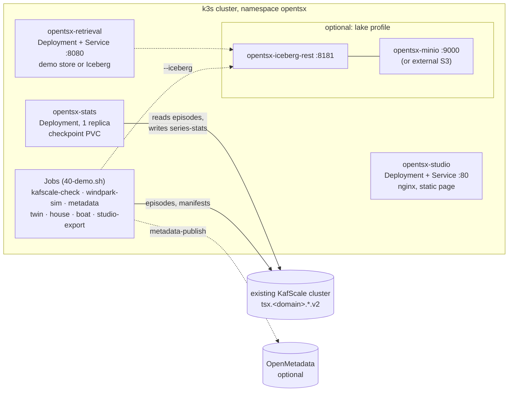

# DevOps guide: OpenTSx on k3s against an existing KafScale cluster

> **Kurzfassung (Deutsch).** Dieser Leitfaden zeigt, wie OpenTSx lokal in einem **k3s-Cluster** gegen ein
> **bestehendes KafScale-Cluster** läuft. Die Skripte liegen in [`deploy/k3s/`](../../deploy/k3s/), die Images in
> [`deploy/docker/`](../../deploy/docker/). Reihenfolge: `00-prereqs.sh` → `10-build.sh` → `11-import-images.sh` →
> `20-configure.sh KAFSCALE_BOOTSTRAP=<host:port>` → `30-deploy.sh` → `40-demo.sh all`. Danach laufen
> Statistik-Prozessor, Retrieval-Server und Smart Topics Studio dauerhaft; Windpark-Simulator, die drei
> Zwillings-Szenarien (H2-Kette, Haus, Boot), Studio-Export und der OpenMetadata-Export laufen als Jobs.
> Lauffähig ist heute der Java-Stand; der Go-Smart-Topic-Prozessor mit YAML-DAG und MLflow aus Konzept 11 ist geplant
> und fügt sich später als weiteres Deployment ein ([heute und geplant](today-vs-planned.md)).
> Der [Sizing-Plan](sizing-plan.md) rechnet Speicher und Ressourcen je Szenario vor (z. B. 50 Anlagen × 100 Kanäle
> × 1 Hz ≈ 0,94 GB/Tag auf S3 bei gemessenen 2,18 B/Wert). Wichtigste Stolperfalle: Die **advertised address** des
> KafScale-Brokers muss aus den Pods erreichbar sein – `40-demo.sh kafscale-check` prüft genau das.

## Pages

| Page | Content |
|------|---------|
| [Anleitung lokale Testinstallation](anleitung-lokale-testinstallation.md) (German, printable) | one Linux machine: local KafScale via docker compose + k3s, step by step with expected output, checklist, troubleshooting, plan B without a cluster |
| [Setup plan](setup-plan.md) | prerequisites, network path to KafScale, step-by-step installation with checks after each step, configuration reference, upgrade, teardown |
| [Sizing plan](sizing-plan.md) | resources per component, storage formula and worked examples (wind farm, house, boat), what still has to be measured |
| [Demos](demos.md) | how to run each example on k3s and what output to expect |
| [Today vs. planned](today-vs-planned.md) | what is deployable now, and where the Go Smart Topic processor, DAG and MLflow (concept 11) will slot in |
| [Troubleshooting](troubleshooting.md) | symptoms, causes, fixes |
| [History archive](history-archive.md) | market and weather history: one-off backfill, daily forward archiving of day-ahead data and MOSMIX as k3s CronJobs (`deploy/k3s/history/`) |

## What gets deployed



| Component | Kind | Image | Command (inside the image) |
|-----------|------|-------|---------------------------|
| statistics processor | Deployment (1 replica, `Recreate`) | `opentsx/tools` | `opentsx stats --kafscale … --checkpoint /state/stats.ckpt` |
| retrieval server | Deployment + Service | `opentsx/tools` | `opentsx retrieval-server --port 8080 --demo true` (lake: `--iceberg …`) |
| Smart Topics Studio | Deployment + Service | `opentsx/studio` | nginx serving the page generated during the image build |
| KafScale check / topic provisioning | Job | `opentsx/tools` | `opentsx kafscale-check --kafscale … --provision true` |
| wind-farm simulator | Job | `opentsx/tools` | `opentsx windpark-sim --scenario … --kafscale …` |
| metadata (dry run / publish) | Job | `opentsx/tools` | `opentsx metadata --scenario … --dry-run /data/om-requests` |
| twin, house, boat | Jobs | `opentsx/tools` | `opentsx twin` / `house` / `boat` |
| Studio export | Job | `opentsx/tools` | `opentsx studio-export /tmp/studio.json` |
| Iceberg REST catalog, MinIO | Deployments (lake profile) | `apache/iceberg-rest-fixture:1.9.2`, `quay.io/minio/minio` | — |

KafScale itself is **not** deployed: the guide assumes an existing cluster (for a local one, see
`docker-compose.kafscale.yml` and [Getting started](../user-manual/02-getting-started.md)).

## Quick start

```bash
deploy/k3s/00-prereqs.sh                                   # tools, cluster, KafScale reachable?
deploy/k3s/10-build.sh                                     # mvn install, stage jars, build opentsx/tools + opentsx/studio
deploy/k3s/11-import-images.sh                             # docker save | sudo k3s ctr images import -
deploy/k3s/20-configure.sh KAFSCALE_BOOTSTRAP=192.168.1.50:9092   # your broker, reachable from the pods
deploy/k3s/30-deploy.sh                                    # kubectl apply -k deploy/k3s/overlays/local
deploy/k3s/40-demo.sh kafscale-check                       # from inside the cluster, incl. advertised addresses
deploy/k3s/40-demo.sh all                                  # every example, with output
deploy/k3s/40-demo.sh studio                               # http://localhost:8088
deploy/k3s/50-status.sh                                    # state at a glance
deploy/k3s/90-teardown.sh                                  # remove everything (KafScale topics stay)
```

Every script has `--help`, is idempotent and stops with a clear message when something is missing.

## Files

| Path | Content |
|------|---------|
| `deploy/k3s/00-prereqs.sh` … `90-teardown.sh` | the scripts, sharing `deploy/k3s/lib.sh` |
| `deploy/k3s/env.example` | every configuration key with its default; `20-configure.sh` writes the git-ignored `deploy/k3s/.env` |
| `deploy/k3s/base/` | kustomize base: ConfigMap, PVCs, stats, retrieval, studio |
| `deploy/k3s/jobs/` | the demo Jobs (rendered and started by `40-demo.sh`) |
| `deploy/k3s/components/` | optional parts: `hostnetwork`, `lake`, `lake-minio`, `lake-jobs`, `ingress` |
| `deploy/k3s/overlays/local/` | rendered by `20-configure.sh`, git-ignored (namespace, config, Secret, images, components) |
| `deploy/docker/opentsx-tools.Dockerfile` | one JRE image with all v2 commands (`eclipse-temurin:21.0.8_9-jre-noble`) |
| `deploy/docker/studio.Dockerfile` | Studio page generated in the build, served by `nginxinc/nginx-unprivileged:1.27.4-alpine` |
| `deploy/docker/stage.sh` | stages the image context: every runtime jar once (Maven layout) + exact classpath per module |
| `deploy/docker/opentsx-entrypoint.sh` | the image's `opentsx` command (counterpart of `bin/opentsx`) |
| `deploy/docker/src/…/KafScaleCheck.java` | deployment helper: bootstrap + advertised brokers + topic record counts, optional provisioning |

## Design decisions

| Decision | Choice | Why |
|----------|--------|-----|
| Images | one tools image for all Java commands, built from **pre-staged jars** (no Maven in Docker) | one artifact to version and import; the build reuses the local Maven repository and works offline; no `RUN` step, so an arm64 image for a Raspberry Pi needs no emulation |
| Studio | page generated **during the image build** (multi-stage: StudioExport → `build_studio.py` → nginx) | immutable and versioned with the code; no ReadWriteMany volume between a Job and nginx (k3s' local-path volumes are node-local). The `studio-export` Job proves the export also runs in the cluster |
| KafScale access | `direct` (default), `hostnetwork` or `service` | KafScale clients connect to the **advertised** broker address after the bootstrap; a Service can only alias the bootstrap. See [setup plan, step 3](setup-plan.md#step-3-network-path-to-kafscale) |
| Statistics processor | exactly one replica, `Recreate`, checkpoint on a PVC | manual partition assignment and checkpoint file (KafScale consumer groups are unreliable) |
| Topic provisioning | `kafscale-check --provision true` or the first `windpark-sim` run (`TopicLayout.provision`) | no separate CLI existed; the helper reuses `TopicLayout` so partitions and configs are identical |
| Configuration | `KEY=VALUE` → `.env` → rendered kustomize overlay | no secrets in Git; one place to change; the overlay can be inspected with `kubectl kustomize` |

## Related

* [Operations](../user-manual/12-operations.md) (configuration, state and restarts, security notes),
  [Appendix A: CLI](../user-manual/appendix-a-cli.md), [Appendix B: REST](../user-manual/appendix-b-rest.md).
* [Concept 11: Smart Topic processor and DevOps](../datamodel-2026/11-SMART-TOPIC-PROZESSOR-DEVOPS.md) (German).
* [KafScale constraints](../../opentsx-kafka-v2/README.md) and the measured storage cost.
