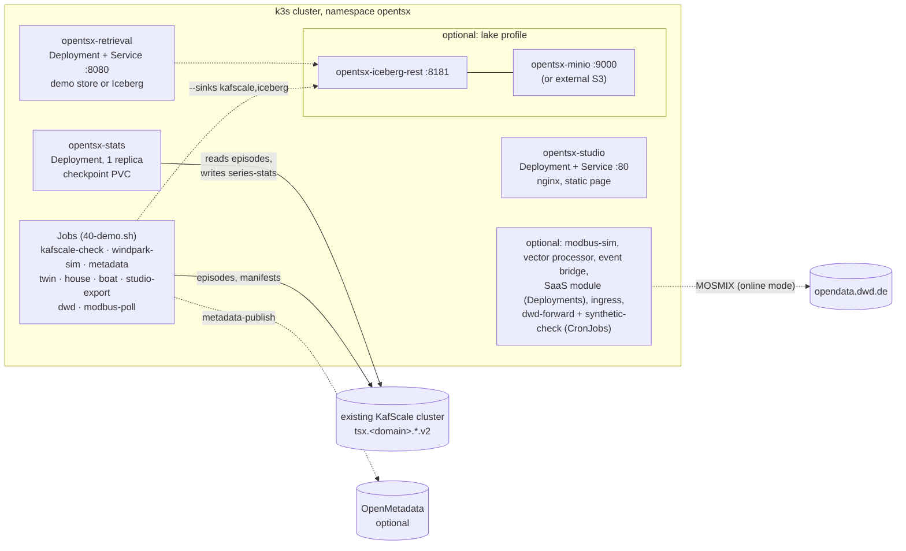

# DevOps guide: OpenTSx on k3s against an existing KafScale cluster

> This guide shows how OpenTSx runs locally in a **k3s cluster** against an **existing KafScale cluster**. The scripts
> are in [`deploy/k3s/`](../../deploy/k3s/), the images in [`deploy/docker/`](../../deploy/docker/). The order is
> `00-prereqs.sh` → `10-build.sh` → `11-import-images.sh` → `20-configure.sh KAFSCALE_BOOTSTRAP=<host:port>` →
> `30-deploy.sh` → `40-demo.sh all`. After that the statistics processor, the retrieval server and Smart Topics Studio
> run permanently; the wind farm simulator, the three twin scenarios (H2 chain, house, boat), the Studio export, DWD
> weather, the Modbus poller and the OpenMetadata export run as Jobs. A Modbus simulator and CronJobs for the daily
> MOSMIX download and a synthetic check are optional.
> What runs today is the Java code, including the DAGs `opentsx.dag.v1` and `opentsx.dag.v2` that the vector processor
> runs; the Go Smart Topic processor and MLflow of concept 11 are planned ([today vs. planned](today-vs-planned.md)).
> The [sizing plan](sizing-plan.md) works out storage and resources per scenario (for example 50 turbines × 100
> channels × 1 Hz ≈ 0.94 GB/day on S3 at a measured 2.18 B/value). The most common trap: the **advertised address** of
> the KafScale broker must be reachable from the pods; `40-demo.sh kafscale-check` checks exactly that.
> **Probe locally in one step:** `deploy/k3s/60-probe.sh --local-kafscale` starts KafScale with Docker Compose and the
> LAN IP as advertised address, builds, installs, runs all examples (including DWD weather offline and the Modbus
> simulator with the poller) and writes a PASS/FAIL report `probe-report-<UTC time>.md`; `--dry-run` only shows the
> plan. The **[operations concept](operations.md)** describes the service catalogue, environments, monitoring, backup
> (`70-backup.sh`, `71-restore.sh`), updates, secrets, security, runbooks, roles and SLOs.

## Pages

| Page | Content |
|------|---------|
| [Operations](operations.md) | the local probe (`60-probe.sh`), service catalogue, environments, monitoring and alerting, logging, backup and restore, update and rollback, secrets, security, runbooks, roles, SLOs, capacity review |
| [Local test installation](anleitung-lokale-testinstallation.md) (printable) | one Linux machine: local KafScale via docker compose + k3s, step by step with expected output, checklist, troubleshooting, plan B without a cluster |
| [Setup plan](setup-plan.md) | prerequisites, network path to KafScale, step-by-step installation with checks after each step, configuration reference, upgrade, teardown |
| [Sizing plan](sizing-plan.md) | resources per component, storage formula and worked examples (wind farm, house, boat), what still has to be measured |
| [Demos](demos.md) | how to run each example on k3s and what output to expect |
| [Today vs. planned](today-vs-planned.md) | what is deployable now, including the DAGs `opentsx.dag.v1` and `opentsx.dag.v2` on the vector processor, and where the Go Smart Topic processor and MLflow (concept 11) fit in |
| [Troubleshooting](troubleshooting.md) | symptoms, causes, fixes |
| [History archive](history-archive.md) | market and weather history: one-off backfill, daily forward archiving of day-ahead data and MOSMIX as k3s CronJobs (`deploy/k3s/history/`) |

## What gets deployed



| Component | Kind | Image | Command (inside the image) |
|-----------|------|-------|---------------------------|
| statistics processor | Deployment (1 replica, `Recreate`) | `opentsx/tools` | `opentsx stats --checkpoint /state/stats.ckpt` (bootstrap, domain, windows and lateness as variables) |
| retrieval server | Deployment + Service | `opentsx/tools` | `opentsx retrieval-server --port 8080 --source demo` (lake: `--source iceberg`; `RETRIEVAL_SOURCE=kafscale`: `--source kafscale`) |
| Smart Topics Studio | Deployment + Service | `opentsx/studio` | nginx serving the page generated during the image build |
| KafScale check / topic provisioning | Job | `opentsx/tools` | `opentsx kafscale-check` (provisions through `OPENTSX_KAFSCALE_PROVISION=true`) |
| wind-farm simulator | Job | `opentsx/tools` | `opentsx windpark-sim --index /data/<domain>-index.tsv --ground-truth /data/ground-truth.json` |
| metadata (dry run / publish) | Job | `opentsx/tools` | `opentsx metadata --dry-run /data/om-requests` |
| twin, house, boat | Jobs | `opentsx/tools` | `opentsx twin` / `house` / `boat` |
| Studio export | Job | `opentsx/tools` | `opentsx studio-export /tmp/studio.json` |
| DWD weather demo | Job | `opentsx/tools` | `opentsx dwd mosmix` + `opentsx dwd house` with `OPENTSX_DWD_OFFLINE=<fixture>` (`dwd-online`: `OPENTSX_DWD_STATION=<id>`) |
| DWD forecast collector (`DWD_FORWARD=true`) | CronJob, daily | `opentsx/tools` | `opentsx dwd mosmix --station <id> --out /data/dwd/…csv` per station in `DWD_STATIONS` |
| Modbus simulator (`MODBUS_SIM=true`) | Deployment + Service :1502 | `opentsx/tools` | `opentsx modbus simulate --map example --port 1502 --bind 0.0.0.0` |
| Modbus poller | Job | `opentsx/tools` | `opentsx modbus poll --file /data/modbus/…jsonl` (map, host, port, count, interval, output and episode length as variables) |
| synthetic check (`MONITORING=true`) | CronJob, every 10 min | `opentsx/tools` | `kafscale-check`, checkpoint age, disk usage |
| vector processor (`VECTOR_PROCESSOR=true`) | Deployment (1 replica, `Recreate`), state PVC | `opentsx/tools` | `opentsx vectors --state /state` (bootstrap and domain as variables) |
| event bridge (`EVENT_BRIDGE=true`) | Deployment + NodePort Service :30312 | `opentsx/tools` | `opentsx twin-live bridge --port 8090` |
| SaaS module (`SAAS=true`) | Deployments frontend, backend and database; frontend NodePort Service :30311 | `opentsx/saas-frontend`, `opentsx/saas-backend`, `postgres:15.12-alpine` | nginx with the web workbench at `/workbench`; `uvicorn app.main:app --host 0.0.0.0 --port 8000` |
| ingress (`INGRESS=true`) | Ingress (k3s Traefik) | none | Studio at `/`, the retrieval API at `/v1` |
| Iceberg REST catalog, MinIO | Deployments (lake profile) | `apache/iceberg-rest-fixture:1.9.2`, `quay.io/minio/minio` | the command of the image; MinIO with `server /data --console-address :9001` |

The commands read the ConfigMap values as variables of the configuration registry, not as flags. The DWD forecast
collector is the exception: the registry has no key for a list of stations, so its script runs
`opentsx dwd mosmix --station <id>` once for each station of `DWD_STATIONS`. See
[Pass settings to a command](../../deploy/k3s/README.md#pass-settings-to-a-command).

KafScale itself is **not** deployed: the guide assumes an existing cluster (for a local one, see
`docker-compose.kafscale.yml` and [Getting started](../user-manual/02-getting-started.md)).

## Quick start

To try everything on one machine (docker + k3s), one command does all steps below and writes a report:

```bash
deploy/k3s/60-probe.sh --local-kafscale                    # KafScale via compose, build, deploy, all demos -> probe-report-<time>.md
deploy/k3s/60-probe.sh --dry-run --local-kafscale          # the plan and a configuration check, nothing changed
```

Step by step:

```bash
deploy/k3s/00-prereqs.sh                                   # tools, cluster, KafScale reachable?
deploy/k3s/10-build.sh                                     # mvn install, stage jars, build opentsx/tools + opentsx/studio
deploy/k3s/11-import-images.sh                             # docker save | sudo k3s ctr images import -
deploy/k3s/20-configure.sh KAFSCALE_BOOTSTRAP=192.168.1.50:9092   # your broker, reachable from the pods
deploy/k3s/30-deploy.sh                                    # kubectl apply -k deploy/k3s/overlays/local
deploy/k3s/40-demo.sh kafscale-check                       # from inside the cluster, incl. advertised addresses
deploy/k3s/40-demo.sh all                                  # every example, with output
deploy/k3s/40-demo.sh studio                               # http://localhost:8088
deploy/k3s/40-demo.sh dwd                                  # DWD MOSMIX (offline fixture) -> CSV + house twin
deploy/k3s/40-demo.sh modbus                               # Modbus poller against the simulator (MODBUS_SIM=true)
deploy/k3s/50-status.sh                                    # state at a glance
deploy/k3s/70-backup.sh --quiesce                          # checkpoint, data, catalog, MinIO, config -> ./opentsx-backup-<time>/
deploy/k3s/90-teardown.sh                                  # remove everything (KafScale topics stay)
```

Every script has `--help`, is idempotent and stops with a clear message when something is missing.

## Files

| Path | Content |
|------|---------|
| `deploy/k3s/00-prereqs.sh` … `90-teardown.sh` | the scripts, sharing `deploy/k3s/lib.sh` |
| `deploy/k3s/60-probe.sh` | local trial run with PASS/FAIL report ([operations](operations.md#try-it-locally-first-the-probe)) |
| `deploy/k3s/70-backup.sh`, `71-restore.sh` | backup and restore of the PVCs and the configuration ([operations](operations.md#backup-and-restore)) |
| `deploy/k3s/env.example` | every configuration key with its default; `20-configure.sh` writes the git-ignored `deploy/k3s/.env` |
| `deploy/k3s/base/` | kustomize base: ConfigMap, PVCs, stats, retrieval, studio |
| `deploy/k3s/jobs/` | the demo Jobs (rendered and started by `40-demo.sh`) |
| `deploy/k3s/components/` | optional parts, each switched on by a key of `20-configure.sh`: `hostnetwork` (`KAFSCALE_NETWORK=hostnetwork`), `lake` and `lake-jobs` (`LAKE=true`), `lake-minio` (`LAKE=true` with `LAKE_MINIO=true`), `retrieval-kafscale` (`RETRIEVAL_SOURCE=kafscale`), `modbus-sim` (`MODBUS_SIM=true`), `dwd-forward` (`DWD_FORWARD=true`), `monitoring` (`MONITORING=true`), `saas` (`SAAS=true`), `event-bridge` (`EVENT_BRIDGE=true`), `vector-processor` (`VECTOR_PROCESSOR=true`), `ingress` (`INGRESS=true`) |
| `deploy/k3s/overlays/local/` | rendered by `20-configure.sh`, git-ignored (namespace, config, Secret, images, components) |
| `deploy/docker/opentsx-tools.Dockerfile` | one JRE image with all v2 commands (`eclipse-temurin:21.0.8_9-jre-noble`) |
| `deploy/docker/studio.Dockerfile` | Studio page generated in the build, served by `nginxinc/nginx-unprivileged:1.27.4-alpine` |
| `deploy/docker/saas-backend.Dockerfile` | SaaS backend (FastAPI) on `python:3.12.9-slim-bookworm`, port 8000; `10-build.sh` builds it with `SAAS=true` |
| `deploy/docker/saas-frontend.Dockerfile` | SaaS frontend with the web workbench, built on `node:22.14.0-alpine3.21` and served by `nginxinc/nginx-unprivileged:1.27.4-alpine`, port 8080; `10-build.sh` builds it with `SAAS=true` |
| `deploy/docker/notebook-content.Dockerfile` | the Python package `opentsx` and the notebooks for a Jupyter notebook; it runs nothing, an init container copies its files ([`deploy/k3s/notebook/`](../../deploy/k3s/notebook/README.md)); built with `docker build`, not by `10-build.sh` |
| `deploy/docker/stage.sh` | stages the image context: every runtime jar once (Maven layout) + exact classpath per module; `--out DIR` refuses a directory that is not empty and has no `.opentsx-stage` marker (exit 2), a failed Maven step shows Maven's output and exits 1 |
| `deploy/docker/opentsx-entrypoint.sh` | the image's `opentsx` command (counterpart of `bin/opentsx`) |
| `deploy/docker/src/…/KafScaleCheck.java` | deployment helper: bootstrap + advertised brokers + topic record counts, optional provisioning |

## Design decisions

| Decision | Choice | Why |
|----------|--------|-----|
| Images | one tools image for all Java commands, built from **pre-staged jars** (no Maven in Docker) | one artifact to version and import; the build reuses the local Maven repository and works offline; no `RUN` step, so an arm64 image for a Raspberry Pi needs no emulation |
| Studio | page generated **during the image build** (multi-stage: StudioExport → `build_studio.py` → nginx) | immutable and versioned with the code; no ReadWriteMany volume between a Job and nginx (k3s' local-path volumes are node-local). The `studio-export` Job proves the export also runs in the cluster |
| KafScale access | `direct` (default), `hostnetwork` or `service` | KafScale clients connect to the **advertised** broker address after the bootstrap; a Service can only alias the bootstrap. See [setup plan, step 3](setup-plan.md#step-3-network-path-to-kafscale) |
| Statistics processor | exactly one replica, `Recreate`, checkpoint on a PVC | manual partition assignment and checkpoint file (KafScale consumer groups are unreliable) |
| Topic provisioning | `kafscale-check --provision true` or the first `windpark-sim` run (`TopicLayout.provision`) | no separate CLI existed; the helper reuses `TopicLayout` so partitions and configs are identical |
| Configuration | `KEY=VALUE` → `.env` → rendered kustomize overlay | no secrets in Git; one place to change; the overlay can be inspected with `kubectl kustomize` |

## Related

* [Operations](../user-manual/12-operations.md) (configuration, state and restarts, security notes),
  [Appendix A: CLI](../user-manual/appendix-a-cli.md), [Appendix B: REST](../user-manual/appendix-b-rest.md).
* [Concept 11: Smart Topic processor and DevOps](../datamodel-2026/11-SMART-TOPIC-PROZESSOR-DEVOPS.md).
* [KafScale constraints](../../opentsx-kafka-v2/README.md) and the measured storage cost.
