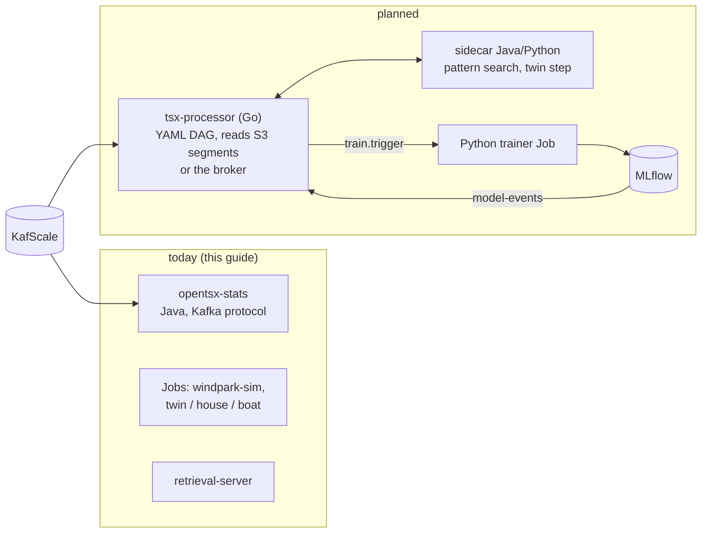

# Today vs. planned

What this guide deploys exists and runs today (Java 17/21 CLIs and services). The stream architecture of
[concept 11](../datamodel-2026/11-SMART-TOPIC-PROZESSOR-DEVOPS.md) (German) — a Go Smart Topic processor executing a
declarative YAML DAG, training via MLflow — is a **proposal**; none of it is implemented yet. This page separates the
two and shows where the planned parts will fit into the same namespace, images and scripts.

## Deployable now

| Component | Status | On k3s |
|-----------|--------|--------|
| episode storage and replay on KafScale (`opentsx-kafka-v2`) | done | library inside the tools image; topics via `kafscale-check --provision` or `windpark-sim` |
| wind-farm simulator (`windpark-sim`) | done | Job |
| statistics processor (`stats`) | done | Deployment, one replica, checkpoint PVC |
| OpenMetadata publisher (`metadata`) | done | Job (dry run or publish) |
| retrieval server (`retrieval-server`) | done | Deployment + Service, demo store or Iceberg |
| Iceberg store (`opentsx-store-iceberg`) | done | lake profile; S3 needs `--with-s3` |
| digital twin, variant T (one process): H2 chain, house, boat | proof of concept (P9) | Jobs |
| Smart Topics Studio | static prototype | nginx Deployment, page built into the image |
| Python package / client | done | outside the cluster (port-forward); not containerized |

## Planned (concept 11) and how it slots in

| Planned part | Concept 11 | How it will be deployed here |
|--------------|-----------|------------------------------|
| **Go TSx processor** (stream core: decode, episodes, stats/sketches, DQ, segmentation, resampling, scoring) | §1, §4, §6 | a third image (distroless, ~20 MB, amd64 + arm64) and a Deployment per DAG; one lease per partition (etcd in the cluster) or a checkpoint file at the edge. Takes the place of `opentsx-stats` once the operator conformance tests (Go ↔ Java, shared test vectors) pass — the Java processor stays as reference |
| **DAG spec `opentsx.dag.v1`** | §5 | a ConfigMap per DAG, rendered by `20-configure.sh` from `deploy/k3s/dags/*.yaml`; CI validates it (schema, operator availability, replay test) |
| **Java/Python sidecar** (pattern search, twin step, causal analysis) | §1.5 | second container in the processor pod (`opentsx/tools` image), gRPC on localhost |
| **training** (`train.trigger` → Python job → MLflow → `model-events`) | §1.4, §8 | a Job/CronJob template for the trainer and an MLflow Deployment (lake profile, artifacts on S3) |
| **shadow rollout** (`…shadow` topics, comparison job, switch by config) | §8 | a second processor Deployment with the new DAG version; switch = ConfigMap change + `30-deploy.sh --restart` |
| **edge** (boat Pi, lab PC) | §9 | the Go binary as a systemd unit with a checkpoint file, or the same Deployment on a single-node k3s with `hostnetwork` and local storage |
| **observability** (Prometheus metrics: lag per partition, time per operator, DQ rates) | §8 | ServiceMonitor/annotations once the processor exposes `/metrics`; the Java tools expose none today |

Until then, the KafScale constraints apply as implemented in the Java tools: no consumer groups (manual assignment),
no transactions or idempotent producer (deduplication by `episodeId`), no compaction (append-only, latest record
wins), no timestamp seek (episode index).

## What was tested

| Check | Result |
|-------|--------|
| `bash -n` and `shellcheck` on all scripts | clean (also in CI) |
| `kubectl kustomize` for the overlay variants (default, hostnetwork, service by IP/DNS, lake + MinIO + ingress + storage class, lake with external S3 + OpenMetadata) | renders; `kubeconform -strict` against the Kubernetes 1.31 schemas: 122 resources valid |
| `hadolint` on both Dockerfiles | clean |
| image content (staged tree) | `twin`, `house` (+ `--calibrate` with the template), `boat` (+ `--data … --calibrate`), `studio-export`, `metadata --dry-run`, `windpark-sim` → Iceberg (JDBC/SQLite, file warehouse), `retrieval-server` (demo store and that warehouse) run through the image's entrypoint; Studio page from the staged context is byte-identical to the committed one |
| scripts against a stub `kubectl` | `30-deploy.sh`, `40-demo.sh` (Job rendering, extra arguments, wait logic), `50-status.sh`, `90-teardown.sh` run through |
| **not run** | `docker build` (no container daemon available when this was written), any `kubectl apply` on a real k3s, the KafScale path (`kafscale-check` success path, `windpark-sim --kafscale`, `stats`) against a live broker, the S3/REST-catalog lake path |

The first real run on k3s should therefore start with `40-demo.sh kafscale-check` and `40-demo.sh twin` (no
infrastructure needed), then `windpark-sim` and `stats`.
