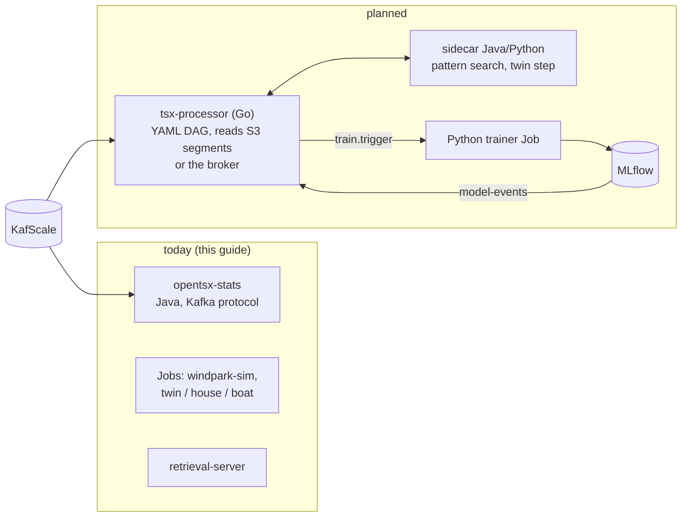

# Today vs. planned

What this guide deploys exists and runs today (Java 17/21 CLIs and services). The stream architecture of
[concept 11](../datamodel-2026/11-SMART-TOPIC-PROZESSOR-DEVOPS.md) (German) — a Go Smart Topic processor executing a
declarative YAML DAG, training via MLflow — is a **proposal**; none of it is implemented yet. This page separates the
two and shows where the planned parts will fit into the same namespace, images and scripts.

## Deployable now

| Component | Status | On k3s |
|-----------|--------|--------|
| episode storage and replay on KafScale (`opentsx-kafka-v2`) | done | library inside the tools image; topics via `kafscale-check --provision` or `windpark-sim` |
| wind-farm simulator (`windpark-sim`) | done | Job |
| statistics processor (`stats`) | done | Deployment, one replica, checkpoint PVC |
| OpenMetadata publisher (`metadata`) | done | Job (dry run or publish) |
| retrieval server (`retrieval-server`) | done | Deployment + Service; demo store, Iceberg, or the episodes topic on KafScale (`RETRIEVAL_SOURCE=kafscale`) |
| Iceberg store (`opentsx-store-iceberg`) | done | lake profile; S3 needs `--with-s3` |
| digital twin, variant T (one process): H2 chain, house, boat | proof of concept (P9) | Jobs |
| Modbus poller (`modbus poll`, `opentsx-modbus`) | tested against the in-JVM simulator; real meter and register sheets pending | Job `opentsx-modbus-poll` (`40-demo.sh modbus`): episodes as JSON lines on the data PVC; simulator `opentsx-modbus-sim` as Deployment + Service :1502 (component `modbus-sim`, `MODBUS_SIM=true`). **Planned:** a long-running poller Deployment close to the converter (the `hostnetwork` pattern if the meter network is only reachable from the node) and a KafScale sink - neither exists yet |
| DWD collector (`dwd`, `opentsx-dwd`) | MOSMIX/CDC parsers tested on fixtures and live downloads | Job `opentsx-dwd` (`40-demo.sh dwd`: offline fixture in the image; `dwd-online`: live) and CronJob `opentsx-dwd-forward` (component `dwd-forward`, `DWD_FORWARD=true`): daily MOSMIX per station as CSV on the data PVC. **Planned:** KafScale producer to `tsx.weather.*`, observations (CDC) on a schedule |
| operations | — | `60-probe.sh` (local trial run with report), `70-backup.sh` / `71-restore.sh`, component `monitoring` (synthetic check CronJob + alert rules for kube-state-metrics), [operations concept](operations.md) |
| Smart Topics Studio | static prototype | nginx Deployment, page built into the image |
| Python package / client | done | outside the cluster (port-forward); not containerized |

## Planned (concept 11) and how it slots in

| Planned part | Concept 11 | How it will be deployed here |
|--------------|-----------|------------------------------|
| **Go TSx processor** (stream core: decode, episodes, stats/sketches, DQ, segmentation, resampling, scoring) | §1, §4, §6 | a third image (distroless, ~20 MB, amd64 + arm64) and a Deployment per DAG; one lease per partition (etcd in the cluster) or a checkpoint file at the edge. Takes the place of `opentsx-stats` once the operator conformance tests (Go ↔ Java, shared test vectors) pass — the Java processor stays as reference |
| **DAG spec `opentsx.dag.v1`** | §5 | a ConfigMap per DAG, rendered by `20-configure.sh` from `deploy/k3s/dags/*.yaml`; CI validates it (schema, operator availability, replay test) |
| **Java/Python sidecar** (pattern search, twin step, causal analysis) | §1.5 | second container in the processor pod (`opentsx/tools` image), gRPC on localhost |
| **training** (`train.trigger` → Python job → MLflow → `model-events`) | §1.4, §8 | a Job/CronJob template for the trainer and an MLflow Deployment (lake profile, artifacts on S3) |
| **shadow rollout** (`…shadow` topics, comparison job, switch by config) | §8 | a second processor Deployment with the new DAG version; switch = ConfigMap change + `30-deploy.sh --restart` |
| **edge** (boat Pi, lab PC) | §9 | the Go binary as a systemd unit with a checkpoint file, or the same Deployment on a single-node k3s with `hostnetwork` and local storage |
| **observability** (Prometheus metrics: lag per partition, time per operator, DQ rates) | §8 | ServiceMonitor/annotations once the processor exposes `/metrics`; the Java tools expose none today. Until then: synthetic check and kube-state-metrics rules ([operations](operations.md#monitoring-and-alerting)) |

Until then, the KafScale constraints apply as implemented in the Java tools: no consumer groups (manual assignment),
no transactions or idempotent producer (deduplication by `episodeId`), no compaction (append-only, latest record
wins), no timestamp seek (episode index).

## What was tested

| Check | Result |
|-------|--------|
| `bash -n` and `shellcheck` on all scripts (incl. `60-probe.sh`, `70-backup.sh`, `71-restore.sh`) | clean (also in CI) |
| `kubectl kustomize` for the overlay variants (default, hostnetwork, service by IP/DNS, lake + MinIO + ingress + storage class, lake with external S3 + OpenMetadata) | renders; `kubeconform -strict` against the Kubernetes 1.31 schemas: 122 resources valid |
| `hadolint` on both Dockerfiles | clean |
| image content (staged tree) | `twin`, `house` (+ `--calibrate` with the template), `boat` (+ `--data … --calibrate`), `studio-export`, `metadata --dry-run`, `windpark-sim` → Iceberg (JDBC/SQLite, file warehouse), `retrieval-server` (demo store and that warehouse) run through the image's entrypoint; Studio page from the staged context is byte-identical to the committed one |
| scripts against a stub `kubectl` | `30-deploy.sh`, `40-demo.sh` (Job rendering, extra arguments, wait logic, `dwd`, `dwd-online`, `dwd-forward`, `modbus`), `50-status.sh`, `90-teardown.sh` run through; `60-probe.sh` full run (PASS path, a failing Job, a failing deploy with SKIP of the rest, report with hints), `70-backup.sh` / `71-restore.sh` (archives, MANIFEST, checksum check, confirmation) |
| `60-probe.sh --dry-run` | plan and configuration check (temporary overlay), with and without `--local-kafscale`; `docker compose config` validates `docker-compose.kafscale.yml`; also in CI |
| new manifests (components `modbus-sim`, `dwd-forward`, `monitoring`; Jobs `dwd`, `modbus-poll`; backup helper pod) | render in 6 configurations; `kubeconform -strict` (Kubernetes 1.31): 145 resources valid (also in CI) |
| Job/CronJob shell scripts (`dwd`, `dwd-forward`, `modbus-poll`, `synthetic-check`) | run with `/bin/sh` (dash, as in the image) through the image entrypoint on the staged tree: DWD offline and online (live opendata.dwd.de), Modbus poller against `modbus simulate`, failure exit codes |
| KafScale path through the image entrypoint | against a live KafScale broker (built from source, in-memory S3), from the host: `kafscale-check --provision`, `windpark-sim --kafscale`, `stats` → 4,300 `series-stats` records, checkpoint written; `00-prereqs.sh` KafScale checks pass |
| **not run** | `docker build` and `docker compose up` (no container daemon could be started here), any `kubectl apply` on a real k3s (so: pods, port-forwards, PVC mounts, the CronJobs, NetworkPolicies), KafScale **as seen from a pod** (advertised address through the pod network), the S3/REST-catalog lake path, the alert rules in a running Prometheus |

The first real run on k3s is `deploy/k3s/60-probe.sh --local-kafscale` (or `--skip-build` with imported images); its
report shows step by step which of the untested parts work.
