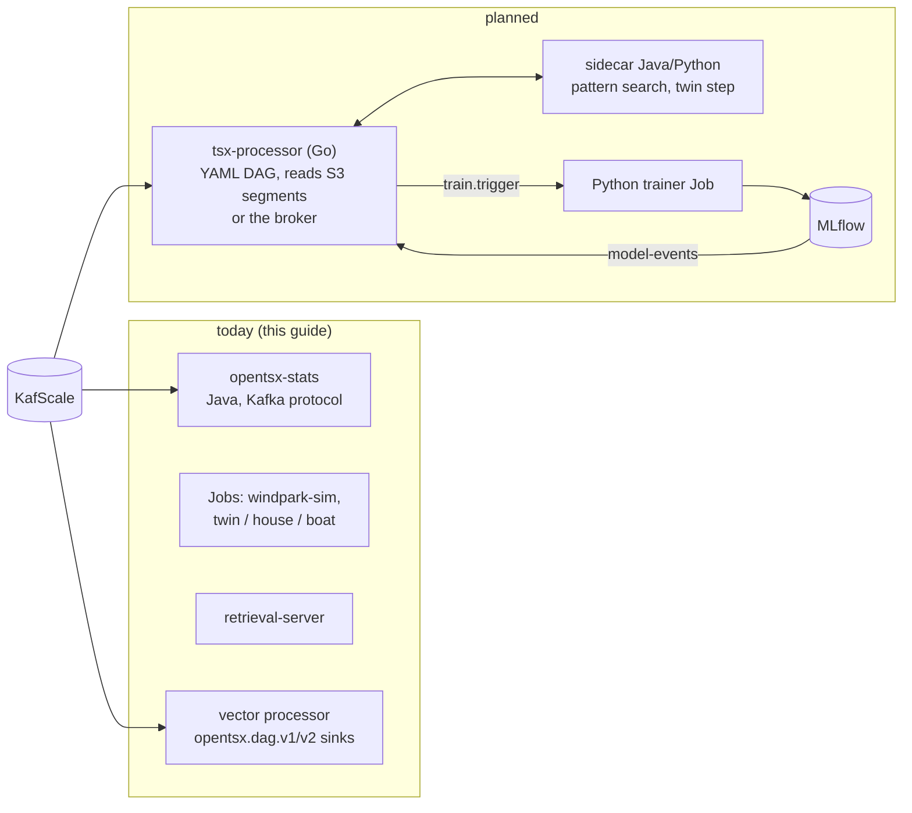

# Today vs. planned

What this guide deploys exists and runs today (Java 17/21 CLIs and services). That includes the declarative DAG
`opentsx.dag.v1` of [concept 11](../datamodel-2026/11-SMART-TOPIC-PROZESSOR-DEVOPS.md) (German) and its extension
`opentsx.dag.v2` with series sinks ([concept 14](../datamodel-2026/14-ENGINEERING-FLOW.md), German, section 6.3): the
vector processor runs their vector and series sinks. The rest of concept 11, a Go Smart Topic processor and training
via MLflow, is a **proposal** and not implemented. This page separates the two and shows where the planned parts fit
into the same namespace, images and scripts.

## Deployable now

| Component | Status | On k3s |
|-----------|--------|--------|
| episode storage and replay on KafScale (`opentsx-kafka-v2`) | done | library inside the tools image; topics via `kafscale-check --provision` or `windpark-sim` |
| wind-farm simulator (`windpark-sim`) | done | Job |
| statistics processor (`stats`) | done | Deployment, one replica, checkpoint PVC |
| OpenMetadata publisher (`metadata`) | done | Job (dry run or publish) |
| retrieval server (`retrieval-server`) | done | Deployment + Service; demo store, Iceberg, or the episodes topic on KafScale (`RETRIEVAL_SOURCE=kafscale`) |
| DAG `opentsx.dag.v1` and `opentsx.dag.v2` | done for vector sinks (`opentsx.dag.v1`: `align.vector` on source series) and series sinks (`opentsx.dag.v2`: a single-input chain of `dq.checks`, `convert.unit`, `resample`, `model.wind-shear`, `model.power-curve`, `feature.lag`, `feature.rolling`) | `POST /v1/dags/deploy` of the retrieval server (`RETRIEVAL_DAG_RUNS=true`) or `opentsx vectors deploy` checks a DAG and writes it to the control topic `tsx.<domain>.dags.v1` ([Kafka native streaming](kafka-native-streaming.md#publish-an-executable-graph)) |
| vector processor (`vectors`) | done | Deployment `opentsx-vectors`, one replica, checkpoint PVC `opentsx-vectors-state` (component `vector-processor`, `VECTOR_PROCESSOR=true`); runs the deployed DAGs and reports per sink to `tsx.<domain>.dag-status.v1` |
| Iceberg store (`opentsx-store-iceberg`) | done | lake profile; S3 needs `--with-s3` |
| digital twin, variant T (one process): H2 chain, house, boat | proof of concept (P9) | Jobs |
| Modbus poller (`modbus poll`, `opentsx-modbus`) | tested against the in-JVM simulator; real meter and register sheets pending | Job `opentsx-modbus-poll` (`40-demo.sh modbus`): episodes as JSON lines on the data PVC; simulator `opentsx-modbus-sim` as Deployment + Service :1502 (component `modbus-sim`, `MODBUS_SIM=true`). **Planned:** a long-running poller Deployment close to the converter (the `hostnetwork` pattern if the meter network is only reachable from the node) and a KafScale sink; neither exists yet |
| DWD collector (`dwd`, `opentsx-dwd`) | MOSMIX/CDC parsers tested on fixtures and live downloads | Job `opentsx-dwd` (`40-demo.sh dwd`: offline fixture in the image; `dwd-online`: live) and CronJob `opentsx-dwd-forward` (component `dwd-forward`, `DWD_FORWARD=true`): daily MOSMIX per station as CSV on the data PVC. **Planned:** KafScale producer to `tsx.weather.*`, observations (CDC) on a schedule |
| operations | done | `60-probe.sh` (local trial run with report), `70-backup.sh` / `71-restore.sh`, component `monitoring` (synthetic check CronJob + alert rules for kube-state-metrics), [operations concept](operations.md) |
| Smart Topics Studio | static prototype | nginx Deployment, page built into the image |
| Python package / client | done | outside the cluster (port-forward); not containerized |

## Planned (concept 11) and how it slots in

| Planned part | Concept 11 | How it will be deployed here |
|--------------|-----------|------------------------------|
| **Go TSx processor** (stream core: decode, episodes, stats/sketches, DQ, segmentation, resampling, scoring) | §1, §4, §6 | a third image (distroless, ~20 MB, amd64 + arm64) and a Deployment per DAG; one lease per partition (etcd in the cluster) or a checkpoint file at the edge. Takes the place of `opentsx-stats` once the operator conformance tests (Go ↔ Java, shared test vectors) pass; the Java processor stays as reference |
| **Java/Python sidecar** (pattern search, twin step, causal analysis) | §1.5 | second container in the processor pod (`opentsx/tools` image), gRPC on localhost |
| **training** (`train.trigger` → Python job → MLflow → `model-events`) | §1.4, §8 | a Job/CronJob template for the trainer and an MLflow Deployment (lake profile, artifacts on S3) |
| **shadow rollout** (`…shadow` topics, comparison job, switch by config) | §8 | a second processor Deployment with the new DAG version; switch = ConfigMap change + `30-deploy.sh --restart` |
| **edge** (boat Pi, lab PC) | §9 | the Go binary as a systemd unit with a checkpoint file, or the same Deployment on a single-node k3s with `hostnetwork` and local storage |
| **observability** (Prometheus metrics: lag per partition, time per operator, DQ rates) | §8 | ServiceMonitor/annotations once the processor exposes `/metrics`; the Java tools expose none today. Until then: synthetic check and kube-state-metrics rules ([operations](operations.md#monitoring-and-alerting)) |

Until then, the KafScale constraints apply as implemented in the Java tools: no consumer groups (manual assignment),
no transactions or idempotent producer (deduplication by `episodeId`), no compaction (append-only, latest record
wins), no timestamp seek (episode index).

## What CI checks

The job `k3s scripts and manifests` (`deploy` in [`.github/workflows/ci.yml`](../../.github/workflows/ci.yml)) runs on
every pull request and on every push to `master`. It runs:

* `bash -n` and `shellcheck -x -P SCRIPTDIR` on the scripts of `deploy/k3s/`, `deploy/k3s/test/` and `deploy/docker/`.
* the shell tests in `deploy/k3s/test/` for `00-prereqs.sh`, `20-configure.sh`, `40-demo.sh`, `60-probe.sh`,
  `70-backup.sh` and `90-teardown.sh`, with stand-ins for `kubectl` and the other tools they call instead of a
  cluster.
* `kubectl kustomize` of the overlay and the Jobs for four `20-configure.sh` configurations and of the history archive,
  then `kubeconform -strict` against the Kubernetes 1.31 schemas on everything rendered.
* a load of every rendered `opentsx/tools` container through `OpenTsxConf` (environment, arguments and
  `OPENTSX_EXTRA_ARGS`).
* `60-probe.sh --dry-run`, with and without `--local-kafscale`.

[`.github/workflows/image.yml`](../../.github/workflows/image.yml) builds the `opentsx-tools` image on every pull
request that changes `deploy/docker/` and pushes it on a release tag.

CI does not run `kubectl apply` on a real k3s (pods, port-forwards, PVC mounts, the CronJobs, NetworkPolicies),
KafScale as seen from a pod (advertised address through the pod network), the S3 or REST-catalog lake path, or the
alert rules in a running Prometheus.

The first real run on k3s is `deploy/k3s/60-probe.sh --local-kafscale` (or `--skip-build` with imported images); its
report shows step by step which of the untested parts work.
