<!-- Generated by org.opentsx.retrieval.system.OperatorCatalog from systems/processors/*.yaml. Do not edit. -->
# 17. Time-series operators

This chapter lists every time-series operator of OpenTSx 3.0.1: what it computes, where it runs, and an example whose chart shows the result.

Each operator is described once, in `systems/processors/<id>.yaml` (schema `opentsx.processor.v1`, [`opentsx.processor.v1.schema.json`](../datamodel-2026/schemas/opentsx.processor.v1.schema.json)). This page is generated from those files. A test fails when a runtime marked `available` names code that does not exist, or when this page is out of date.

## Read the status

| Runtime | Where the operator runs |
|---|---|
| workbench | the browser workbench (`opentsx-saas-frontend/src/workbench`) |
| java | the Java API of a module; `available (2.x)` means `opentsx-core` on the 2.x `TimeSeriesObject` model ([chapter 11](11-classic-analytics.md)) |
| python | the `opentsx` Python package ([chapter 10](10-python.md)) |
| processor | continuously on a topic: a node of an `opentsx.dag.v1` DAG (`bin/opentsx vectors`), or its own processor such as `bin/opentsx stats` |
| go | the Go Smart Topic processor. It is not built. |

`available` means the code exists in that runtime. Every operator with a runtime other than 2.x Java has an example test that runs in every build. 2.x code often has no test; its note says so. `planned` means a plan file names it. `none` means it does not exist and is not planned. An empty cell means the runtime is not described.

## Find an operator

| Operator | Id | Section | workbench | java | python | processor | go |
|---|---|---|---|---|---|---|---|
| [Long-range correlated noise](#long-range-correlated-noise-genlrc) | `gen.lrc` | Generate series | none | available (2.x) | none | none | none |
| [Mean-reverting noise](#mean-reverting-noise-genou) | `gen.ou` | Generate series | none | available | none | planned | none |
| [Cycle with noise](#cycle-with-noise-gensine) | `gen.sine` | Generate series | none | available | none | planned | none |
| [Wind park simulator](#wind-park-simulator-genwindpark) | `gen.windpark` | Generate series | none | available | none | none | none |
| [Data-quality checks on statistics](#data-quality-checks-on-statistics-dqstats) | `dq.stats` | Check data quality | none | available | none | none | planned |
| [Pair coverage](#pair-coverage-paircoverage) | `pair.coverage` | Check data quality | available | none | none | planned | none |
| [Unit conversion](#unit-conversion-convertunit) | `convert.unit` | Clean and convert values | available | none | none | available | none |
| [Plausible range](#plausible-range-dqplausible-range) | `dq.plausible-range` | Clean and convert values | available | none | none | available | planned |
| Gap filling | `fill.gaps` | Clean and convert values | none | planned | none | none | none |
| [Select series by label](#select-series-by-label-select) | `select` | Clean and convert values | available | none | available | none | none |
| [Align to vector](#align-to-vector-alignvector) | `align.vector` | Resample and align series | available | available | none | available | planned |
| [Resample](#resample-resample) | `resample` | Resample and align series | available | available | available | available | planned |
| Change-point segments | `segment.changepoint` | Cut series into episodes | none | planned | none | none | none |
| [Segments around extrema](#segments-around-extrema-segmentextremum) | `segment.extremum` | Cut series into episodes | none | available | available | none | planned |
| [Fixed-count segments](#fixed-count-segments-segmentfixed-count) | `segment.fixed-count` | Cut series into episodes | none | available | available | none | planned |
| [Fixed-duration segments](#fixed-duration-segments-segmentfixed-duration) | `segment.fixed-duration` | Cut series into episodes | none | available | available | none | planned |
| [Segments between thresholds](#segments-between-thresholds-segmentthreshold) | `segment.threshold` | Cut series into episodes | available | available | available | none | planned |
| Sum over series | `agg.sum` | Compute statistics | none | none | none | planned | none |
| [Sigma band](#sigma-band-sigmaband) | `sigma.band` | Compute statistics | available | available (2.x) | none | none | none |
| [Episode summary](#episode-summary-statssummary) | `stats.summary` | Compute statistics | none | available | available | none | planned |
| [Window statistics](#window-statistics-statswelford-ddsketch) | `stats.welford-ddsketch` | Compute statistics | available | available | available | available | planned |
| [Remove a polynomial trend](#remove-a-polynomial-trend-detrend) | `detrend` | Transform values | none | none | available | none | none |
| [Difference to the previous sample](#difference-to-the-previous-sample-diff) | `diff` | Transform values | available | available (2.x) | available | none | none |
| [Natural logarithm](#natural-logarithm-log) | `log` | Transform values | available | available (2.x) | none | none | none |
| [Log return](#log-return-logreturn) | `logreturn` | Transform values | available | available (2.x) | none | none | none |
| [Divide by the maximum](#divide-by-the-maximum-normmax) | `norm.max` | Transform values | available | available (2.x) | none | none | none |
| [Standardize (z-score)](#standardize-z-score-normzscore) | `norm.zscore` | Transform values | available | available (2.x) | available | none | none |
| [Profile (cumulated deviations)](#profile-cumulated-deviations-profile) | `profile` | Transform values | available | available (2.x) | none | none | none |
| [Moving average](#moving-average-smoothmovavg) | `smooth.movavg` | Transform values | available | none | none | none | none |
| [Cumulative distribution](#cumulative-distribution-cdf) | `cdf` | Describe value distributions | available | available (2.x) | none | none | none |
| [Shannon entropy in a sliding window](#shannon-entropy-in-a-sliding-window-entropywindow) | `entropy.window` | Describe value distributions | available | available (2.x) | none | none | none |
| [Histogram per series](#histogram-per-series-histogram) | `histogram` | Describe value distributions | available | available (2.x) | none | none | none |
| [Histogram per time slice](#histogram-per-time-slice-histogramcrosscut) | `histogram.crosscut` | Describe value distributions | available | none | none | none | none |
| [Shapiro-Wilk normality test](#shapiro-wilk-normality-test-normalityshapiro-wilk) | `normality.shapiro-wilk` | Describe value distributions | none | available (2.x) | none | none | none |
| Coherence | `coherence` | Compute spectra | none | planned | none | none | none |
| [Amplitude spectrum](#amplitude-spectrum-fft) | `fft` | Compute spectra | available | available (2.x) | none | none | none |
| Welch power spectral density | `psd.welch` | Compute spectra | none | planned | none | none | none |
| [Detrended fluctuation analysis](#detrended-fluctuation-analysis-dfa) | `dfa` | Measure fluctuations and extreme events | available | available (2.x) | available | none |  |
| [Multifractal detrended fluctuation analysis](#multifractal-detrended-fluctuation-analysis-mfdfa) | `mfdfa` | Measure fluctuations and extreme events | none | available (2.x) | available | none | none |
| [Return interval statistics](#return-interval-statistics-ris) | `ris` | Measure fluctuations and extreme events | none | available (2.x) | available | none | none |
| [Autocorrelation](#autocorrelation-acf) | `acf` | Measure dependency between series | available | none | none | none | none |
| Event coincidence analysis | `eca` | Measure dependency between series | none | planned | none | planned | none |
| [Event synchronization](#event-synchronization-es) | `es` | Measure dependency between series | none | available (2.x) | available | none | none |
| [Granger causality test](#granger-causality-test-granger) | `granger` | Measure dependency between series | none | available (2.x) | none | none | none |
| Hawkes-Granger causality | `hawkes.granger` | Measure dependency between series | none | none | planned | none | none |
| Cross-correlation link strengths | `link.cc` | Measure dependency between series | planned | planned | none | planned | none |
| [Event synchronisation per pair window](#event-synchronisation-per-pair-window-paires) | `pair.es` | Measure dependency between series | available | planned | none | planned | none |
| Granger test per pair window | `pair.granger` | Measure dependency between series | planned | none | none | planned | none |
| Scatter fit per pair window | `pair.scatter` | Measure dependency between series | planned | none | none | planned | none |
| [Cross-correlation per pair window](#cross-correlation-per-pair-window-pairxcorr) | `pair.xcorr` | Measure dependency between series | available | planned | none | planned | none |
| Multivariate transfer entropy | `te.multivariate` | Measure dependency between series | none | none | planned | none | none |
| [Shuffle values](#shuffle-values-shuffle) | `shuffle` | Test against surrogates | available | available (2.x) | none | none | none |
| Iterative amplitude adjusted Fourier surrogate | `surrogate.iaaft` | Test against surrogates | none | planned | none | none | none |
| [Inter-event interval shuffle](#inter-event-interval-shuffle-surrogateisi-shuffle) | `surrogate.isi-shuffle` | Test against surrogates | none | none | available | none | none |
| [Phase-randomized surrogate](#phase-randomized-surrogate-surrogatephase) | `surrogate.phase` | Test against surrogates | none | available (2.x) | none | none | none |
| Matrix profile | `pattern.matrix-profile` | Search for patterns | none | planned | none | none | none |
| [Subsequence search](#subsequence-search-patternsearch) | `pattern.search` | Search for patterns | none | available | available | none | none |
| [Similar episodes](#similar-episodes-patternsimilar-episodes) | `pattern.similar-episodes` | Search for patterns | none | available | available | none | none |
| Calendar features | `feature.calendar` | Build model features | none | planned | planned | planned | none |
| Feature extraction per episode | `feature.extract` | Build model features | none | planned | none | none | none |
| [Lag feature](#lag-feature-featurelag) | `feature.lag` | Build model features | available | none | none | available | none |
| [Rolling-window feature](#rolling-window-feature-featurerolling) | `feature.rolling` | Build model features | available | none | none | available | none |
| [Power curve](#power-curve-modelpower-curve) | `model.power-curve` | Apply physical models | available | available | none | available | none |
| [Wind shear](#wind-shear-modelwind-shear) | `model.wind-shear` | Apply physical models | available | none | none | available | none |
| [Power curve, method of bins](#power-curve-method-of-bins-powercurvebins) | `powercurve.bins` | Apply physical models | none | available | none | none | none |
| Smart Topic forecast | `forecast` | Forecast | none | planned | planned | planned | planned |
| AR, MA, ARMA, ARIMA, SARIMA and CARIMA | `forecast.arima` | Forecast | none | none | none | none | none |
| Residual, anomaly score and drift | `metric.anomaly-score` | Forecast | none | none | none | planned | none |
| Graph metrics as time series | `graph.metrics` | Reconstruct networks | none | planned | none | none | none |
| Network reconstruction | `network.reconstruct` | Reconstruct networks | planned | planned | none | none | none |
| PCMCI+ causal discovery | `pcmci` | Reconstruct networks | none | none | planned | none | none |

## Run the examples and draw the charts

You need the build from [chapter 2](02-getting-started.md), Node.js for the workbench examples, and matplotlib for the charts (`python -m pip install -e "python-package[viz]"`). The order matters.

```bash
export OPENTSX_EXAMPLES_DIR=/tmp/opentsx-examples
mkdir -p "$OPENTSX_EXAMPLES_DIR"
mvn -B -ntp test -Dtest='*ExampleTest' -Dsurefire.failIfNoSpecifiedTests=false
(cd python-package && python -m pytest -q tests/examples)
(cd opentsx-saas-frontend && npx vitest run src/workbench/examples)
python3 tools/operator_charts.py "$OPENTSX_EXAMPLES_DIR"
java -cp "$(bin/opentsx classpath opentsx-retrieval)" org.opentsx.retrieval.system.OperatorCatalog
```

Each example test checks its result in every build. With `OPENTSX_EXAMPLES_DIR` set it also writes the chart data as `<id>.csv`. `tools/operator_charts.py` draws `docs/user-manual/img/operators/<id>.png` from it, and `OperatorCatalog` writes this page.

## Generate series

### Long-range correlated noise (`gen.lrc`)

Draws Gaussian white noise, multiplies its Fourier coefficient at frequency f by f^(−β/2) and transforms back (Fourier filtering). The power spectrum of the result falls as f^(−β), and its DFA exponent is alpha = (1 + β) / 2: β = 0 is white noise, β = 1 is 1/f noise, β below 0 gives anti-correlated values. It gives a series with a known exponent, for example to check DFA.

| Runtime | Status | Entry point | Note |
|---|---|---|---|
| workbench | none |  |  |
| java | available (2.x) | `org.opentsx.generators.LongTermCorrelationSeriesGenerator#getRandomRow` | 2.x model in opentsx-core: getRandomRow(length, beta, new java.util.Random(seed), false, false) draws Gaussian noise from that Random, filters it with TimeSeriesObjectFFT.getModifiedTimeSeries_FourierFiltered for every beta, 0 included, and divides it by its standard deviation, so the result has variance 1; the mean is 0 for a length that is a power of two. The same seed gives the same series, and no RNGWrapper.init() is needed. getRandomRow(length, beta, false, false) draws from one Random with the seed 1 that all such calls share. LongTermCorrelationSeriesGeneratorTest checks the variance, the seed and beta 0. |
| python | none |  |  |
| processor | none |  |  |
| go | none |  |  |

| Port | Direction | Type | Description |
|---|---|---|---|
| `out` | out | series |  |

| Parameter | Type | Default | Range | Description |
|---|---|---|---|---|
| `beta` | number | required |  | Exponent β of the power spectrum f^(−β). |
| `length` | integer | required | 2 ..  | Number of values; a power of two avoids zero padding before the FFT. |
| `seed` | integer | required |  | Seed of the random generator. |

Semantics: deterministic; origin SYNTHETIC.

See: [more](../../docs/user-manual/11-classic-analytics.md), [description](../../systems/processors/gen.lrc.yaml).

Literature: H. A. Makse, S. Havlin, M. Schwartz, H. E. Stanley, Method for generating long-range correlations for large systems, Phys. Rev. E 53, 5445 (1996).

### Mean-reverting noise (`gen.ou`)

Values wander around a mean and are pulled back to it. A stand-in for a price or a demand where no data is connected. Each step takes back the share reversion of the distance to the mean and adds noise: x(k+1) − mean = (1 − reversion) (x(k) − mean) + sigma · ε. The lag-1 autocorrelation is 1 − reversion and the standard deviation sigma / sqrt(1 − (1 − reversion)²). A demo generator: it knows nothing of the rest of the system. Values are clipped to the plausible range of the signal.

| Runtime | Status | Entry point | Note |
|---|---|---|---|
| workbench | none |  | The page Signals presets the parameters from the expectation of the signal and asks the server to generate. |
| java | available | `org.opentsx.retrieval.generate.Generators#values` | One run over a period, started by a person; no continuous operation. The value of a step does not depend on where the run began: the recursion starts early enough that earlier steps fade below a thousandth. Generators.episodes(target, params, interval, from, to) cuts the run into episodes of 600 samples; POST /v1/systems/<id>/generate writes them to tsx.<domain>.synthetic.v2. A parameter that is no number is refused with its name, and so is a reversion outside 0.00007 to 1. |
| python | none |  |  |
| processor | planned |  | A generator that keeps writing is part of step E2 of the decision circle. |
| go | none |  |  |

| Port | Direction | Type | Description |
|---|---|---|---|
| `out` | out | series |  |

| Parameter | Type | Default | Range | Description |
|---|---|---|---|---|
| `mean` | number | required |  | Level the values return to |
| `reversion` | number | `0.1` | 7.0E-5 .. 1 | Share of the distance to the mean taken back per step. Below 0.00007 the start of a run would not fade within the warm-up and the request is refused. |
| `sigma` | number | required | 0 ..  | Standard deviation of one step |
| `min` | number |  |  | Preset from `expect.min`. |
| `max` | number |  |  | Preset from `expect.max`. |
| `every` | duration | required |  | Preset from `expect.interval`. |
| `unit` | string |  |  | Preset from `expect.unit`. |

Semantics: needs one window of input per output value; deterministic; origin SYNTHETIC.

See: [more](../../docs/user-manual/16-engineering-method.md#step-4-connect-the-sources), [description](../../systems/processors/gen.ou.yaml), plan: [E2](../../docs/datamodel-2026/15-ENTSCHEIDUNGSKREIS.md).

Literature: G. E. Uhlenbeck, L. S. Ornstein, On the theory of the Brownian motion, Phys. Rev. 36, 823 (1930).

Example, from [`opentsx-retrieval/src/test/java/org/opentsx/retrieval/examples/OuGeneratorExampleTest.java`](../../opentsx-retrieval/src/test/java/org/opentsx/retrieval/examples/OuGeneratorExampleTest.java):

```java
JsonNode params = new ObjectMapper().readTree("{\"mean\": 62.8, \"sigma\": 9.0, \"reversion\": 0.08}");
Generators.Target target = new Generators.Target("h2-chain", "market.price_eur_mwh",
        "h2-chain.market.price_eur_mwh", "EUR/MWh", "gen.ou", 7, null, null, "example");
List<Episode> episodes = Generators.episodes(target, params, 15 * MINUTE, from, from + 5000 * 15 * MINUTE);
double[] values = episodes.stream().flatMapToDouble(e -> Arrays.stream(Episodes.values(e))).toArray();
```

Run it:

```bash
mvn -B -ntp -pl opentsx-retrieval test -Dtest=OuGeneratorExampleTest
```

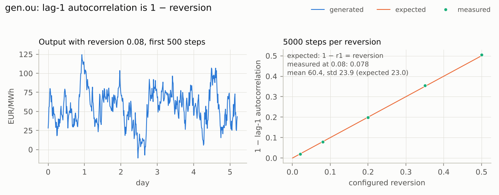

With reversion 0.08 the measured 1 − lag-1 autocorrelation is 0.078, and for reversions from 0.02 to 0.5 it lies on the line 1 − r1 = reversion; the mean is 60.4 against 62.8 and the standard deviation 23.9 against the expected 23.0.

### Cycle with noise (`gen.sine`)

A sine around a mean with a period, for example a day, plus noise. A stand-in for a quantity with a daily shape. The value at time t since the epoch is mean + amplitude · sin(2π (t mod period / period + phase)) + sigma · ε, with ε standard normal per step of the seed. A demo generator: it knows nothing of the rest of the system. Values are clipped to the plausible range of the signal.

| Runtime | Status | Entry point | Note |
|---|---|---|---|
| workbench | none |  | The page Signals presets the parameters from the expectation of the signal and asks the server to generate. |
| java | available | `org.opentsx.retrieval.generate.Generators#values` | One run over a period, started by a person; no continuous operation. Generators.episodes(target, params, interval, from, to) cuts the run into episodes of 600 samples; POST /v1/systems/<id>/generate writes them to tsx.<domain>.synthetic.v2. A parameter that is no number is refused with its name. |
| python | none |  |  |
| processor | planned |  | A generator that keeps writing is part of step E2 of the decision circle. |
| go | none |  |  |

| Port | Direction | Type | Description |
|---|---|---|---|
| `out` | out | series |  |

| Parameter | Type | Default | Range | Description |
|---|---|---|---|---|
| `mean` | number | required |  |  |
| `amplitude` | number | required | 0 ..  |  |
| `period` | duration | `P1D` |  |  |
| `phase` | number | `0` |  | Share of the period the cycle is shifted by |
| `sigma` | number | `0` | 0 ..  | Standard deviation of the noise |
| `min` | number |  |  | Preset from `expect.min`. |
| `max` | number |  |  | Preset from `expect.max`. |
| `every` | duration | required |  | Preset from `expect.interval`. |
| `unit` | string |  |  | Preset from `expect.unit`. |

Semantics: needs one point of input per output value; deterministic; origin SYNTHETIC.

See: [more](../../docs/user-manual/16-engineering-method.md#step-4-connect-the-sources), [description](../../systems/processors/gen.sine.yaml), plan: [E2](../../docs/datamodel-2026/15-ENTSCHEIDUNGSKREIS.md).

Example, from [`opentsx-retrieval/src/test/java/org/opentsx/retrieval/examples/SineGeneratorExampleTest.java`](../../opentsx-retrieval/src/test/java/org/opentsx/retrieval/examples/SineGeneratorExampleTest.java):

```java
JsonNode params = new ObjectMapper().readTree(
        "{\"mean\": 60, \"amplitude\": 30, \"period\": \"P1D\", \"phase\": 0.5, \"sigma\": 3}");
Generators.Target target = new Generators.Target("h2-chain", "offtake.demand_kgph",
        "h2-chain.offtake.demand_kgph", "kg/h", "gen.sine", 1, 0.0, 120.0, "example");
List<Episode> episodes = Generators.episodes(target, params, 15 * MINUTE, from, from + 7 * DAY);
double[] values = episodes.stream().flatMapToDouble(e -> Arrays.stream(Episodes.values(e))).toArray();
```

Run it:

```bash
mvn -B -ntp -pl opentsx-retrieval test -Dtest=SineGeneratorExampleTest
```

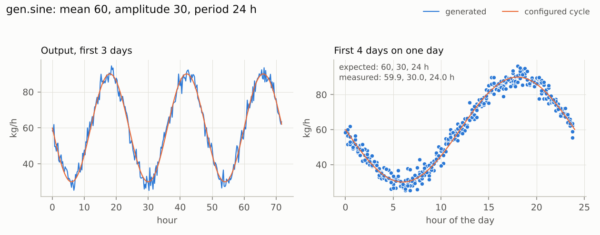

Seven days of gen.sine with mean 60, amplitude 30, period P1D and noise 3 have the measured mean 59.9, amplitude 30.0 and period 24.0 h, as configured.

### Wind park simulator (`gen.windpark`)

Simulates a wind park from a scenario: free wind from hourly Weibull means with turbulence and a daily cycle, wakes after Jensen, and per turbine the power curve, rotor and generator speed, pitch, yaw, generator temperature and operating state. It writes one REGULAR episode per turbine, channel and episodeDuration, and injects operations and sensor faults, each returned as ground truth and written as a label on the episodes it overlaps. The same scenario and seed give the same episodes, ids included.

| Runtime | Status | Entry point | Note |
|---|---|---|---|
| workbench | none |  |  |
| java | available | `org.opentsx.windpark.sim.WindparkSimulator#run` | bin/opentsx windpark-sim --scenario <file.yaml> runs a scenario once and writes the episodes to KafScale as one sealed bucket (--kafscale), to Iceberg (--iceberg) or to both; --ground-truth <file.json> writes the ground truth. --sinks auto\|kafscale\|iceberg chooses the sinks; auto follows --kafscale and --iceberg on the command line. The wind defaults apply when the scenario has no wind block. |
| python | none |  |  |
| processor | none |  | A run covers the duration of the scenario and ends; nothing writes continuously. |
| go | none |  |  |

| Port | Direction | Type | Description |
|---|---|---|---|
| `episodes` | out | series (many) | 10 channels per turbine: wind speed and direction, ambient temperature, nacelle direction, rotor speed, pitch angle, generator speed and temperature, active power, state |
| `ground_truth` | out | events | Per injected event: category (operation or sensor-fault), type, turbine, channel, from, to, params |

| Parameter | Type | Default | Range | Description |
|---|---|---|---|---|
| `seed` | integer |  |  | Seed of all random numbers. |
| `start` | string | required |  | Start instant, aligned to episodeDuration, for example 2026-10-01T00:00:00Z. |
| `duration` | duration | required |  | Simulated time, positive. |
| `sampleInterval` | duration | `PT1S` |  | Time step and sampling interval, positive. |
| `episodeDuration` | duration | `PT10M` |  | Length of one episode, positive. A multiple of sampleInterval. |
| `turbineModel` | enum: GENERIC-3MW, GENERIC-8MW | `GENERIC-3MW` |  | Turbine type of the park (park.turbineModel). |
| `rows` | integer | required | 1 ..  | Rows of the turbine grid (park.rows). |
| `columns` | integer | required | 1 ..  | Turbines per row (park.columns). |
| `spacingRotorDiameters` | number | `5` | 0 ..  | Spacing within a row in rotor diameters. 0 or a missing value takes the default. |
| `rowSpacingRotorDiameters` | number | `7` | 0 ..  | Spacing between rows in rotor diameters. 0 or a missing value takes the default. |
| `wakeDecay` | number | `0.05` | 0 ..  | Wake decay constant of the Jensen model. 0 or a missing value takes the default. |
| `weibullK` | number | `2.0` |  | Shape of the Weibull distribution of hourly mean wind (wind.weibullK). |
| `weibullC` | number | `9.0` |  | Scale of the Weibull distribution of hourly mean wind. Unit: m/s. |
| `turbulenceIntensity` | number | `0.1` |  | Standard deviation of the wind relative to its mean. |
| `meanDirectionDeg` | number | `240` |  | Mean wind direction. Unit: degree. |
| `directionStdDeg` | number | `15` |  | Standard deviation of the wind direction. Unit: degree. |
| `diurnalAmplitude` | number | `0.1` |  | Relative day and night change of the mean wind. |
| `meanTemperatureC` | number | `10` |  | Mean ambient temperature. Unit: degree Celsius. |
| `operations` | list |  |  | CURTAILMENT (limitKw, required, 0 or more), FAULT or MAINTENANCE, each with turbines of the park (empty or * for all), offset and a positive duration. |
| `sensorFaults` | list |  |  | STUCK, DRIFT (ratePerHour, required), OFFSET (magnitude, required), SPIKES (magnitude and probability above 0 and at most 1, required) or GAP, each with turbine, a channel metric of the catalog, offset and a positive duration; a parameter of another type is refused. |

Semantics: deterministic; origin SYNTHETIC.

See: [more](../../docs/user-manual/06-windpark.md#64-simulator-and-scenarios), [description](../../systems/processors/gen.windpark.yaml).

Literature: N. O. Jensen, A note on wind generator interaction, Risø-M-2411, Risø National Laboratory (1983).

Example, from [`opentsx-windpark/src/test/java/org/opentsx/windpark/examples/WindparkSimulatorExampleTest.java`](../../opentsx-windpark/src/test/java/org/opentsx/windpark/examples/WindparkSimulatorExampleTest.java):

```java
Scenario scenario = new Scenario("example", 10, Instant.parse("2026-10-01T00:00:00Z"), Duration.ofHours(6),
        Duration.ofSeconds(1), Duration.ofMinutes(10),
        new Scenario.ParkSpec("p1", "example", 54, 13, "GENERIC-3MW", 1, 1, 5, 7, 0.05), Scenario.WindSpec.DEFAULT, List.of(),
        List.of(new Scenario.SensorFault(Scenario.SensorFaultType.STUCK, "T01", "wind.met.wind_speed",
                Duration.ofHours(2), Duration.ofMinutes(30), null, null, null)));
WindparkSimulator sim = new WindparkSimulator(scenario, ChannelCatalog.standard());
List<Episode> episodes = new ArrayList<>();
sim.run(episodes::add);
List<GroundTruth> truth = sim.groundTruth();
```

Run it:

```bash
mvn -B -ntp -pl opentsx-windpark test -Dtest=WindparkSimulatorExampleTest
```


In a 6-hour scenario the 1-minute means of T01 lie on average 14 kW from the reference power curve; while the injected STUCK fault holds the anemometer at 11.00 m/s from hour 2 to 2.5, the power moves between 549 and 1957 kW, and the ground truth and the episode labels mark exactly that half hour.

## Check data quality

### Data-quality checks on statistics (`dq.stats`)

Evaluates up to five checks on one SeriesStats record, without the raw values. COMPLETENESS is validCount / floor(window / expectedInterval), PLAUSIBLE_RANGE the share of values outside [minPlausible, maxPlausible] estimated from the quantile sketch, FLATLINE the standard deviation over at least flatlineMinCount values, GAPS the gapCount and FRESHNESS the age of lastSeen. Each check gives SUCCESS or FAILED with its value; the parameters say when a check is skipped.

| Runtime | Status | Entry point | Note |
|---|---|---|---|
| workbench | none |  |  |
| java | available | `org.opentsx.stats.DataQuality#evaluate` | Expectation.of(min, max, interval) sets the defaults; withoutFlatline() and withMaxAge(age) change them. A window in which a series has no value has no SeriesStats record, so no check runs on it: the outage shows in GAPS of the window where the values resume, when the engine knows the expected interval, and in COMPLETENESS of a longer window such as PT1H. |
| python | none |  |  |
| processor | none |  | bin/opentsx metadata --kafscale reads the latest statistics once and publishes the results to OpenMetadata. No processor evaluates them continuously. |
| go | planned |  | DQ in the Go stream core of the proposed Go TSx processor. |

| Port | Direction | Type | Description |
|---|---|---|---|
| `in` | in | stats (one) | One SeriesStats record of a window or of GLOBAL |
| `results` | out | events | One Result per evaluated check: check, status SUCCESS, FAILED or ABORTED, value, threshold and message |

| Parameter | Type | Default | Range | Description |
|---|---|---|---|---|
| `minPlausible` | number |  |  | Lower plausible bound. Without both bounds PLAUSIBLE_RANGE is skipped. Preset from `expect.min`. |
| `maxPlausible` | number |  |  | Upper plausible bound. Preset from `expect.max`. |
| `expectedInterval` | duration |  |  | Expected sampling interval. Without it COMPLETENESS is skipped and GAPS runs only when gaps were counted. Preset from `expect.interval`. |
| `minCompleteness` | number | `0.95` | 0 .. 1 | COMPLETENESS fails below this share of the expected values. |
| `maxOutOfRange` | number | `0.001` | 0 .. 1 | PLAUSIBLE_RANGE fails above this share outside the bounds. Without a sketch the share is 1 when min or max lies outside, else 0. |
| `flatlineCheck` | boolean | `true` |  | Run FLATLINE. withoutFlatline() turns it off. |
| `flatlineMinCount` | integer | `60` | 0 ..  | FLATLINE runs only on windows with at least this many valid values. |
| `flatlineEpsilon` | number | `1.0E-9` | 0 ..  | FLATLINE fails when the standard deviation is at most this value. |
| `maxGaps` | integer | `0` | 0 ..  | GAPS fails above this number of gaps. |
| `maxAge` | duration |  |  | FRESHNESS fails when lastSeen is older. Runs only with the current time (evaluate(stats, expectation, now)); a record without lastSeen gives ABORTED. |

Semantics: deterministic.

See: [more](../../docs/user-manual/07-stats-quality.md#73-data-quality-checks), [description](../../systems/processors/dq.stats.yaml), plan: [P7f](../../EVOLUTION/TASK-016-smart-topics.md).

Example, from [`opentsx-stats/src/test/java/org/opentsx/stats/examples/DataQualityExampleTest.java`](../../opentsx-stats/src/test/java/org/opentsx/stats/examples/DataQualityExampleTest.java):

```java
StatsEngine engine = new StatsEngine(StatsEngine.Config.defaults().withWindows(Duration.ofMinutes(10))
        .withExpectedInterval(series -> OptionalLong.of(10_000_000L)));
List<SeriesStats> windows = new ArrayList<>();
for (Observation o : observations) {
    windows.addAll(engine.onObservation(o));
}
windows.addAll(engine.flush());
DataQuality.Expectation expected = DataQuality.Expectation.of(0.0, 40.0, Duration.ofSeconds(10));
List<DataQuality.Result> results = new ArrayList<>();
for (SeriesStats w : windows) {
    if (w.getWindowType().equals("PT10M")) {
        results.addAll(DataQuality.evaluate(w, expected));
    }
}
```

Run it:

```bash
mvn -B -ntp -pl opentsx-stats test -Dtest=DataQualityExampleTest
```


In 2 hours of 10 s wind speed, an anemometer stuck from minute 80 to 90 fails FLATLINE with standard deviation 0 (the other windows have 0.75 or more), and an outage from minute 102 to 108 fails COMPLETENESS with 40 % valid values and GAPS with 1 gap, both in window 100 to 110 only.

### Pair coverage (`pair.coverage`)

Puts series A and B on one clock and gives, for each window of a pair range, the share of clock ticks in which both have a value, coverage = ticks with A and B / ticks in the window, and the number of ticks. Each value is stamped at the window centre. It shows what the other pair methods see: they give a gap where the coverage of a window is below their minCoverage.

| Runtime | Status | Entry point | Note |
|---|---|---|---|
| workbench | available | operator `pair.coverage` | Operator "Pair coverage", tab Multi-variate Analysis. At most 200 pairs per run. The defaults above hold for the operator panel and for a call of apply without them. An emptied, negative or non-numeric every or minCoverage is refused with its name, for example minCoverage: empty value; expected a share from 0 to 1. step is read only when window is a width in seconds and maxAge only when fill is as-of; then such a value is refused too. |
| java | none |  |  |
| python | none |  |  |
| processor | planned |  | TASK-015 phase 3: the pair methods as a stream phase on top of align.vector. |
| go | none |  |  |

| Port | Direction | Type | Description |
|---|---|---|---|
| `a` | in | series (many) | Series A. Without b every pair of its series is compared. |
| `b` | in | series (many) | Series B, optional: each series of a is paired with each series of b. |
| `coverage` | out | series (many) | Metric pair.coverage.coverage, tags a, b, window and step; one value per window, NaN with quality 1 below minCoverage. |
| `ticks` | out | series (many) | Metric pair.coverage.ticks, the number of clock ticks per window. |

| Parameter | Type | Default | Range | Description |
|---|---|---|---|---|
| `pairing` | enum: same, intersect | `same` |  | same: an episode of A with the episode of B that has the same start and end. intersect: overlapping episodes on their overlap. A series without episodes is one range from its first sample to its last plus one sampling interval. |
| `window` | string | `episode` |  | episode: one window over the whole pair range. A number: the window width in seconds; a window that would end after the range is not computed. |
| `step` | duration | `PT0S` |  | Distance of the window starts. 0: the window width, windows side by side. |
| `every` | duration | `PT0S` |  | Clock; ticks are multiples of every since the epoch. 0: the larger sampling interval (median spacing) of A and B. |
| `agg` | enum: MEAN, LAST, FIRST, MIN, MAX, SUM, COUNT | `MEAN` |  | Aggregate of the samples of one series in one tick, as in align.vector. |
| `fill` | enum: none, as-of | `none` |  | as-of: a tick without a sample takes the last value when it is at most maxAge old. The fill does not reach back across the start of the pair range. |
| `maxAge` | duration | `PT60S` |  | Age of the oldest value fill as-of takes. |
| `minCoverage` | number | `0` | 0 .. 1 | Below this coverage a window gives NaN with quality 1. |

Semantics: needs one window of input per output value; deterministic.

See: [more](../../docs/user-manual/16-engineering-method.md#168-compare-two-series-in-pair-windows), [description](../../systems/processors/pair.coverage.yaml), plan: [3](../../EVOLUTION/TASK-015-multivariate-analysis.md).

Example, from [`opentsx-saas-frontend/src/workbench/examples/pair.coverage.example.test.ts`](../../opentsx-saas-frontend/src/workbench/examples/pair.coverage.example.test.ts):

```typescript
const pair: Bucket = {
  name: 'wind', xKind: 'time', xLabel: 't [s]', yLabel: 'm/s', t0Ms: T0,
  series: [
    { id: 'A', label: 'mast', unit: 'm/s', x: seconds, y: a },
    { id: 'B', label: 'nacelle', unit: 'm/s', x: seconds, y: b },
  ],
};
const coverage = OP_BY_ID['pair.coverage'];
const sliding = coverage.apply(pair, { window: 600, step: 60, minCoverage: 0 });
const whole = coverage.apply(pair, { window: 'episode', minCoverage: 0 });
const perWindow = sliding.series.find((s) => s.metric === 'pair.coverage.coverage')!;
const overall = whole.series.find((s) => s.metric === 'pair.coverage.coverage')!.y[0];
```

Run it:

```bash
(cd opentsx-saas-frontend && npx vitest run src/workbench/examples/pair.coverage.example.test.ts)
```

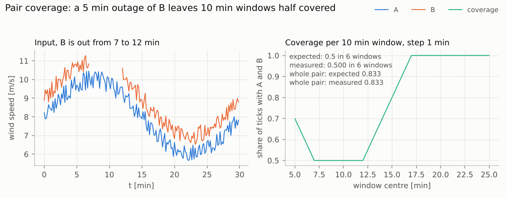

B misses 5 of 30 minutes; in 10 min windows with a step of 1 min the coverage is the expected 0.500 in the 6 windows that hold the whole outage, and over the whole pair it is the expected 0.833, 150 of 180 ticks.

## Clean and convert values

### Unit conversion (`convert.unit`)

Computes value * factor + offset for every value and gives the output a new unit. Degrees Celsius to degrees Fahrenheit is factor 1.8 and offset 32, W to kW is factor 0.001. Gaps stay gaps and the time axis stays as it is.

| Runtime | Status | Entry point | Note |
|---|---|---|---|
| workbench | available | operator `convert.unit` |  |
| java | none |  |  |
| python | none |  |  |
| processor | available | `org.opentsx.retrieval.clean.CleanChain#Convert` | A step of the clean chain before a series sink (bin/opentsx vectors). Refuses a factor or offset that is no number. |
| go | none |  |  |

| Port | Direction | Type | Description |
|---|---|---|---|
| `in` | in | series (one) |  |
| `out` | out | series |  |

| Parameter | Type | Default | Range | Description |
|---|---|---|---|---|
| `factor` | number | `1` |  | Multiplier. |
| `offset` | number | `0` |  | Added after the multiplication. |
| `unit` | string |  |  | Unit of the output. Without it the output keeps the unit of the input. |

Semantics: needs one point of input per output value; deterministic; keeps time, series; origin INHERIT.

See: [test vectors](../../docs/datamodel-2026/testvectors/clean-ops.v1.json), [description](../../systems/processors/convert.unit.yaml).

Example, from [`opentsx-saas-frontend/src/workbench/examples/convert.unit.example.test.ts`](../../opentsx-saas-frontend/src/workbench/examples/convert.unit.example.test.ts):

```typescript
const raw: Bucket = {
  name: 'air',
  xKind: 'time',
  xLabel: 't [s]',
  yLabel: 'Cel',
  t0Ms: T0,
  series: [{ id: 'air', label: 'air temperature', unit: 'Cel', x: seconds, y: celsius }],
};
const convert = OP_BY_ID['convert.unit'];
const out = convert.apply(raw, { factor: 1.8, offset: 32, unit: '[degF]' }).series[0];
```

Run it:

```bash
(cd opentsx-saas-frontend && npx vitest run src/workbench/examples/convert.unit.example.test.ts)
```

![A day of air temperature in Cel becomes [degF]; output over input is a straight line with the measured slope 1.8000 and intercept 32.0000.](img/operators/convert.unit.png)

A day of air temperature in Cel becomes [degF]; output over input is a straight line with the measured slope 1.8000 and intercept 32.0000.

### Plausible range (`dq.plausible-range`)

Checks every value against the band [min, max]. A value below min or above max becomes a gap (mode gap) or the bound it crossed (mode clip). Values inside the band, gaps of the input and the time axis stay as they are.

| Runtime | Status | Entry point | Note |
|---|---|---|---|
| workbench | available | operator `dq.plausible-range` | The form presets min -10 and max 10, or the expected range of the signal it was opened for. An emptied min or max is no bound and is left out of the DAG. Refuses min above max, as the processor does. Any mode other than clip gives gaps. |
| java | none |  |  |
| python | none |  |  |
| processor | available | `org.opentsx.retrieval.clean.CleanChain#Range` | DAG op dq.checks with checks [PLAUSIBLE_RANGE], a step of the clean chain before a series sink (bin/opentsx vectors). Refuses min above max, a min or max that is no number and a mode other than gap or clip. |
| go | planned |  | DQ in the Go stream core of the proposed Go TSx processor. |

| Port | Direction | Type | Description |
|---|---|---|---|
| `in` | in | series (one) |  |
| `out` | out | series |  |

| Parameter | Type | Default | Range | Description |
|---|---|---|---|---|
| `min` | number |  |  | Lower bound. Without it the band has no lower bound. Preset from `expect.min`. |
| `max` | number |  |  | Upper bound. Without it the band has no upper bound. Preset from `expect.max`. |
| `mode` | enum: gap, clip | `gap` |  | gap: a value outside becomes a gap. clip: it becomes the bound. |

Semantics: needs one point of input per output value; deterministic; keeps time, unit, series; origin INHERIT.

See: [more](../../docs/user-manual/16-engineering-method.md), [test vectors](../../docs/datamodel-2026/testvectors/clean-ops.v1.json), [description](../../systems/processors/dq.plausible-range.yaml), plan: [P7f](../../EVOLUTION/TASK-016-smart-topics.md).

Example, from [`opentsx-saas-frontend/src/workbench/examples/dq.plausible-range.example.test.ts`](../../opentsx-saas-frontend/src/workbench/examples/dq.plausible-range.example.test.ts):

```typescript
const raw: Bucket = {
  name: 'wind',
  xKind: 'time',
  xLabel: 't [s]',
  yLabel: 'm/s',
  t0Ms: T0,
  series: [{ id: 'wind', label: 'wind speed', unit: 'm/s', x: seconds, y: wind }],
};
const range = OP_BY_ID['dq.plausible-range'];
const gaps = range.apply(raw, { min: 0, max: 60, mode: 'gap' }).series[0];
const clipped = range.apply(raw, { min: 0, max: 60, mode: 'clip' }).series[0];
```

Run it:

```bash
(cd opentsx-saas-frontend && npx vitest run src/workbench/examples/dq.plausible-range.example.test.ts)
```

![A 10 s dropout of -10 m/s and a 5 s spike of 95 m/s lie outside [0, 60] m/s; mode gap turns exactly these 15 values into gaps and mode clip sets them to 0 and 60.](img/operators/dq.plausible-range.png)

A 10 s dropout of -10 m/s and a 5 s spike of 95 m/s lie outside [0, 60] m/s; mode gap turns exactly these 15 values into gaps and mode clip sets them to 0 and 60.

### Select series by label (`select`)

Keeps the series whose label or id matches a regular expression, case ignored, and drops the others. The kept series are passed on unchanged. The pattern wind speed keeps WT01 Wind speed and drops WT01 Power.

| Runtime | Status | Entry point | Note |
|---|---|---|---|
| workbench | available | operator `select` | A pattern that is no valid regular expression keeps no series and gives no error. |
| java | none |  |  |
| python | available | `opentsx.core.bucket.TSBucket#filter` | bucket.filter(predicate) keeps the series for which the predicate is true, for example lambda ts: re.search('wind speed', ts.label, re.I). It takes any predicate, not a pattern. |
| processor | none |  | The workbench exports the step to a PFD as FILTER, which the Flink PFD runtime refuses (PFDValidation). |
| go | none |  |  |

| Port | Direction | Type | Description |
|---|---|---|---|
| `in` | in | series (many) |  |
| `out` | out | series (many) | The series that match, in their input order |

| Parameter | Type | Default | Range | Description |
|---|---|---|---|---|
| `pattern` | string | `.*` |  | Regular expression in JavaScript syntax, tested against label and id. |

Semantics: needs one point of input per output value; deterministic; keeps time, unit, count, series.

See: [description](../../systems/processors/select.yaml).

Example, from [`opentsx-saas-frontend/src/workbench/examples/select.example.test.ts`](../../opentsx-saas-frontend/src/workbench/examples/select.example.test.ts):

```typescript
const raw: Bucket = {
  name: 'turbines',
  xKind: 'time',
  xLabel: 't [s]',
  yLabel: 'y',
  t0Ms: T0,
  series: [
    { id: 'wt01.wind', label: 'WT01 Wind speed', unit: 'm/s', x: seconds, y: w1 },
    { id: 'wt01.power', label: 'WT01 Power', unit: 'MW', x: seconds, y: power(w1) },
    { id: 'wt02.wind', label: 'WT02 Wind speed', unit: 'm/s', x: seconds, y: w2 },
    { id: 'wt02.power', label: 'WT02 Power', unit: 'MW', x: seconds, y: power(w2) },
  ],
};
const select = OP_BY_ID['select'];
const kept = select.apply(raw, { pattern: 'wind speed' }).series;
```

Run it:

```bash
(cd opentsx-saas-frontend && npx vitest run src/workbench/examples/select.example.test.ts)
```

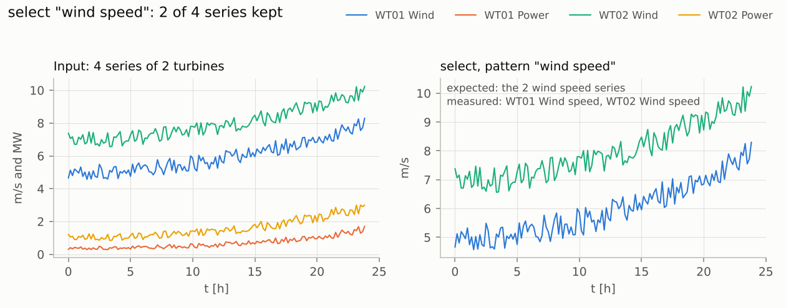

The pattern wind speed keeps WT01 Wind speed and WT02 Wind speed of 4 series and drops the two power series.

## Resample and align series

### Align to vector (`align.vector`)

Brings several inputs onto one clock: ticks are multiples of every since the epoch, and each tick gives one measuring point with one component per input, the aggregate of that input's samples in the tick. A component without a sample is missing, or with fill as-of takes its last value when that is at most maxAge old. key decides which series form one vector: the same series, all of them, or the series with the same value of a tag.

| Runtime | Status | Entry point | Note |
|---|---|---|---|
| workbench | available | operator `align.vector` | An emptied every is refused in the preview and before the deployment: every: empty value; expected a number of seconds above 0, and the DAG leaves it out. An emptied maxAge with fill as-of is refused the same way: maxAge: empty value; expected a number of seconds, 0 or more. Without maxAge fill as-of takes values up to one tick old, as in the processor. |
| java | available | `org.opentsx.retrieval.vector.VectorAligner` | One run over all data. Without maxAge fill as-of takes values up to one tick old. |
| python | none |  |  |
| processor | available | `org.opentsx.retrieval.vector.VectorProcessor` | bin/opentsx vectors. lateness applies here only. |
| go | planned |  | Concept 11, section 6, marks align.vector as planned for the Go core. |

| Port | Direction | Type | Description |
|---|---|---|---|
| `in` | in | series (many) |  |
| `out` | out | vector |  |

| Parameter | Type | Default | Range | Description |
|---|---|---|---|---|
| `every` | duration | `PT60S` |  | Clock. Tick k covers [k * every, (k + 1) * every). Preset from `expect.interval`. |
| `key` | string | `series` |  | series, all, or the name of a tag |
| `agg` | enum: MEAN, MIN, MAX, FIRST, LAST, SUM, COUNT | `MEAN` |  | Aggregate of the samples of one input in one tick. |
| `fill` | enum: none, as-of | `none` |  | as-of: a missing component takes its last value. |
| `maxAge` | duration | `PT60S` |  | Age of the oldest value fill as-of takes. |
| `emit` | enum: any, complete | `any` |  | any: a tick with at least one component. complete: only ticks with every component. |
| `names` | list |  |  | Names of the components in the order of the inputs |
| `lateness` | duration | `PT0S` |  | How long a tick waits for series that lag behind. |

Semantics: needs one window of input per output value; deterministic; keeps unit; origin INHERIT.

See: [more](../../docs/datamodel-2026/11-SMART-TOPIC-PROZESSOR-DEVOPS.md), [test vectors](../../docs/datamodel-2026/testvectors/align-vector.v1.json), [description](../../systems/processors/align.vector.yaml), plan: [P7f](../../EVOLUTION/TASK-016-smart-topics.md).

Example, from [`opentsx-saas-frontend/src/workbench/examples/align.vector.example.test.ts`](../../opentsx-saas-frontend/src/workbench/examples/align.vector.example.test.ts):

```typescript
const a: Bucket = {
  name: 'A', xKind: 'time', xLabel: 't [s]', yLabel: 'm/s', t0Ms: T0,
  series: [{ id: 'wind', label: 'mast every 10 s', unit: 'm/s', x: aX, y: aY }],
};
const b: Bucket = {
  name: 'B', xKind: 'time', xLabel: 't [s]', yLabel: 'm/s', t0Ms: T0,
  series: [{ id: 'wind', label: 'nacelle every 60 s', unit: 'm/s', x: bX, y: bY }],
};
const align = OP_BY_ID['align.vector'];
const vector = align.apply(a, { every: 60, key: 'series', agg: 'MEAN', fill: 'as-of', maxAge: 120, emit: 'any' }, [b]);
const [compA, compB] = vector.series;
```

Run it:

```bash
(cd opentsx-saas-frontend && npx vitest run src/workbench/examples/align.vector.example.test.ts)
```

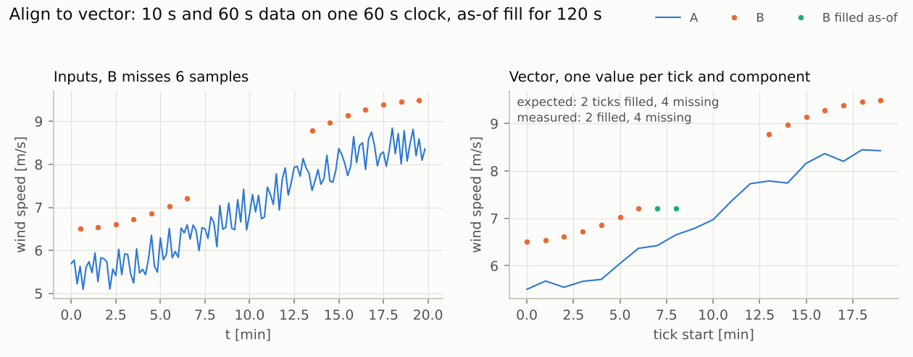

A series every 10 s and a series every 60 s that misses 6 samples become one vector on a 60 s clock; as-of fill with maxAge 120 s fills the first 2 empty ticks with the last value and leaves the other 4 missing, as expected.

### Resample (`resample`)

Cuts the time axis into windows of the width every, aligned to the epoch, and gives one value per window: the aggregate of its values that are no gap, at the start of the window. A window without values is a gap. 1 s data with every PT1M gives one value per minute, at the full minutes, whatever the first sample is.

| Runtime | Status | Entry point | Note |
|---|---|---|---|
| workbench | available | operator `resample` | every in units of the x axis, default 0.05; 60 s when the workbench is opened for a signal. Refuses an every of 0 or less, as the processor does. Runs the series episode by episode, as the processor runs its blocks, and hands out a window once the end of an episode has passed its end; without episodes the data ends at the last sample plus the median sampling interval. As in the processor, an end more than 10000 windows after the open window hands out no window, and after 10000 empty windows the grid starts again at the next sample. |
| java | available | `org.opentsx.retrieval.Resampling#resample` | One episode at a time, also GET /v1/episodes?resample=PT1M&agg=MEAN. agg also FIRST, SUM and COUNT; an empty window is NaN, for COUNT 0. A step that gives more than 100000 points for one episode is refused (400). |
| python | available | `opentsx.core.time_series.TimeSeriesObject#resample` | resample(factor, method) aggregates blocks of factor samples, not time windows; method mean, median, max or min. RetrievalClient.episodes(resample=, agg=) has the server resample. |
| processor | available | `org.opentsx.retrieval.clean.CleanChain#Resample` | A step of the clean chain before a series sink (bin/opentsx vectors). Hands out a window once the data has passed its end. After 10000 empty windows the grid starts again at the next sample. |
| go | planned |  | Resampling in the Go stream core of the proposed Go TSx processor. |

| Port | Direction | Type | Description |
|---|---|---|---|
| `in` | in | series (one) |  |
| `out` | out | series |  |

| Parameter | Type | Default | Range | Description |
|---|---|---|---|---|
| `every` | duration | required |  | Width of a window. Windows start at multiples of every since the epoch. |
| `agg` | enum: MEAN, MIN, MAX, LAST | `MEAN` |  | Aggregate of the values of a window. |

Semantics: needs one window of input per output value; deterministic; keeps unit, series; origin INHERIT.

See: [more](../../docs/user-manual/09-retrieval.md), [test vectors](../../docs/datamodel-2026/testvectors/clean-ops.v1.json), [description](../../systems/processors/resample.yaml), plan: [P7f](../../EVOLUTION/TASK-016-smart-topics.md).

Example, from [`opentsx-saas-frontend/src/workbench/examples/resample.example.test.ts`](../../opentsx-saas-frontend/src/workbench/examples/resample.example.test.ts):

```typescript
const raw: Bucket = {
  name: 'wind',
  xKind: 'time',
  xLabel: 't [s]',
  yLabel: 'm/s',
  t0Ms: T0,
  series: [{ id: 'wind', label: 'wind speed', unit: 'm/s', x: seconds, y: wind }],
};
const resample = OP_BY_ID['resample'];
const mean = resample.apply(raw, { every: 60, agg: 'MEAN' }).series[0];
const max = resample.apply(raw, { every: 60, agg: 'MAX' }).series[0];
```

Run it:

```bash
(cd opentsx-saas-frontend && npx vitest run src/workbench/examples/resample.example.test.ts)
```

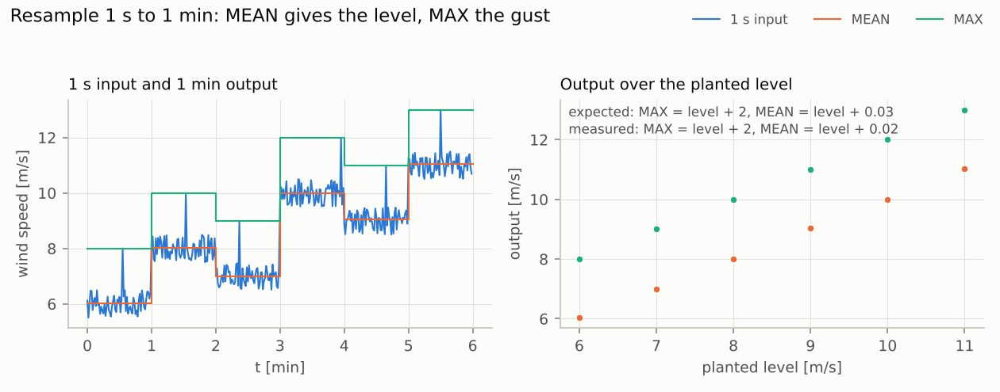

Six minutes of 1 s wind speed with a known level and one gust of level + 2 m/s per minute become six values per aggregate; MAX is level + 2 in every minute, and MEAN is level + 0.02 on average against the expected 0.03 of one gust in 60 samples.

## Cut series into episodes

### Segments around extrema (`segment.extremum`)

Cuts a window around each local maximum (MAX) or minimum (MIN) that stands out. A sample is a peak when its prominence, the height above the higher of the lowest points on its two sides within ±window/2, is at least prominence, and when it is the most extreme value within ±distance; ties go to the earliest. The segment covers [t − pre, t + post] around the peak time t, which is its anchor. NaN values are never peaks.

| Runtime | Status | Entry point | Note |
|---|---|---|---|
| workbench | none |  |  |
| java | available | `org.opentsx.retrieval.segment.Segmenter#extremum` | Segmenter.extremum takes all six parameters. A peak is decided once the series has reached t + max(post, distance, window/2), so StreamingSegmenter and EpisodeService.segments(...).fetch() give the same segments. The retrieval server offers it as POST /v1/segments with strategy FEATURE_EXTREMUM and answers 400 when prominence is missing or no number. |
| python | available | `opentsx.client.retrieval.RetrievalClient#segments` | segments("FEATURE_EXTREMUM", {"prominence": 2, "window": "PT5M", "distance": "PT2M"}) calls POST /v1/segments of the retrieval server; Python computes nothing. |
| processor | none |  |  |
| go | planned |  | Concept 11, section 6, lists segment.extremum, incremental, for the Go core. |

| Port | Direction | Type | Description |
|---|---|---|---|
| `in` | in | series (many) |  |
| `segments` | out | series (many) | Derived episodes, one per peak, with segmentation FEATURE_EXTREMUM and the peak time as anchorTs |

| Parameter | Type | Default | Range | Description |
|---|---|---|---|---|
| `feature` | enum: MAX, MIN | `MAX` |  | Maxima or minima. |
| `prominence` | number | required | 0 ..  | Least height of a peak above its surroundings, in the unit of the series. |
| `window` | duration | required |  | Neighbourhood ±window/2 in which the prominence is measured. |
| `distance` | duration | required |  | The peak must be the most extreme value within ±distance. |
| `pre` | duration | `PT0S` |  | Part of the segment before the peak. |
| `post` | duration | `PT0S` |  | Part of the segment after the peak. |

Semantics: needs one window of input per output value; deterministic; keeps time, unit, series; origin INHERIT.

See: [more](../../docs/user-manual/09-retrieval.md#92-segmentation), [description](../../systems/processors/segment.extremum.yaml), plan: [P7f](../../EVOLUTION/TASK-016-smart-topics.md).

Example, from [`opentsx-retrieval/src/test/java/org/opentsx/retrieval/examples/SegmentExtremumExampleTest.java`](../../opentsx-retrieval/src/test/java/org/opentsx/retrieval/examples/SegmentExtremumExampleTest.java):

```java
InMemorySeriesStore store = new InMemorySeriesStore();
store.write(episodes);
EpisodeService svc = new EpisodeService(store);
Segmenter gusts = Segmenter.extremum(Segmenter.Feature.MAX, 2.0, Duration.ofMinutes(5), Duration.ofMinutes(2),
        Duration.ofSeconds(60), Duration.ofSeconds(90));
Segmenter everyMaximum = Segmenter.extremum(Segmenter.Feature.MAX, 0.0, Duration.ofMinutes(5),
        Duration.ofMinutes(2), Duration.ofSeconds(60), Duration.ofSeconds(90));
List<Episode> found = svc.segments(gusts).metric("wind.met.wind_speed").fetch();
List<Episode> unfiltered = svc.segments(everyMaximum).metric("wind.met.wind_speed").fetch();
```

Run it:

```bash
mvn -B -ntp -pl opentsx-retrieval test -Dtest=SegmentExtremumExampleTest
```

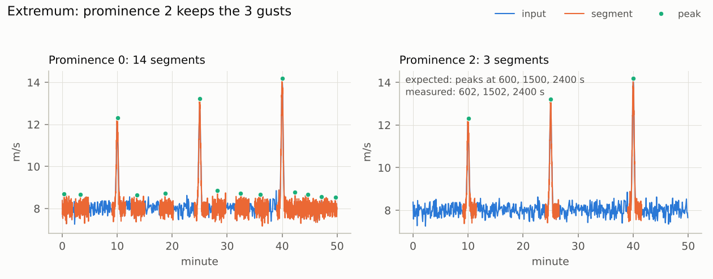

With prominence 2 the segmenter finds exactly the 3 gusts planted at 600, 1500 and 2400 s, at 602, 1502 and 2400 s; with prominence 0 it cuts 14 segments, 11 of them around noise.

### Fixed-count segments (`segment.fixed-count`)

Cuts each series into blocks of n consecutive samples. Block k starts at sample k · (n − overlap), counted from the first sample of the selection, so consecutive blocks share overlap samples. Samples at the end that do not fill a block are dropped. A typical use is blocks for an FFT with 50 % overlap.

| Runtime | Status | Entry point | Note |
|---|---|---|---|
| workbench | none |  |  |
| java | available | `org.opentsx.retrieval.segment.Segmenter#fixedCount` | EpisodeService.segments(Segmenter.fixedCount(n, overlap)).fetch() over stored episodes; StreamingSegmenter gives the same blocks episode by episode. The retrieval server offers it as POST /v1/segments with strategy FIXED_COUNT. Where the first block starts depends on the start of the selection (from). |
| python | available | `opentsx.client.retrieval.RetrievalClient#segments` | segments("FIXED_COUNT", {"n": 256, "overlap": 128}) calls POST /v1/segments of the retrieval server; Python computes nothing. |
| processor | none |  |  |
| go | planned |  | Concept 11, section 6, lists episodes.fixed-count for the Go core. |

| Port | Direction | Type | Description |
|---|---|---|---|
| `in` | in | series (many) |  |
| `segments` | out | series (many) | Derived episodes of n samples each, with segmentation FIXED_COUNT |

| Parameter | Type | Default | Range | Description |
|---|---|---|---|---|
| `n` | integer | required | 1 ..  | Samples per block. |
| `overlap` | integer | `0` | 0 ..  | Samples two consecutive blocks share. Below n. |

Semantics: needs one window of input per output value; deterministic; keeps time, unit, series; origin INHERIT.

See: [more](../../docs/user-manual/09-retrieval.md#92-segmentation), [description](../../systems/processors/segment.fixed-count.yaml), plan: [P7f](../../EVOLUTION/TASK-016-smart-topics.md).

Example, from [`opentsx-retrieval/src/test/java/org/opentsx/retrieval/examples/SegmentFixedCountExampleTest.java`](../../opentsx-retrieval/src/test/java/org/opentsx/retrieval/examples/SegmentFixedCountExampleTest.java):

```java
InMemorySeriesStore store = new InMemorySeriesStore();
store.write(episodes);
EpisodeService svc = new EpisodeService(store);
List<Episode> blocks = svc.segments(Segmenter.fixedCount(256, 128))
        .metric("wind.generator.speed")
        .fetch();
```

Run it:

```bash
mvn -B -ntp -pl opentsx-retrieval test -Dtest=SegmentFixedCountExampleTest
```

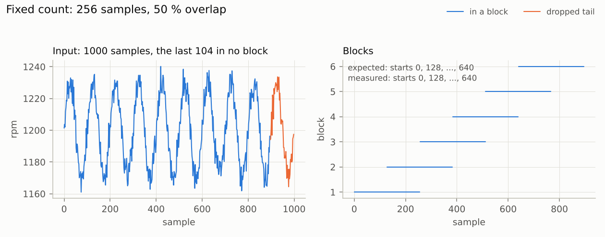

1000 samples give 6 blocks of 256 samples that start at 0, 128 and on to 640, as expected for 50 % overlap; the last 104 samples fill no block and are dropped.

### Fixed-duration segments (`segment.fixed-duration`)

Cuts each series into windows of the same duration that are aligned to the epoch, shifted by offset: a sample at time t belongs to the window that starts at floor((t − offset) / duration) · duration + offset. Where a window begins does not depend on where the data begins, and a window without samples gives no segment. Each segment is a derived episode that records the strategy FIXED_DURATION, its parameters and the source episode.

| Runtime | Status | Entry point | Note |
|---|---|---|---|
| workbench | none |  |  |
| java | available | `org.opentsx.retrieval.segment.Segmenter#fixedDuration` | EpisodeService.segments(Segmenter.fixedDuration(duration)).fetch() over stored episodes; StreamingSegmenter gives the same segments episode by episode. The retrieval server offers it as POST /v1/segments with strategy FIXED_DURATION. |
| python | available | `opentsx.client.retrieval.RetrievalClient#segments` | segments("FIXED_DURATION", {"duration": "PT10M"}) calls POST /v1/segments of the retrieval server; Python computes nothing. |
| processor | none |  |  |
| go | planned |  | Concept 11, section 6, lists episodes.fixed-duration for the Go core. |

| Port | Direction | Type | Description |
|---|---|---|---|
| `in` | in | series (many) |  |
| `segments` | out | series (many) | Derived episodes, one per window that holds samples, with segmentation FIXED_DURATION |

| Parameter | Type | Default | Range | Description |
|---|---|---|---|---|
| `duration` | duration | required |  | Length of a window, at least PT0.000001S (the microsecond of the time axis). |
| `offset` | duration | `PT0S` |  | Shift of the windows against the epoch. |

Semantics: needs one window of input per output value; deterministic; keeps time, unit, series; origin INHERIT.

See: [more](../../docs/user-manual/09-retrieval.md#92-segmentation), [description](../../systems/processors/segment.fixed-duration.yaml), plan: [P7f](../../EVOLUTION/TASK-016-smart-topics.md).

Example, from [`opentsx-retrieval/src/test/java/org/opentsx/retrieval/examples/SegmentFixedDurationExampleTest.java`](../../opentsx-retrieval/src/test/java/org/opentsx/retrieval/examples/SegmentFixedDurationExampleTest.java):

```java
InMemorySeriesStore store = new InMemorySeriesStore();
store.write(episodes);
EpisodeService svc = new EpisodeService(store);
List<Episode> segments = svc.segments(Segmenter.fixedDuration(Duration.ofMinutes(10)))
        .metric("wind.met.wind_speed")
        .fetch();
```

Run it:

```bash
mvn -B -ntp -pl opentsx-retrieval test -Dtest=SegmentFixedDurationExampleTest
```

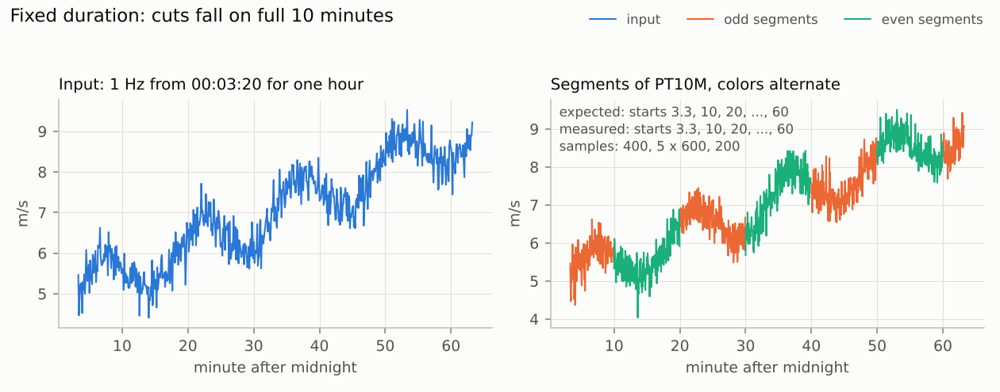

An hour of 1 Hz data that starts at 00:03:20 is cut at 00:10, 00:20 and on to 01:00 into 7 segments of 400, 5 x 600 and 200 samples, as expected for windows of PT10M aligned to the clock.

### Segments between thresholds (`segment.threshold`)

Cuts one segment per phase in which the series reaches enter and stays until it crosses back over exit. For ABOVE a phase starts at a value ≥ enter and ends at the first value < exit, with exit ≤ enter; for BELOW the other way round. The gap between enter and exit is a hysteresis: noise near one level does not end a phase. The segment is extended by pre before and post after the phase; phases shorter than minDuration are dropped, longer than maxDuration are cut there, and NaN values change nothing.

| Runtime | Status | Entry point | Note |
|---|---|---|---|
| workbench | available | operator `segment.threshold` | A different cut with the same id: one window per crossing of enter in the given direction, pre samples before and post samples after it (defaults level 0, pre 20, post 80), aligned on the crossing. No exit level, no hysteresis, no minimum or maximum duration. It draws the first 24 windows and counts all. A flow that publishes it beside a vector is not deployed; no DAG runtime runs it. |
| java | available | `org.opentsx.retrieval.segment.Segmenter#threshold` | Segmenter.threshold takes all seven parameters. EpisodeService.segments(...).fetch() and StreamingSegmenter give the same segments. The retrieval server offers it as POST /v1/segments with strategy FEATURE_THRESHOLD and answers 400 when enter is missing or no number. |
| python | available | `opentsx.client.retrieval.RetrievalClient#segments` | segments("FEATURE_THRESHOLD", {"enter": 20, "exit": 18}) calls POST /v1/segments of the retrieval server; Python computes nothing. |
| processor | none |  | The workbench lists it in the stream catalog, but CleanChain refuses it before a series sink. |
| go | planned |  | Concept 11, section 6, lists segment.threshold, incremental, for the Go core. |

| Port | Direction | Type | Description |
|---|---|---|---|
| `in` | in | series (many) |  |
| `segments` | out | series (many) | Derived episodes, one per phase, with segmentation FEATURE_THRESHOLD and the start of the phase as anchorTs |

| Parameter | Type | Default | Range | Description |
|---|---|---|---|---|
| `direction` | enum: ABOVE, BELOW | `ABOVE` |  | Phases above or below the levels. |
| `enter` | number | required |  | Level that starts a phase. |
| `exit` | number |  |  | Level that ends a phase; it must not lie beyond enter. Without it exit equals enter: no hysteresis. |
| `pre` | duration | `PT0S` |  | Part of the segment before the phase. |
| `post` | duration | `PT0S` |  | Part of the segment after the phase. |
| `minDuration` | duration | `PT0S` |  | Shorter phases are dropped. |
| `maxDuration` | duration | `PT0S` |  | Longer phases are cut here; the next phase starts only after the value crossed exit. PT0S: no limit. |

Semantics: needs one window of input per output value; deterministic; keeps time, unit, series; origin INHERIT.

See: [more](../../docs/user-manual/09-retrieval.md#92-segmentation), [description](../../systems/processors/segment.threshold.yaml), plan: [P7f](../../EVOLUTION/TASK-016-smart-topics.md).

Example, from [`opentsx-retrieval/src/test/java/org/opentsx/retrieval/examples/SegmentThresholdExampleTest.java`](../../opentsx-retrieval/src/test/java/org/opentsx/retrieval/examples/SegmentThresholdExampleTest.java):

```java
InMemorySeriesStore store = new InMemorySeriesStore();
store.write(episodes);
EpisodeService svc = new EpisodeService(store);
Segmenter hysteresis = Segmenter.threshold(Segmenter.Direction.ABOVE, 20, 18,
        Duration.ZERO, Duration.ZERO, Duration.ZERO, Duration.ZERO);
Segmenter oneLevel = Segmenter.threshold(Segmenter.Direction.ABOVE, 20, 20,
        Duration.ZERO, Duration.ZERO, Duration.ZERO, Duration.ZERO);
List<Episode> phases = svc.segments(hysteresis).metric("wind.met.wind_speed").fetch();
List<Episode> chatter = svc.segments(oneLevel).metric("wind.met.wind_speed").fetch();
```

Run it:

```bash
mvn -B -ntp -pl opentsx-retrieval test -Dtest=SegmentThresholdExampleTest
```

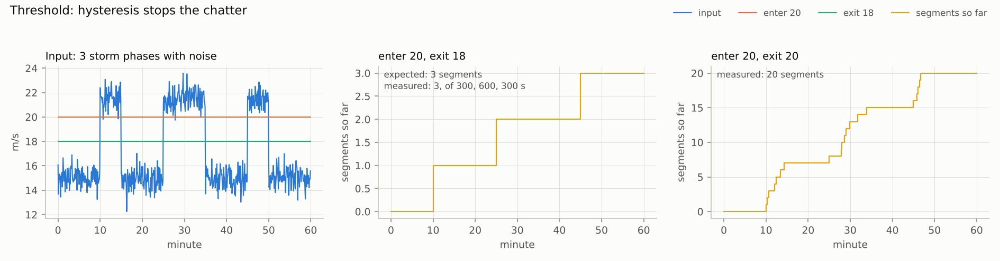

Three storm phases at 21.5 m/s with noise give 3 segments of 300, 600 and 300 s with enter 20 and exit 18, as expected; with exit 20 the noise near the level cuts them into 20 segments.

## Compute statistics

### Sigma band (`sigma.band`)

Gives, at every sample index, the mean of all input series and the mean plus and minus one standard deviation across them, std with n − 1 for n series. The series are paired by index, not by time, up to the length of the shortest, and the output takes the time axis of the first series. For the series of n turbines it shows the level and the spread of the park at every time.

| Runtime | Status | Entry point | Note |
|---|---|---|---|
| workbench | available | operator `sigma.band` | A value that is not finite is left out of its column. One series gives a band of width 0. |
| java | available (2.x) | `org.opentsx.data.series.TimeSeriesObject#sigmaForAll` | 2.x model in opentsx-core: averageForAll and sigmaForAll (std with n − 1) up to the shortest series; sigmaForAll uses the sample index as x. The Swing button Sigma Band opens org.opentsx.chart.simple.SigmaFilter. No automated test. |
| python | none |  |  |
| processor | none |  |  |
| go | none |  |  |

| Port | Direction | Type | Description |
|---|---|---|---|
| `in` | in | series (many) |  |
| `mean` | out | series | Id avg: the mean across the series |
| `upper` | out | series | Id avg+sigma: mean + std |
| `lower` | out | series | Id avg-sigma: mean − std |

Semantics: needs one point of input per output value; deterministic; keeps time, unit.

See: [description](../../systems/processors/sigma.band.yaml).

Example, from [`opentsx-saas-frontend/src/workbench/examples/sigma.band.example.test.ts`](../../opentsx-saas-frontend/src/workbench/examples/sigma.band.example.test.ts):

```typescript
const raw: Bucket = {
  name: 'park',
  xKind: 'time',
  xLabel: 't [s]',
  yLabel: 'm/s',
  t0Ms: T0,
  series: wind.map((y, k) => ({ id: `WT0${k + 1}`, label: `WT0${k + 1} wind speed`, unit: 'm/s', x: seconds, y })),
};
const band = OP_BY_ID['sigma.band'];
const [avg, upper, lower] = band.apply(raw, {}).series;
```

Run it:

```bash
(cd opentsx-saas-frontend && npx vitest run src/workbench/examples/sigma.band.example.test.ts)
```

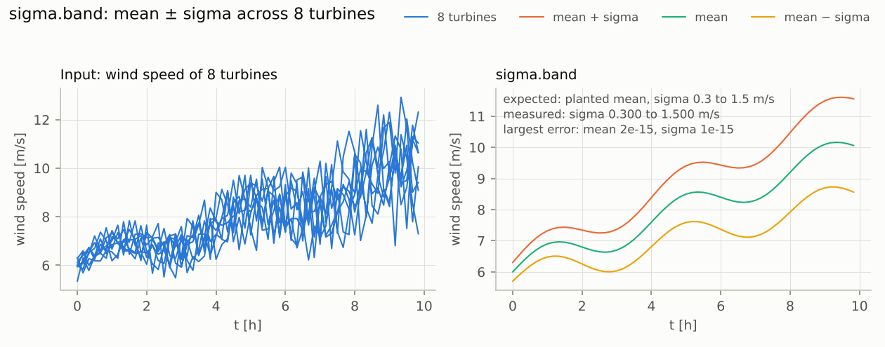

Across 8 turbines whose wind speeds have a planted mean and a planted spread from 0.3 to 1.5 m/s, sigma.band gives that mean and that spread, within 2e-15 and 1e-15.

### Episode summary (`stats.summary`)

Counts the NaN and infinite values and keeps count, min, max and Welford's running mean and m2 of the finite values: delta = x − mean, mean += delta / n, m2 += delta * (x − mean). Two summaries merge exactly (Chan et al.): n = na + nb, mean = mean_a + delta * nb / n, m2 = m2_a + m2_b + delta^2 * na * nb / n with delta = mean_b − mean_a. The sample variance is m2 / (n − 1). Every episode carries the summary of its values.

| Runtime | Status | Entry point | Note |
|---|---|---|---|
| workbench | none |  | ops.ts has a helper stats() for n, mean, std, min and max that other operators use; no operator exposes it. |
| java | available | `org.opentsx.model.Summaries` | Summaries.of(values), Summaries.merge(a, b), Summaries.variance(s). Episodes.regular(...).build() sets the summary of every episode. Infinite values count as nanCount, as in StatsAccumulator. |
| python | available | `opentsx.model.summary.summarize` | summarize(values), merge_summaries(a, b) and variance(s) of opentsx.model, as dicts with the Avro field names. Infinite values count as nanCount, as in Java. |
| processor | none |  | No processor merges summaries; bin/opentsx stats computes its own moments (stats.welford-ddsketch). |
| go | planned |  | Episodes and Welford in the Go stream core of the proposed Go TSx processor. |

| Port | Direction | Type | Description |
|---|---|---|---|
| `in` | in | series (one) | The values of an episode, or of any array |
| `summary` | out | stats | EpisodeSummary: validCount, nanCount, min, max, mean, m2 |

Semantics: needs one window of input per output value; deterministic.

See: [more](../../docs/user-manual/03-data-model.md#33-episodes), [description](../../systems/processors/stats.summary.yaml), plan: [P7f](../../EVOLUTION/TASK-016-smart-topics.md).

Literature: B. P. Welford, Note on a method for calculating corrected sums of squares and products, Technometrics 4, 419 (1962); T. F. Chan, G. H. Golub, R. J. LeVeque, Updating formulae and a pairwise algorithm for computing sample variances, Stanford report STAN-CS-79-773 (1979).

Example, from [`python-package/tests/examples/test_summary_example.py`](../../python-package/tests/examples/test_summary_example.py):

```python
from opentsx.model import merge_summaries, summarize, variance

merged = merge_summaries(summarize(first), summarize(second))
std = variance(merged) ** 0.5
```

Run it:

```bash
(cd python-package && python -m pytest -q tests/examples/test_summary_example.py)
```

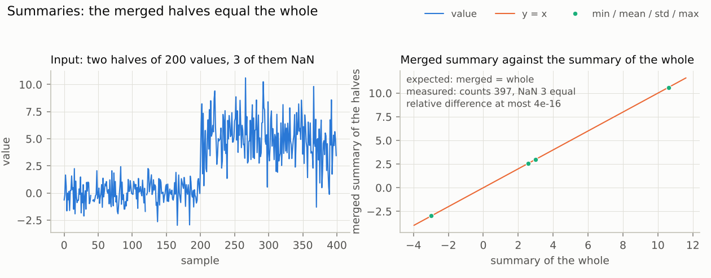

The summaries of two halves of 200 values (mean 0 with 3 NaN, and mean 5) merge into the summary of all 400 values, with the same counts 397 and 3, the same min and max, and mean and standard deviation at most 4e-16 apart relative.

### Window statistics (`stats.welford-ddsketch`)

Keeps per series and per epoch-aligned tumbling window, and in GLOBAL since the start, the number of valid and of NaN values, min, max, and Welford's running mean and m2, with variance = m2 / (n − 1), plus a DDSketch of the values. Every quantile from the sketch is off by at most alpha relative to the exact quantile, and windows, partitions or turbines merge without the raw values. A step between timestamps of more than gapFactor times the expected interval counts as a gap; an episode that arrives twice (same episodeId) counts once.

| Runtime | Status | Entry point | Note |
|---|---|---|---|
| workbench | available | operator `stats.window` | Written into the DAG as stats.welford-ddsketch, but no DAG runtime runs it: the clean chain of the processor refuses it, and a flow that publishes it beside a vector is not deployed. One field per node, MEAN, STD (sample, the default; NaN for a window with one value), MIN or MAX, over windows of window units of the x axis (default 0.25). No quantiles, no gaps. After more than 10000 empty windows the grid starts again at the next sample. |
| java | available | `org.opentsx.stats.StatsEngine` | onEpisode and onObservation return the windows they close, emitGlobal the GLOBAL records of changed series, flush closes all windows. The engine keeps at most 100000 recent episode ids for deduplication and at most 4096 sketch bins per sign. |
| python | available | `opentsx.stats.sketch.QuantileSketch` | Builds, merges and reads the DDSketch with the same bytes as Java; it has no bin limit. stats_to_frame turns SeriesStats records into a pandas frame with std and the quantiles q05 to q95. No windows and no Welford moments of its own: summarize and merge_summaries (stats.summary) give those. |
| processor | available | `org.opentsx.stats.StatsProcessor` | bin/opentsx stats: its own processor on the episode topic, not a DAG node. Writes tsx.<domain>.series-stats.v2 and keeps positions and engine state in a checkpoint file. A record that does not decode is counted as undecodable and skipped, and the first one per partition is logged at WARN with topic, partition and offset. An episode that fails Episodes.validate, for example a count that differs from the number of values or a REGULAR episode without a positive intervalMicros, is counted as invalid and skipped, and the first one per partition is logged at WARN with topic, partition and offset. A failure of the engine stops the processor, and the checkpoint stays before that record. Records that retention deleted before they were read, at the start of a run or during it, are counted in lostToRetention and logged at WARN. In continuous mode it logs one INFO progress line with its counters after every checkpoint. The same engine runs as the Flink job StatsJob of opentsx-flink-core (bin/opentsx stats-flink). |
| go | planned |  | Welford and DDSketch in the Go stream core of the proposed Go TSx processor. |

| Port | Direction | Type | Description |
|---|---|---|---|
| `in` | in | series (many) | Episodes and optionally observations, keyed by seriesId |
| `stats` | out | stats | SeriesStats per series and window (windowType PT10M, PT1H, ... or GLOBAL): validCount, nanCount, min, max, mean, m2, quantileSketch, gapCount, lastSeen |

| Parameter | Type | Default | Range | Description |
|---|---|---|---|---|
| `windows` | list | `["PT10M","PT1H"]` |  | Tumbling windows aligned to the epoch, each a positive whole number of microseconds and each length once. GLOBAL is always kept. |
| `alpha` | number | `0.01` |  .. 1 | Relative accuracy of the quantile sketch, below 1. Sketches merge only with the same alpha. 0 or less keeps no sketch. |
| `lateness` | duration | `PT0S` |  | Zero or a positive whole number of microseconds. A window closes when its series reaches the window end plus lateness. Later values count in GLOBAL only. |
| `gapFactor` | number | `1.5` | 1 ..  | A step between timestamps of more than gapFactor times the expected interval is a gap. Above 1. Java API only. |
| `expectedInterval` | duration |  |  | Expected sampling interval per series. Without it the interval of the last REGULAR episode is used. Java API only (withExpectedInterval). Preset from `expect.interval`. |
| `observations` | boolean | `false` |  | Also read the observations topic. bin/opentsx stats and bin/opentsx stats-flink. |

Semantics: needs one window of input per output value; deterministic; keeps series.

See: [more](../../docs/user-manual/07-stats-quality.md#71-what-is-computed), [description](../../systems/processors/stats.welford-ddsketch.yaml), plan: [P7f](../../EVOLUTION/TASK-016-smart-topics.md).

Literature: B. P. Welford, Note on a method for calculating corrected sums of squares and products, Technometrics 4, 419 (1962); C. Masson, J. E. Rim, H. K. Lee, DDSketch: a fast and fully-mergeable quantile sketch with relative-error guarantees, Proc. VLDB Endow. 12, 2195 (2019).

Example, from [`opentsx-stats/src/test/java/org/opentsx/stats/examples/StatsWindowExampleTest.java`](../../opentsx-stats/src/test/java/org/opentsx/stats/examples/StatsWindowExampleTest.java):

```java
StatsEngine engine = new StatsEngine(StatsEngine.Config.defaults().withWindows(Duration.ofHours(1)));
List<SeriesStats> hours = new ArrayList<>();
for (Episode e : episodes) {
    hours.addAll(engine.onEpisode(e));
}
SeriesStats global = engine.emitGlobal().get(0);
QuantileSketch sketch = QuantileSketch.fromBytes(global.getQuantileSketch());
double median = sketch.quantile(0.5);
```

Run it:

```bash
mvn -B -ntp -pl opentsx-stats test -Dtest=StatsWindowExampleTest
```


Hourly windows over 4 hours with mean 8 and std 1 and 2 hours with mean 12 and std 3 give means within 0.08 and standard deviations within 0.11 of these values, and the quantiles of the GLOBAL sketch are at most 0.98 % off the exact quantiles, inside the 1 % bound.

## Transform values

### Remove a polynomial trend (`detrend`)

Fits one polynomial of the given order to the whole series by least squares and subtracts it, so the result is the residual y − p(i) over the sample index i. Order 1 removes a straight line, order 2 a parabola; a trend of higher order than the fit leaves a bow in the residual.

| Runtime | Status | Entry point | Note |
|---|---|---|---|
| workbench | none |  |  |
| java | none |  |  |
| python | available | `opentsx.core.time_series.TimeSeriesObject#detrend` | ts.detrend(order=1) returns a new TimeSeriesObject on the same timestamps; its metadata records detrend_order. The fit uses the sample index, not the timestamps, so gaps in irregular series are not taken into account. |
| processor | none |  |  |
| go | none |  |  |

| Port | Direction | Type | Description |
|---|---|---|---|
| `in` | in | series (one) |  |
| `out` | out | series | The residual on the timestamps of the input |

| Parameter | Type | Default | Range | Description |
|---|---|---|---|---|
| `order` | integer | `1` | 0 ..  | Order of the polynomial; 0 removes the mean |

Semantics: needs one series of input per output value; deterministic; keeps time, unit, count.

See: [description](../../systems/processors/detrend.yaml).

Example, from [`python-package/tests/examples/test_detrend_example.py`](../../python-package/tests/examples/test_detrend_example.py):

```python
from opentsx import TimeSeriesObject

ts = TimeSeriesObject(data=values, timestamps=t * 60.0, label="temperature")
linear = ts.detrend(order=1)
quadratic = ts.detrend(order=2)
```

Run it:

```bash
(cd python-package && python -m pytest -q tests/examples/test_detrend_example.py)
```

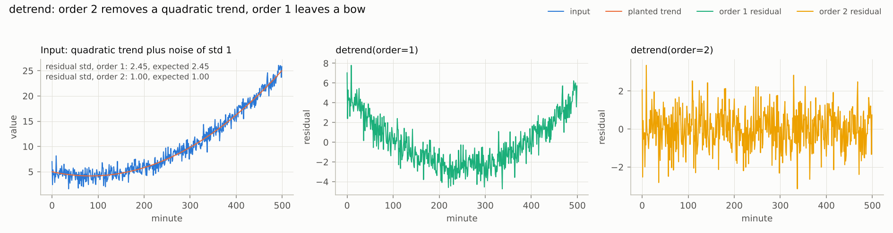

On a quadratic trend plus noise of std 1.00, detrend(order=2) leaves a residual of std 1.00 and removes the planted trend within 0.11, while detrend(order=1) leaves a bow with a residual std of 2.45 against the expected 2.45.

### Difference to the previous sample (`diff`)

Gives the change from one sample to the next, out[i] = y[i] − y[i−1], and 0 at the first sample, on the time axis of the input. The differences of a counter, such as an energy meter, are the amount of each step; the differences of a ramp are constant.

| Runtime | Status | Entry point | Note |
|---|---|---|---|
| workbench | available | operator `diff` |  |
| java | available (2.x) | `org.opentsx.data.series.TimeSeriesObject#getNextDiffs` | 2.x model in opentsx-core: the x values of the output are the sample index 0, 1, 2 and so on. No automated test. |
| python | available | `opentsx.core.time_series.TimeSeriesObject#diff` | diff(periods=1) leaves out the first sample: n − 1 values on the timestamps from the second on. periods above 1 gives the difference of that order (numpy.diff with n=periods), not y[i] − y[i − periods]. |
| processor | none |  |  |
| go | none |  |  |

| Port | Direction | Type | Description |
|---|---|---|---|
| `in` | in | series (one) |  |
| `out` | out | series | y[i] − y[i−1], 0 at the first sample |

Semantics: needs one window of input per output value; deterministic; keeps time, unit, count, series.

See: [description](../../systems/processors/diff.yaml).

Example, from [`opentsx-saas-frontend/src/workbench/examples/diff.example.test.ts`](../../opentsx-saas-frontend/src/workbench/examples/diff.example.test.ts):

```typescript
const raw: Bucket = {
  name: 'meter',
  xKind: 'time',
  xLabel: 't [s]',
  yLabel: 'kWh',
  t0Ms: T0,
  series: [{ id: 'meter', label: 'energy meter', unit: 'kWh', x: seconds, y: meter }],
};
const diff = OP_BY_ID['diff'];
const out = diff.apply(raw, {}).series[0];
```

Run it:

```bash
(cd opentsx-saas-frontend && npx vitest run src/workbench/examples/diff.example.test.ts)
```

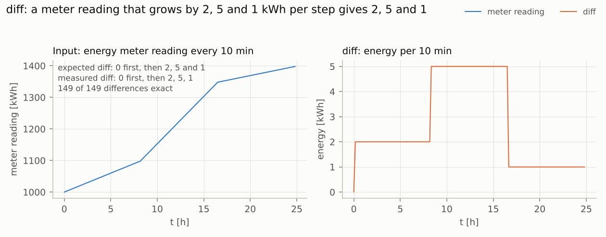

The differences of an energy meter that grows by 2, 5 and 1 kWh per 10 min are 2, 5 and 1 kWh, exact for all 149 steps, with 0 at the first sample.

### Natural logarithm (`log`)

Takes the natural logarithm of every value, out = ln(y). Values without a finite logarithm (0, negative values and NaN) are dropped together with their time, so the output can be shorter than the input. Exponential growth y = a · e^(r t) becomes the straight line ln(a) + r t.

| Runtime | Status | Entry point | Note |
|---|---|---|---|
| workbench | available | operator `log` | The output keeps the unit of the input although it has none. |
| java | available (2.x) | `org.opentsx.data.series.TimeSeriesObject#calcMR_Ln_for_Y` | 2.x model in opentsx-core: a value of 0 or below gives NaN and keeps its time, so the output has as many points as the input. TimeSeriesObjectStatisticsTest checks [e, 0, -1]. |
| python | none |  |  |
| processor | none |  |  |
| go | none |  |  |

| Port | Direction | Type | Description |
|---|---|---|---|
| `in` | in | series (one) |  |
| `out` | out | series | ln(y) at the times where it is finite |

Semantics: needs one point of input per output value; deterministic; keeps time, series.

See: [description](../../systems/processors/log.yaml).

Example, from [`opentsx-saas-frontend/src/workbench/examples/log.example.test.ts`](../../opentsx-saas-frontend/src/workbench/examples/log.example.test.ts):

```typescript
const raw: Bucket = {
  name: 'requests',
  xKind: 'time',
  xLabel: 't [s]',
  yLabel: '1/min',
  t0Ms: T0,
  series: [{ id: 'requests', label: 'requests per minute', x: seconds, y: requests }],
};
const log = OP_BY_ID['log'];
const out = log.apply(raw, {}).series[0];
```

Run it:

```bash
(cd opentsx-saas-frontend && npx vitest run src/workbench/examples/log.example.test.ts)
```

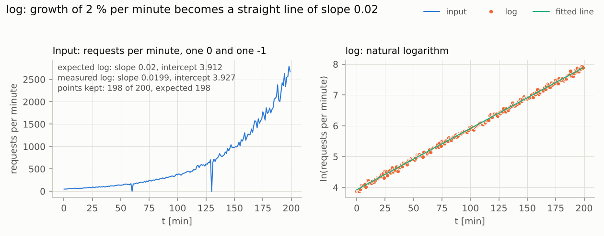

Requests that grow by 2 % per minute become a straight line with the measured slope 0.0199 and intercept 3.927 against the expected 0.02 and 3.912, and the two samples with 0 and -1 are dropped, so 198 of 200 remain.

### Log return (`logreturn`)

Gives the change of the logarithm from one sample to the next, out[i] = ln(y[i]) − ln(y[i−1]), and 0 at the first sample, on the time axis of the input. For small changes it is close to the relative change (y[i] − y[i−1]) / y[i−1]. A value of 0 or below gives an infinite value or NaN at its sample and at the next one.

| Runtime | Status | Entry point | Note |
|---|---|---|---|
| workbench | available | operator `logreturn` | The output keeps the unit of the input although it has none. |
| java | available (2.x) | `org.opentsx.data.series.TimeSeriesObject#getLogReturn` | 2.x model in opentsx-core: the x values of the output are the sample index 0, 1, 2 and so on. No automated test. |
| python | none |  |  |
| processor | none |  |  |
| go | none |  |  |

| Port | Direction | Type | Description |
|---|---|---|---|
| `in` | in | series (one) |  |
| `out` | out | series | ln(y[i]) − ln(y[i−1]), 0 at the first sample |

Semantics: needs one window of input per output value; deterministic; keeps time, count, series.

See: [description](../../systems/processors/logreturn.yaml).

Example, from [`opentsx-saas-frontend/src/workbench/examples/logreturn.example.test.ts`](../../opentsx-saas-frontend/src/workbench/examples/logreturn.example.test.ts):

```typescript
const raw: Bucket = {
  name: 'price',
  xKind: 'time',
  xLabel: 't [s]',
  yLabel: 'EUR/MWh',
  t0Ms: T0,
  series: [{ id: 'price', label: 'price', unit: 'EUR/MWh', x: seconds, y: price }],
};
const logreturn = OP_BY_ID['logreturn'];
const out = logreturn.apply(raw, {}).series[0];
```

Run it:

```bash
(cd opentsx-saas-frontend && npx vitest run src/workbench/examples/logreturn.example.test.ts)
```

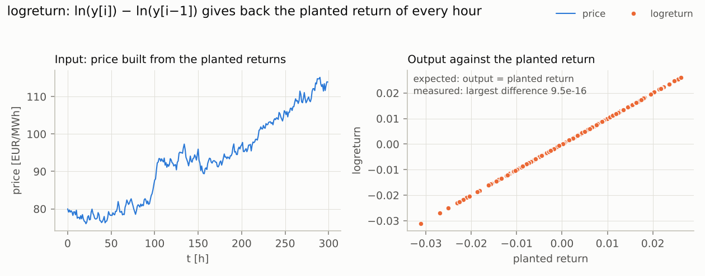

The log returns of a price built from 299 planted hourly returns equal those returns with a largest difference of 9.5e-16, and the first value is 0.

### Divide by the maximum (`norm.max`)

Divides every value of a series by the largest value of that series, out = y / max(y), with the maximum taken over the finite values. The largest value becomes 1 and the shape of the series stays. The divisor is the largest value, not the largest absolute value: a series whose maximum is 0 or below does not end with the maximum 1.

| Runtime | Status | Entry point | Note |
|---|---|---|---|
| workbench | available | operator `norm.max` | The output keeps the unit of the input although it is a ratio. |
| java | available (2.x) | `org.opentsx.data.series.TimeSeriesObject#normalize` | 2.x model in opentsx-core: normalize() divides in place by the maximum and appends it to the label. No automated test. |
| python | none |  | TimeSeriesObject.normalize('minmax') gives (y − min) / (max − min), another scaling. |
| processor | none |  | The workbench exports the step to a PFD as NORMALIZE. The Flink PFD runtime of opentsx-flink-core accepts NORMALIZE only with method center (PFDValidation) and subtracts the mean (OperationFactory), so the exported step does not divide by the maximum. |
| go | none |  |  |

| Port | Direction | Type | Description |
|---|---|---|---|
| `in` | in | series (one) |  |
| `out` | out | series | y / max(y) on the time axis of the input |

Semantics: needs one series of input per output value; deterministic; keeps time, count, series.

See: [description](../../systems/processors/norm.max.yaml).

Example, from [`opentsx-saas-frontend/src/workbench/examples/norm.max.example.test.ts`](../../opentsx-saas-frontend/src/workbench/examples/norm.max.example.test.ts):

```typescript
const raw: Bucket = {
  name: 'power',
  xKind: 'time',
  xLabel: 't [s]',
  yLabel: 'kW',
  t0Ms: T0,
  series: TURBINES.map((w, k) => ({ id: w.id, label: `${w.id} power`, unit: 'kW', x: seconds, y: power[k] })),
};
const normMax = OP_BY_ID['norm.max'];
const out = normMax.apply(raw, {}).series;
```

Run it:

```bash
(cd opentsx-saas-frontend && npx vitest run src/workbench/examples/norm.max.example.test.ts)
```

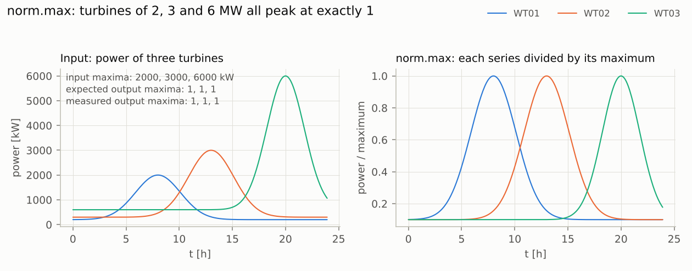

Three turbines with the maxima 2000, 3000 and 6000 kW all have the maximum 1 after norm.max, and each output is its input divided by that maximum.

### Standardize (z-score) (`norm.zscore`)

Subtracts the mean of a series and divides by its standard deviation, z = (y − mean) / std, both over the finite values and std with n − 1. Every series ends with mean 0 and standard deviation 1 whatever its level and spread, so series of different units become comparable. A constant series gives 0 everywhere.

| Runtime | Status | Entry point | Note |
|---|---|---|---|
| workbench | available | operator `norm.zscore` | The output keeps the unit of the input although it has none. |
| java | available (2.x) | `org.opentsx.data.series.TimeSeriesObject#normalizeToStdevIsOne` | 2.x model in opentsx-core: through DatasetNormalizationTool.normalizeToMWZeroANDSTDevONE, std with n − 1. Throws IllegalArgumentException for fewer than 2 values, values that are not finite and a standard deviation of 0. Tested in TimeSeriesObjectStatisticsTest. |
| python | available | `opentsx.core.time_series.TimeSeriesObject#normalize` | normalize('zscore'), the default, divides by the standard deviation with n (numpy.std), so the result has std 1 with n, not with n − 1. A constant series gives NaN and a RuntimeWarning. The two other methods scale by the range and by the interquartile range. |
| processor | none |  | The workbench exports the step to a PFD as NORMALIZE. The Flink PFD runtime of opentsx-flink-core accepts NORMALIZE only with method center (PFDValidation) and subtracts the mean (OperationFactory), so the exported step does not divide by the standard deviation. |
| go | none |  |  |

| Port | Direction | Type | Description |
|---|---|---|---|
| `in` | in | series (one) |  |
| `out` | out | series | (y − mean) / std on the time axis of the input |

Semantics: needs one series of input per output value; deterministic; keeps time, count, series.

See: [description](../../systems/processors/norm.zscore.yaml).

Example, from [`opentsx-saas-frontend/src/workbench/examples/norm.zscore.example.test.ts`](../../opentsx-saas-frontend/src/workbench/examples/norm.zscore.example.test.ts):

```typescript
const raw: Bucket = {
  name: 'sensors',
  xKind: 'time',
  xLabel: 't [s]',
  yLabel: 'y',
  t0Ms: T0,
  series: inputs.map((s) => ({ id: s.id, label: s.label, x: seconds, y: s.y })),
};
const zscore = OP_BY_ID['norm.zscore'];
const out = zscore.apply(raw, {}).series;
```

Run it:

```bash
(cd opentsx-saas-frontend && npx vitest run src/workbench/examples/norm.zscore.example.test.ts)
```

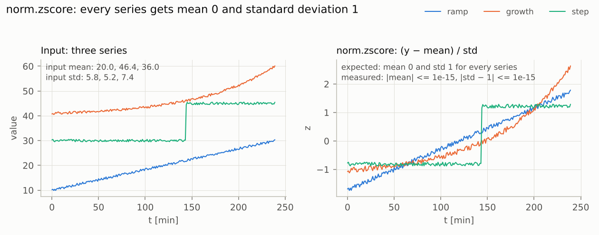

Three series with the means 20.0, 46.4 and 36.0 and the standard deviations 5.8, 5.2 and 7.4 all have mean 0 and standard deviation 1 within 1e-15 after norm.zscore.

### Profile (cumulated deviations) (`profile`)

Gives the running sum of the deviations from the mean, out[i] = sum over j ≤ i of (y[j] − mean), with the mean over the finite values; a value that is not finite adds 0. The profile ends at 0. It is 0 for a constant, falls while the values lie below the mean and rises while they lie above; DFA starts from it.

| Runtime | Status | Entry point | Note |
|---|---|---|---|
| workbench | available | operator `profile` |  |
| java | available (2.x) | `org.opentsx.data.series.TimeSeriesObject#getProfile` | 2.x model in opentsx-core: the x values of the output are the sample index 0, 1, 2 and so on. No automated test. |
| python | none |  | DFA and MFDFA compute the profile inside analyze; no function returns it. |
| processor | none |  |  |
| go | none |  |  |

| Port | Direction | Type | Description |
|---|---|---|---|
| `in` | in | series (one) |  |
| `out` | out | series | The running sum of y − mean on the time axis of the input |

Semantics: needs one series of input per output value; deterministic; keeps time, unit, count, series.

See: [description](../../systems/processors/profile.yaml).

Literature: C.-K. Peng et al., Mosaic organization of DNA nucleotides, Phys. Rev. E 49, 1685 (1994).

Example, from [`opentsx-saas-frontend/src/workbench/examples/profile.example.test.ts`](../../opentsx-saas-frontend/src/workbench/examples/profile.example.test.ts):

```typescript
const raw: Bucket = {
  name: 'levels',
  xKind: 'time',
  xLabel: 't [s]',
  yLabel: 'y',
  t0Ms: T0,
  series: [
    { id: 'constant', label: 'constant 7.3', x: seconds, y: constant },
    { id: 'step', label: 'step 4 to 6', x: seconds, y: step },
  ],
};
const profile = OP_BY_ID['profile'];
const [flat, v] = profile.apply(raw, {}).series;
```

Run it:

```bash
(cd opentsx-saas-frontend && npx vitest run src/workbench/examples/profile.example.test.ts)
```

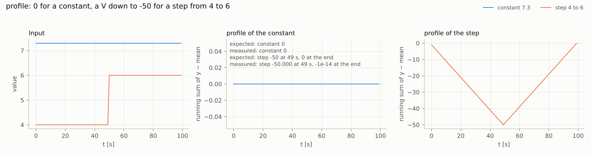

The profile of a constant 7.3 is 0 at every sample, and the profile of a step from 4 to 6 falls to -50.000 at 49 s and ends at -1e-14, against the expected -50 and 0.

### Moving average (`smooth.movavg`)

Replaces every value by the mean of the last window samples, the current one included; values that are not finite are left out. The first window − 1 samples average the samples there are. A step becomes a ramp of window samples, and white noise keeps 1 / sqrt(window) of its standard deviation.

| Runtime | Status | Entry point | Note |
|---|---|---|---|
| workbench | available | operator `smooth.movavg` |  |
| java | none |  |  |
| python | none |  |  |
| processor | none |  | The processor has a trailing mean over a time window: feature.rolling with fn MEAN. |
| go | none |  |  |

| Port | Direction | Type | Description |
|---|---|---|---|
| `in` | in | series (one) |  |
| `out` | out | series | The trailing mean on the time axis of the input |

| Parameter | Type | Default | Range | Description |
|---|---|---|---|---|
| `window` | integer | `25` | 1 ..  | Number of samples, the current one included. A call of apply without window uses 5. Unit: samples. |

Semantics: needs one window of input per output value; deterministic; keeps time, unit, count, series.

See: [description](../../systems/processors/smooth.movavg.yaml).

Example, from [`opentsx-saas-frontend/src/workbench/examples/smooth.movavg.example.test.ts`](../../opentsx-saas-frontend/src/workbench/examples/smooth.movavg.example.test.ts):

```typescript
const raw: Bucket = {
  name: 'level',
  xKind: 'time',
  xLabel: 't [s]',
  yLabel: 'y',
  t0Ms: T0,
  series: [{ id: 'level', label: 'step with noise', x: seconds, y: level }],
};
const movavg = OP_BY_ID['smooth.movavg'];
const out = movavg.apply(raw, { window: WINDOW }).series[0];
```

Run it:

```bash
(cd opentsx-saas-frontend && npx vitest run src/workbench/examples/smooth.movavg.example.test.ts)
```

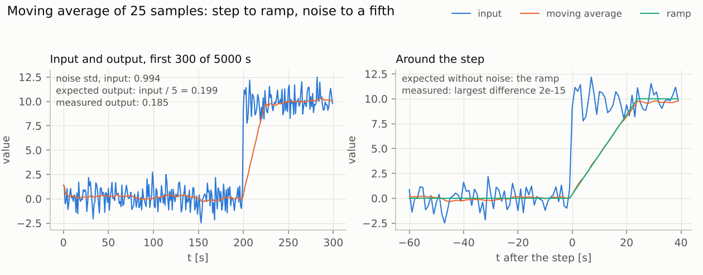

A moving average of 25 samples turns a step from 0 to 10 into a ramp of 25 samples, exact within 2e-15 without noise, and lowers the noise std from 0.994 to 0.185 against the expected 0.199.

## Describe value distributions

### Cumulative distribution (`cdf`)

Builds the histogram of each series, with bins of equal width w between its minimum and its maximum, and cumulates the relative frequencies. The value at the centre x of a bin is the share of values up to the upper edge of that bin, x + w/2, so the last value is 1.

| Runtime | Status | Entry point | Note |
|---|---|---|---|
| workbench | available | operator `cdf` |  |
| java | available (2.x) | `org.opentsx.data.series.TimeSeriesObject#cumulatedDistributionOfYValues` | The 2.x model in opentsx-core has TimeSeriesObject#cumulatedDistributionOfYValues(bins) behind the Swing button CDF, without a test. It returns cumulated counts, not shares. |
| python | none |  |  |
| processor | none |  |  |
| go | none |  |  |

| Port | Direction | Type | Description |
|---|---|---|---|
| `in` | in | series (one) |  |
| `cdf` | out | xy | Cumulated relative frequency over the bin centre |

| Parameter | Type | Default | Range | Description |
|---|---|---|---|---|
| `bins` | integer | `30` | 2 ..  | Number of bins between the minimum and the maximum of the series. |

Semantics: needs one series of input per output value; deterministic; keeps series.

See: [description](../../systems/processors/cdf.yaml).

Example, from [`opentsx-saas-frontend/src/workbench/examples/cdf.example.test.ts`](../../opentsx-saas-frontend/src/workbench/examples/cdf.example.test.ts):

```typescript
const raw: Bucket = {
  name: 'samples',
  xKind: 'time',
  xLabel: 't [s]',
  yLabel: 'y',
  t0Ms: T0,
  series: [
    { id: 'uniform', label: 'uniform', x: seconds, y: uniform },
    { id: 'normal', label: 'normal', x: seconds, y: normal },
  ],
};
const cdf = OP_BY_ID['cdf'];
const [uniformCdf, normalCdf] = cdf.apply(raw, { bins: 30 }).series;
```

Run it:

```bash
(cd opentsx-saas-frontend && npx vitest run src/workbench/examples/cdf.example.test.ts)
```

![The CDF of 20000 uniform values on [0, 1] is a straight line and that of 20000 normal values the normal S curve; both match the distribution function at the upper bin edge within 0.0045 and 0.0043.](img/operators/cdf.png)

The CDF of 20000 uniform values on [0, 1] is a straight line and that of 20000 normal values the normal S curve; both match the distribution function at the upper bin edge within 0.0045 and 0.0043.

### Shannon entropy in a sliding window (`entropy.window`)

Computes the Shannon entropy H = −sum_k p_k log2(p_k) in bit of the values in a sliding window, with p_k the share of the window's values in bin k. The bins divide the range between the minimum and the maximum of the whole series, the same for every window. H is 0 when all values of a window fall into one bin and log2(bins) when they spread evenly over all bins.

| Runtime | Status | Entry point | Note |
|---|---|---|---|
| workbench | available | operator `entropy.window` | Gaps are left out of the counts. |
| java | available (2.x) | `org.opentsx.data.series.TimeSeriesObject#calcEntropyForWindow` | The 2.x model in opentsx-core has TimeSeriesObject#calcEntropyForWindow(length) behind the Swing button ENTROPY. It uses the same windows and step, but divides each window by its maximum and maps the values to 100 levels instead of bins over the range of the series. A length below 4 throws IllegalArgumentException. TimeSeriesObjectStatisticsTest checks the length and the step, not the entropy values. |
| python | none |  |  |
| processor | none |  |  |
| go | none |  |  |

| Port | Direction | Type | Description |
|---|---|---|---|
| `in` | in | series (one) |  |
| `entropy` | out | series | H in bit per window, over the index of the window start (sample, not time) |

| Parameter | Type | Default | Range | Description |
|---|---|---|---|---|
| `length` | integer | `20` | 4 ..  | Window length in samples. A window starts every floor(length / 4) samples; the last windows end at the end of the series and are shorter. |
| `bins` | integer | `16` | 2 ..  | Number of bins over the range of the whole series. |

Semantics: needs one window of input per output value; deterministic; keeps series.

See: [description](../../systems/processors/entropy.window.yaml).

Literature: C. E. Shannon, A mathematical theory of communication, Bell Syst. Tech. J. 27, 379 (1948).

Example, from [`opentsx-saas-frontend/src/workbench/examples/entropy.window.example.test.ts`](../../opentsx-saas-frontend/src/workbench/examples/entropy.window.example.test.ts):

```typescript
const raw: Bucket = {
  name: 'sensor',
  xKind: 'time',
  xLabel: 't [s]',
  yLabel: 'y',
  t0Ms: T0,
  series: [{ id: 'sensor', label: 'sensor', x: seconds, y }],
};
const entropy = OP_BY_ID['entropy.window'];
const h = entropy.apply(raw, { length: 800, bins: 16 }).series[0];
```

Run it:

```bash
(cd opentsx-saas-frontend && npx vitest run src/workbench/examples/entropy.window.example.test.ts)
```

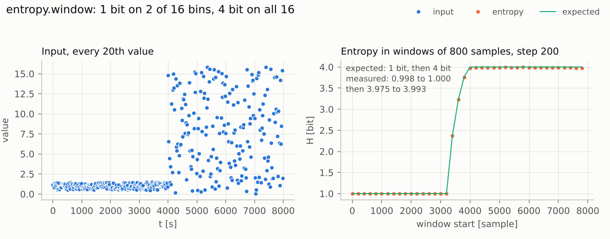

In windows of 800 samples the entropy is 0.998 to 1.000 bit while the values use 2 of 16 bins and 3.975 to 3.993 bit once they spread over all 16, against the expected 1 and 4 bit.

### Histogram per series (`histogram`)

Counts the values of each series in bins of equal width w = (max − min) / bins and divides each count by the number of values inside [min, max]. The result is the relative frequency per bin at the bin centre; it sums to 1. Values outside the range and gaps are left out and do not count in the total.

| Runtime | Status | Entry point | Note |
|---|---|---|---|
| workbench | available | operator `histogram` |  |
| java | available (2.x) | `org.opentsx.data.series.TimeSeriesObject#distributionOfYValues` | The 2.x model in opentsx-core has TimeSeriesObject#distributionOfYValues(min, max, bins) behind the Swing button Histogram per series, without a test. It returns counts, not shares, takes min and max as integers and leaves out empty bins. |
| python | none |  |  |
| processor | none |  |  |
| go | none |  |  |

| Port | Direction | Type | Description |
|---|---|---|---|
| `in` | in | series (one) |  |
| `histogram` | out | xy | Relative frequency per bin over the bin centre |

| Parameter | Type | Default | Range | Description |
|---|---|---|---|---|
| `min` | number | `-10` |  | Lower edge of the first bin. |
| `max` | number | `10` |  | Upper edge of the last bin. A value equal to max counts in the last bin. |
| `bins` | integer | `50` | 2 ..  | Number of bins. |

Semantics: needs one series of input per output value; deterministic; keeps series.

See: [description](../../systems/processors/histogram.yaml).

Example, from [`opentsx-saas-frontend/src/workbench/examples/histogram.example.test.ts`](../../opentsx-saas-frontend/src/workbench/examples/histogram.example.test.ts):

```typescript
const raw: Bucket = {
  name: 'samples',
  xKind: 'time',
  xLabel: 't [s]',
  yLabel: 'y',
  t0Ms: T0,
  series: [
    { id: 'uniform', label: 'uniform', x: seconds, y: uniform },
    { id: 'normal', label: 'normal', x: seconds, y: normal },
  ],
};
const histogram = OP_BY_ID['histogram'];
const [flat, bell] = histogram.apply(raw, { min: -4, max: 4, bins: 40 }).series;
```

Run it:

```bash
(cd opentsx-saas-frontend && npx vitest run src/workbench/examples/histogram.example.test.ts)
```

![20000 uniform values on [0, 4] give 0.048 to 0.052 in each of their 20 bins (expected 0.050), and 20000 normal values match the bin probabilities of the normal distribution within 0.0024 (peak 0.0817 against 0.0793).](img/operators/histogram.png)

20000 uniform values on [0, 4] give 0.048 to 0.052 in each of their 20 bins (expected 0.050), and 20000 normal values match the bin probabilities of the normal distribution within 0.0024 (peak 0.0817 against 0.0793).

### Histogram per time slice (`histogram.crosscut`)

Cuts the sample index into consecutive slices of the given length and pools the values of all series in a slice into one histogram, computed as by histogram. Each result is labelled with the first and the end index of its slice, for example 0_100. It shows how the distribution across many series changes over time. At most 16 slices are computed.

| Runtime | Status | Entry point | Note |
|---|---|---|---|
| workbench | available | operator `histogram.crosscut` |  |
| java | none |  | The 2.x Swing button Histogram cross-cut computes it inside TSOperationControlerPanel (opentsx-core), with no API and no test. It returns counts, not shares, and has no limit of 16 slices. |
| python | none |  |  |
| processor | none |  |  |
| go | none |  |  |

| Port | Direction | Type | Description |
|---|---|---|---|
| `in` | in | series (many) |  |
| `slices` | out | xy | One relative-frequency histogram per time slice over the bin centre |

| Parameter | Type | Default | Range | Description |
|---|---|---|---|---|
| `min` | number | `-10` |  | Lower edge of the first bin. |
| `max` | number | `10` |  | Upper edge of the last bin. A value equal to max counts in the last bin. |
| `bins` | integer | `50` | 2 ..  | Number of bins. |
| `window` | integer | `100` | 2 ..  | Length of a slice in samples. The slices follow each other from sample 0 to the end of the first series. |

Semantics: needs one window of input per output value; deterministic.

See: [description](../../systems/processors/histogram.crosscut.yaml).

Example, from [`opentsx-saas-frontend/src/workbench/examples/histogram.crosscut.example.test.ts`](../../opentsx-saas-frontend/src/workbench/examples/histogram.crosscut.example.test.ts):

```typescript
const raw: Bucket = {
  name: 'sensors',
  xKind: 'time',
  xLabel: 't [s]',
  yLabel: 'y',
  t0Ms: T0,
  series: sensors.map((y, j) => ({ id: `s${j + 1}`, label: `sensor ${j + 1}`, x: seconds, y })),
};
const crosscut = OP_BY_ID['histogram.crosscut'];
const slices = crosscut.apply(raw, { min: -4, max: 8, bins: 48, window: 200 }).series;
```

Run it:

```bash
(cd opentsx-saas-frontend && npx vitest run src/workbench/examples/histogram.crosscut.example.test.ts)
```

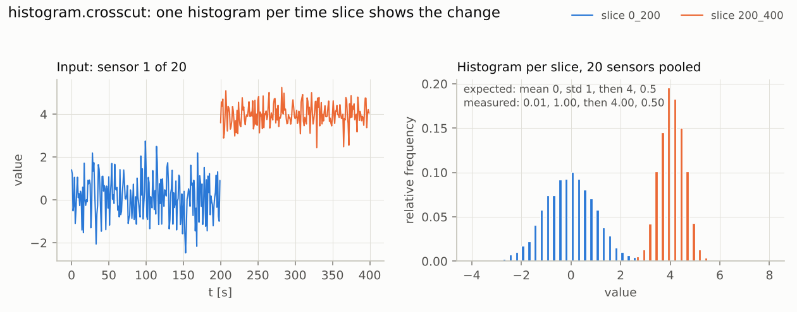

Pooled over 20 sensors that change their distribution at 200 s, the slice 0_200 has mean 0.01 and std 1.00 and the slice 200_400 mean 4.00 and std 0.50, as generated (0 and 1, then 4 and 0.5).

### Shapiro-Wilk normality test (`normality.shapiro-wilk`)

Tests whether the values of a series come from a normal distribution. The statistic W = (sum_i a_i x_(i))^2 / sum_i (x_i − m)^2 compares the ordered values x_(i) with the expected order statistics of a normal sample through the coefficients a_i, with the mean m. W is close to 1 for normal values and smaller otherwise; the p value is the probability of a W this small for normal values.

| Runtime | Status | Entry point | Note |
|---|---|---|---|
| workbench | none |  | Listed as not ported (TEST Normal Distribution) in ops.ts NOT_PORTED. |
| java | available (2.x) | `org.opentsx.algorithms.statistics.Statistical#shapiroWilk` | The 2.x model in opentsx-core has org.opentsx.algorithms.statistics.Statistical#shapiroWilk(values), a port of algorithm AS R94 made for 3 to 5000 values, used by DistributionTester#testDataset and TimeSeriesObject#getSWTestResult. It returns W at index SHAPIRO_WILK_WSTAT (0) and p at index SHAPIRO_WILK_PVALUE (1). StatisticalTest checks both against scipy.stats.shapiro and checks that adding a constant does not change them. It throws for fewer than 3 values and returns W = p = -1 when all values are equal. The Swing button TEST Normal Distribution draws histograms of W in windows of 20 to 100 values. |
| python | none |  |  |
| processor | none |  |  |
| go | none |  |  |

| Port | Direction | Type | Description |
|---|---|---|---|
| `in` | in | series (one) |  |
| `result` | out | stats | W and the p value |

Semantics: needs one series of input per output value; deterministic.

See: [description](../../systems/processors/normality.shapiro-wilk.yaml).

Literature: S. S. Shapiro and M. B. Wilk, An analysis of variance test for normality (complete samples), Biometrika 52, 591 (1965); P. Royston, Remark AS R94: A remark on algorithm AS 181: The W-test for normality, Appl. Statist. 44, 547 (1995).

## Compute spectra

### Amplitude spectrum (`fft`)

Removes the mean, pads the n values with zeros to the smallest power of two N not below n and computes the discrete Fourier transform X_k with a radix-2 FFT. It returns the one-sided amplitude spectrum 2 |X_k| / n at the frequencies k / (N dt) for k from 0 to N/2 − 1, with the sampling interval dt. For n = N, a sine of amplitude A whose frequency falls on a bin gives a peak of height A.

| Runtime | Status | Entry point | Note |
|---|---|---|---|
| workbench | available | operator `fft` | dt is the median spacing of x, so f is in Hz for a time axis in seconds and in 1/sample for an index axis. Gaps count as 0 after the mean is removed. No window function: a frequency between two bins leaks into its neighbours. |
| java | available (2.x) | `org.opentsx.data.series.TimeSeriesObjectFFT#getFFT` | 2.x model in opentsx-core: getFFT(samplingRate) pads with zeros to a power of two but keeps the mean, and returns the real parts of the unscaled coefficients at k * samplingRate / N for all N bins, not the amplitude. The Swing button FFT derives the sampling rate from uniformly spaced coordinates. |
| python | none |  |  |
| processor | none |  |  |
| go | none |  |  |

| Port | Direction | Type | Description |
|---|---|---|---|
| `in` | in | series (one) |  |
| `spectrum` | out | xy | Amplitude over the frequency |

Semantics: needs one series of input per output value; deterministic; keeps series.

See: [more](../../docs/user-manual/11-classic-analytics.md#115-java-tools-in-opentsx-core-2x-model), [description](../../systems/processors/fft.yaml).

Literature: J. W. Cooley and J. W. Tukey, An algorithm for the machine calculation of complex Fourier series, Math. Comp. 19, 297 (1965).

Example, from [`opentsx-saas-frontend/src/workbench/examples/fft.example.test.ts`](../../opentsx-saas-frontend/src/workbench/examples/fft.example.test.ts):

```typescript
const raw: Bucket = {
  name: 'vibration',
  xKind: 'time',
  xLabel: 't [s]',
  yLabel: 'acceleration',
  t0Ms: T0,
  series: [{ id: 'vibration', label: 'vibration', x: seconds, y }],
};
const fft = OP_BY_ID['fft'];
const spectrum = fft.apply(raw, {}).series[0];
```

Run it:

```bash
(cd opentsx-saas-frontend && npx vitest run src/workbench/examples/fft.example.test.ts)
```

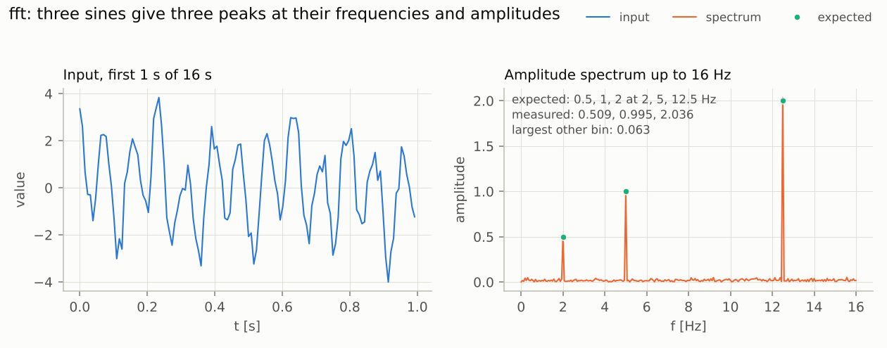

Three sines of amplitude 0.5, 1 and 2 at 2, 5 and 12.5 Hz in noise of standard deviation 0.5 give peaks of 0.509, 0.995 and 2.036 at exactly these frequencies; the largest other bin is 0.063.

## Measure fluctuations and extreme events

### Detrended fluctuation analysis (`dfa`)

Sums the deviations from the mean into a profile, removes a polynomial trend in windows of size s and returns the fluctuation function F(s). The exponent alpha is the slope of log F(s) over log s. It is about 0.5 for uncorrelated values, between 0.5 and 1 for long-range correlated values, about 1 for 1/f noise and about 1.5 for a random walk.

| Runtime | Status | Entry point | Note |
|---|---|---|---|
| workbench | available | operator `dfa` | Defaults order 2, 40 scales. |
| java | available (2.x) | `org.opentsx.algorithms.detrending.methods.DFA` | 2.x tools DFA, SingleDFATool, MultiDFATool. |
| python | available | `opentsx.algorithms.dfa.DFA` | DFA(polynom_order=1).analyze(x): alpha, r_squared, scales, fluctuations and interpretation, the band of alpha: below 0.45 anti-correlated, 0.45 to 0.55 uncorrelated, below 0.95 correlated, 0.95 to 1.05 1/f noise, above 1.05 non-stationary. Windows from 10 to n/4. Raises ValueError naming the argument for a value that is not finite, a constant series, fewer than 44 values with the default windows, and a window size at which F(s) is 0 up to rounding. |
| processor | none |  |  |

| Port | Direction | Type | Description |
|---|---|---|---|
| `in` | in | series (one) |  |
| `fluctuation` | out | xy | F(s) over the window size s; alpha is the slope in log-log |

| Parameter | Type | Default | Range | Description |
|---|---|---|---|---|
| `order` | integer | `1` | 1 ..  | Order of the detrending polynomial |
| `scales` | integer | `20` | 4 ..  | Number of window sizes, spaced evenly in log s |

Semantics: needs one series of input per output value; deterministic.

See: [more](../../docs/user-manual/11-classic-analytics.md), [description](../../systems/processors/dfa.yaml).

Literature: C.-K. Peng et al., Mosaic organization of DNA nucleotides, Phys. Rev. E 49, 1685 (1994).

Example, from [`python-package/tests/examples/test_dfa_example.py`](../../python-package/tests/examples/test_dfa_example.py):

```python
from opentsx import DFA

dfa = DFA(polynom_order=1)
results = {name: dfa.analyze(x) for name, x in series.items()}
alpha = {name: r["alpha"] for name, r in results.items()}
```

Run it:

```bash
(cd python-package && python -m pytest -q tests/examples/test_dfa_example.py)
```

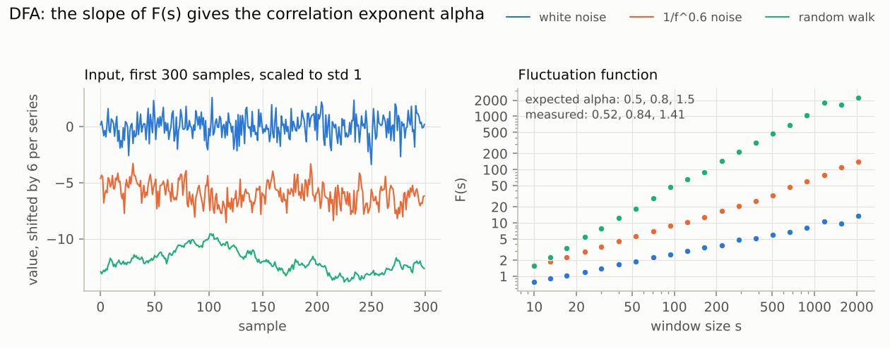

The fluctuation functions of white noise, 1/f^0.6 noise and a random walk are straight lines in log-log with the slopes 0.52, 0.84 and 1.41, close to the expected 0.5, 0.8 and 1.5.

### Multifractal detrended fluctuation analysis (`mfdfa`)

Cuts the profile (cumulative sum of the deviations from the mean) into segments of size s, removes a polynomial trend per segment and averages the q-th power of the segment fluctuations: F_q(s) = {mean of [F^2(s)]^(q/2)}^(1/q), with a geometric mean at q = 0. The generalized Hurst exponent h(q) is the slope of log F_q(s) over log s; from it follow tau(q) = q h(q) − 1 and the singularity spectrum f(alpha). h(q) is flat for a monofractal series, and the widths delta h = h(q_min) − h(q_max) and delta alpha measure how multifractal a series is.

| Runtime | Status | Entry point | Note |
|---|---|---|---|
| workbench | none |  | Listed as not ported (MF-DFA) in ops.ts NOT_PORTED. |
| java | available (2.x) | `org.opentsx.algorithms.detrending.MFDFAAnalyzer` | 2.x model in opentsx-core: MFDFAAnalyzer.process runs the 2.x method MFDFA of order 2 for q = -5 to 5 without 0, writes measurement tables to databuffer/MFDFA and opens charts. MFDFAAnalyzerTest runs processMFDFA on one series without charts and checks that it returns 10 series and writes nothing to standard output. |
| python | available | `opentsx.algorithms.mfdfa.MFDFA#analyze` | MFDFA(polynom_order=1).analyze(x): q_values, scales, Fq, h_q, tau_q, alpha, f_alpha, delta_h, delta_alpha, delta_h_surrogates, is_multifractal, h_2. Segments are cut from the start only; the rest of n / s is dropped. Windows that the trend fits exactly up to rounding are left out of F_q(s). is_multifractal is delta_h above the largest delta_h of 19 phase-randomized copies, which keep the power spectrum and have close to Gaussian values. Of 100 series of 8192 values each, Gaussian white noise, 1/f^0.6 noise, 1/f^0.9 noise and a random walk passed 7, 7, 8 and 4 times; uncorrelated values with a broad distribution pass as well (Student-t with 1.5 degrees of freedom: 100 times). In the example it is False for the white noise (delta_h 0.09 against 0.12) and True for the cascade (1.42 against 0.15). h_2 is h(2). The input checks of dfa apply and raise ValueError. |
| processor | none |  |  |
| go | none |  |  |

| Port | Direction | Type | Description |
|---|---|---|---|
| `in` | in | series (one) |  |
| `hurst` | out | xy | h(q) over q; also tau(q) and the fluctuation functions F_q(s) |
| `spectrum` | out | xy | f(alpha) over alpha; delta alpha is its width |
| `summary` | out | stats | delta_h, delta_alpha, delta_h_surrogates, is_multifractal (delta_h above delta_h_surrogates), h_2 = h(2) |

| Parameter | Type | Default | Range | Description |
|---|---|---|---|---|
| `polynom_order` | integer | `1` | 1 ..  | Order of the detrending polynomial |
| `q_range` | list |  |  | Values of q; they must include 2, up to 1e-10. Default: -10 to 10.5 in steps of 0.5, with 0 (42 values) |
| `min_scale` | integer | `10` |  | Smallest window size s |
| `max_scale` | integer |  |  | Largest window size s. Default: a quarter of the series length |
| `num_scales` | integer | `20` |  | Number of window sizes, spaced evenly in log s |
| `surrogates` | integer | `19` | 1 ..  | Number of phase-randomized copies whose largest delta_h is delta_h_surrogates |
| `seed` | integer | `1` |  | Seed of the numpy generator that draws the phases |

Semantics: needs one series of input per output value; deterministic.

See: [more](../../docs/user-manual/11-classic-analytics.md#112-multifractal-dfa-mfdfa), [description](../../systems/processors/mfdfa.yaml).

Literature: J. W. Kantelhardt et al., Multifractal detrended fluctuation analysis of nonstationary time series, Physica A 316, 87 (2002).

Example, from [`python-package/tests/examples/test_mfdfa_example.py`](../../python-package/tests/examples/test_mfdfa_example.py):

```python
from opentsx import MFDFA

mfdfa = MFDFA(polynom_order=1)
results = {name: mfdfa.analyze(x) for name, x in series.items()}
delta_h = {name: r["delta_h"] for name, r in results.items()}
delta_alpha = {name: r["delta_alpha"] for name, r in results.items()}
```

Run it:

```bash
(cd python-package && python -m pytest -q tests/examples/test_mfdfa_example.py)
```

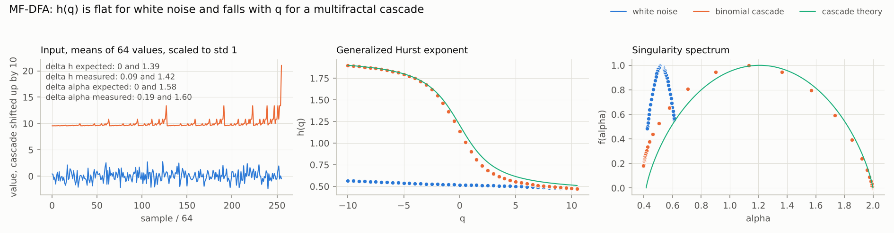

For white noise h(q) stays within 0.07 of 0.5 (delta h 0.09), for a binomial cascade with a = 0.75 it falls from 1.90 to 0.47 and follows the theory within 0.10 (delta h 1.42 against 1.39, delta alpha 1.60 against 1.58).

### Return interval statistics (`ris`)

Marks every value above a threshold (by default the 95th percentile) as an extreme event and returns the intervals r between consecutive events with their mean, median, spread and the risk parameter R = std(r) / mean(r). For uncorrelated values the intervals are geometric, R is sqrt(1 − p) for an exceedance probability p, and the mean is 1 / p. Long-term correlations cluster the extremes: R rises above 1 while the mean interval stays 1 / p.

| Runtime | Status | Entry point | Note |
|---|---|---|---|
| workbench | none |  |  |
| java | available (2.x) | `org.opentsx.algorithms.ris.RISTool` | 2.x model in opentsx-core: collects return intervals of many series into binned distributions, scaled by the mean interval R_q. It opens no window and stops with English messages. add rejects a NaN or infinite probability with IllegalArgumentException that names its index, before it writes a log line or changes the container. RISToolTest checks these. For results with 2 to 1024 intervals add needs RISTool.projekt, RISTool.logFileNames and initRqMIN(), and initRqCollectors() as well when RISTool.offset is not 0. Without them add throws IllegalStateException that names the missing setup, and a log line that cannot be written throws UncheckedIOException. A clean-room Java library for the univariate stage (DFA, RIS) is planned in TASK-015 P8.1. |
| python | available | `opentsx.algorithms.ris.RIS#analyze` | RIS(threshold_percentile=95).analyze(x). An event is a value strictly above the threshold; a value that is not finite or fewer than 3 events raise ValueError. analyze returns R as risk_parameter, without a risk label. survival_function(r) gives S(r), the share of intervals of r or longer. stretched_exponential_fit(r) is a maximum-likelihood fit of P(r) proportional to exp[-(r / tau_0)^gamma] and returns gamma and tau_0; analyze does not call it. gamma is near 1 for uncorrelated values (mean 1.08 over 40 series of 8192 values at the 95th percentile, above 1 because the intervals are whole numbers) and 1 − beta for 1/f^beta noise (Bunde et al. 2005). |
| processor | none |  |  |
| go | none |  |  |

| Port | Direction | Type | Description |
|---|---|---|---|
| `in` | in | series (one) |  |
| `events` | out | events | Indices of the values above the threshold |
| `intervals` | out | xy | Return interval r over the event number |
| `summary` | out | stats | num_events, threshold, mean_ri, median_ri, std_ri, min_ri, max_ri, risk_parameter |

| Parameter | Type | Default | Range | Description |
|---|---|---|---|---|
| `threshold` | number |  |  | Absolute threshold. When set, threshold_percentile is not used |
| `threshold_percentile` | number | `95` | 0 .. 100 | Percentile of the values that is the threshold |

Semantics: needs one series of input per output value; deterministic.

See: [more](../../docs/user-manual/11-classic-analytics.md#114-return-interval-statistics-ris), [description](../../systems/processors/ris.yaml).

Literature: A. Bunde, J. F. Eichner, J. W. Kantelhardt, S. Havlin, Long-term memory: a natural mechanism for the clustering of extreme events and anomalous residual times in climate records, Phys. Rev. Lett. 94, 048701 (2005); E. G. Altmann, H. Kantz, Recurrence time analysis, long-term correlations, and extreme events, Phys. Rev. E 71, 056106 (2005).

Example, from [`python-package/tests/examples/test_ris_example.py`](../../python-package/tests/examples/test_ris_example.py):

```python
from opentsx import RIS

ris = RIS(threshold_percentile=95)
results = {name: ris.analyze(x) for name, x in series.items()}
mean_interval = {name: r["mean_ri"] for name, r in results.items()}
risk = {name: r["risk_parameter"] for name, r in results.items()}
```

Run it:

```bash
(cd python-package && python -m pytest -q tests/examples/test_ris_example.py)
```

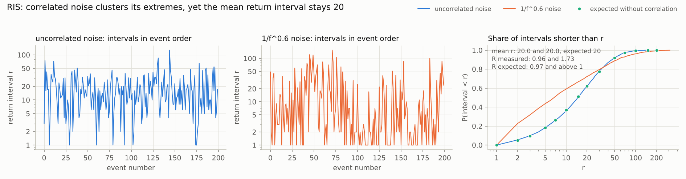

Uncorrelated noise and 1/f^0.6 noise both have a mean return interval of 20.0 above the 95th percentile, but R is 0.96 (expected 0.97) for uncorrelated noise and 1.73 for the correlated noise, where 23 percent of the intervals are 1 against 5 percent.

## Measure dependency between series

### Autocorrelation (`acf`)

Computes the autocorrelation C(k) = sum_i (y_i − m)(y_(i+k) − m) / sum_i (y_i − m)^2 with the mean m, for the lags k from 0 to min(n/2, maxLag) − 1 samples. C(0) is 1. For a long AR(1) series with the coefficient phi, C(k) is close to phi^k; for white noise it is close to 0 for every lag above 0.

| Runtime | Status | Entry point | Note |
|---|---|---|---|
| workbench | available | operator `acf` | Values that are not finite are skipped: the mean and the denominator use the finite values, and C(k) sums only the pairs whose two values are finite. A sine of 400 values with period 50 and one gap gives C(k) within 0.01 of the gap-free result. |
| java | none |  | The 2.x Swing button Auto-Correlation computes it inside TSOperationControlerPanel (opentsx-core), with no API and no test: the Pearson correlation of the series with a shifted copy, for lags up to half the length. |
| python | none |  |  |
| processor | none |  |  |
| go | none |  |  |

| Port | Direction | Type | Description |
|---|---|---|---|
| `in` | in | series (one) |  |
| `acf` | out | xy | C(k) over the lag k in samples |

| Parameter | Type | Default | Range | Description |
|---|---|---|---|---|
| `maxLag` | integer | `1000` | 1 ..  | Number of lags. The largest lag is maxLag − 1, and at most n/2 − 1. |

Semantics: needs one series of input per output value; deterministic; keeps series.

See: [description](../../systems/processors/acf.yaml).

Example, from [`opentsx-saas-frontend/src/workbench/examples/acf.example.test.ts`](../../opentsx-saas-frontend/src/workbench/examples/acf.example.test.ts):

```typescript
const raw: Bucket = {
  name: 'signals',
  xKind: 'time',
  xLabel: 't [s]',
  yLabel: 'y',
  t0Ms: T0,
  series: [
    { id: 'ar1', label: 'AR(1) phi 0.7', x: seconds, y: ar },
    { id: 'noise', label: 'white noise', x: seconds, y: noise },
  ],
};
const acf = OP_BY_ID['acf'];
const [c, w] = acf.apply(raw, { maxLag: 20 }).series;
```

Run it:

```bash
(cd opentsx-saas-frontend && npx vitest run src/workbench/examples/acf.example.test.ts)
```

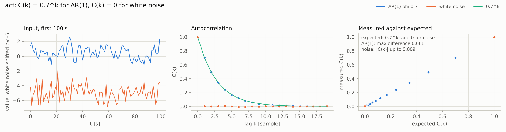

For 50000 values of AR(1) with phi 0.7 the autocorrelation follows 0.7^k within 0.006 up to lag 19, and for white noise |C(k)| stays at 0.009 or below for every lag above 0.

### Event synchronization (`es`)

Takes the local maxima above mean + 2 std of two whole series as events and counts the event pairs that lie closer than a local window, half the smallest distance to a neighbouring event of either series. Q = (c(b|a) + c(a|b)) / sqrt(m_a m_b) is in [0, 1], the delay q = (c(b|a) − c(a|b)) / sqrt(m_a m_b) in [-1, 1] says which series leads. The chance level q_rand is the mean Q of a against copies of b whose inter-event intervals are shuffled; only a Q clearly above q_rand points to a coupling.

| Runtime | Status | Entry point | Note |
|---|---|---|---|
| workbench | none |  | The workbench computes the same Q, q and q_rand per window of a pair with pair.es (es.ts), not over whole series. |
| java | available (2.x) | `org.opentsx.algorithms.eventsynchronisation.ESCalc#calc` | 2.x model in opentsx-core: ESCalc.calc(ti, tj) on sorted event times returns sync and delay, counts only events with two neighbours and normalizes by sqrt((m_a − 1)(m_b − 1)). No automated test. A clean-room Java library with Q_rand calibration is planned in TASK-015 P8.1. |
| python | available | `opentsx.algorithms.event_sync.EventSynchronization#analyze` | EventSynchronization().analyze(a, b), then surrogate_sync(events_1, events_2, shuffles=10, seed=1) for q_rand. calculate_synchronization takes event indices directly. leader names a series only when \|q\| is above delay_surrogates, the largest \|q\| of 19 copies of b with shuffled inter-event intervals (analyze surrogates=19, seed=1); 13 of 200 independent pairs of about 120 events name one. analyze raises ValueError for surrogates below 1, for a value that is not finite, for a series without events and for method absolute without threshold1 and threshold2. |
| processor | none |  |  |
| go | none |  |  |

| Port | Direction | Type | Description |
|---|---|---|---|
| `a` | in | series (one) |  |
| `b` | in | series (one) |  |
| `sync` | out | stats | overall_sync (Q), sync_1_to_2, sync_2_to_1, delay (q), delay_surrogates, leader, lead_lag_strength |
| `q_rand` | out | stats | Chance level from surrogate_sync |
| `events` | out | events (many) | Event indices of a and of b |

| Parameter | Type | Default | Range | Description |
|---|---|---|---|---|
| `method` | enum: std, percentile, absolute | `std` |  | Event threshold: mean + 2 std, the 95th percentile, or threshold1 and threshold2, which absolute requires |
| `threshold1` | number |  |  | Event threshold of a; overrides method |
| `threshold2` | number |  |  | Event threshold of b; overrides method |
| `tau_max` | number |  | 0 ..  | Cap of the local window. No cap by default. Unit: samples. |
| `shuffles` | integer | `10` | 1 ..  | Number of shuffled copies of b for q_rand |
| `surrogates` | integer | `19` | 1 ..  | Number of shuffled copies of b that the delay is compared with to name the leader |
| `seed` | integer | `1` |  | Seed of the Mulberry32 generator that shuffles |

Semantics: needs one series of input per output value; deterministic.

See: [more](../../docs/user-manual/11-classic-analytics.md#113-event-synchronization-es), [test vectors](../../docs/datamodel-2026/testvectors/pair-es.v1.json), [description](../../systems/processors/es.yaml).

Literature: R. Quian Quiroga, T. Kreuz, P. Grassberger, Event synchronization: a simple and fast method to measure synchronicity and time delay patterns, Phys. Rev. E 66, 041904 (2002).

Example, from [`python-package/tests/examples/test_es_example.py`](../../python-package/tests/examples/test_es_example.py):

```python
from opentsx import EventSynchronization

es = EventSynchronization()
results = {}
for share, (x, y) in pairs.items():
    r = es.analyze(x, y)
    q_rand = es.surrogate_sync(r["events_1"], r["events_2"], shuffles=10, seed=1)
    results[share] = {"Q": r["overall_sync"], "q_rand": q_rand, "leader": r["leader"]}
```

Run it:

```bash
(cd python-package && python -m pytest -q tests/examples/test_es_example.py)
```

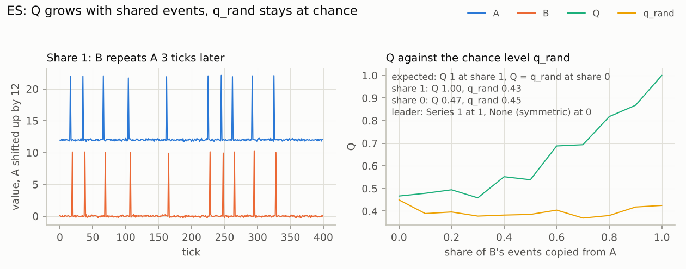

When B repeats every event of A 3 ticks later, Q is 1.00 against a chance level q_rand of 0.43 and A is the leader; when B shares no events with A, Q is 0.47 against q_rand 0.45, and Q rises in between with the share of copied events.

### Granger causality test (`granger`)

Tests whether the l past values of x improve the least-squares prediction of y from its own l past values. With RSS0 and RSS1 the residual sums of squares of the model without and with x and n = N − l rows, F = ((RSS0 − RSS1) / l) / (RSS1 / (n − 2l − 1)) and p = 1 − F_cdf(F; l, n − 2l − 1). A small p means that x Granger-causes y.

| Runtime | Status | Entry point | Note |
|---|---|---|---|
| workbench | none |  | The test per pair window is planned as pair.granger. |
| java | available (2.x) | `org.opentsx.algorithms.statistics.GrangerCausality#grangerCausalityTest` | 2.x model in opentsx-core: grangerCausalityTest(y, x, l) on two arrays; both models have an intercept and nothing is written to standard output. GrangerCausalityTest compares p with reference values from numpy and scipy, and checks over 200 seeds that x driving y at lag 1 gives p below 1e-6 for x to y while p for y to x averages 0.4 to 0.6. |
| python | none |  |  |
| processor | none |  |  |
| go | none |  |  |

| Port | Direction | Type | Description |
|---|---|---|---|
| `y` | in | series (one) | The series to predict. |
| `x` | in | series (one) | The predictor, as long as y. |
| `p` | out | stats | p value of the F test |

| Parameter | Type | Default | Range | Description |
|---|---|---|---|---|
| `l` | integer | required | 1 ..  | Number of past values of y and of x in the models. |

Semantics: needs one series of input per output value; deterministic.

See: [description](../../systems/processors/granger.yaml).

Literature: C. W. J. Granger, Investigating causal relations by econometric models and cross-spectral methods, Econometrica 37, 424 (1969).

### Event synchronisation per pair window (`pair.es`)

Puts series A and B on one clock and takes, in each window, the local maxima above mean + sigma std of each series as its events. An event pair counts as synchronous when it lies closer than half the smaller distance to a neighbouring event of either series, capped by tauMax. q_total = (c(B|A) + c(A|B)) / sqrt(m_A m_B) is in [0, 1], q_ab = c(B|A) / sqrt(m_A m_B) counts B after A and q_ba A after B, so q_ab > q_ba means B follows A. q_rand is the mean q_total of A against copies of B with shuffled intervals between its events: the level chance gives.

| Runtime | Status | Entry point | Note |
|---|---|---|---|
| workbench | available | operator `pair.es` | Operator "Event synchronisation", tab Multi-variate Analysis. Port of event_sync.py; the 8 shared test vector cases give the same four numbers to 12 decimals. A window without events in A or B gives 0 in every field. Strictly periodic events keep their timing under any shuffle, so there q_rand equals q_total. The defaults above hold for the operator panel and for a call of apply without them. An emptied or non-numeric sigma, tauMax, shuffles, seed, every or minCoverage is refused with its name, and so are a negative every, minCoverage or tauMax, a shuffles below 1 and a seed that is not a whole number, for example sigma: empty value; expected a number such as 2. step is read only when window is a width in seconds and maxAge only when fill is as-of; then an emptied, negative or non-numeric value is refused too. |
| java | planned |  | TASK-015 P8.1 plans event synchronisation with the closed-form Q_rand calibration in a clean-room Java library. The 2.x ESCalc in opentsx-core (operator es) works on whole series. |
| python | none |  | The Python package computes the same q_total, q_ab, q_ba and q_rand over whole series with EventSynchronization and surrogate_sync (operator es), not per pair window. |
| processor | planned |  | TASK-015 phase 3: the pair methods as a stream phase on top of align.vector. |
| go | none |  |  |

| Port | Direction | Type | Description |
|---|---|---|---|
| `a` | in | series (many) | Series A. Without b every pair of its series is compared. |
| `b` | in | series (many) | Series B, optional: each series of a is paired with each series of b. |
| `q_total` | out | series (many) | Metric pair.es.q_total, tags a, b, window and step; one value per window at its centre. |
| `q_ab` | out | series (many) | Metric pair.es.q_ab, the share of synchronous events where B follows A. |
| `q_ba` | out | series (many) | Metric pair.es.q_ba, the share where A follows B. |
| `q_rand` | out | series (many) | Metric pair.es.q_rand, the mean q_total against the shuffled copies of B. |

| Parameter | Type | Default | Range | Description |
|---|---|---|---|---|
| `sigma` | number | `2` |  | Events are local maxima above mean + sigma std of the window (population std); the first and the last tick and a tick next to a gap are none. |
| `tauMax` | duration | `PT0S` |  | Cap of the local window of every event pair. 0: no cap. |
| `shuffles` | integer | `10` | 1 ..  | Number of copies of B with shuffled intervals for q_rand. |
| `seed` | integer | `1` |  | Seed of the mulberry32 generator that shuffles. |
| `pairing` | enum: same, intersect | `same` |  | same: an episode of A with the episode of B that has the same start and end. intersect: overlapping episodes on their overlap. A series without episodes is one range from its first sample to its last plus one sampling interval. |
| `window` | string | `episode` |  | episode: one window over the whole pair range. A number: the window width in seconds; a window that would end after the range is not computed. |
| `step` | duration | `PT0S` |  | Distance of the window starts. 0: the window width, windows side by side. |
| `every` | duration | `PT0S` |  | Clock; ticks are multiples of every since the epoch. 0: the larger sampling interval (median spacing) of A and B. |
| `agg` | enum: MEAN, LAST, FIRST, MIN, MAX, SUM, COUNT | `MEAN` |  | Aggregate of the samples of one series in one tick, as in align.vector. |
| `fill` | enum: none, as-of | `none` |  | as-of: a tick without a sample takes the last value when it is at most maxAge old. The fill does not reach back across the start of the pair range. |
| `maxAge` | duration | `PT60S` |  | Age of the oldest value fill as-of takes. |
| `minCoverage` | number | `0.8` | 0 .. 1 | Below this share of ticks with A and B a window gives NaN with quality 1 (see pair.coverage). |

Semantics: needs one window of input per output value; deterministic.

See: [more](../../docs/user-manual/11-classic-analytics.md#113-event-synchronization-es), [test vectors](../../docs/datamodel-2026/testvectors/pair-es.v1.json), [description](../../systems/processors/pair.es.yaml), plan: [3 (processor), P8.1 (java)](../../EVOLUTION/TASK-015-multivariate-analysis.md).

Literature: R. Quian Quiroga, T. Kreuz, P. Grassberger, Event synchronization: a simple and fast method to measure synchronicity and time delay patterns, Phys. Rev. E 66, 041904 (2002).

Example, from [`opentsx-saas-frontend/src/workbench/examples/pair.es.example.test.ts`](../../opentsx-saas-frontend/src/workbench/examples/pair.es.example.test.ts):

```typescript
const pair: Bucket = {
  name: 'events', xKind: 'time', xLabel: 't [s]', yLabel: 'y', t0Ms: T0,
  series: [
    { id: 'A', label: 'A', x: seconds, y: spikesA },
    { id: 'B', label: 'B', x: seconds, y: spikesB },
  ],
};
const es = OP_BY_ID['pair.es'];
const out = es.apply(pair, { window: 600, sigma: 2, shuffles: 10, seed: 1 });
const field = (name: string) => out.series.find((s) => s.metric === `pair.es.${name}`)!;
const [qTotal, qAb, qBa, qRand] = ['q_total', 'q_ab', 'q_ba', 'q_rand'].map(field);
```

Run it:

```bash
(cd opentsx-saas-frontend && npx vitest run src/workbench/examples/pair.es.example.test.ts)
```

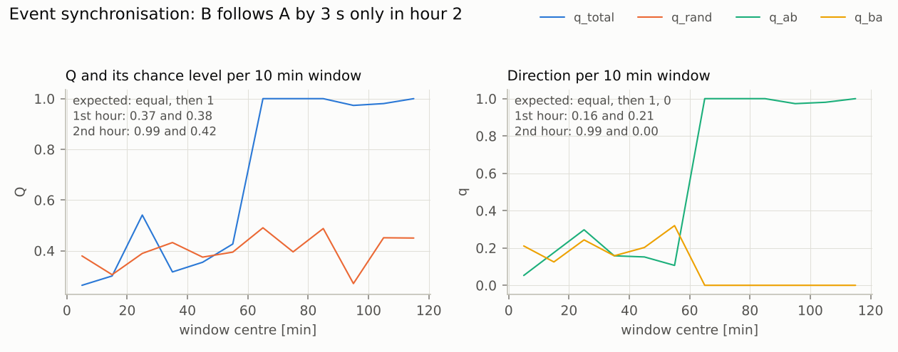

While B fires independently of A, q_total is 0.37 against a chance level q_rand of 0.38; while B fires 3 s after every event of A, q_total is 0.99 against q_rand 0.42, and q_ab 0.99 against q_ba 0.00 says that B follows A.

### Cross-correlation per pair window (`pair.xcorr`)

Puts series A and B on one clock and computes in each window CC(k) = Σ (a[t] − ā)(b[t − k] − b̄) / ((N − 1) s_a s_b) for k from −lags to lags ticks, with N the ticks of the window and B shifted in by zeros, so CC(0) is the Pearson correlation. max is the extreme of |CC| with its sign, lag is −k times the clock at that extreme (lag > 0: B follows A), and strength = (|max| − mean of CC) / std of CC over the 2 lags + 1 values. A tick without a value counts as the mean of its series.

| Runtime | Status | Entry point | Note |
|---|---|---|---|
| workbench | available | operator `pair.xcorr` | Operator "Cross-correlation", tab Multi-variate Analysis. Port of KreuzKorrelation.calcKRCoeffizient and CCFunction.calcStrength_VERSION_A of kamir/WikiExplorer.NG at 7b56e3d, equal to the original to 12 decimals in the 5 cases of the test vectors. Unlike the original, max and lag belong to the extreme that strength measures, also when it is negative. A window without spread in A or B gives NaN in all three fields. The defaults above hold for the operator panel and for a call of apply without them. An emptied, negative or non-numeric lags, every or minCoverage is refused with its name, for example lags: empty value; expected a whole number of clock ticks, 0 or more. step is read only when window is a width in seconds and maxAge only when fill is as-of; then such a value is refused too. |
| java | planned |  | No Java cross-correlation exists. TASK-015 P8.1 plans a clean-room Java library for lagged cross-correlation with the link strengths l_adj, l_norm and l_trans; strength here is l_norm. |
| python | none |  |  |
| processor | planned |  | TASK-015 phase 3: the pair methods as a stream phase on top of align.vector. |
| go | none |  |  |

| Port | Direction | Type | Description |
|---|---|---|---|
| `a` | in | series (many) | Series A. Without b every pair of its series is compared. |
| `b` | in | series (many) | Series B, optional: each series of a is paired with each series of b. |
| `max` | out | series (many) | Metric pair.xcorr.max, tags a, b, window and step; one value per window at its centre. |
| `lag` | out | series (many) | Metric pair.xcorr.lag, in seconds; lag > 0: B follows A. |
| `strength` | out | series (many) | Metric pair.xcorr.strength. For a positive peak at most 2 lags / sqrt(2 lags + 1), 4.36 for lags 10. |

| Parameter | Type | Default | Range | Description |
|---|---|---|---|---|
| `lags` | integer | `10` | 0 ..  | Largest shift of B against A in both directions. Unit: clock ticks. |
| `pairing` | enum: same, intersect | `same` |  | same: an episode of A with the episode of B that has the same start and end. intersect: overlapping episodes on their overlap. A series without episodes is one range from its first sample to its last plus one sampling interval. |
| `window` | string | `episode` |  | episode: one window over the whole pair range. A number: the window width in seconds; a window that would end after the range is not computed. |
| `step` | duration | `PT0S` |  | Distance of the window starts. 0: the window width, windows side by side. |
| `every` | duration | `PT0S` |  | Clock; ticks are multiples of every since the epoch. 0: the larger sampling interval (median spacing) of A and B. |
| `agg` | enum: MEAN, LAST, FIRST, MIN, MAX, SUM, COUNT | `MEAN` |  | Aggregate of the samples of one series in one tick, as in align.vector. |
| `fill` | enum: none, as-of | `none` |  | as-of: a tick without a sample takes the last value when it is at most maxAge old. The fill does not reach back across the start of the pair range. |
| `maxAge` | duration | `PT60S` |  | Age of the oldest value fill as-of takes. |
| `minCoverage` | number | `0.8` | 0 .. 1 | Below this share of ticks with A and B a window gives NaN with quality 1 (see pair.coverage). |

Semantics: needs one window of input per output value; deterministic.

See: [more](../../docs/user-manual/16-engineering-method.md#168-compare-two-series-in-pair-windows), [test vectors](../../docs/datamodel-2026/testvectors/pair-xcorr.v1.json), [description](../../systems/processors/pair.xcorr.yaml), plan: [3 (processor), P8.1 (java)](../../EVOLUTION/TASK-015-multivariate-analysis.md).

Literature: M. Kämpf, Time-Series-Based Reconstruction and Analysis of Complex Networks: Methods for Quantitative Comparison of Dynamic Processes, dissertation, Martin Luther University Halle-Wittenberg (2017), urn:nbn:de:gbv:3:4-21151.

Example, from [`opentsx-saas-frontend/src/workbench/examples/pair.xcorr.example.test.ts`](../../opentsx-saas-frontend/src/workbench/examples/pair.xcorr.example.test.ts):

```typescript
const pair: Bucket = {
  name: 'pair', xKind: 'time', xLabel: 't [s]', yLabel: 'y', t0Ms: T0,
  series: [
    { id: 'A', label: 'A', x: seconds, y: a },
    { id: 'B', label: 'B', x: seconds, y: b },
  ],
};
const xcorr = OP_BY_ID['pair.xcorr'];
const out = xcorr.apply(pair, { window: 600, step: 300, lags: 10 });
const field = (name: string) => out.series.find((s) => s.metric === `pair.xcorr.${name}`)!;
const [max, lag, strength] = ['max', 'lag', 'strength'].map(field);
```

Run it:

```bash
(cd opentsx-saas-frontend && npx vitest run src/workbench/examples/pair.xcorr.example.test.ts)
```

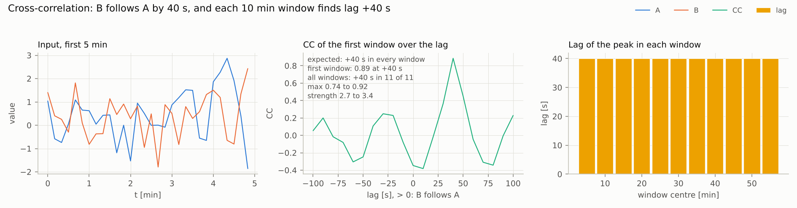

B is A delayed by 40 s plus noise; in all 11 windows of 10 min the peak of the cross-correlation lies at the planted lag of +40 s, with max 0.74 to 0.92 and strength 2.7 to 3.4.

## Test against surrogates

### Shuffle values (`shuffle`)

Puts the values of each series into a random order (Fisher-Yates from the last value down, rounds times in a row) and leaves the time axis as it is. The values and their distribution stay; their order in time, and with it the autocorrelation, is lost. A statistic that keeps its value on shuffled copies does not depend on the order of the values.

| Runtime | Status | Entry point | Note |
|---|---|---|---|
| workbench | available | operator `shuffle` | Drops the ground-truth marks of the bucket: the values have left their place in time. |
| java | available (2.x) | `org.opentsx.data.series.TimeSeriesObject#shuffleYValues` | 2.x model in opentsx-core: shuffleYValues(rounds) shuffles in place with Collections.shuffle and no seed, so every call gives another order. No automated test. Surrogates by shuffling in a clean-room Java library are planned in TASK-015 P8.1. |
| python | none |  | isi_shuffle in opentsx.algorithms.event_sync shuffles the intervals between events, not the values (operator surrogate.isi-shuffle). |
| processor | none |  |  |
| go | none |  |  |

| Port | Direction | Type | Description |
|---|---|---|---|
| `in` | in | series (one) |  |
| `out` | out | series | The same values in a random order on the time axis of the input |

| Parameter | Type | Default | Range | Description |
|---|---|---|---|---|
| `rounds` | integer | `1` | 1 ..  | Number of shuffles in a row. |
| `seed` | integer | `1` |  | Seed of the Mulberry32 generator; the same seed gives the same order. |

Semantics: needs one series of input per output value; deterministic; keeps time, unit, count, series.

See: [description](../../systems/processors/shuffle.yaml).

Literature: J. Theiler, S. Eubank, A. Longtin, B. Galdrikian, J. D. Farmer, Testing for nonlinearity in time series: the method of surrogate data, Physica D 58, 77 (1992).

Example, from [`opentsx-saas-frontend/src/workbench/examples/shuffle.example.test.ts`](../../opentsx-saas-frontend/src/workbench/examples/shuffle.example.test.ts):

```typescript
const raw: Bucket = {
  name: 'ar1',
  xKind: 'time',
  xLabel: 't [s]',
  yLabel: 'y',
  t0Ms: T0,
  series: [{ id: 'ar1', label: 'AR(1) 0.9', x: seconds, y: ar }],
};
const shuffle = OP_BY_ID['shuffle'];
const out = shuffle.apply(raw, { rounds: 1, seed: 1 }).series[0];
const acf = OP_BY_ID['acf'];
const before = acf.apply(raw, { maxLag: 30 }).series[0];
const after = acf.apply({ ...raw, series: [out] }, { maxLag: 30 }).series[0];
```

Run it:

```bash
(cd opentsx-saas-frontend && npx vitest run src/workbench/examples/shuffle.example.test.ts)
```

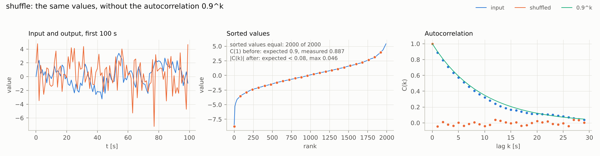

Shuffling 2000 values of an AR(1) series with coefficient 0.9 keeps all 2000 values, while the autocorrelation at lag 1 falls from the measured 0.887 (expected 0.9) to at most 0.046 in absolute value at lags 1 to 29, below the white-noise bound 0.08.

### Inter-event interval shuffle (`surrogate.isi-shuffle`)

Puts the intervals between consecutive events into a random order (Fisher-Yates, from the last interval down) and adds them up again from the first event. The first and the last event, the event count and the set of intervals stay; the timing relative to any other series is lost. A coupling measure that keeps its value on such copies is explained by the event rate and the intervals alone.

| Runtime | Status | Entry point | Note |
|---|---|---|---|
| workbench | none |  | isiShuffle in es.ts runs only inside pair.es, for q_rand; it is no operator of its own. |
| java | none |  |  |
| python | available | `opentsx.algorithms.event_sync.isi_shuffle` | isi_shuffle(events, Mulberry32(seed)) returns one copy; fewer than 3 events are returned unchanged. EventSynchronization.surrogate_sync uses it for q_rand. Mulberry32 draws bit for bit what the workbench draws. |
| processor | none |  |  |
| go | none |  |  |

| Port | Direction | Type | Description |
|---|---|---|---|
| `in` | in | events (one) |  |
| `out` | out | events | The event times with shuffled intervals |

| Parameter | Type | Default | Range | Description |
|---|---|---|---|---|
| `seed` | integer | `1` |  | Seed of the Mulberry32 generator; one generator draws all copies in turn |
| `shuffles` | integer | `10` | 1 ..  | Number of copies surrogate_sync draws and averages |

Semantics: needs one series of input per output value; deterministic; keeps count.

See: [test vectors](../../docs/datamodel-2026/testvectors/pair-es.v1.json), [description](../../systems/processors/surrogate.isi-shuffle.yaml).

Example, from [`python-package/tests/examples/test_isi_shuffle_example.py`](../../python-package/tests/examples/test_isi_shuffle_example.py):

```python
from opentsx import EventSynchronization
from opentsx.algorithms.event_sync import Mulberry32, isi_shuffle

rand = Mulberry32(1)
copies = [isi_shuffle(events_b, rand) for _ in range(10)]

es = EventSynchronization()
q_original = es.calculate_synchronization(events_a, events_b)[0]
q_copies = [es.calculate_synchronization(events_a, c)[0] for c in copies]
```

Run it:

```bash
(cd python-package && python -m pytest -q tests/examples/test_isi_shuffle_example.py)
```

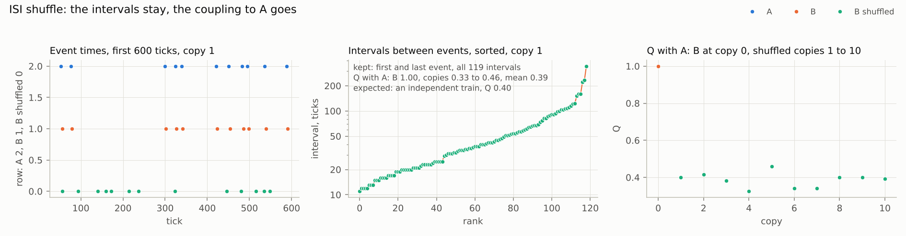

Ten shuffled copies of B, which repeats every event of A 3 ticks later, keep the first and last event and all 119 intervals, while Q with A falls from 1.00 to between 0.33 and 0.46 (mean 0.39), the level of an independent train (0.40).

### Phase-randomized surrogate (`surrogate.phase`)

Transforms the series with an FFT, multiplies each Fourier coefficient c_k by e^(iφ_k) with a random phase φ_k, uniform in [0, 2π), and its mirror c_(N−k) by e^(−iφ_k), and transforms back. The copy has the same power spectrum, and so the same linear autocorrelation, as the input; nonlinear structure and the phase relation to any other series are lost. A measure that keeps its value on such copies is explained by the spectrum alone.

| Runtime | Status | Entry point | Note |
|---|---|---|---|
| workbench | none |  | The operator shuffle keeps the values and destroys the spectrum. |
| java | available (2.x) | `org.opentsx.data.series.TimeSeriesObjectFFT#getModifiedTimeSeries_PhaseRandomized` | 2.x model in opentsx-core: getModifiedTimeSeries_PhaseRandomized(random) on TimeSeriesObjectFFT.convertToMessreiheFFT(ts) draws the phases from the java.util.Random it is given; without an argument it uses a new Random. Pads to a power of two with zeros and returns the first n values of the inverse transform, so for other lengths the result does not keep the amplitude spectrum; keeps the real coefficient at the Nyquist frequency; sets c_0 of the padded values to 0, so the result has mean 0 only for a length that is a power of two; opens no window. LongTermCorrelationSeriesGenerator.getPhaseRandomizedRow(ts, false, false) calls it without a seed. FFTPhaseRandomizer.getPhaseRandomizedRow mode 1 adds random phases the same way, mode 0 permutes the phases of the coefficients instead; getPhaseRandomizedModifiedFFT_MULTIPLY_RANDOM_INV(random) and getPhaseRandomizedModifiedFFT_SHUFFLED_INV(random) take a seed. TimeSeriesObjectFFTTest checks the amplitude spectrum, the change of the series and the seed of all three. Surrogates by phase randomization in a clean-room Java library are planned in TASK-015 P8.1. |
| python | none |  |  |
| processor | none |  |  |
| go | none |  |  |

| Port | Direction | Type | Description |
|---|---|---|---|
| `in` | in | series (one) |  |
| `out` | out | series | One surrogate copy as long as the input |

Semantics: needs one series of input per output value; not deterministic; keeps count.

See: [more](../../docs/user-manual/11-classic-analytics.md), [description](../../systems/processors/surrogate.phase.yaml).

Literature: J. Theiler, S. Eubank, A. Longtin, B. Galdrikian, J. D. Farmer, Testing for nonlinearity in time series: the method of surrogate data, Physica D 58, 77 (1992).

## Search for patterns

### Subsequence search (`pattern.search`)

Finds the topK windows of the selected series that look most like a query pattern of m values, m ≥ 4. Both distances compare z-normalized windows. zED is their Euclidean distance, computed for every window at once with MASS in O(n log n). DTW is dynamic time warping in a Sakoe-Chiba band of band · m samples, pruned exactly with LB_Kim and LB_Keogh, so it also matches a copy that is a little faster or slower. Two matches in one series start at least m/2 samples apart, windows with NaN are skipped, and a window may span episodes where the sampling continues.

| Runtime | Status | Entry point | Note |
|---|---|---|---|
| workbench | none |  |  |
| java | available | `org.opentsx.retrieval.pattern.PatternSearch` | EpisodeService.similarTo(pattern) or similarTo(episodeId, offset, length), then distance(Distance.dtw(band)), topK(k) and fetch(). Distance.dtw has no default band. The retrieval server offers it as POST /v1/patterns/search. |
| python | available | `opentsx.client.retrieval.RetrievalClient#search` | search(pattern=..., distance="DTW", band=0.1, top_k=10) calls POST /v1/patterns/search of the retrieval server and returns the matches as a DataFrame; Python computes nothing. |
| processor | none |  |  |
| go | none |  | Concept 11, section 6: the Go core runs no pattern search and would call the Java search as a sidecar (sidecar.call). |

| Port | Direction | Type | Description |
|---|---|---|---|
| `in` | in | series (many) |  |
| `matches` | out | events (many) | PatternMatch per window, best first: episodeId, seriesId, offset, length, distance, metric zED or DTW(w=band) |

| Parameter | Type | Default | Range | Description |
|---|---|---|---|---|
| `pattern` | list |  |  | Query values, 4 to 100000 (EpisodeService.MAX_PATTERN_LENGTH). Instead of pattern: episodeId, offset and length. |
| `episodeId` | string |  |  | Episode that holds the query. |
| `offset` | integer |  | 0 ..  | First sample of the query in that episode. |
| `length` | integer |  | 4 .. 100000 | Number of samples of the query, 4 to 100000 (EpisodeService.MAX_PATTERN_LENGTH) and at most the values of the episode. |
| `distance` | enum: zED, DTW | `zED` |  | z-normalized Euclidean distance or dynamic time warping. |
| `band` | number | `0.1` | 0 .. 1 | DTW only: width of the Sakoe-Chiba band as a share of m. |
| `topK` | integer | `10` | 1 .. 1000 | Number of matches. |

Semantics: needs one series of input per output value; deterministic.

See: [more](../../docs/user-manual/09-retrieval.md#93-pattern-search), [description](../../systems/processors/pattern.search.yaml).

Literature: T. Rakthanmanon et al., Searching and mining trillions of time series subsequences under dynamic time warping, Proc. 18th ACM SIGKDD, 262 (2012); H. Sakoe, S. Chiba, Dynamic programming algorithm optimization for spoken word recognition, IEEE Trans. Acoust. Speech Signal Process. 26, 43 (1978).

Example, from [`opentsx-retrieval/src/test/java/org/opentsx/retrieval/examples/PatternSearchExampleTest.java`](../../opentsx-retrieval/src/test/java/org/opentsx/retrieval/examples/PatternSearchExampleTest.java):

```java
InMemorySeriesStore store = new InMemorySeriesStore();
store.write(episodes);
EpisodeService svc = new EpisodeService(store);
List<PatternMatch> euclidean = svc.similarTo(pattern)
        .metric("wind.met.wind_speed")
        .topK(4)
        .fetch();
List<PatternMatch> dtw = svc.similarTo(pattern)
        .metric("wind.met.wind_speed")
        .distance(Distance.dtw(0.2))
        .topK(4)
        .fetch();
```

Run it:

```bash
mvn -B -ntp -pl opentsx-retrieval test -Dtest=PatternSearchExampleTest
```

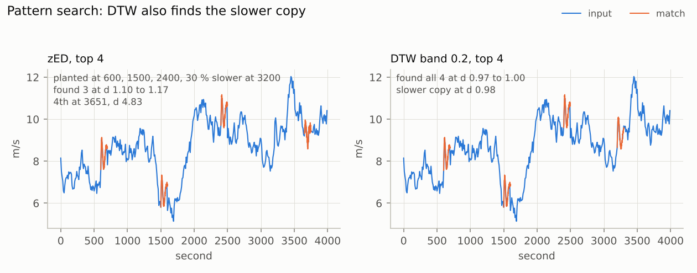

Both distances find the 3 planted copies of the pattern, zED at distances 1.10 to 1.17; only DTW with band 0.2 also finds the copy that is 30 % slower, at distance 0.98, while the fourth zED match lies elsewhere at 4.83.

### Similar episodes (`pattern.similar-episodes`)

Ranks whole episodes by how much they look like a query episode. Each episode becomes its z-normalized PAA of 64 values, so episodes of different length, level and scale compare; the distance is the Euclidean distance of these representations, or DTW on them. SAX words of 16 letters from an alphabet of 8 bound the Euclidean distance from below and skip candidates without changing the result. The query itself and episodes with fewer than 64 values are left out.

| Runtime | Status | Entry point | Note |
|---|---|---|---|
| workbench | none |  |  |
| java | available | `org.opentsx.retrieval.pattern.EpisodeSimilarity` | EpisodeService.similarEpisodes(episodeId).topK(k).fetch(); representation(points, saxLength, alphabet) changes 64, 16 and 8. EpisodeSimilarity.annotate stores the SAX word in EpisodeSummary.sax; no writer in this repository calls it, so the search computes the word of every candidate that carries none with the same parameters. The SAX bound skips candidates for zED only. The retrieval server offers it as POST /v1/episodes/similar. |
| python | available | `opentsx.client.retrieval.RetrievalClient#similar` | similar(episode_id, series=[...], top_k=10) calls POST /v1/episodes/similar of the retrieval server and returns a DataFrame; Python computes nothing. python-package/tests/test_retrieval_client.py checks the request body and the frame against a stub server; the endpoint is tested in RetrievalServerTest. |
| processor | none |  |  |
| go | none |  |  |

| Port | Direction | Type | Description |
|---|---|---|---|
| `in` | in | series (many) | Candidate episodes. Without metric, those of the query's metric. |
| `matches` | out | events (many) | PatternMatch per episode, best first: episodeId, seriesId, offset 0, length, distance, metric zED@paa64 |

| Parameter | Type | Default | Range | Description |
|---|---|---|---|---|
| `episodeId` | string | required |  | The query episode. |
| `distance` | enum: zED, DTW | `zED` |  | Euclidean distance of the representations or DTW on them. |
| `band` | number | `0.1` | 0 .. 1 | DTW only: width of the Sakoe-Chiba band as a share of 64. |
| `topK` | integer | `10` | 1 .. 1000 | Number of matches. |
| `points` | integer | `64` |  | Java only: length of the representation. |
| `saxLength` | integer | `16` |  | Java only: letters of a SAX word; at most points. |
| `alphabet` | integer | `8` |  | Java only: size of the SAX alphabet. |

Semantics: needs one series of input per output value; deterministic.

See: [more](../../docs/user-manual/09-retrieval.md#93-pattern-search), [description](../../systems/processors/pattern.similar-episodes.yaml).

Literature: E. Keogh, K. Chakrabarti, M. Pazzani, S. Mehrotra, Dimensionality reduction for fast similarity search in large time series databases, Knowl. Inf. Syst. 3, 263 (2001); J. Lin, E. Keogh, L. Wei, S. Lonardi, Experiencing SAX: a novel symbolic representation of time series, Data Min. Knowl. Discov. 15, 107 (2007).

Example, from [`opentsx-retrieval/src/test/java/org/opentsx/retrieval/examples/SimilarEpisodesExampleTest.java`](../../opentsx-retrieval/src/test/java/org/opentsx/retrieval/examples/SimilarEpisodesExampleTest.java):

```java
InMemorySeriesStore store = new InMemorySeriesStore();
store.write(episodes);
EpisodeService svc = new EpisodeService(store);
List<PatternMatch> like = svc.similarEpisodes(query.getEpisodeId())
        .distance(Distance.zNormalizedEuclidean())
        .topK(9)
        .fetch();
```

Run it:

```bash
mvn -B -ntp -pl opentsx-retrieval test -Dtest=SimilarEpisodesExampleTest
```

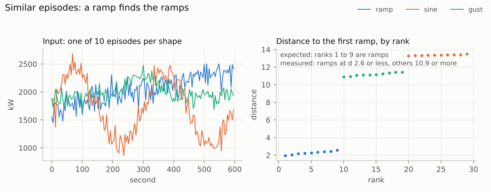

Of 30 noisy episodes of three shapes, the 9 nearest to the first ramp are the other 9 ramps, at distances of 2.6 or less, against 10.9 or more for every sine and gust.

## Build model features

### Lag feature (`feature.lag`)

Gives every sample the value steps samples earlier, out[i] = in[i - steps], on the time axis of the input. The first steps samples are gaps. A feature for models that predict from the recent past.

| Runtime | Status | Entry point | Note |
|---|---|---|---|
| workbench | available | operator `feature.lag` | The panel starts with steps 1. Like the processor, apply refuses a missing steps and steps that is not a whole number from 1 to 100000. |
| java | none |  |  |
| python | none |  |  |
| processor | available | `org.opentsx.retrieval.clean.CleanChain#Lag` | A step of the clean chain before a series sink (bin/opentsx vectors). Keeps the last steps samples of each series between blocks. |
| go | none |  |  |

| Port | Direction | Type | Description |
|---|---|---|---|
| `in` | in | series (one) |  |
| `out` | out | series |  |

| Parameter | Type | Default | Range | Description |
|---|---|---|---|---|
| `steps` | integer | required | 1 .. 100000 | Number of samples back. |

Semantics: needs one window of input per output value; deterministic; keeps time, unit, series; origin INHERIT.

See: [test vectors](../../docs/datamodel-2026/testvectors/clean-ops.v1.json), [description](../../systems/processors/feature.lag.yaml).

Example, from [`opentsx-saas-frontend/src/workbench/examples/feature.lag.example.test.ts`](../../opentsx-saas-frontend/src/workbench/examples/feature.lag.example.test.ts):

```typescript
const raw: Bucket = {
  name: 'noise',
  xKind: 'time',
  xLabel: 't [s]',
  yLabel: 'y',
  t0Ms: T0,
  series: [{ id: 'noise', label: 'white noise', x: seconds, y: noise }],
};
const lag = OP_BY_ID['feature.lag'];
const lagged = lag.apply(raw, { steps: 5 }).series[0];
```

Run it:

```bash
(cd opentsx-saas-frontend && npx vitest run src/workbench/examples/feature.lag.example.test.ts)
```

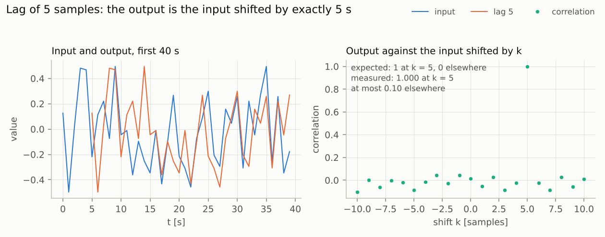

White noise lagged by 5 samples correlates with the input shifted by k samples at the measured 1.000 for k = 5 and at most 0.10 for every other shift from -10 to 10.

### Rolling-window feature (`feature.rolling`)

Gives every sample an aggregate of the values of the last window, the current sample included and gaps left out: the samples with a time after t - window and up to t. STD is the population standard deviation of those values. A feature for models that predict from the recent past.

| Runtime | Status | Entry point | Note |
|---|---|---|---|
| workbench | available | operator `feature.rolling` | window in units of the x axis, default 3600. Refuses a window of 0 or less, as the processor does. |
| java | none |  |  |
| python | none |  |  |
| processor | available | `org.opentsx.retrieval.clean.CleanChain#Rolling` | A step of the clean chain before a series sink (bin/opentsx vectors). Each sample enters and leaves the running sums and the extremes once, so a step costs the same for any window. A step adds up the window afresh when a finite value whose square is no finite number (above about 1.3e154 in magnitude) leaves it, and at every step while the values of the window or their squares add up beyond about 1.8e308. While such a value is in the window or the squares of the window add up beyond about 1.8e308, and the values of the window are finite and not all equal, STD is infinite, or NaN when MEAN is above about 1.3e154 in magnitude or infinite. While the values of the window are finite, add up beyond about 1.8e308 and are not all equal, MEAN is infinite even when their mean is a finite number: 1e308 and 1.5e308 give Infinity, not 1.25e308. While a finite value whose square is no finite number is in the window, MEAN can differ in the last digits from the mean of the window added up afresh. After a resample step the window may span at most 100000 of its intervals; a longer one refuses the DAG with an error that names the node, POST /v1/dags/deploy answers 400 and vectors deploy exits with code 2. Without a resample step before it, a window that holds more than 100000 values fails the sink with an error that names the node. Give a shorter window or resample the series first. |
| go | none |  |  |

| Port | Direction | Type | Description |
|---|---|---|---|
| `in` | in | series (one) |  |
| `out` | out | series |  |

| Parameter | Type | Default | Range | Description |
|---|---|---|---|---|
| `window` | duration | required |  | Length of the window. |
| `fn` | enum: MEAN, STD, MIN, MAX | `MEAN` |  | Aggregate of the values in the window. |

Semantics: needs one window of input per output value; deterministic; keeps time, unit, series; origin INHERIT.

See: [test vectors](../../docs/datamodel-2026/testvectors/clean-ops.v1.json), [description](../../systems/processors/feature.rolling.yaml).

Example, from [`opentsx-saas-frontend/src/workbench/examples/feature.rolling.example.test.ts`](../../opentsx-saas-frontend/src/workbench/examples/feature.rolling.example.test.ts):

```typescript
const raw: Bucket = {
  name: 'level',
  xKind: 'time',
  xLabel: 't [s]',
  yLabel: 'y',
  t0Ms: T0,
  series: [{ id: 'level', label: 'step', x: seconds, y: level }],
};
const rolling = OP_BY_ID['feature.rolling'];
const mean = rolling.apply(raw, { window: 20, fn: 'MEAN' }).series[0];
const std = rolling.apply(raw, { window: 20, fn: 'STD' }).series[0];
```

Run it:

```bash
(cd opentsx-saas-frontend && npx vitest run src/workbench/examples/feature.rolling.example.test.ts)
```

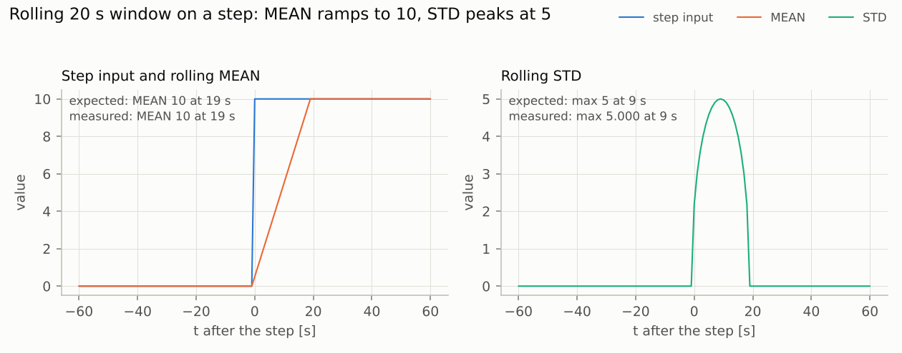

On a 1 s step from 0 to 10 a 20 s window gives a MEAN that reaches the measured 10 at 19 s after the step and a STD with the measured peak of 5.000 at 9 s, where half the window is 10.

## Apply physical models

### Power curve (`model.power-curve`)

Turns wind speed at hub height into the power the wind offers count turbines: 0 below cutIn and above cutOut, ratedKw from ratedWind on, and count * ratedKw * (v^3 - cutIn^3) / (ratedWind^3 - cutIn^3) in between. A model, not a measurement: it does not fall when a turbine is curtailed.

| Runtime | Status | Entry point | Note |
|---|---|---|---|
| workbench | available | operator `model.power-curve` | The panel starts with ratedKw 3000, cutIn 3, ratedWind 12.5, cutOut 25, count 1. Like the processor, apply refuses a missing ratedKw, cutIn, ratedWind or cutOut, ratedKw or count at or below 0, cutIn below 0, ratedWind at or below cutIn and cutOut below ratedWind. |
| java | available | `org.opentsx.windpark.sim.PowerCurve#powerKw` | The same curve for one turbine of a TurbineType of the windpark catalog, without count. Used by WindparkSimulator and PowerCurveAnalysis, tested through PowerCurveAnalysisTest. |
| python | none |  |  |
| processor | available | `org.opentsx.retrieval.clean.CleanChain#PowerCurve` | A step of the clean chain before a series sink (bin/opentsx vectors); the output unit is kW. |
| go | none |  |  |

| Port | Direction | Type | Description |
|---|---|---|---|
| `in` | in | series (one) | Wind speed at hub height in m/s |
| `out` | out | series | Power in kW |

| Parameter | Type | Default | Range | Description |
|---|---|---|---|---|
| `ratedKw` | number | required |  | Rated power of one turbine. Above 0. Unit: kW. |
| `cutIn` | number | required | 0 ..  | Wind speed below which the turbine gives nothing. Unit: m/s. |
| `ratedWind` | number | required |  | Wind speed from which the turbine gives rated power. Above cutIn. Unit: m/s. |
| `cutOut` | number | required |  | Wind speed above which the turbine stops. At least ratedWind. Unit: m/s. |
| `count` | number | `1` |  | Number of turbines that see the same wind. Above 0. |

Semantics: needs one point of input per output value; deterministic; keeps time, series; origin ESTIMATED.

See: [more](../../docs/user-manual/06-windpark.md), [test vectors](../../docs/datamodel-2026/testvectors/clean-ops.v1.json), [description](../../systems/processors/model.power-curve.yaml).

Example, from [`opentsx-saas-frontend/src/workbench/examples/model.power-curve.example.test.ts`](../../opentsx-saas-frontend/src/workbench/examples/model.power-curve.example.test.ts):

```typescript
const met: Bucket = {
  name: 'wind',
  xKind: 'time',
  xLabel: 't [s]',
  yLabel: 'm/s',
  t0Ms: T0,
  series: [{ id: 'wind', label: 'wind speed at hub height', unit: 'm/s', x: seconds, y: wind }],
};
const curve = OP_BY_ID['model.power-curve'];
const power = curve.apply(met, { ratedKw: 3000, cutIn: 3, ratedWind: 12.5, cutOut: 25, count: 1 }).series[0];
```

Run it:

```bash
(cd opentsx-saas-frontend && npx vitest run src/workbench/examples/model.power-curve.example.test.ts)
```

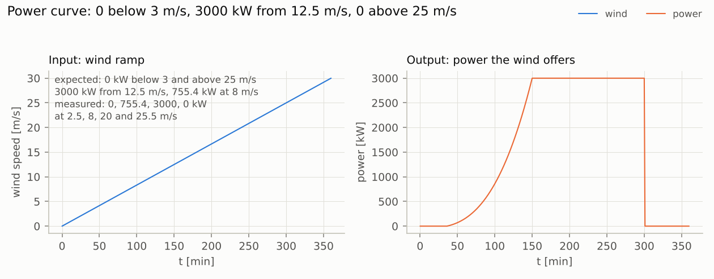

A wind ramp from 0 to 30 m/s gives 0 kW up to 3 m/s, the cubic rise to the measured 755.4 kW at 8 m/s, 3000 kW from 12.5 m/s to 25 m/s and 0 kW above 25 m/s, as expected for the default curve.

### Wind shear (`model.wind-shear`)

Carries the wind speed measured at one height to another height by the power law v * (toM / fromM)^alpha. The exponent alpha belongs to the site: about 0.1 over open sea, 0.14 over flat land, 0.2 and more over rough land. A model with one exponent for every weather: it knows neither the stability of the air nor the wind direction.

| Runtime | Status | Entry point | Note |
|---|---|---|---|
| workbench | available | operator `model.wind-shear` | The panel starts with fromM 10, toM 120, alpha 0.11. Like the processor, apply refuses a missing fromM, toM or alpha, fromM or toM at or below 0 and alpha outside [0, 0.6]. |
| java | none |  |  |
| python | none |  |  |
| processor | available | `org.opentsx.retrieval.clean.CleanChain#WindShear` | A step of the clean chain before a series sink (bin/opentsx vectors). Refuses fromM or toM at or below 0 and alpha outside [0, 0.6]. |
| go | none |  |  |

| Port | Direction | Type | Description |
|---|---|---|---|
| `in` | in | series (one) | Wind speed at the height fromM |
| `out` | out | series | Wind speed at the height toM |

| Parameter | Type | Default | Range | Description |
|---|---|---|---|---|
| `fromM` | number | required |  | Height of the measurement. Above 0. Unit: m. |
| `toM` | number | required |  | Height the wind is carried to. Above 0. Unit: m. |
| `alpha` | number | required | 0 .. 0.6 | Shear exponent of the site. |

Semantics: needs one point of input per output value; deterministic; keeps time, unit, series; origin ESTIMATED.

See: [test vectors](../../docs/datamodel-2026/testvectors/clean-ops.v1.json), [description](../../systems/processors/model.wind-shear.yaml).

Literature: G. Hellmann, Meteorologische Zeitschrift 34, 273 (1916).

Example, from [`opentsx-saas-frontend/src/workbench/examples/model.wind-shear.example.test.ts`](../../opentsx-saas-frontend/src/workbench/examples/model.wind-shear.example.test.ts):

```typescript
const mast: Bucket = {
  name: 'wind_10m',
  xKind: 'time',
  xLabel: 't [s]',
  yLabel: 'm/s',
  t0Ms: T0,
  series: [{ id: 'wind', label: 'wind speed at 10 m', unit: 'm/s', x: seconds, y: v10 }],
};
const shear = OP_BY_ID['model.wind-shear'];
const hub = shear.apply(mast, { fromM: 10, toM: 120, alpha: 0.14 }).series[0];
```

Run it:

```bash
(cd opentsx-saas-frontend && npx vitest run src/workbench/examples/model.wind-shear.example.test.ts)
```

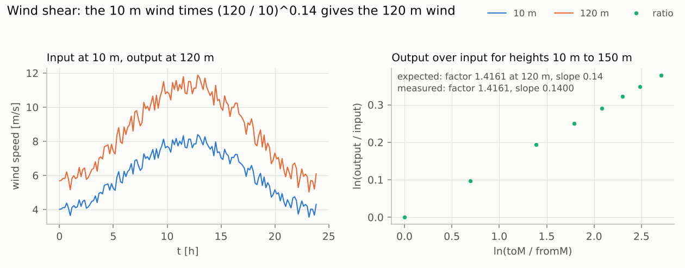

With alpha 0.14 every value of a day of 10 m wind speed is multiplied by the expected factor (120 / 10)^0.14 = 1.4161, and ln(output / input) over ln(toM / fromM) for heights from 10 m to 150 m is a straight line with the measured slope 0.1400.

### Power curve, method of bins (`powercurve.bins`)

Averages wind speed and active power of one turbine over aligned intervals, sorts the interval means into wind-speed bins and gives per bin the count, mean wind, mean power, its standard deviation and the reference power at the mean wind (IEC 61400-12-1, simplified: nacelle anemometer, no air-density or site correction). The performance index is produced / expected energy over the intervals in which the reference expects at least minExpectedShare of rated power. Runs of such intervals with measured / reference power below ratioThreshold are underperformance periods, with their mean ratio and the energy lost against the reference.

| Runtime | Status | Entry point | Note |
|---|---|---|---|
| workbench | none |  |  |
| java | available | `org.opentsx.windpark.analysis.PowerCurveAnalysis#analyze` | Java API only; no command runs it. |
| python | none |  |  |
| processor | none |  |  |
| go | none |  |  |

| Port | Direction | Type | Description |
|---|---|---|---|
| `wind` | in | series (one) | Wind speed of the turbine in m/s |
| `power` | in | series (one) | Active power of the turbine in kW |
| `bins` | out | xy | Per bin: windFromMs, windToMs, count, meanWindMs, meanPowerKw, stdPowerKw, referenceKw |
| `underperformance` | out | events | Per period: fromMicros, toMicros, meanRatio, lostEnergyKwh |

| Parameter | Type | Default | Range | Description |
|---|---|---|---|---|
| `interval` | duration | `PT10M` |  | Length of the aligned averaging intervals. An interval without a wind or a power value is left out. |
| `binWidthMs` | number | `0.5` |  | Width of the wind-speed bins. Unit: m/s. |
| `ratioThreshold` | number | `0.8` | 0 ..  | An interval with measured / reference power below it underperforms. |
| `minExpectedShare` | number | `0.1` | 0 .. 1 | Share of rated power the reference must expect for an interval to count in the performance index and in underperformance. |
| `reference` | enum: GENERIC-3MW, GENERIC-8MW |  |  | Turbine type whose reference curve (PowerCurve.powerKw) and rated power are used. The second analyze takes any curve and its rated power, for example a warranted curve. |

Semantics: needs one series of input per output value; deterministic.

See: [more](../../docs/user-manual/06-windpark.md#65-power-curve-analysis), [description](../../systems/processors/powercurve.bins.yaml).

Literature: IEC 61400-12-1:2017, Wind energy generation systems, Part 12-1: Power performance measurements of electricity producing wind turbines.

Example, from [`opentsx-windpark/src/test/java/org/opentsx/windpark/examples/PowerCurveBinsExampleTest.java`](../../opentsx-windpark/src/test/java/org/opentsx/windpark/examples/PowerCurveBinsExampleTest.java):

```java
PowerCurveAnalysis.Settings settings = PowerCurveAnalysis.Settings.defaults();
PowerCurveAnalysis.Result all = PowerCurveAnalysis.analyze(TurbineType.GENERIC_3MW, wind, power, settings);
List<PowerCurveAnalysis.Underperformance> found = all.underperformance();
PowerCurveAnalysis.Result healthy = PowerCurveAnalysis.analyze(TurbineType.GENERIC_3MW, healthyWind, healthyPower, settings);
List<PowerCurveAnalysis.Bin> curve = healthy.bins();
```

Run it:

```bash
mvn -B -ntp -pl opentsx-windpark test -Dtest=PowerCurveBinsExampleTest
```


Over 48 simulated hours the bins with 5 or more of the 252 healthy 10-minute intervals lie within 253 kW of the reference curve (performance index 0.992), and a curtailment to 500 kW from hour 20 to 26 is found as one underperformance period from hour 20.0 to 26.0 with a mean ratio of 0.39.

## Find planned and missing operators

These operators have no runtime today.

| Operator | Id | Section | What it computes | Status | Plan |
|---|---|---|---|---|---|
| Gap filling | `fill.gaps` | Clean and convert values | Fills the gaps of a series linearly, from the season or from a model, and marks every filled value with the quality code SUBSTITUTED. align.vector fills a missing tick with the last value (fill as-of); no operator fills the gaps of a series. | planned | [P6](../../EVOLUTION/TASK-018-analytics-storage-extensions.md) |
| Change-point segments | `segment.changepoint` | Cut series into episodes | Cuts a series where its behaviour changes, for example where the mean or the variance shifts. CUSUM adds up the deviations from a reference level and marks a change when the sum passes a threshold; PELT finds the change points that minimise a cost per segment plus a penalty per change over the whole series. No code exists. | planned | [P6](../../EVOLUTION/TASK-018-analytics-storage-extensions.md) |
| Sum over series | `agg.sum` | Compute statistics | Adds several series into one on a common clock, for example the clean active power of the turbines of a park into the generation of the park (park.p_gen_kw). The flow systems/flows/park-power.flow.yaml names it; no runtime runs it. | planned | [E2a](../../docs/datamodel-2026/15-ENTSCHEIDUNGSKREIS.md) |
| Coherence | `coherence` | Compute spectra | Measures per frequency how closely two series oscillate together: C(f) = \|P_ab(f)\|² / (P_aa(f) P_bb(f)), with the cross spectrum P_ab and the power spectra P_aa and P_bb estimated by the method of Welch. C is between 0 and 1; it is 1 at a frequency where B follows A with a fixed amplitude ratio and phase. No code exists. | planned | [P6](../../EVOLUTION/TASK-018-analytics-storage-extensions.md) |
| Welch power spectral density | `psd.welch` | Compute spectra | Cuts the series into overlapping segments, multiplies each segment by a window function, computes its periodogram \|FFT\|² and averages the periodograms. The average varies much less than one periodogram of the whole series, at the cost of frequency resolution. The plan names it for vibration signals. No code exists. | planned | [P6](../../EVOLUTION/TASK-018-analytics-storage-extensions.md) |
| Event coincidence analysis | `eca` | Measure dependency between series | Counts how often events of two series coincide within a tolerance window ΔT after a lag τ. The precursor rate is the share of events in A with at least one event of B in [t − τ − ΔT, t − τ] before them; the trigger rate is the share of events in B followed by at least one event of A in [t + τ, t + τ + ΔT]. Rates far above those of independent event series point to a coupling; unlike event synchronisation, events that cluster in time distort them little. No code exists. | planned | [P8.1](../../EVOLUTION/TASK-015-multivariate-analysis.md) |
| Hawkes-Granger causality | `hawkes.granger` | Measure dependency between series | Fits a multivariate Hawkes process to several event streams: the rate of stream i is a base rate plus, for every past event of every stream j, a decaying kernel φ_ij. Stream j Granger-causes stream i when φ_ij is not zero. Bursts within one stream are part of the model as self-excitation instead of being mistaken for coupling. No code exists. | planned | [P8.2](../../EVOLUTION/TASK-015-multivariate-analysis.md) |
| Cross-correlation link strengths | `link.cc` | Measure dependency between series | Turns the lagged cross-correlation function CC(τ) of a pair into three link strengths. l_adj relates the peak to its mean over ten shuffled copies; l_norm is the peak minus the mean of CC(τ), divided by the standard deviation of CC(τ), and counts as significant above 5; l_trans separates a single sharp peak from broad structure. The field strength of pair.xcorr has the form of l_norm; l_adj and l_trans exist nowhere. | planned | [P8.1](../../EVOLUTION/TASK-015-multivariate-analysis.md) |
| Granger test per pair window | `pair.granger` | Measure dependency between series | Puts series A and B on one clock and runs the Granger F test of the operator granger in each pair window. The field p is the p value of that test, one value per window, stamped at the window centre. A small p means that the past of one series improves the least-squares prediction of the other beyond its own past. | planned | [1f (workbench), 3 (processor)](../../EVOLUTION/TASK-015-multivariate-analysis.md) |
| Scatter fit per pair window | `pair.scatter` | Measure dependency between series | Puts series A and B on one clock and gives, in each pair window, the slope of the least-squares line through the aligned values and their Pearson correlation r. One value per field and window, stamped at the window centre. | planned | [1e (workbench), 3 (processor)](../../EVOLUTION/TASK-015-multivariate-analysis.md) |
| Multivariate transfer entropy | `te.multivariate` | Measure dependency between series | Measures how much the past of a source X reduces the uncertainty of the next value of a target Y beyond the past of Y and of the sources already selected, Z: TE = I(Y_t ; X_past \| Y_past, Z_past). Sources are added one at a time while a permutation test finds them significant, which keeps false links in check as the data grow; pairwise transfer entropy does not. The plan runs IDTxl in a Python worker behind a process boundary. No code exists. | planned | [P8.2](../../EVOLUTION/TASK-015-multivariate-analysis.md) |
| Iterative amplitude adjusted Fourier surrogate | `surrogate.iaaft` | Test against surrogates | Starts from a shuffled copy and repeats two steps: give the copy the Fourier amplitudes of the original while keeping its phases, then put the original values back in the rank order of the copy. The result has the value distribution and nearly the power spectrum of the original, so long-range correlations stay while nonlinear structure and the timing relative to other series are lost. No runtime implements it. | planned | [P8.1](../../EVOLUTION/TASK-015-multivariate-analysis.md) |
| Matrix profile | `pattern.matrix-profile` | Search for patterns | Gives every window of m samples the z-normalized Euclidean distance to its nearest other window: the matrix profile. Its minima are motifs, shapes that repeat; its maxima are discords, shapes that occur nowhere else. The plan searches motifs and discords across buckets and writes the matches back as annotations. No code exists. | planned | [5c](../../EVOLUTION/TASK-018-analytics-storage-extensions.md) |
| Calendar features | `feature.calendar` | Build model features | Encodes the time stamp of each value as points on a circle: hour of day h as sin(2π h / 24) and cos(2π h / 24), day of year d as sin and cos of 2π d over the length of the year. 23:00 and 00:00 lie close together, as they do in time, which a plain hour number does not show a model. No code exists. | planned | [P7a (java, python), P7c (processor)](../../EVOLUTION/TASK-016-smart-topics.md) |
| Feature extraction per episode | `feature.extract` | Build model features | Computes one vector of features per episode in the manner of tsfresh, for example statistics of the values, autocorrelations and spectral measures. Episodes can then be compared, clustered or used to train a model by their vectors instead of their raw values. The plan names the operator, not its feature set. No code exists. | planned | [P6](../../EVOLUTION/TASK-018-analytics-storage-extensions.md) |
| Smart Topic forecast | `forecast` | Forecast | Trains the candidates PERSISTENCE (the last value), SEASONAL_NAIVE (the value one season earlier), HOLT_WINTERS (exponential smoothing of level, trend and season), LINEAR (ridge regression on lags, rolling windows, statistics, calendar and context) and EXTERNAL (a Python entry point such as LightGBM) per target and horizon, on a temporal split with a gap. Each candidate with context is also trained without it. The champion has the lowest MAE on the holdout and must beat PERSISTENCE; conformal intervals come from the holdout residuals. No code exists. | planned | [P7b (python), P7c (java, processor), P7f (go)](../../EVOLUTION/TASK-016-smart-topics.md) |
| AR, MA, ARMA, ARIMA, SARIMA and CARIMA | `forecast.arima` | Forecast | An ARIMA(p, d, q) model differences the series d times and explains each value by its p previous values (AR) and its q previous forecast errors (MA); SARIMA adds the same terms at the season, CARIMA a controlled input. The fitted model forecasts the next values. No runtime implements any of them and no plan names them. | none |  |
| Residual, anomaly score and drift | `metric.anomaly-score` | Forecast | Compares each forecast with the actual value when it arrives. RESIDUAL is the difference of the two, ANOMALY_SCORE is \|actual − forecast\| / σ_holdout with σ_holdout the spread of the holdout residuals of the model, and DRIFT is the rolling error divided by the holdout error. A high anomaly score can be cut into episodes by a threshold segmenter; a drift above a set limit, for example 3.0, can start a new training. No code exists. | planned | [P7c](../../EVOLUTION/TASK-016-smart-topics.md) |
| Graph metrics as time series | `graph.metrics` | Reconstruct networks | Computes metrics S_m of the network reconstructed in each window or episode, for example the structure induced stress (SIS) or the fit parameters of the adaptive link threshold, so that the structure becomes a time series S_m(t). A jump in S_m(t) marks a structural break such as a burst, a regime change or a fault, and can start a new fit of the model. No code exists. | planned | [P8.1, P8.3](../../EVOLUTION/TASK-015-multivariate-analysis.md) |
| Network reconstruction | `network.reconstruct` | Reconstruct networks | Builds a network from a group of series by the reconstruction grammar of Kämpf: one link measure per layer, for example link.cc or eca, gives a strength for every pair; a filter keeps the significant links; a projection combines the layers linearly, l_c = Σ c_i l_i. The result is a versioned edge table with source, target, layer, method, lag, score, p value, null model and correction per edge, which simulation and optimization read. No code exists. | planned | [1g (workbench), P8.0 and P8.1 (java)](../../EVOLUTION/TASK-015-multivariate-analysis.md) |
| PCMCI+ causal discovery | `pcmci` | Reconstruct networks | Finds the causal parents of each series among the lagged values of all series in two steps. A PC-style selection drops candidates that are independent of the target given others; the momentary conditional independence test (MCI) then tests each remaining link given the parents of both ends. PCMCI+ also finds links at lag 0, RPCMCI handles regimes and J-PCMCI+ several contexts. No code exists. | planned | [P8.2](../../EVOLUTION/TASK-015-multivariate-analysis.md) |

